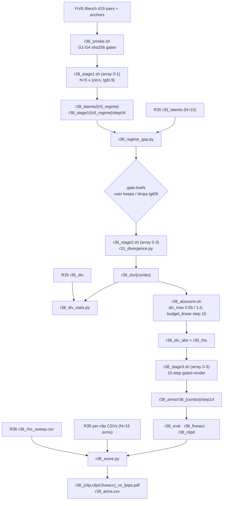

# R38: Reduced-Step Draft Divergence Routing

## Context

R35 routes the stage-3 render with a per-token divergence field measured on a **15-step** stage-1 draft. R38 asks whether a draft at a third of the cost gives maps that still route well: stage 1 at **N=5** (the paper's long-video step count), stage 3 unchanged at 15 steps. R35's `first2` counts steps, so it means a different share of the trajectory at each N; R38 replaces it with **`tgt0.9`**: a model call is fully source-anchored iff its input t > 0.9. At N=15 this is exactly `first2`, so R35's four arms are the N=15 points and are not rerun. At N=5 it anchors only the t=1.0 call, which sees pure noise for the current chunk; a regime-gap check after stage 1 decides whether those combos are worth carrying.

**Done when:** the R38 combos that survive the low-N gate are rendered and scored on all 419 pairs, and the three Pareto figures place them next to R35's N=15 arms and R36's VP rho-sweep curve.

## Execution steps

| # | Step id | Type | What it does | Sets status |
|---|---------|------|--------------|-------------|
| — | *(prep)* | — | `/build-step` the 11 `todos` | `implemented` |
| 1 | `smoke` | sbatch | 2 clips, 4 sha256 gates for `tgt0.9` + regression | |
| 2 | `wait-smoke` | manual | All gates PASS | |
| 3 | `stage1` | sbatch | Array 0-1 over the regime at N=5, 419 pairs each | `running` |
| 4 | `wait-stage1` | manual | 419 npz per task; echoed vectors correct | |
| 5 | `regime-gap` | local | tgt09 vs unblended gap at N=5 vs N=15 | |
| 6 | `gate-lowN` | manual | **User** keeps or drops the tgt09 combos | |
| 7 | `stage2` | sbatch | Array 0-3, divergence npz per combo | |
| 8 | `wait-stage2` | manual | 419 npz per combo | |
| 9 | `divstats` | local | Raw-divergence distribution + saturation per combo vs R35 | |
| 10 | `absnorm` | sbatch | CPU job: absolute normalisation + rho maps | |
| 11 | `stage3` | sbatch | Array 0-3, gated 15-step render | |
| 12 | `wait-stage3` | manual | 419 step14 dirs per combo | `finished` |
| 13 | `eval` | sbatch | 9-metric harness, stride 8 | |
| 14 | `fiveacc` | sbatch | `five_acc` alone | |
| 15 | `clipd` | sbatch | CLIP-directional, single job | |
| 16 | `wait-eval` | manual | CSV coverage, 0 errors | |
| 17 | `figures` | local | Three Pareto figures + `r38_arms.csv` | `analyzed` |

```
/run-step R38 smoke        /run-step R38 gate-lowN    /run-step R38 stage3
/run-step R38 wait-smoke   /run-step R38 stage2       /run-step R38 wait-stage3
/run-step R38 stage1       /run-step R38 wait-stage2  /run-step R38 eval|fiveacc|clipd
/run-step R38 wait-stage1  /run-step R38 divstats     /run-step R38 wait-eval
/run-step R38 regime-gap   /run-step R38 absnorm      /run-step R38 figures
```

## Decisions

| Question | Choice |
|---|---|
| Step counts | Stage 1 at **N=5 only** (15/3; the paper's long-video setting). **Stage 3 stays at `--step 15`**: only the draft gets cheaper, the ρ map keeps its 15-step meaning. Draft + render = 20/15 ≈ 1.33× a plain render, vs 2× for R35 |
| Grid at shift 1 | `np.arange(1000, 0, -1000/5)`, warp = identity at `flow_shift 1.0`: 1000, 800, 600, 400, 200 |
| Regimes | `zero` (UNBLENDED) and **`tgt0.9`**: s = 1 iff the call's **warped input** t > 0.9 (strict), else 0. Not `t_next`. Anchored calls: N=15 → t = 1.0, 0.933 (= `first2`); N=5 → t = 1.0 only (= `first1`). The fractional boundary-step weight was rejected (it weakens the first call, already the least informative one) |
| `firstK` | Kept unchanged, so R35's `blend_sched` labels keep their meaning |
| N=15 reference | **R35's four arms reused, not rerun.** Licensed only by smoke gate G1 (`tgt0.9` at N=15 byte-identical to R35's `first2`) |
| Combos (SLURM priority order) | `dino_n5_unblended`, `dino_n5_tgt09`, `lpips_n5_unblended`, `lpips_n5_tgt09` (array index 0-3). Stage-1 array 0-1: `n5_unblended`, `n5_tgt09` |
| Stage-1 measured latent | Final x0: `--dump_steps 4 --measure_index 4` (step04) — the same "fully denoised draft" convention as R35's step14 |
| Low-N gate | After stage 1, `r38_regime_gap.py` reports the tgt09-vs-unblended gap at N=5 against N=15's first2-vs-unblended gap. **The user decides** at `gate-lowN` whether to drop the tgt09 combos if near-identical; dropped combos are left out of every later `--array` |
| Normalisation | R35's values: absolute, `div_min = 0`, `div_max` **0.65 DINO / 1.0 LPIPS**. `r38_div_stats.csv` logs how far N=5 shifts the raw distribution and the saturation fraction |
| Mapping + render | Identical to R35: `budget_linear`, `tau_min 2`, `tau_max 50`, `--step 15`, `flow_shift 1.0`; `--vp_mode vp` + anchors, `fg_boost 4`, `blend_power 2`, `rollout_chunk_size 21`, `seed 0`, `--dump_steps 14` |
| Scope | All **419** pairs; stages 1 and 3 pass no `--cases_json`; stage 2 uses `evaluation/r7_anchor_manifest.json` |
| Outputs | `r38_clip_vs_lpips.pdf`, `r38_clipd_vs_lpips.pdf`, `r38_fiveacc_vs_lpips.pdf`: y = `lpips_unedit_part`, x = CLIP-target / `clip_d_prompt` / FiVE-Acc yes-no; R36 curve (gray, ρ-labelled) + R35's 4 arms + R38's 4; hue = metric, marker = regime, each (metric, regime) joined N=15 → 5 and labelled by N. Plain per-clip mean over 419, never `_avg.csv`. **No tau grids** |
| Storage | `~/Data/dataggen/outputs/five_bench/r38_*`. Estimated from R35: ~31 GB stage-1 frames + ~5 GB latents + ~60 GB renders ≈ **95 GB**. R35 already hit `Errno 122` (disk quota) once in stage 3 |
| Node / partition | `--partition=L40S`, `--exclude=node01,node51,node52,node57`, `PYTORCH_CUDA_ALLOC_CONF=expandable_segments:True` (R35's proven set) |
| N=7 | **Out of scope; conditional follow-up.** Run only if N=5 is clearly worse than N=15, to tell a gradual decline from a cliff. The R38 scripts take N from a table, so it is an added row, not a rewrite |
| Out of scope | Mixed-grid control (anchoring on the N=15 grid, free phase on N=5); recalibrated `div_max`; tau grids; LongLive backbone |

## Step commands

### smoke

```bash
sbatch slurm_scripts/five_bench/r38_smoke.sh          # 1 GPU, ~1 h
```

### wait-smoke

```bash
grep -h "GATE\|blender_rate per step" logs/r38_smoke_*.out
```

### stage1

```bash
sbatch slurm_scripts/five_bench/r38_stage1.sh          # array 0-1
```

### wait-stage1

```bash
D=~/Data/dataggen/outputs/five_bench
for r in n5_unblended n5_tgt09; do
  echo -n "$r: $(ls $D/r38_latents/$r/edit*/*.npz 2>/dev/null | wc -l) (expect 419) "
  for T in 1 2 3 4 5 6; do echo -n " e$T=$(ls $D/r38_latents/$r/edit$T/*.npz 2>/dev/null | wc -l)"; done; echo
done
grep -h "blender_rate per step" logs/r38_stage1_*.out | sort | uniq -c
```

### regime-gap

```bash
python evaluation/r38_regime_gap.py      # -> evaluation/csv/r38_regime_gap.csv
```

### gate-lowN

```bash
column -s, -t evaluation/csv/r38_regime_gap.csv
# if the tgt09 combos are dropped, later steps use --array=0,2
```

### stage2

```bash
sbatch slurm_scripts/five_bench/r38_stage2.sh          # array 0-3 (or 0,2 after a drop)
```

### wait-stage2

```bash
D=~/Data/dataggen/outputs/five_bench
for c in $(ls $D/r38_div); do echo "$c: $(ls $D/r38_div/$c/edit*/*.npz | wc -l) (expect 419)"; done
grep -c "\[ERROR\]" logs/r38_stage2_*.out
```

### divstats

```bash
python evaluation/r38_div_stats.py       # -> evaluation/csv/r38_div_stats.csv
```

### absnorm

```bash
sbatch slurm_scripts/five_bench/r38_absnorm.sh                       # all surviving combos, CPU node
sbatch slurm_scripts/five_bench/r38_absnorm.sh dino_n5_unblended lpips_n5_unblended   # explicit subset
```

### stage3

```bash
sbatch slurm_scripts/five_bench/r38_stage3.sh          # array 0-3 (or 0,2 after a drop)
```

### wait-stage3

```bash
D=~/Data/dataggen/outputs/five_bench
for d in $D/r38_arms/r38_*; do
  echo "$(basename $d): $(ls -d $d/step14/edit*/*/ | wc -l) step14 dirs (expect 419)"
  for f in $d/_manifest_edit*.csv; do awk -F, 'NR>1 && $3!="ok"' "$f"; done | wc -l
done
```

### eval

```bash
sbatch slurm_scripts/five_bench/r38_eval.sh            # array 0-3 (or subset)
```

### fiveacc

```bash
sbatch slurm_scripts/five_bench/r38_fiveacc.sh         # array 0-3 (or subset)
```

### clipd

```bash
sbatch slurm_scripts/five_bench/r38_clipd.sh           # single job
```

### wait-eval

```bash
ls evaluation/csv/edit?_FiVE_r38_*_frame_stride8.csv | wc -l   # expect 2 x 6 x n_combos
grep -c "Error:\|out of memory" logs/r38_eval_*.metrics.log
wc -l evaluation/csv/r38_clip_directional.csv                  # expect n_combos*419 + 1
```

### figures

```bash
python evaluation/r38_score.py --all     # 3 PDFs + evaluation/csv/r38_arms.csv
```

## Pipeline



## Code to touch

**`Self-Forcing_StreamEdit/pipeline/utils.py`** — `_schedule_blend_rate(sched, step_idx, num_steps, t_cur=None)`. New branch before the final `raise`:

```python
if sched.startswith("tgt"):
    tau = float(sched[len("tgt"):])            # "tgt0.9" -> 0.9
    if not 0.0 < tau < 1.0:
        raise ValueError(f"blend schedule {sched!r}: tau must be in (0, 1)")
    if t_cur is None:
        raise ValueError(f"blend schedule {sched!r} needs the call's input t (t_cur)")
    return 1.0 if t_cur > tau else 0.0         # strict: a grid point AT tau is not anchored
```
Every other branch ignores `t_cur`, so all existing schedules are unchanged.

**`Self-Forcing_StreamEdit/pipeline/edit_causal_inference.py:906`** — pass `t_cur=float(current_timestep) / 1000` (the warped input t, same value the bridge stores as `current_timestep`).

**`evaluation/r31_stage1.py`** — `choices` gains `"tgt0.9"` (still a closed set). The startup echo (line ~301) must call `_schedule_blend_rate(args.blend_sched, i, n_steps, t_cur=float(pipeline.denoising_step_list[i]) / 1000)` so the echoed vector is computed on the real warped grid; print the grid next to it. `blend_sched` is already written into the npz.

**`slurm_scripts/five_bench/r38_smoke.sh`** *(new)* — 1 GPU, L40S, 2 h; writes a 2-clip cases json (`0001_bus` / edit1, `0034_cows` / edit2 — the latter multi-window) to `$TMPDIR`; out root `~/Data/dataggen/outputs/five_bench/r38_smoke/`. Gates, each printing `GATE<k> PASS|FAIL`:
- **G1** `tgt0.9` at N=15 == R35 `first2`: sha256 of every `step14` PNG and `np.array_equal` on `z_trg` vs `r35_stage1/first2` + `r35_latents/first2`. Licenses reusing R35's N=15 arms.
- **G2** `zero` at N=15 == R35 `unblended` (regression for the new `t_cur` plumbing).
- **G3** `tgt0.9` at N=5 == `first1` at N=5 (threshold logic matches the step-count logic where they should coincide).
- **G4** echoed vectors: N=15 `[0,0,1,…]`, N=5 `[0,1,1,1,1]`.

**`slurm_scripts/five_bench/r38_stage1.sh`** *(new)* — copy of `r35_stage1.sh`; `RUNS=(n5_unblended n5_tgt09)`, `SCHEDS=(zero tgt0.9)`, `NSTEPS=(5 5)` (a table, so N=7 is an added row if the follow-up runs); `--step $N --dump_steps $((N-1)) --measure_index $((N-1))`; out `r38_stage1/$RUN`, latents `r38_latents/$RUN`; same post-run per-type guard. `--time=20:00:00`.

**`evaluation/r38_regime_gap.py`** *(new)* — for N=15 (R35 `first2` vs `unblended`) and N=5 (R38 `tgt09` vs `unblended`): per clip `||z_a − z_b|| / ||z_b||` on the stage-1 `z_trg` over all 419 (numpy), plus mean frame LPIPS between the two regimes' final frames on the 22 `cases.json` clips at stride 8 (five-bench env, CPU is enough). Writes one row per N: mean / median latent gap, mean LPIPS, n_clips.

**`slurm_scripts/five_bench/r38_stage2.sh`** *(new)* — copy of `r35_stage2.sh` with the 4 combos; parse `ARM` (`dino_patch` | `lpips`), `RUN` (`n5_regime`) and `N` from the combo via an explicit case table; `TARGET_ROOT=r38_stage1/$RUN/step$(printf %02d $((N-1)))`, `LATENT_DIR=r38_latents/$RUN`, `-o r38_div --arm_dir_name $COMBO`, `--no-save_native`, five-bench env.

**`evaluation/r38_div_stats.py`** *(new)* — reads raw `d` from `r38_div/{combo}` and `r35_div/{combo}`; per combo: mean, p50, p90, p99, and fraction of tokens with `d ≥ div_max` (0.65 DINO / 1.0 LPIPS). One CSV row per combo with an `N` column.

**`slurm_scripts/five_bench/r38_absnorm.sh`** *(new)* — copy of `r35_absnorm.sh` with the 4 combo names; `div_max` chosen by combo prefix (`dino_*` → 0.65, `lpips_*` → 1.0); roots `r38_div` → `r38_div_abs` → `r38_rho`; positional args select a subset.

**`slurm_scripts/five_bench/r38_stage3.sh`** *(new)* — copy of `r35_stage3.sh`, array 0-3 over the combos, `METHOD=r38_{combo}`, roots `r38_div_abs` / `r38_rho` → `r38_arms`; render flags unchanged. Fix R35's guard false positive: count non-ok manifest rows per file, not over a `cat` of 6 CSVs.

**`slurm_scripts/five_bench/r38_eval.sh`, `r38_fiveacc.sh`, `r38_clipd.sh`** *(new)* — copies of the R35 three: array 0-3, stems `r38_{combo}` / `r38_fiveacc_{combo}`, `r38_clipd.sh` passes one `--methods r38_{combo}=<dir>` per surviving combo and writes `evaluation/csv/r38_clip_directional.csv`.

**`evaluation/r38_score.py`** *(new)* — import `clip_index`, `load_harness`, `load_clipd`, `r36_points`, `_check_coverage` from `r35_score.py` (no copy). Build points for R35's 4 combos (N=15, from R35's CSVs) and the surviving R38 combos (N=5); skip combos whose CSVs are absent only if they are listed as dropped via `--dropped`, otherwise hard-fail. Plot per figure: R36 curve, then for each (metric, regime) a thin line N=15 → 5 with N-labelled markers; hue = metric (DINO slot 1, LPIPS slot 2), marker = regime (unblended filled circle, threshold hollow triangle; R35's `first2` is the N=15 point of the `tgt09` line). Writes `evaluation/csv/r38_arms.csv` (source, combo, N, regime, metric, n_clips, the three x metrics, `lpips_unedit_part`).
