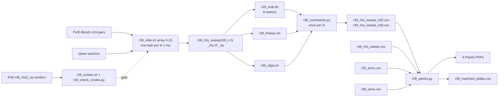

# R39: Rho Sweep at Matched Compute

## Context

R35 and R38 route a 15-step render with rho maps measured on a stage-1 draft of 15 or 5 steps, so a clip costs 15+15 = 30 or 15+5 = 20 NFEs. Both compare their arms against R36's uniform VP rho curve, which costs 15. A reviewer can fairly ask whether the uniform baseline, given the same NFEs, would close the gap. R39 answers this with the only meaningful uniform use of that budget: one pass at **N=20** and at **N=30**. A second pass would be wasted for uniform rho, because the draft only feeds the divergence map, so the render would be byte-identical to R36. The NFEs are the same kind: the draft calls `rollout_inference` exactly as the render does (one source+target forward per step, plus 2 clean-context forwards per chunk), so N=15+K single-pass is even marginally cheaper than 15+K two-pass.

**Done when:** `r39_rho_sweep_n20.csv` and `r39_rho_sweep_n30.csv` each have one full-bench row per rho; the Pareto figures show both curves next to R36's, R38's 15+5 arms and R35's 15+15 arms; and `r39_matched_deltas.csv` gives each routing arm's alignment gain against R36 and against its NFE-matched curve, at the same background LPIPS.

## Execution steps

| # | Step id | Type | What | Sets status |
|---|---------|------|------|-------------|
| — | *(prep)* | — | `/build-step` the 7 `todos` (see **Code to touch**) | `implemented` |
| 1 | `smoke` | sbatch | 2 clips × {N15 rho2, N20 rho2, N20 rho3, N30 rho2}, sha256 gates | — |
| 2 | `wait-smoke` | manual | All gates pass | — |
| 3 | `infer` | sbatch | Array 0-15, one task per (N, rho) arm, 419 pairs each | `running` |
| 4 | `wait-infer` | manual | 16/16 done, 419 dirs per arm | `finished` |
| 5 | `evaluate` | sbatch | 9-metric harness, array over 16 arms | — |
| 6 | `five-acc` | sbatch | FiVE-Acc alone, array over 16 arms | — |
| 7 | `clip-d` | sbatch | CLIP-D, single job, 16 arms | — |
| 8 | `wait-eval` | manual | CSV coverage, 0 metric errors | — |
| 9 | `summarize` | local | `r36_summarize.py` once per N → `r39_rho_sweep_n{20,30}.csv` | — |
| 10 | `figures` | local | 4 Pareto PDFs + `r39_matched_deltas.csv` | — |
| 11 | `verdict` | manual | Read figures (R38 half once its arms exist); log the outcome | `analyzed` |

```
/run-step R39 smoke        /run-step R39 evaluate     /run-step R39 summarize
/run-step R39 wait-smoke   /run-step R39 five-acc     /run-step R39 figures
/run-step R39 infer        /run-step R39 clip-d       /run-step R39 verdict
/run-step R39 wait-infer   /run-step R39 wait-eval
```

## Decisions

| Topic | Choice |
|-------|--------|
| NFE budgets | **N=20** single pass = R38's 15+5; **N=30** single pass = R35's 15+15 (user decision 2026-10-01). 15+7 (N=22) dropped |
| Two-pass uniform | Rejected: the draft only feeds the divergence map, so a uniform render after it would be byte-identical to R36 at N=15 |
| NFE accounting | Verified in `edit_causal_inference.py`: per step, one batch-2 (source+target) forward (`:949`), whatever `--blend_sched` is; plus 2 batch-1 context forwards per chunk (`:860`, `:1015`). A single pass saves the draft's context forwards, VAE decode and DINO/LPIPS scoring, so the comparison slightly favours the baseline |
| Step grids | `np.arange(1000, 0, -1000/N).astype(int)`, identity warp at `flow_shift 1.0`. N=20: 1000, 950, …, 50 (20 entries). N=30: 1000, 966, 933, …, 33 (30 entries, checked) |
| Step-index gates | Unchanged code. Source-KV injection (`index > N//2`, `causal_model.py:492`) covers t ≤ 0.466 at N=15, t ≤ 0.45 at N=20, t ≤ 0.466 at N=30; the mask update at `index == N//2` sits at t = 0.533 / 0.5 / 0.499. All stay at the paper's t_inj ≈ 0.5 |
| Rho grid | Full R36 grid `{2,3,4,6,8,10,20,50}` at both N (user decision), so the curves line up point for point |
| Rho comparability | `blend_power` acts per step, so the same rho means a different anchoring at each N. Curves are compared at the same LPIPS, never rho against rho |
| Render config | R36's except `--step`: `--vp_mode vp`, Qwen anchors, `fg_boost 4`, `flow_shift 1.0`, `seed 0`, default chunk/overlap/sink |
| Gate | Smoke only (user decision): G1 N=15 rho=2 == R36 `r36_rho2_vp`; G2 N=20 and N=30 each ≠ N=15 on every frame, and N=30 ≠ N=20; G3 N=20 rho=3 ≠ rho=2. No full-bench parity, since no N=20/30 reference exists |
| Output root | `~/Data/dataggen/outputs/five_bench/r39_rho_sweep/r39_n{N}_rho{R}_vp/edit{T}/`; smoke under `r39_smoke/` |
| Render tasks | **One 16-task array, one task per (N, rho) arm** (user decision): 0-7 = N=20 × rho (~14 h), 8-15 = N=30 × rho (~17.5–19 h), all 6 edit types each. Estimate: R36's measured 11.5–12.8 h per arm at N=15 (job 1007603) plus ~2–4 s per extra step per clip (smoke job 1016517); per-clip VAE / I/O cost does not scale with N. L40S, 64G, `--time=24:00:00` (partition max). An N=30 task on a slow node can hit the limit: resubmit that index alone; `r39_infer.sh` skips complete edit types, but `run_fivebench.py` has no per-clip skip, so the interrupted type (≤ ~5 h at N=30) is re-rendered. ≈ 113 (N=20) + 168 (N=30) ≈ **280 L40S GPU-h** |
| Scheduling | **In parallel with R38** (user decision). 16 render tasks + R38's arrays (≤4) + the interactive session fit under the 27–32 per-user cap. `evaluate` / `five-acc` (16 tasks each, same index map as the render array) are submitted one after the other, not together |
| Storage | ~15 GB per arm (frame count does not depend on N) × 16 arms → **~240 GB**, on top of R38's ~95 GB. The home quota killed R35/R36 renders on 2026-09-25 (`Errno 122`). Quota on 2026-10-01: **829.4 GiB / 2.0 TiB used** → R39 + R38 bring it to ~1.16 TiB (~57%), so space fits. R39 also writes ~456k files (28.5k per arm); no file-count quota is reported, but `Errno 122` would show up the same way |
| Metrics | R36's set: 9-metric harness, `five_acc` alone, CLIP-D; `--tmp_resize`; no motion fidelity |
| Averaging | Plain per-clip mean over 419 from the per-clip CSVs (via `r36_summarize.py`); never `_avg.csv` |
| Figures | y = `lpips_unedit_part`; x = CLIP-T / `clip_d_prompt` / `five_acc` (full) / `five_acc_yes_no`. Curves: R36 N=15 (gray), R39 N=20, R39 N=30. Arms: R38 15+5, R35 15+15, each coloured like its NFE-matched curve |
| Matched deltas | Per routing arm and x metric: Δ vs R36 and Δ vs the NFE-matched curve (R38 → N=20, R35 → N=30), each linearly interpolated at the arm's LPIPS. No significance test here (R35's open item, out of scope) |
| CSV stems | `r39_n{N}_rho{R}_vp` (harness), `r39_fiveacc_n{N}_rho{R}_vp`, `r39_clip_directional`, `r39_rho_sweep_n{N}`, `r39_matched_deltas` |
| Out of scope | N=22 (15+7); no-VP sweep; motion fidelity; bootstrap test of the deltas |

## Step commands

### smoke
```bash
sbatch slurm_scripts/five_bench/r39_smoke.sh
```

### wait-smoke
```bash
grep -E 'GATE|IDENTICAL|DIFFERS|FAIL' logs/r39_smoke_<job_id>.out
grep -c Traceback logs/r39_smoke_<job_id>.err                # expect 0
grep -o '[0-9]*/\(20\|30\) \[' logs/r39_smoke_<job_id>.err | sort -u | tail -4   # n20 / n30 renders ran 20 / 30 steps
```

### infer
```bash
# quota 2026-10-01: 829.4 GiB / 2.0 TiB -> ~1.2 TiB free; need ~240 GB (+ R38's ~95 GB). Re-check if usage has grown a lot since.
squeue -u $USER -h -r | wc -l                                      # 16 tasks must fit under the 27-32 cap
sbatch slurm_scripts/five_bench/r39_infer.sh
```

### wait-infer
```bash
sacct -j <job_id> --format=JobID,State,Elapsed | grep -v COMPLETED   # expect only header
grep -h 'failures:' logs/r39_infer_<job_id>_*.out | sort | uniq -c   # expect 16 x 'failures: 0'
for N in 20 30; do for R in 2 3 4 6 8 10 20 50; do
  D=~/Data/dataggen/outputs/five_bench/r39_rho_sweep/r39_n${N}_rho${R}_vp
  echo "N=$N rho=$R: $(ls -d $D/edit*/*/ | grep -vc '_resize/$') dirs, $(awk -F, 'FNR>1 && $3!="ok"' $D/edit*/_manifest.csv | wc -l) non-ok"
done; done   # expect 419 dirs, 0 non-ok
```

### evaluate
```bash
sbatch slurm_scripts/five_bench/r39_eval.sh
```

### five-acc
```bash
squeue -u $USER -h -r | wc -l    # submit once r39_eval's 16 tasks leave room under the cap
sbatch slurm_scripts/five_bench/r39_fiveacc.sh
```

### clip-d
```bash
sbatch slurm_scripts/five_bench/r39_clipd.sh
```

### wait-eval
```bash
ls evaluation/csv/edit?_FiVE_r39_n*_rho*_vp_frame_stride8.csv | wc -l           # expect 96
ls evaluation/csv/edit?_FiVE_r39_fiveacc_n*_rho*_vp_frame_stride8.csv | wc -l   # expect 96
wc -l evaluation/csv/r39_clip_directional.csv                                   # expect 16*419 + 1 = 6705
grep -lE 'Error:|out of memory' logs/r39_eval_*.metrics.log logs/r39_fiveacc_*.metrics.log   # expect nothing
tail -1 logs/r39_clipd_<job_id>.out                                             # expect "[r39_clipd] OK -> ..."
```

### summarize
```bash
for N in 20 30; do
  python evaluation/r36_summarize.py \
    --harness_fmt "r39_n${N}_rho{rho}_vp" \
    --fiveacc_fmt "r39_fiveacc_n${N}_rho{rho}_vp" \
    --clipd_csv evaluation/csv/r39_clip_directional.csv \
    --clipd_method_fmt "r39_n${N}_rho{rho}_vp" \
    --out "evaluation/csv/r39_rho_sweep_n${N}.csv" || exit 1
done
```

### figures
```bash
python evaluation/r39_pareto.py --outdir evaluation/figures
# -> r39_clip_vs_lpips.pdf, r39_clipd_vs_lpips.pdf, r39_fiveacc_full_vs_lpips.pdf, r39_fiveacc_vs_lpips.pdf
#    + evaluation/csv/r39_matched_deltas.csv (R35 rows always; R38 rows only if evaluation/csv/r38_arms.csv exists)
```

### verdict
Open the 4 PDFs and `r39_matched_deltas.csv` (re-run `figures` first if R38's `r38_arms.csv` appeared after it), then record the outcome in `daily.md`.

## Pipeline



## Code to touch

| File | Change |
|------|--------|
| `slurm_scripts/five_bench/r39_smoke.sh` | **built**: 4 configs (15,2) (20,2) (20,3) (30,2), `--time=03:00:00` |
| `evaluation/r39_check_smoke.py` | **built**: G1–G3, G2 covers n20/n30 vs n15 (every frame) and n30 vs n20 |
| `slurm_scripts/five_bench/r39_infer.sh` | **built**: clone of `r36_infer.sh`, `--array=0-15`, `--time=24:00:00`, with the arm map below |
| `slurm_scripts/five_bench/r39_eval.sh` | **built**: clone of `r36_eval.sh`, array 0-15, `N=(20 30)[TID/8]`, `R=RHOS[TID%8]`, r39 out root + stem |
| `slurm_scripts/five_bench/r39_fiveacc.sh` | **built**: clone of `r36_fiveacc.sh`, same 16-arm map |
| `slurm_scripts/five_bench/r39_clipd.sh` | **built**: clone of `r36_clipd.sh`, 16 `r39_n{N}_rho{R}_vp` methods, `-o evaluation/csv/r39_clip_directional.csv` |
| `evaluation/r39_pareto.py` | **built**: 4 figures + matched deltas; arm points from per-clip CSVs (r38_arms.csv lacks full five_acc) |
| `evaluation/r36_summarize.py` | **unchanged**: already takes the stems as flags |

Arm map in `r39_infer.sh` (shared by `r39_eval.sh` / `r39_fiveacc.sh`):

```bash
RHOS=(2 3 4 6 8 10 20 50)
NS=(20 30)
STEPS=${NS[$((TID / 8))]}
R=${RHOS[$((TID % 8))]}
METHOD="r39_n${STEPS}_rho${R}_vp"
for T in 1 2 3 4 5 6; do
  # r36_infer.sh's body: skip-if-complete, run_fivebench.py ... --step "$STEPS", count + manifest checks
done
```

Matched deltas in `r39_pareto.py`:

```python
def interp_at(curve: list[dict], lpips: float, x: str) -> float:
    """Linear interpolation of metric x along a rho curve, ordered by lpips_unedit_part."""
    pts = sorted((p["lpips_unedit_part"], p[x]) for p in curve)
    ls, xs = zip(*pts)
    return float(np.interp(lpips, ls, xs, left=np.nan, right=np.nan))

MATCHED = {"R38": ("n20", "15+5"), "R35": ("n30", "15+15")}
# for arm in r38_arms (if present) + r35_arms[source == "R35"], for x in X_METRICS:
#   row = {source, arm, nfe, x, lpips, value,
#          delta_vs_r36_n15 = value - interp_at(r36, lpips, x),
#          delta_vs_matched = value - interp_at(curves[MATCHED[source][0]], lpips, x)}
```
