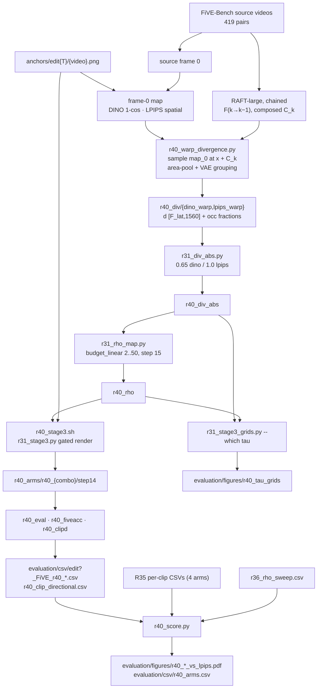

# R40: Anchor-Only Flow-Warped Divergence

## Context

R35 builds its spatial divergence map from a stage-1 **draft** render: one DINO / LPIPS map per frame, source vs draft. That draft costs a full 15-step pass. The cheaper alternative a reviewer would suggest: the VP anchor (edited first frame) is already available, so compute the map once on frame 0 (source frame 0 vs anchor) and spread it to the other frames with optical flow computed on the source video. R40 runs exactly that pipeline. Everything downstream of the map is R35's: absolute normalisation, budget-linear m→rho, gated stage-3 render, the same scoring.

**Story:** the draft is necessary, because the draft-free alternative (anchor map + flow warping) is worse. R40 changes two things at once on purpose (the map comes from the anchor, and it is spread by warping, not measured per frame), since together they make up the alternative being tested.

**Done when:** both R40 arms (`dino_warp`, `lpips_warp`) are rendered and scored on all 419 pairs; the tau-grid pages exist; and the Pareto figures place the 2 R40 arms next to R35's 4 arms and R36's VP rho curve.

## Execution steps

| # | Step id | Type | What it does | Sets status |
|---|---------|------|--------------|-------------|
| — | *(prep)* | — | `/build-step` the 7 `todos` | `implemented` |
| 1 | `smoke` | sbatch | 2 clips, gates G1-G3 + overlay PNGs | |
| 2 | `wait-smoke` | manual | all gates PASS, overlays look right | |
| 3 | `warp` | sbatch | Single job, 419 clips, both arms. **Submit only after R38/R39 renders leave the queue** | `running` |
| 4 | `wait-warp` | manual | 419 npz per arm, exact per-type breakdown | |
| 5 | `absnorm` | local | Absolute normalisation + budget-linear rho, NumPy only | |
| 6 | `stage3` | sbatch | Array 0-1, gated render, one combo per task | |
| 7 | `wait-stage3` | manual | 419 step14 dirs per combo | `finished` |
| 8 | `eval` | sbatch | 9-metric harness, stride 8, array 0-1 | |
| 9 | `fiveacc` | sbatch | FiVE-Acc, array 0-1 | |
| 10 | `clipd` | sbatch | CLIP-directional, single job | |
| 11 | `wait-eval` | manual | CSV coverage + 0 error lines | |
| 12 | `grids` | local | 419 tau-grid pages, 4 rows each | |
| 13 | `figures` | local | Pareto figures + `r40_arms.csv` | `analyzed` |

```
/run-step R40 smoke       /run-step R40 absnorm      /run-step R40 eval|fiveacc|clipd
/run-step R40 wait-smoke  /run-step R40 stage3       /run-step R40 wait-eval
/run-step R40 warp        /run-step R40 wait-stage3  /run-step R40 grids
/run-step R40 wait-warp                              /run-step R40 figures
```

## Decisions

| Question | Choice |
|---|---|
| Claim supported | "The draft-free alternative is worse", not "warping per se fails". No map-similarity control, no warped-draft-map arm |
| Scope | All **419** pairs, case list `evaluation/r7_anchor_manifest.json` |
| Arms | `dino_warp` (DINOv3 ViT-B/16 per-patch 1-cos) and `lpips_warp` (LPIPS alex, spatial). No stage-1 regime axis: there is no draft |
| Frame-0 map | Source frame 0 vs anchor `anchors/edit{T}/{video}.png`, both resized to 480×832, same metric code as `r31_divergence.py` |
| Order of operations | **Warp in pixel space, then reduce to latents.** (1) frame-0 map at 480×832 (LPIPS native; DINO 30×52 patch grid nearest-upsampled); (2) warp to every pixel frame k → `[F_pix, 480, 832]`; (3) 16×16 area-mean → `[F_pix, 30, 52]`; (4) VAE temporal grouping ({0}, {4f−3…4f}, mean) → `d [F_lat, 1560]`. Steps 3-4 are R35's own reduction, so only step 2 differs from R35. Not warping on the token grid: a 30×52 flow averages motion over each 16×16 token and smears boundaries at the edited object |
| Flow | torchvision **RAFT-large**, `C_T_SKHT_V2` weights, 12 updates, on the **source** video at 480×832. **Chained**: consecutive backward flows F(k→k−1), composed into a cumulative field C_k = F(k→k−1) + C_{k−1}∘(x + F(k→k−1)); the map is sampled **once** from frame 0 at x + C_k, so it does not blur over 80 resamplings |
| Disocclusions / out-of-frame | **Naive warp**: bilinear `grid_sample`, `padding_mode="border"`, no fill. Forward-backward check (α=0.01, β=0.5) computed for **diagnostics only**: per-frame `occ_frac`, `oob_frac`, `invalid_chain_frac` saved in the npz, never used to modify the map |
| DINO map before warping | 30×52 patch grid **nearest**-upsampled to 480×832, so the area-pool back to the token grid is exact on frame 0 |
| Reductions | R31's: 16×16 area-mean to 30×52, VAE temporal grouping (frame 0 alone, then blocks of 4), `temporal_reduce mean` |
| Frame count | `n_pix = find_closest_num_frame(len(video))`, `n_latent = (n_pix−1)/4 + 1`; the smoke cross-checks against R35's npz |
| npz format | R31 stage-2 keys (`d`, `m`, `d_min`, `d_max`, `grid_h/w`, `n_latent_frames`, `n_pixel_frames`, `arm`, `video_name`, `edit_type`, `temporal_reduce`, `seed`), plus `measure_index=-1`, `measure_kind="r40_anchor_warp"`, so `r31_div_abs.py` / `r31_rho_map.py` / `r31_stage3_grids.py` run unmodified |
| Normalisation + mapping | Same as R35: absolute, `div_min 0`, `div_max` **0.65** DINO / **1.0** LPIPS; `budget_linear`, `tau_min 2`, `tau_max 50`, `--step 15`, `flow_shift 1.0` |
| Render config | Same as R35 stage 3: `--vp_mode vp`, anchors, `fg_boost 4`, `blend_power 2`, `rollout_chunk_size 21`, `seed 0`, `--step 15`, `--dump_steps 14` |
| Comparison | R36 VP rho curve (`r36_rho_sweep.csv`, `n_pairs == 419`) + R35's 4 arms (`r35_arms.csv` sources) + 2 R40 arms; plain per-clip means, never `_avg.csv`; x = alignment, y = bg LPIPS |
| Figures | Same set as `r35_score.py --all` (CLIP-T, CLIP-D, FiVE-Acc yes/no, multiple choice, full), files `evaluation/figures/r40_*_vs_lpips.pdf` |
| Out of scope | Paired bootstrap, disocclusion-stratified gap, occlusion-aware fill |
| Queueing | `warp` and `stage3` submitted **after R38/R39 renders** leave the queue; `smoke` (1 task, ~1 h) may run before |
| Compute / disk | warp ~3-4 GPU-h (2 RAFT calls per frame pair); stage 3 ~2 × 10.5 GPU-h; ~30 GB of renders in `~/Data/dataggen/outputs/five_bench/r40_arms` |
| Storage / nodes | Root `~/Data/dataggen/outputs/five_bench/`; `--exclude=node52` (node01/51/57 re-allowed 2026-10-08); stage 3 on L40S only |

## Step commands

### smoke

```bash
sbatch slurm_scripts/five_bench/r40_smoke.sh
# runs, in five-bench:
#   python evaluation/r40_warp_divergence.py --smoke \
#     --videos 0001_bus 0034_cows -o ~/Data/dataggen/outputs/five_bench/r40_smoke \
#     --png_dir evaluation/figures/r40_smoke
```

### wait-smoke

```bash
grep -h "GATE" logs/r40_smoke_*.out          # G1, G2, G3 all PASS
grep -c "Traceback" logs/r40_smoke_*.err     # 0
ls evaluation/figures/r40_smoke/
```

### warp

```bash
squeue -u $USER -o "%.18i %.20j %.8T"        # no r38_* / r39_infer tasks left
sbatch slurm_scripts/five_bench/r40_warp.sh
```

### wait-warp

```bash
D=~/Data/dataggen/outputs/five_bench
for c in dino_warp lpips_warp; do
  echo -n "$c: $(ls $D/r40_div/$c/edit*/*.npz 2>/dev/null | wc -l) (expect 419) "
  for T in 1 2 3 4 5 6; do echo -n " edit$T=$(ls $D/r40_div/$c/edit$T/*.npz 2>/dev/null | wc -l)"; done; echo
done
grep -c "\[ERROR\]" logs/r40_warp_*.out
```

### absnorm

```bash
D=~/Data/dataggen/outputs/five_bench
python evaluation/r31_div_abs.py --arms dino_warp lpips_warp \
  --div_max dino_warp=0.65 lpips_warp=1.0 \
  --div_root $D/r40_div -o $D/r40_div_abs
for c in dino_warp lpips_warp; do
  python evaluation/r31_rho_map.py --div_root $D/r40_div_abs/$c -o $D/r40_rho/$c \
    --mapping budget_linear --tau_min 2 --tau_max 50 --step 15 --flow_shift 1.0
done
for c in dino_warp lpips_warp; do echo "$c rho: $(ls $D/r40_rho/$c/edit*/*.npz | wc -l) (expect 419)"; done
```

### stage3

```bash
squeue -u $USER -o "%.18i %.20j %.8T"        # R38/R39 renders gone
sbatch slurm_scripts/five_bench/r40_stage3.sh          # array 0-1
```

### wait-stage3

```bash
D=~/Data/dataggen/outputs/five_bench
for c in dino_warp lpips_warp; do
  echo "$c: $(ls -d $D/r40_arms/r40_$c/step14/edit*/*/ | wc -l) step14 dirs (expect 419)"
  cat $D/r40_arms/r40_$c/_manifest_edit*.csv | awk -F, '$3!="status" && $3!="ok"' | wc -l
done
```

### eval

```bash
sbatch slurm_scripts/five_bench/r40_eval.sh            # array 0-1
```

### fiveacc

```bash
sbatch slurm_scripts/five_bench/r40_fiveacc.sh         # array 0-1
```

### clipd

```bash
sbatch slurm_scripts/five_bench/r40_clipd.sh           # single job
```

### wait-eval

```bash
ls evaluation/csv/edit?_FiVE_r40_*_frame_stride8.csv | wc -l     # expect 24 (12 harness + 12 five_acc)
grep -c "Error:\|out of memory" logs/r40_eval_*.metrics.log
wc -l evaluation/csv/r40_clip_directional.csv                    # expect 2*419 + 1
```

### grids

```bash
D=~/Data/dataggen/outputs/five_bench
python evaluation/r31_stage3_grids.py --which tau \
  --arms dino_warp lpips_warp \
  --cases evaluation/r7_anchor_manifest.json \
  --div_root $D/r40_div_abs --rho_root $D/r40_rho \
  --tau_out_dir evaluation/figures/r40_tau_grids
```

### figures

```bash
python evaluation/r40_score.py --all      # r40_*_vs_lpips.pdf + evaluation/csv/r40_arms.csv
```

## Pipeline



## Code to touch

**`evaluation/r40_warp_divergence.py`** *(new)* — imports `latent_frame_groups`, `to_token_grid`, `reduce_temporal`, `load_dinov3`, `dinov3_patch_divergence`, `load_frames` and the PIXEL/GRID constants from `r31_divergence.py`, `load_lpips` / `to_unit_tensor` from `r30_divergence.py`, and copies `find_closest_num_frame` (3 lines; importing `inference_edit_streamedit.py` would pull in the pipeline). Loads LPIPS + DINOv3 + RAFT once; one job writes both arms.

```python
for case in manifest(edit_type):
    src = load_frames(video_mp4)[: find_closest_num_frame(n)]          # n_pix frames
    n_lat = (len(src) - 1) // 4 + 1
    anchor = Image.open(anchor_root / f"edit{T}" / f"{name}.png")
    maps0 = {"lpips_warp": lpips_map(src[0], anchor),                   # [480, 832]
             "dino_warp":  nearest_up(dino_grid(src[0], anchor))}        # [30,52] -> [480,832]
    C = zeros(2, 480, 832); invalid = zeros(480, 832, bool)
    per_frame = {k: [m0] for k, m0 in maps0.items()}
    for k in 1..n_pix-1:
        fb = raft(src[k], src[k-1]); ff = raft(src[k-1], src[k])        # batched pair
        C = fb + sample(C, x + fb)                                       # composed, border pad
        occ = fb_check(fb, ff, alpha=0.01, beta=0.5); oob = outside(x + C)
        invalid = occ | oob | sample(invalid, x + fb) > 0.5
        for arm, m0 in maps0.items(): per_frame[arm].append(sample(m0, x + C))  # bilinear, border
        log occ_frac[k], oob_frac[k], invalid_chain_frac[k]              # diagnostics only
    for arm: d = reduce_temporal(to_token_grid(stack), latent_frame_groups(n_pix, n_lat), "mean")
             save R31-format npz (+ measure_index=-1, measure_kind="r40_anchor_warp",
                                  occ_frac, oob_frac, invalid_chain_frac, flow model id)
```

`--smoke` gates (printed as `GATE Gn PASS/FAIL`):
- **G1** frame-0 identity: row 0 of `d` equals the un-warped frame-0 map pooled directly (exact for DINO, `atol 1e-6` for LPIPS).
- **G2** frame count: `n_latent_frames` equals R35's `r35_div/dino_first2/edit{T}/{name}.npz` for the clip.
- **G3** flow direction: warping **source frame 0** with the same C_k gives a lower mean |·−src[k]| than un-warped frame 0, for ≥ 90% of k. Catches a swapped flow convention, the most likely bug.
- Overlay PNGs of the warped LPIPS map on frames 0 / mid / last, for a visual check.

**`slurm_scripts/five_bench/r40_smoke.sh`** *(new)* — L40S, 1 GPU, 64G, 1 h; `conda deactivate; conda activate five-bench` (same env reason as `r35_stage2.sh`); offline HF/torch env vars.

**`slurm_scripts/five_bench/r40_warp.sh`** *(new)* — single job, five-bench, `--time=08:00:00`, `--mem=64G`, node exclusions; loops T 1..6; post-run guard: 419 npz per arm, 100/100/100/100/9/10.

**`slurm_scripts/five_bench/r40_stage3.sh`** *(new)* — copy of `r35_stage3.sh` with `COMBOS=(dino_warp lpips_warp)`, `--array=0-1`, roots `r40_div_abs` / `r40_rho` / `r40_arms`, `METHOD=r40_${COMBO}`, bad-id guard `0-1`, messages pointing to `/run-step R40 absnorm`.

**`slurm_scripts/five_bench/r40_eval.sh`, `r40_fiveacc.sh`, `r40_clipd.sh`** *(new)* — copies of the `r35_*` scripts with the 2 combos, `r40_arms` root, array 0-1 (clipd single job → `evaluation/csv/r40_clip_directional.csv`).

**`evaluation/r40_score.py`** *(new)* — `from r35_score import load_harness, load_clipd, r35_points, r36_points, FIGURES, ...`; adds `r40_points()` (same loaders, stems `r40_{combo}` / `r40_fiveacc_{combo}`, preflight 100/100/100/100/9/10); plots the R36 curve + R35 points (existing colours/markers) + R40 points (same arm colour, distinct "warp" marker); output names `r35_` → `r40_`; writes `evaluation/csv/r40_arms.csv` (source R35|R36|R40, label, n_clips, metrics, `lpips_unedit_part`). If `r35_score.plot` hard-codes the R35 combos, factor the point list into an argument instead of copying the function.

**No change:** `r31_div_abs.py`, `r31_rho_map.py`, `r31_stage3.py`, `r31_stage3_grids.py` (the 2-arm, 4-row layout is the narrower-arm-set branch already in place).
