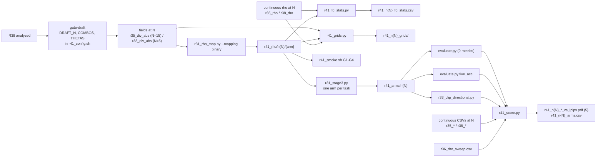

# R41: Binary vs Continuous Rho Mapping

## Context

The divergence routing maps each token's divergence `m` to an exponent with a continuous, budget-linear m -> rho map. R41 asks whether the graded timing matters, or whether a two-level map built from the same field does as well: rho=2 below a cut theta, rho=50 above. Everything upstream of the mapping (draft, divergence network, normalisation) is reused from disk. A binary map needs a cut, and any single cut can be called badly chosen, so theta is swept and the binary arm is read as a curve.

The ablation must be run on the method as shipped, so R41 is built on the **final** stage-1 draft length N: R35's fields if N=15, R38's if N=5. N is chosen at `gate-draft`, after R38 is analyzed; both the binary arms and the continuous arms they are compared to use that same N.

**Done when:** the binary arms (surviving combos x theta) at the chosen N are rendered and scored on all 419 pairs, and the Pareto figures place each combo's binary theta-curve next to its continuous point at the same N and R36's VP rho curve.

## Execution steps

| # | Step id | Type | What it does | Sets status |
|---|---------|------|--------------|-------------|
| — | *(prep)* | — | `/build-step` the 9 `todos` (can be done before R38 finishes) | `implemented` |
| 0 | `gate-draft` | manual | **User** chooses N (5 or 15), combos and thetas in `r41_config.sh`, after R38 is `analyzed` | |
| 1 | `rhomap` | sbatch | CPU: binary rho trees from the chosen N's fields | |
| 2 | `wait-rhomap` | manual | len(ARMS) x 419 npz; banner N correct | |
| 3 | `fgstats` | local | FG fraction + source budget per arm vs continuous | |
| 4 | `grids` | local | 419 pages | |
| 5 | `smoke` | sbatch | 4 gates: mapping regression, binary correctness, continuous render parity, binary render | |
| 6 | `wait-smoke` | manual | G1-G4 PASS | |
| 7 | `stage3` | sbatch | One arm per array task, 419 pairs | `running` |
| 8 | `wait-stage3` | manual | 419 step14 dirs per arm | `finished` |
| 9 | `eval` | sbatch | 9-metric harness, one arm per task | |
| 10 | `fiveacc` | sbatch | FiVE-Acc, one arm per task | |
| 11 | `clipd` | sbatch | CLIP-D, one theta per task | |
| 12 | `wait-eval` | manual | All CSVs complete | |
| 13 | `figures` | local | 5 Pareto figures + arms CSV | `analyzed` |

```
/run-step R41 gate-draft   /run-step R41 rhomap   /run-step R41 smoke
/run-step R41 stage3       /run-step R41 eval     /run-step R41 fiveacc
/run-step R41 clipd        /run-step R41 figures
```

## Decisions

| Topic | Decision |
|-------|----------|
| Question tested | Continuous (budget-linear) vs binary m -> rho, with draft, divergence network, regime and normalisation held fixed |
| Draft length N | **The final method's N, not fixed in this plan.** Chosen at `gate-draft` once R38 is `analyzed`; binary and continuous arms always share it |
| When to run | After R38. Code can be built before; no step runs until `gate-draft` sets `DRAFT_N` |
| Single source of N | `slurm_scripts/five_bench/r41_config.sh` (`DRAFT_N` empty by default; every script refuses to run without it and prints it in a banner); Python scripts take `--draft_n` |
| Combos | Two regimes x two divergence networks, same names at both N: `dino_unblended`, `dino_tgt09`, `lpips_unblended`, `lpips_tgt09`. `tgt09` at N=15 is R35's `first2` (byte-identical, R38 smoke G1). At N=5 the `tgt09` pair is removed only if R38's gate-lowN dropped it |
| Inputs at N=15 | Fields `r35_div_abs`, continuous rho `r35_rho`, continuous renders and CSVs `r35_*` (upstream names `*_first2` for `tgt09`) |
| Inputs at N=5 | Fields `r38_div_abs`, continuous rho `r38_rho`, continuous renders and CSVs `r38_*` (upstream names `*_n5_unblended`, `*_n5_tgt09`) |
| Upstream names | Appear only in `r41_config.sh`'s lookup; every R41 path, stem, figure label and CSV row uses the four combo names above |
| Normalisation | The chosen draft's own absolute `div_max` (0.65 DINO / 1.0 LPIPS at both N) |
| Mapping | `rho = 2 if m < theta else 50`; `tau_min` / `tau_max` identical to the continuous arm |
| Cuts | Default theta in {0.3, 0.5, 0.7}, read as a curve; no single cut is defended. Set from N=15 data (at m >= 0.8 the `tgt09` combos have < 0.5% FG in 36-48% of clips); re-checked at `gate-draft` with `--precheck` on the chosen N |
| Arms | COMBOS x THETAS (12 at 4 combos), named `{combo}_t03 / _t05 / _t07` (e.g. `lpips_tgt09_t05`); render method `r41_n{N}_{arm}` |
| Array order | theta-major, t05 first, combos in COMBOS order |
| Render config | Identical to `r35_stage3.sh`: vp, anchors, stage 3 at `--step 15` whatever the draft N, `flow_shift 1.0`, `fg_boost 4`, `blend_power 2`, chunk 21, seed 0, `--dump_steps 14`, L40S |
| Continuous reference | Stored continuous arms at the chosen N (R35 or R38), not re-rendered. Smoke G3 proves today's tree reproduces them byte-for-byte |
| Pipeline code | No change. Only `r31_rho_map.py` gains a mode |
| Evaluation | R35's three jobs, same metric lists: `eval` (9 metrics), `fiveacc`, `clipd` |
| Aggregation | Plain per-clip mean over 419, never `{stem}_avg.csv`; x = alignment, y = `lpips_unedit_part` |
| Figures | R35's 5 x-metrics; one panel per combo: R36 curve, same-N continuous point, binary theta-curve; titles state N |
| Significance test | None (user decision); figures and per-arm means only |
| FG statistics | `r41_precheck_n{N}.csv` at the gate; `r41_n{N}_fg_stats.csv` after rhomap (FG fraction, source budget next to the continuous arm's) |
| Grids | All 419 pages, per combo rows m / continuous rho / binary rho per theta, 8 frames, `evaluation/figures/r41_n{N}_grids/` |
| Naming | Every output carries `n{N}`: `r41_rho/n{N}`, `r41_arms/n{N}`, `r41_smoke/n{N}`, stems `r41_n{N}_*`, so N=5 and N=15 outputs can never mix |
| Disk | ~15 GB per arm (measured on `r35_lpips_first2`) -> ~180 GB at 12 arms; 38 TB free |
| Out of scope | Running both N; per-clip, Otsu or budget-matched cuts; segmentation-mask routing (R26's row of Table 3) |

## Step commands

### gate-draft
```bash
# precondition: R38 row is `analyzed` in daily.md
cat evaluation/csv/r38_arms.csv evaluation/csv/r38_div_stats.csv
python evaluation/r41_fg_stats.py --precheck --draft_n 15
python evaluation/r41_fg_stats.py --precheck --draft_n 5
# user edits DRAFT_N / COMBOS / THETAS in slurm_scripts/five_bench/r41_config.sh, then:
bash slurm_scripts/five_bench/r41_config.sh          # prints the banner
```

### rhomap
```bash
sbatch slurm_scripts/five_bench/r41_rhomap.sh
```

### wait-rhomap
```bash
grep -E 'DRAFT_N|npz total|failures' logs/r41_rhomap_<job_id>.out
```

### fgstats
```bash
python evaluation/r41_fg_stats.py --draft_n "$(bash slurm_scripts/five_bench/r41_config.sh --draft_n)"
```

### grids
```bash
python evaluation/r41_grids.py --draft_n "$(bash slurm_scripts/five_bench/r41_config.sh --draft_n)" \
  --cases evaluation/r7_anchor_manifest.json
```

### smoke
```bash
sbatch slurm_scripts/five_bench/r41_smoke.sh
```

### wait-smoke
```bash
grep -E 'DRAFT_N|GATE' logs/r41_smoke_<job_id>.out
grep -c Traceback logs/r41_smoke_<job_id>.err
```

### stage3
```bash
sbatch --array=0-$(bash slurm_scripts/five_bench/r41_config.sh --max_index) slurm_scripts/five_bench/r41_stage3.sh
```

### wait-stage3
```bash
grep -h 'DRAFT_N\|step14 dirs total\|non-ok manifest\|failures:' logs/r41_stage3_<job_id>_*.out
```

### eval
```bash
sbatch --array=0-$(bash slurm_scripts/five_bench/r41_config.sh --max_index) slurm_scripts/five_bench/r41_eval.sh
```

### fiveacc
```bash
sbatch --array=0-$(bash slurm_scripts/five_bench/r41_config.sh --max_index) slurm_scripts/five_bench/r41_fiveacc.sh
```

### clipd
```bash
sbatch --array=0-$(bash slurm_scripts/five_bench/r41_config.sh --max_theta_index) slurm_scripts/five_bench/r41_clipd.sh
```

### wait-eval
```bash
grep -h 'OK\|FAILED' logs/r41_eval_<job_id>_*.out logs/r41_fiveacc_<job_id>_*.out logs/r41_clipd_<job_id>_*.out
N=$(bash slurm_scripts/five_bench/r41_config.sh --draft_n)
ls evaluation/csv/edit*_FiVE_r41_n${N}_*_frame_stride8.csv | wc -l     # expect 12 x len(ARMS)
```

### figures
```bash
python evaluation/r41_score.py --all --draft_n "$(bash slurm_scripts/five_bench/r41_config.sh --draft_n)"
```

## Pipeline



## Code to touch

| File | Change |
|------|--------|
| `slurm_scripts/five_bench/r41_config.sh` | **new** — `DRAFT_N=` (empty), `COMBOS`, `THETAS`; resolves roots / stems and the combo -> upstream-name lookup from N; validates; banner; `--draft_n`, `--max_index`, `--max_theta_index` print modes |
| `evaluation/r41_config.py` | **new** (added at build) — Python side of `r41_config.sh`: runs `--json N`, refuses an N that differs from the configured `DRAFT_N` (except `--precheck`); honours the test-only `R41_CONFIG` / `R41_TEST_D` overrides |
| `evaluation/r31_rho_map.py` | Add `--mapping binary` (`binary_tau`: `np.where(m >= thresh, tau_max, tau_min)`, NaN guard, `0 < thresh < 1`); `--thresh` default None, linear_threshold keeps 0.4, binary requires it; record `mapping`, `thresh`, `tau_at_m_half` |
| `evaluation/r41_fg_stats.py` | **new** — numpy only, `--draft_n` required, `--precheck` mode on div_abs; imports `a_disc`, `t_next_schedule` from `r30_b_map` |
| `slurm_scripts/five_bench/r41_rhomap.sh` | **new** — CPU batch (`--partition=CPU`, 4 CPUs, 16G, 2 h), r35_absnorm.sh conventions; preflight + post-run 419 guard |
| `evaluation/r41_grids.py` | **new** — imports helpers from `r31_stage3_grids.py` without modifying it |
| `slurm_scripts/five_bench/r41_smoke.sh` | **new** — 1x L40S, 64G, 2 h; CPU gates G1-G2 then 2-clip renders for G3-G4 |
| `slurm_scripts/five_bench/r41_stage3.sh` | **new** — copy of `r35_stage3.sh`; no `#SBATCH --array` (passed on the command line from `--max_index`) |
| `slurm_scripts/five_bench/r41_eval.sh` | **new** — copy of `r35_eval.sh`, one arm per task |
| `slurm_scripts/five_bench/r41_fiveacc.sh` | **new** — copy of `r35_fiveacc.sh`, one arm per task |
| `slurm_scripts/five_bench/r41_clipd.sh` | **new** — copy of `r35_clipd.sh`, one theta per task, all COMBOS |
| `evaluation/r41_score.py` | **new** — loaders from `r35_score`; one panel per combo; continuous inputs resolved from `--draft_n` |

`r41_config.sh` sketch:

```bash
DRAFT_N=            # set at gate-draft: 5 or 15
COMBOS=(dino_unblended dino_tgt09 lpips_unblended lpips_tgt09)   # same names at both N
THETAS=(0.3 0.5 0.7)
case "$DRAFT_N" in
  15) DIV_ABS_ROOT=.../r35_div_abs; CONT_RHO_ROOT=.../r35_rho; CONT_PREFIX=r35
      declare -A SRC_NAME=([dino_unblended]=dino_unblended [dino_tgt09]=dino_first2
                           [lpips_unblended]=lpips_unblended [lpips_tgt09]=lpips_first2) ;;
  5)  DIV_ABS_ROOT=.../r38_div_abs; CONT_RHO_ROOT=.../r38_rho; CONT_PREFIX=r38
      declare -A SRC_NAME=([dino_unblended]=dino_n5_unblended [dino_tgt09]=dino_n5_tgt09
                           [lpips_unblended]=lpips_n5_unblended [lpips_tgt09]=lpips_n5_tgt09) ;;
  *)  echo "[r41] DRAFT_N not set -- run gate-draft first (N=5 or N=15?)"; exit 1 ;;
esac
# fields of combo c: $DIV_ABS_ROOT/${SRC_NAME[$c]};  continuous arm: ${CONT_PREFIX}_${SRC_NAME[$c]}
# ARMS = for theta in THETAS (t05 first): for c in COMBOS: "${c}_t${theta/./}"
```

Gate pseudocode for `r41_smoke.sh`:

```python
# G1: continuous path unchanged
for c in COMBOS: rebuild budget_linear into SMOKE/rho_bl/c; assert all(np.array_equal(new, CONT_RHO/SRC_NAME[c]/clip))
# G2: binary maps are what they claim
for arm in ARMS: z = load(r41_rho/n{N}/arm/clip); m = load(DIV_ABS/SRC_NAME[combo]/clip)["m"]
    assert set(np.unique(z["rho"])) <= {2., 50.} and np.array_equal(z["rho"] == 50, m >= z["thresh"])
# G3: continuous render parity at N (sha256 of every step14 PNG, 2 clips, last combo)
# G4: binary t05 render: same frame count as G3, not byte-identical to G3
```
