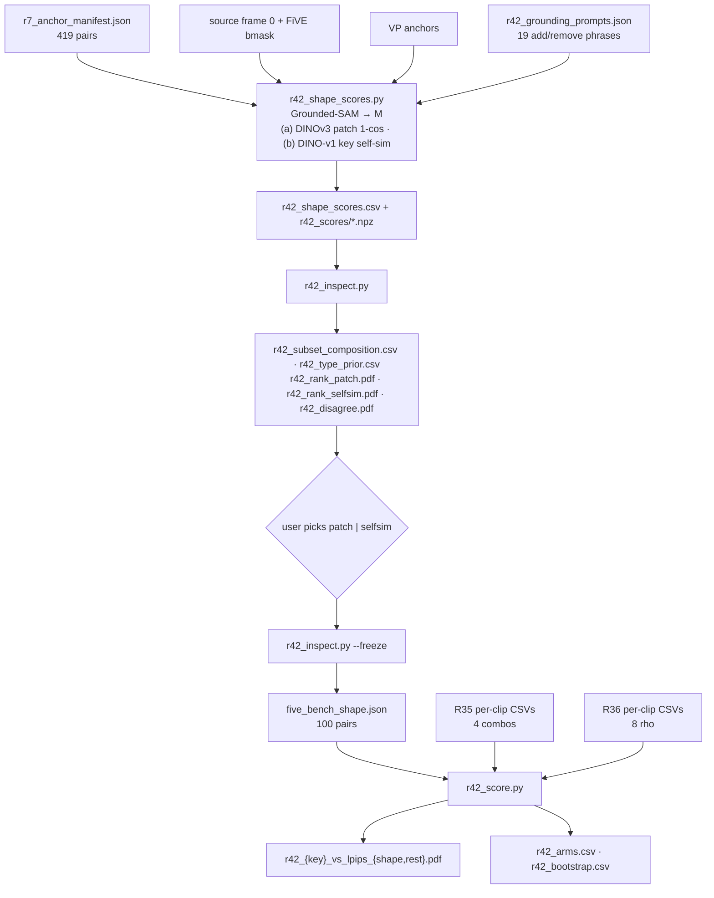

# R42: FiVE-Bench-Shape Subset

## Context

R35 (draft-based spatial divergence routing) and R36 (VP rho sweep) were scored on all 419 FiVE-Bench pairs, where the many colour/material edits dilute any effect of routing on edits that change the object's geometry. R42 builds **FiVE-Bench-Shape**: the 100 pairs whose edit requires the most structural divergence, measured between source frame 0 and the VP anchor inside the object region `M = M_src ∪ M_trg`. Two DINO scores are computed side by side, each giving a top-100 candidate; the user picks one by inspection before any R35/R36 result on it is seen. R35 and R36 are then rescored from their existing per-clip CSVs, on the subset and on the 319 others, to test whether routing helps more on shape edits.

**Done when:** `evaluation/five_bench_shape.json` is frozen (100 pairs), and `r42_score.py --all` has written the 5 Pareto figures for both splits, `r42_arms.csv`, and `r42_bootstrap.csv`.

## Execution steps

| # | Step id | Type | What it does | Sets status |
|---|---------|------|--------------|-------------|
| — | *(prep)* | — | `/build-step` the 5 `todos` | `implemented` |
| 1 | `check-prompts` | manual | User reviews the 19 add/remove grounding phrases | |
| 2 | `scores` | sbatch | Grounded-SAM masks + scores (a), (b) on 419 pairs, one job | `running` |
| 3 | `wait-scores` | manual | 419 rows, per-type guard, audit flags | `finished` |
| 4 | `inspect` | local | Composition, type-prior check, ranked PDFs, disagreement PDF | |
| 5 | `pick-subset` | manual | User picks `patch` or `selfsim` | |
| 6 | `freeze` | local | Write `five_bench_shape.json` | |
| 7 | `rescore` | local | 5 figures × {shape, rest}, arms table, bootstrap CIs | `analyzed` |

```
/run-step R42 check-prompts   /run-step R42 inspect       /run-step R42 rescore
/run-step R42 scores          /run-step R42 pick-subset
/run-step R42 wait-scores     /run-step R42 freeze
```

## Decisions

| Question | Choice |
|---|---|
| Scope | All 419 pairs of `evaluation/r7_anchor_manifest.json` (100/100/100/100/9/10), all six edit types |
| Images | Source frame 0 `images/{video}/00001.jpg` and `~/Data/dataggen/outputs/five_bench/anchors/edit{T}/{video}.png` (`--anchor_root`, R40's convention; the manifest's `anchor_image` points at `evaluation/anchors/`, which only holds the 22 R26-era anchors), both resized to 480×832 (the pipeline's own resize); masks resized NEAREST |
| Mask, types 1–4 | `M = M_src ∪ M_trg`; `M_src` = FiVE bmask frame 0 (`> 0`, evaluate.py's convention); `M_trg` = Grounded-SAM(`target_object`, anchor) |
| Mask, type 5 (addition) | `M_src = ∅`; `M = M_trg` = Grounded-SAM(curated phrase, anchor) |
| Mask, type 6 (removal) | `M_trg = ∅`; `M = M_src` = Grounded-SAM(curated phrase, **source** frame 0) — the removed object, not FiVE's subject bmask |
| Grounding phrases, types 5/6 | Hand-curated `evaluation/r42_grounding_prompts.json`, reviewed by the user; FiVE's fields are negations or attribute phrases for these types. Multi-instance removals (0051_dogs-jump, 0055_pigs) keep `phrase_mask`'s single best box (user, 2026-10-01): `M` under-covers them slightly, no multi-box code |
| Grounded-SAM | `r25_iou.load_models` / `phrase_mask` (GroundingDINO-base + SAM2-hiera-large, HF cache), best box; validated at median IoU 0.974 vs FiVE GT in R25. GroundingDINO never abstains, so `score`/`fired` are audit fields only |
| Score (a) `patch` | DINOv3 ViT-B/16 at 480×832, per-patch `1 − cos` on the 30×52 grid (`r31_divergence.dinov3_patch_divergence`, = R35's DINO map); masked mean weighted by the area fraction of `M` in each token |
| Score (b) `selfsim` | DINO v1 ViT-B/8 (FiVE's `structure_distance` backbone), keys of block 11, heads concatenated, at 480×832 (60×104 patch tokens, CLS dropped), input scaled to [0,1] then ImageNet-normalised (fixes FiVE's 0–255 quirk). `S = cos` self-similarity over all patch tokens, computed on the **unmasked** image; score = mean over rows `i ∈ M` (area-weighted) of `mean_j (S_src[i,j] − S_anc[i,j])²` |
| Diagnostics | Unmasked global variant of each score, `area(M)/frame`, `area(M_src)`, `area(M_trg)`, grounding score/box; audit flag if `M` empty or > 50% of frame |
| Ranking | Per score, descending; top **K = 100** is that score's candidate. K fixed now, before any subset result |
| Sanity checks | Per score: medians by edit type (expect 2 > 1 > 3, 4); paired fraction of the 100 shared videos with score(type 2) > score(type 1) |
| Choice of score | Manual, from `inspect` outputs only; R35/R36 numbers on candidates are not looked at before `freeze` |
| Subset file | `evaluation/five_bench_shape.json` (list of `case_id`, plus `score`, `rank`, `chosen_score`) — shared benchmark split, so no `r42_` prefix |
| Rescoring sources | R35: `edit{T}_FiVE_r35_{combo}_frame_stride8.csv`, `edit{T}_FiVE_r35_fiveacc_{combo}_…`, `r35_clip_directional.csv`. R36: `edit{T}_FiVE_r36_rho{ρ}_vp_…`, `edit{T}_FiVE_r36_fiveacc_rho{ρ}_vp_…`, `r36_clip_directional.csv`. Never `_avg.csv`, never `r36_rho_sweep.csv` (full-bench aggregate only) |
| Averaging | Plain per-clip mean within each split; x = alignment metric, y = `lpips_unedit_part` |
| Figures | `r35_score.FIGURES` keys (clip, clipd, fiveacc, fiveacc_mc, fiveacc_full) × {shape, rest} → `evaluation/figures/r42_{key}_vs_lpips_{split}.pdf` |
| Gain | R35 arm's alignment − R36 curve's alignment linearly interpolated (over ρ points sorted by bg LPIPS) at the arm's bg LPIPS; outside R36's LPIPS range → NaN, reported, no extrapolation |
| Bootstrap | B = 10,000, seed 0, clips resampled with replacement within a split, the same draw for R35 and R36 (paired); 95% percentile CI per (arm, metric, split) and for `gain_shape − gain_rest` (splits resampled independently). 20 intervals, uncorrected, read descriptively |
| Compute | One L40S job, ~1 h (2 ViTs + GroundingDINO + SAM2, ≤ 2 groundings per pair); everything else CPU |
| Outputs on disk | `~/Data/dataggen/outputs/five_bench/r42_scores/edit{T}/{video}.npz` |
| Out of scope | New renders; R38/R40/R41 on the subset; IoU-based shape score; multiple-comparison correction |

## Step commands

### check-prompts

```bash
python -c "import json;d=json.load(open('evaluation/r42_grounding_prompts.json'));print(len(d));[print(x['case_id'],x['image'],'|',x['phrase'],'|',x.get('note','')) for x in d]"
```

### scores

```bash
sbatch slurm_scripts/five_bench/r42_scores.sh
# runs, in streamgve:
#   python evaluation/r42_shape_scores.py --manifest evaluation/r7_anchor_manifest.json \
#     --data_root ~/Data/FiVE-Fine-Grained-Video-Editing-Benchmark \
#     --anchor_root ~/Data/dataggen/outputs/five_bench/anchors \
#     --prompts evaluation/r42_grounding_prompts.json \
#     --out_dir ~/Data/dataggen/outputs/five_bench/r42_scores \
#     -o evaluation/csv/r42_shape_scores.csv --seed 0
```

### wait-scores

```bash
grep -h "GUARD\|AUDIT" logs/r42_scores_*.out
grep -c "\[ERROR\]" logs/r42_scores_*.out          # 0
grep -c "Traceback" logs/r42_scores_*.err          # 0
```

### inspect

```bash
python evaluation/r42_inspect.py
```

### pick-subset

```bash
cat evaluation/csv/r42_subset_composition.csv evaluation/csv/r42_type_prior.csv
xdg-open evaluation/figures/r42_rank_patch.pdf evaluation/figures/r42_rank_selfsim.pdf evaluation/figures/r42_disagree.pdf
```

### freeze

```bash
python evaluation/r42_inspect.py --freeze <patch|selfsim>
```

### rescore

```bash
python evaluation/r42_score.py --subset evaluation/five_bench_shape.json --all
```

## Pipeline



## Code to touch

**`evaluation/r42_grounding_prompts.json`** *(new)* — 19 hand-curated entries (types 5/6); drafted by Claude, reviewed by the user.

**`evaluation/r42_shape_scores.py`** *(new)* — imports `load_models`, `phrase_mask`, `resize_nearest`, `set_seed` from `r25_iou.py`; `load_dinov3`, `dinov3_patch_divergence`, `PIXEL_H/W`, `GRID_H/W` from `r31_divergence.py`; DINO v1 via `torch.hub.load('facebookresearch/dino:main', 'dino_vitb8')` (cached) with a forward hook on `blocks[11].attn.qkv`.

```python
for case in manifest:
    src = resize(Image.open(images/video/00001.jpg), 480x832); anc = resize(anchor, 480x832)
    if T in 1..4: M_src = resize_nearest(bmask[video][0] > 0); M_trg = ground(target_object, anc)
    elif T == 5:  M_src = 0;                                    M_trg = ground(prompts[case], anc)
    else:         M_src = ground(prompts[case], src);           M_trg = 0
    M = M_src | M_trg                                           # [480, 832] bool
    # (a) patch
    d_patch = dinov3_patch_divergence(model3, n_prefix, src, anc)   # [30, 52]
    w30 = area_pool(M, 30x52); patch = (w30 * d_patch).sum() / w30.sum()
    # (b) selfsim
    K_s, K_a = keys_b11(dino8, norm(src/255)), keys_b11(dino8, norm(anc/255))   # [6240, 768]
    S_s, S_a = cos_matrix(K_s), cos_matrix(K_a)                                  # [6240, 6240]
    row_err = ((S_s - S_a) ** 2).mean(1).reshape(60, 104)
    w60 = area_pool(M, 60x104); selfsim = (w60 * row_err).sum() / w60.sum()
    save npz(M_src, M_trg, d_patch, row_err, grounding audit); write csv row
    (+ patch_global, selfsim_global, area_M, area_src, area_trg, audit_flag)
```

`--smoke`: one case per edit type; asserts mask shapes, `M` non-empty, both scores finite, and both scores exactly 0 when the source is passed as its own anchor (identity check).

**`slurm_scripts/five_bench/r42_scores.sh`** *(new)* — header cloned from `r40_smoke.sh` (L40S, 1 GPU, 64G, `--time=02:00:00`, node exclusions, `conda activate streamgve` (five-bench has no sam2), `HF_HUB_OFFLINE=1`); one python call; post-run `GUARD` line counting CSV rows per edit type (expect 100/100/100/100/9/10), non-zero exit otherwise.

**`evaluation/r42_inspect.py`** *(new)* — CPU only; matplotlib multi-page PDFs (`PdfPages`), 8 rows per page, rank and both scores in each row title, red rule after rank 100. `--freeze` refuses to overwrite an existing `five_bench_shape.json` unless `--force`.

**`evaluation/r42_score.py`** *(new)* — `from r35_score import clip_index, load_harness, load_clipd, FIGURES`; no edit to `r35_score.py` (R35 is analyzed). `--subset` read once; every per-clip table is checked for full 419 coverage before splitting; each split's point is a plain mean over its clips; R36 curve built per split from the 8 per-clip stems. Bootstrap vectorised in NumPy (index matrix `[B, n_split]`).
