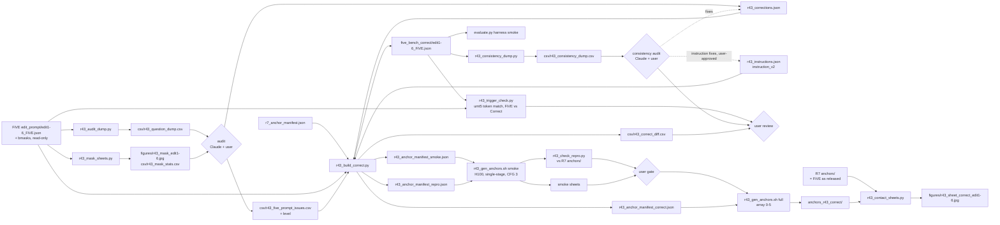

# R43: FiVE-Bench-Correct

## Context
FiVE-Bench as released contains artifacts at three levels: L1 cosmetic, L2 target/instruction contradicting the stated source→target edit, and L3 fundamental errors in the edit category, the mask or an evaluation question. Prompt-level issues found so far are catalogued in `evaluation/csv/r43_five_prompt_issues.csv`; FiVE-Acc questions outside 41 pairs, the `source_object` / `target_object` fields and all masks have not been audited yet. The objects are not just labels: `run_fivebench.py` passes them to StreamEdit as trigger words (`find_phrase_token_indices` locates them verbatim in the prompts to build the cross-attention foreground mask), `r33_clip_directional.py` uses them as the CLIP-D word direction, and R42 grounds them with Grounded-SAM. An object that is truncated, names the wrong thing, or no longer appears in its corrected prompt silently changes method behaviour and metrics. R43 audits all five components, builds **FiVE-Bench-Correct** by fixing artifacts without adding semantic content (excluding pairs that can't be fixed), and **regenerates every FiVE-Bench-Correct VP anchor** from the corrected instructions.

The paper reports two self-consistent tables, and **the anchor generator is identical in both; only the instruction differs**:
- **FiVE as released:** R7's existing `anchors/` = FiVE's official instructions through the R7 generator. Not regenerated; the `anchor-smoke` step re-runs 3 of them to confirm the generator reproduces them.
- **FiVE-Bench-Correct:** `anchors_r43_correct/` = `instruction_v2` (+ the keep-pose suffix for types 1–4) through the same generator, every pair regenerated.

The original FiVE files and `anchors/` stay untouched. Re-rendering the methods on FiVE-Bench-Correct is out of scope (separate task).

**Done when:** every pair's prompts, instruction, objects, questions and mask have been audited and every finding is logged with a level; `evaluation/five_bench_correct/` is built, validated, trigger-checked (no unintended empty trigger), consistency-audited (instruction ↔ source/target prompts ↔ objects on the final files) and approved; the R7 generator check is reported; `anchors_r43_correct/` (one per FiVE-Bench-Correct pair) is generated and inspected; and the harness reads FiVE-Bench-Correct.

## Execution steps

| # | step id | type | waits for | sets status |
|---|---|---|---|---|
| — | *(prep)* cleanup · audit-scripts · object-checks · build-correct script · consistency-script · trigger-check-script · harness-support · gen-anchors-script | todos | — | `implemented` |
| 1 | `question-dump` | local (re-run after object-checks) | — | — |
| 2 | `mask-sheets` | local (re-run after object-checks) | — | — |
| 3 | `audit` | manual | question-dump, mask-sheets | — |
| 4 | `build-correct` | local | audit | — |
| 5 | `trigger-check` | local | build-correct | — |
| 6 | `consistency-dump` | local | build-correct | — |
| 7 | `consistency-audit` | manual (loops with build-correct + trigger-check until clean) | consistency-dump | — |
| 8 | `review-correct` | manual | consistency-audit, trigger-check | — |
| 9 | `harness-smoke` | local | review-correct | — |
| 10 | `anchor-smoke` | sbatch (H100, about 1 h: 3 repro + 26 smoke anchors) | review-correct | — |
| 11 | `inspect-smoke` | manual | anchor-smoke | — |
| 12 | `generate-anchors` | sbatch (H100, array 0-5, one edit type per task, under 4 h each as in R7) | inspect-smoke | `running` |
| 13 | `wait-anchors` | manual | generate-anchors | `finished` |
| 14 | `contact-sheets` | local | wait-anchors | — |
| 15 | `inspect-sheets` | manual | contact-sheets | `analyzed` |

```
/build-step question-dump R43
/build-step mask-sheets R43
/build-step build-correct R43
/build-step trigger-check R43
/build-step consistency-dump R43
/build-step anchor-smoke R43
/build-step harness-smoke R43
/run-step R43 question-dump
/run-step R43 mask-sheets
/run-step R43 audit
/run-step R43 build-correct
/run-step R43 trigger-check
/run-step R43 consistency-dump
/run-step R43 consistency-audit
/run-step R43 review-correct
/run-step R43 harness-smoke
/run-step R43 anchor-smoke
/run-step R43 inspect-smoke
/run-step R43 generate-anchors
/run-step R43 wait-anchors
/run-step R43 contact-sheets
/run-step R43 inspect-sheets
```

## Decisions

| Decision | Choice |
|---|---|
| Guiding principle | No new semantic content: corrections may remove content, restore FiVE's own content, or fix form, never add meaning FiVE does not already state |
| Level L1 — cosmetic | Typos, spacing, grammar, duplicated words, garbled question grammar. Fixed |
| Level L2 — inconsistency | Target prompt or instruction contradicts the stated source→target edit (`source_object` → `target_object`): leftover objects, object conflicts, internal contradictions, removed object still described, leaked edits, instructions contradicting their target. Fixed by deleting the faulty span or copying the word from the pair's own FiVE fields |
| Level L3 — fundamental | Wrong edit category (motion/scene/effect edits FiVE has no category for, no-ops), wrong mask for the edited object, wrong evaluation question (inverted/swapped polarity), and removal prompts that name the removed object under negation (counted as L3 because they break CLIP-T for removal). Fixed only by removing or restoring (swap question polarity, revert to the source prompt's wording, delete the negated clause); otherwise the pair is **excluded** (`edit4/0097_A_bird`, and every pair whose mask doesn't cover its edited object) |
| Objects | `source_object` / `target_object` must name exactly the edited object or attribute and be a **verbatim span of their own prompt** (case-insensitive contiguous token match, the rule of the inference's `find_phrase_token_indices`; a miss = empty trigger = no cross-attention foreground). Released FiVE: 0 empty triggers on all 419 pairs (exact check with the umt5-xxl tokenizer, 2026-10-03), so the guard is about not breaking it with corrections. Levels: typo → L1; truncated span (e.g. `edit1/0006` target `hang` in "hang glider"), object contradicting the stated edit or the instruction → L2, fixed by re-spanning to a verbatim span of the same prompt (copy rule satisfied by construction); object of the wrong kind (negated clause, the unedited subject or companion, e.g. `edit1/0016` `a horse with a rider` → `A camel`) → L3. Presence is necessary but not sufficient: the object CHOICE is checked against the prompt word diff (the edited words) and the instruction. A pair whose object changes counts as **changed** for re-rendering, since the trigger tokens differ from the FiVE-official run |
| Leaked / extra edits | L2 (user, 2026-10-06). A **leak** (a word from a sibling pair's edit, e.g. `edit2/0024` `dragon` + `robot`, `edit6/0017` `rubber`) is deleted, or replaced by the pair's own target word, whichever is the smaller span edit. An **extra edit** the instruction does not ask for (e.g. `edit2/0002` `gray` → `robotic`) is reverted to the source prompt's wording (copy rule satisfied by construction). **Verbs rewritten to fit the new object** (`walking` → `hopping` for dog → rabbit, `moving` → `gliding` for bus → spaceship) are accepted and not logged; only motion changes that are edits in their own right stay in `D_motion_or_scene_edit`. **Attribute / part adaptations to the new object** are accepted the same way (user, 2026-10-06): `edit1/0005` hoodie dropped and jeans → blue suit for Mario, `0011` dress → suit for woman → man, `0013` shirt and shorts → suit for man → ironman, `0066` antler → horn for deer → goats, `0056` drivers → riders for go-karts → bicycles. They are not part of the object (`0011` source = `a woman`) |
| Object span rules | User, 2026-10-06. **Replacements (types 1–2):** `source_object` = only the words the edit replaces; whatever survives unchanged in the target prompt is not part of the edit (`edit1/0016` `a horse with a rider` → `A horse`, the rider is dropped from the object; same for `a motorbike with two riders`, `a person on rollerblades`, `a man with a backpack`, `a man in a yellow shirt`, `a woman dressed as a mermaid`, `a person dressed in a Santa Claus outfit`, `a woman in a black dress`, `a rider on a white horse` → `a white horse`). **Attribute edits (types 3–4):** both objects = the edited item's noun phrase with its old / new attribute, as verbatim spans of their own prompts (`a red hoodie` → `a black hoodie`, `a grey Mini Cooper` → `a metallic Mini Cooper`, `A tennis player` → `A clay tennis player`), replacing FiVE's whole-object → lone-adjective convention and the wearer → garment mismatches (`breakdancer` → `A black hoodie`). If no verbatim span exists in a prompt, the pair goes to a per-pair call at the audit; a prompt is never rephrased to create a span. **Modifier asymmetry** (source keeps a count or adjective the target object omits although the target prompt keeps it, e.g. `two white ibises` → `swans`): left alone, not logged. **Shared scene words** flagged by `obj_unedited_words` (e.g. `tennis` in "tennis court"): no action |
| Multi-edit pairs vs the mask | User, 2026-10-07. FiVE has one mask per video, and background preservation is scored outside it, so an edited object outside the mask rewards methods that fail to edit it. A multi-edit pair whose mask covers only some of its edited objects is **reduced to the masked edit only**: the unmasked edit is reverted in the target prompt (copy from `source_prompt`), dropped from `instruction_v2` (in `r43_instructions.json`, with a note), and the questions / MCQ are made to test the kept edit. Reduced: `edit2/0007` (violinist → tiger kept; guitarist → robot dropped), `edit2/0013` (man → robot kept; golf cart → hovercraft dropped), `edit2/0051` (dogs → robotic dogs kept; woman → robot dropped). Multi-edit pairs whose mask covers every edited object keep all edits (`edit2/0002`, `0041`, `0061`, `0067`); their objects name the first edit of `instruction_v2` |
| Foreground only | User, 2026-10-07. Only foreground changes tied to the edited object are kept (the object, its verbs, attributes and parts). Background, scene and caption-wording changes in the target prompt are reverted to the source wording: `edit2/0080` road → path reverted, `edit2/0100` serene → magical reverted (with `0086`, `0091`, `0093`, `0095`, `0096` already reverted as motion / scene / effect edits) |
| FiVE-Acc semantics (verified in `metrics_calculator.py`, 2026-10-07) | All three questions are asked on the **edited** video. Yes/no is correct iff the source question is answered "no" and the target question "yes" (empty source question → target "yes" only); the MCQ is correct iff the answer is "b". Question fixes are judged by this rule: a source question that is true on a correctly edited video, a target question that is false on it, or an MCQ whose b) is not the target, always fails. Fixes: swap when both questions are in each other's slot; otherwise move the target-true source question to the target slot and empty the source question; swap a) / b) text for an inverted MCQ |
| Objects are method-agnostic | The objects describe the edit, not what a given method needs: the benchmark is not adapted to StreamEdit (user, 2026-10-06). An object that is absent on one side of the edit is empty on that side, even where a method would prefer an anchor |
| edit5 objects | Added-object convention for all 9 edit5 pairs (user, 2026-10-06): `source_object` = `""` (the added object does not exist in the source, and need not be attached to anything, e.g. a dog added in the background), `target_object` = the added object alone as a verbatim span of `target_prompt` ("a hat", "a cap", "a dog", "a bright yellow fedora", "a giant inflatable flamingo", "sunglasses", ...), without the host. Replaces FiVE's host-as-source convention (consistent across the 9, but method-shaped) and its inconsistent targets (5 host + added, 4 added phrase only, e.g. `wearing sunglasses`, `followed closely by a dog`). **Expected effect on StreamEdit, to report rather than hide:** with an empty source trigger the source foreground mask is empty, so (a) the editable region before denoising is the target-trigger mask alone (`edit_causal_inference.py:782`, `trg | src`), and (b) in the second half of denoising the background source-K/V injection covers the whole current chunk (`causal_model.py:479-495`), which pulls the attachment region toward the source; StreamEdit's edit5 scores on FiVE-Bench-Correct may drop vs FiVE as released, and that gap is a method limitation, not a benchmark artifact. CLIP-D's word direction on edit5 becomes `target_object − ""` |
| Exclusions | User, 2026-10-07. **415 pairs** in FiVE-Bench-Correct (419 − 4). `edit4/0097_A_bird`: no-op edit (a bird is already feathered). `edit3/0051_dogs-jump`: the woman whose jacket is recoloured is outside the video mask (dogs only). `edit6/0042_gym-ball`: the removed gym ball is outside the mask (man only). `edit6/0078_A_cat`: the removed toy is outside the mask (cat only). Rule: a single-edit pair whose edited object is entirely outside the mask is excluded, since background preservation would penalise a correct edit; edit6 drops from 10 to 8 pairs |
| edit5 masks | Keep FiVE's edit5 masks, which cover the host (the musician, the bear, the woman), for now (user, 2026-10-06): no mask of the added object exists yet. The L3 "mask doesn't cover the edited object" exclusion does not apply to edit5 host masks. Known bias, reported with the edit5 numbers: background-preservation metrics are computed outside the host mask, so an added object placed away from the host (e.g. the dog following the woman in `0011_lucia`) counts as a background change. Revisit if added-object masks are produced |
| edit6 objects | Removed-object convention for all 10 edit6 pairs (user, 2026-10-03): `source_object` = the removed object as a verbatim span of `source_prompt` (e.g. "a gray dog", "a helmet"), `target_object` = `""`. The inference supports an empty target trigger ("all background for null trigger", `wan/modules/model.py`). Side effect: CLIP-D's word direction on edit6 becomes `"" − source_object` ("away from the removed object") instead of FiVE's negated phrase; reported next to the edit6 CLIP-D numbers. `trigger-check` treats exactly these two empties (edit5 source, edit6 target) as intended |
| Copy rule | For target prompts and questions, every word inserted by a correction must already exist in that pair's own FiVE fields (`source_prompt`, `target_prompt`, `source_object`, `target_object`, `instruction`, questions), unless the correction names a sibling FiVE pair whose phrasing it reuses (`template_from`, flagged); checked by machine and reported per word in the diff. **Typo-fix exception (mandatory, user 2026-10-06):** a word that replaces a misspelled word is always accepted, even if the correct spelling appears nowhere in the pair's fields: a replacement within edit distance 2 of the word it replaces (`boad` → `boat`, `monekys` → `monkeys`, `forging` → `foraging`) or the article swap `a` ↔ `an` (`A azure` → `An azure`). Reported in the diff as `inserted_from = L1-spelling`. **Grammar-fix exception (user 2026-10-07):** subject-verb agreement `is` ↔ `are` (`Is the table tennis players` → `Are the table tennis players`), reported as `inserted_from = L1-grammar`; and deleting `made of` before an adjective (`made of metallic` → `metallic`, `made of wooden` → `wooden`), which is delete-only |
| Instructions | FiVE-Bench-Correct's `instruction` field takes the user-approved single-edit rewrites (`instruction_v2` in `evaluation/r43_instructions.json`, without the keep-pose suffix): 244 of 419 differ from FiVE. These rephrase or remove but add no semantics, so they are exempt from the word-level copy rule. Re-confirmed by the user 2026-10-03 |
| Keep-pose suffix | *" Keep the coarse position, size, facing direction and coarse pose of the original object."* is part of FiVE-Bench-Correct's anchor instruction for edit types 1–4 (types 5–6 get the instruction alone). It goes into the anchor manifest's `first_frame_edit_prompt` ONLY; `r43_build_correct.py` refuses to write if it appears in `instruction`, `target_prompt` or any question field |
| Anchor generator (both tables) | Identical to R7 (job 897770): `Qwen/Qwen-Image-Edit-2511` snapshot `6f3ccc0`, **H100, single-stage** (`pipe.to("cuda")`, no `--two_stage`, no `--cpu_offload`), `true_cfg_scale=3.0`, `guidance_scale=1.0`, 40 steps, `negative_prompt=" "`, seed 0 re-set per case, LANCZOS resize to 832×480, qwen-edit env (diffusers 0.39.0, transformers 5.13.0, torch 2.8.0, unchanged since 2026-07-04, before R7). Only the instruction text differs between the tables |
| Anchor sets | FiVE as released: R7's `~/Data/dataggen/outputs/five_bench/anchors/` (not regenerated). FiVE-Bench-Correct: `~/Data/dataggen/outputs/five_bench/anchors_r43_correct/edit{T}/{video}.png`, **every** non-excluded pair regenerated (no hard-linking; most instructions change) |
| R7 generator check | `anchor-smoke` regenerates 3 pairs with FiVE's official instruction and no suffix (`edit1/0001_bus`, `edit2/0081_A_horse`, `edit5/0007_guitar-violin`) and compares decoded pixels with R7's `anchors/`. IDENTICAL confirms the claim "same generator"; DIFFERS is reported with max abs diff / PSNR and does not block (a node-level kernel difference, not a setting change) |
| Anchor smoke | 26 anchors = edit 1–2 × `0012_goat 0045_butterfly 0059_drift-straight 0081_A_horse 0098_A_squirrel 0074_rhino 0005_breakdance 0036_camel 0003_ocean-birds 0022_skate-jump 0030_rallye 0062_elephant 0018_breakdance-flare`, taken from the correct manifest (instruction_v2 + suffix), to `~/Data/dataggen/outputs/five_bench/anchor_r43_smoke/`; the 3 repro anchors to `anchor_r43_smoke/repro/` |
| Compute | H100 sbatch, cloned from `r7_gen_anchors.sh` (which fit 100 anchors per task in its 4 h limit), plus `--exclude=node01,node51,node52,node57`, `--time=06:00:00`, `cd` to this repo (R7's script `cd`s to the old `Code/StreamEdit`). Resumable: existing PNGs are skipped |
| Out of scope | Re-rendering methods on FiVE-Bench-Correct (separate task: anchor-based rows on every pair, text-only rows on the changed pairs only); redrawing masks |

## Step commands

### question-dump
```bash
python evaluation/r43_audit_dump.py \
  --data_root ~/Data/FiVE-Fine-Grained-Video-Editing-Benchmark \
  --out_csv evaluation/csv/r43_question_dump.csv
```

### mask-sheets
```bash
python evaluation/r43_mask_sheets.py \
  --data_root ~/Data/FiVE-Fine-Grained-Video-Editing-Benchmark \
  --out_dir evaluation/figures \
  --stats_csv evaluation/csv/r43_mask_stats.csv
```

### audit
```bash
# manual: Claude reviews, user confirms new findings
column -s, -t < evaluation/csv/r43_question_dump.csv | less -S
ls evaluation/figures/r43_mask_edit*.jpg
```

### build-correct
```bash
python evaluation/r43_build_correct.py \
  --data_root ~/Data/FiVE-Fine-Grained-Video-Editing-Benchmark \
  --corrections evaluation/r43_corrections.json \
  --instructions evaluation/r43_instructions.json \
  --issues evaluation/csv/r43_five_prompt_issues.csv \
  --r7_manifest evaluation/r7_anchor_manifest.json \
  --out_dir evaluation/five_bench_correct \
  --diff_csv evaluation/csv/r43_correct_diff.csv \
  --manifest_dir evaluation
```

### trigger-check
```bash
python evaluation/r43_trigger_check.py \
  --data_root ~/Data/FiVE-Fine-Grained-Video-Editing-Benchmark \
  --correct_dir evaluation/five_bench_correct \
  --tokenizer Self-Forcing_StreamEdit/wan_models/Wan2.1-T2V-1.3B/google/umt5-xxl \
  --out_csv evaluation/csv/r43_trigger_check.csv
```

### consistency-dump
```bash
python evaluation/r43_consistency_dump.py \
  --correct_dir evaluation/five_bench_correct \
  --out_csv evaluation/csv/r43_consistency_dump.csv
```

### consistency-audit
```bash
# manual: Claude reads every row, user confirms findings; instruction fixes need user approval
column -s, -t < evaluation/csv/r43_consistency_dump.csv | less -S
```

### review-correct
```bash
# manual: approve the before/after table; if edited, re-run build-correct
column -s, -t < evaluation/csv/r43_correct_diff.csv | less -S
```

### harness-smoke
```bash
python evaluation/fivebench/evaluate.py \
  --config_path evaluation/fivebench/config.yaml \
  --annotation_mapping_files evaluation/five_bench_correct/edit2_FiVE.json evaluation/five_bench_correct/edit6_FiVE.json \
  --cases_json evaluation/r43_harness_smoke_cases.json \
  --src_image_folder ~/Data/FiVE-Fine-Grained-Video-Editing-Benchmark \
  --tgt_methods ~/Data/dataggen/outputs/five_bench/r36_rho_sweep/r36_rho2_vp \
  --tgt_layout edit_video \
  --metrics clip_similarity_target_image \
  --edit_category_list 2 6 \
  --tmp_resize \
  --result_path evaluation/csv/r43_harness_smoke.csv
```

### anchor-smoke
```bash
sbatch slurm_scripts/five_bench/r43_gen_anchors.sh smoke
```

### inspect-smoke
```bash
# manual: wait for the job, then read the repro check and view the sheets
tail -n 3 logs/r43_gen_anchors_smoke_*.out
column -s, -t < evaluation/csv/r43_repro_check.csv
ls evaluation/figures/r43_smoke_sheet_edit*.jpg
```

### generate-anchors
```bash
sbatch --array=0-5 slurm_scripts/five_bench/r43_gen_anchors.sh full
```

### wait-anchors
```bash
tail -n 1 logs/r43_gen_anchors_full_*.out
grep -c '^\[ERROR' logs/r43_gen_anchors_full_*.out
find ~/Data/dataggen/outputs/five_bench/anchors_r43_correct -name '*.png' | wc -l   # = FiVE-Bench-Correct pairs
```

### contact-sheets
```bash
/home/ids/skhairi/anaconda3/envs/qwen-edit/bin/python -E -s evaluation/r43_contact_sheets.py \
  --data_root ~/Data/FiVE-Fine-Grained-Video-Editing-Benchmark \
  --r7_manifest evaluation/r7_anchor_manifest.json \
  --correct_manifest evaluation/r43_anchor_manifest_correct.json \
  --r7_root ~/Data/dataggen/outputs/five_bench/anchors \
  --correct_root ~/Data/dataggen/outputs/five_bench/anchors_r43_correct \
  --out_dir evaluation/figures
```

### inspect-sheets
```bash
# manual: view the sheets
ls evaluation/figures/r43_sheet_correct_edit*.jpg
```

## Pipeline



## Code to touch

| File | Change |
|---|---|
| *(cleanup)* | Delete `evaluation/r43_build_manifest.py`, `evaluation/r43_anchor_manifest.json`, `evaluation/csv/r43_instruction_review.csv`, `.claude/plans/r43-improved-qwen-edit-anchors_9c4e2a71.plan.md`, `.claude/plans/r44-five-bench-prompt-corrections_3b8d61e5.plan.md`, `slurm_scripts/five_bench/anchor_cfg_gen.sh`. Rename `evaluation/r44_corrections.json` → `evaluation/r43_corrections.json` and `evaluation/r44_build_overlay.py` → `evaluation/r43_build_correct.py`. Keep `evaluation/r43_instructions.json`, `evaluation/csv/r43_five_prompt_issues.csv`, and the `--two_stage` path in `evaluation/gen_anchors.py` (unused by R43; the default single-stage path is R7's). |
| `evaluation/csv/r43_five_prompt_issues.csv` | Add a `level` column. Mapping: typos / grammar → L1; leftover objects, object conflicts, internal contradictions, removed-object-still-present, leaked edit, attribute leftovers, instruction-vs-target → L2; motion/scene/effect edits, no-op, removal by negation, inverted/swapped questions, wrong masks → L3. Audit findings are appended with new groups `H_question`, `I_mask`, `K_object` (object levels as in the Decisions table) and `L_mask_scope` (multi-edit pairs reduced to their masked edit, L3). |
| `evaluation/r43_audit_dump.py` | **New.** One row per pair: `case_id, edit_type, source_object, target_object, instruction, source_prompt, target_prompt, source_yes_no_question, target_yes_no_question, multiple_choice_question`, plus automatic flags: `polarity_suspect` (the target question names the source object, or the source question names the target object), `unknown_words` (question words found in none of the pair's prompts or objects), `negation` (`not` / `no` / `without` in a question), `empty_field`, `mcq_options` (option count; whether b) names the target object). *(object-checks)* Add object columns: `src_obj_in_prompt` / `tgt_obj_in_prompt` (object is a verbatim, case-insensitive, word-bounded span of its own prompt; the stdlib stand-in for `find_phrase_token_indices`, whose exact version is `trigger-check`), `src_obj_ctx` / `tgt_obj_ctx` (the matched span in brackets with up to 3 prompt words on each side, e.g. `a [hang] glider is soaring`, so truncated or wrong spans are visible at a glance), `obj_same` (source and target objects equal after normalization, i.e. a no-op), `obj_negated` (`not` / `no` / `without` inside an object). Choice checks on the content-word diff of the prompts (same normalization as the question flags): `diff_removed` / `diff_added` (source-only / target-only prompt words = the edit the prompts imply); `obj_unedited_words` (object words in neither diff side and not shared by both objects, so the shared head noun of an attribute edit — "horse" in white horse → black horse — is accepted, but the "rider" of `a horse with a rider` → `A camel` is flagged); `diff_uncovered` (removed words absent from `source_object`, added words absent from `target_object`; prompt leftovers also land here, so it is a hint); `obj_vs_type` (deviation from the Correct convention: edit5 `source_object` non-empty, edit6 `target_object` non-empty, types 1–4 an empty object). Released FiVE is expected to flag all 9 edit5 and all 10 edit6 pairs on `obj_vs_type`. |
| `evaluation/r43_mask_sheets.py` | **New.** For each edit type, one JPEG sheet with one cell per pair: frame 0 (`images/<video>/00001.jpg`) with `bmasks/<video>/00001.*` overlaid in semi-transparent red, captioned `case_id: instruction`. *(object-checks)* First caption line becomes `case_id: source_object → target_object` (an empty object shown as `∅`), followed by the instruction, so each cell shows whether the mask covers `source_object`. Writes `r43_mask_stats.csv` per video: mask area fraction on frame 0, number of empty mask frames, and the frame count compared with `images/`. |
| `evaluation/r43_corrections.json` | Revised under the level policy. Per entry: `case_id`, `level`, `changed_spans`, `must_not_contain`, corrected `target_prompt` / question fields, optional corrected `source_object` / `target_object`, optional `template_from`, optional `exclude`, `note`. Questions: swaps / span fixes instead of whole rewrites; edit6: delete-only (e.g. `0051` "training in an open field", with no "standing"), plus the removed-object convention on all 10 (`source_object` = removed object as a span of `source_prompt`, `target_object` = `""`); edit5: the added-object convention on all 9 (`source_object` = `""`, `target_object` = the added object alone as a span of `target_prompt`); object re-spans under the object span rules (types 1–2 replaced words only, types 3–4 noun phrase with attribute on both sides; expected to touch most type 3–4 pairs); `0093`: effect clause deleted. |
| `evaluation/r43_build_correct.py` | From the renamed builder. Keep: span check (target prompt), `must_not_contain` (word boundary), edit6 negation check, untouched pairs identical, `<field>_orig`, exclusion. Add: **copy check** for target prompts and questions (inserted words must exist in the pair's own FiVE fields or `template_from`'s fields; reported in an `inserted_from` diff column), with the mandatory **typo-fix exception**: a replacement word within edit distance 2 of the word it replaces, or `a` ↔ `an`, always passes and is reported as `inserted_from = L1-spelling` (must accept `edit2/0071` boad → boat and `edit3/0095` A azure → An azure); `level` column in the diff; `instruction` from `instruction_v2` for all non-excluded pairs; **suffix guard** (refuse to write if the keep-pose suffix appears in `instruction`, `target_prompt` or a question); `source_object` / `target_object` added to the correctable fields (with `<field>_orig` and diff rows); **object-span guard** (refuse to write if a non-empty object is not a verbatim, case-insensitive, word-bounded span of its own corrected prompt; or if the empties deviate from the conventions: `source_object` must be empty on every edit5 pair and only there, `target_object` empty on every edit6 pair and only there). `--manifest_dir` writes, in R7's manifest schema (`case_id, edit_type, video_name, src_first_frame, first_frame_edit_prompt, anchor_image`): `r43_anchor_manifest_correct.json` (every non-excluded pair; `instruction_v2` + suffix for types 1–4; `anchor_image` under `anchors_r43_correct`), `r43_anchor_manifest_smoke.json` (the 26 smoke cases from the correct manifest, under `anchor_r43_smoke`), `r43_anchor_manifest_repro.json` (the 3 repro pairs copied verbatim from `--r7_manifest`, `anchor_image` re-pointed under `anchor_r43_smoke/repro`). |
| `evaluation/r43_consistency_dump.py` | **New** (stdlib only). Reads the six final `five_bench_correct/edit{T}_FiVE.json`. One row per pair: `case_id, edit_type, instruction, source_prompt, target_prompt, source_object, target_object`, plus `instruction_changed` / `target_changed` (whether `_orig` fields exist), and heuristic flags on lowercased, plural-stripped content words (articles, prepositions and the edit verbs change/replace/turn/make/add/remove/convert are ignored): `prompt_added` / `prompt_removed` (word diff target vs source = the edit the prompt pair implies); `instr_missing_in_target` (instruction content words found in neither `target_prompt` nor `target_object`, i.e. the instruction asks for something the target doesn't show); `target_extra_unasked` (added words absent from the instruction, i.e. a possible extra edit); `tgt_obj_in_instr` / `tgt_obj_in_target` (types 1–5); `src_obj_in_source` (types 1–4 and 6; edit5 `source_object` is empty by convention) and `src_obj_in_instr` (the instruction names the source object, types 1–4 and 6); `added_obj_in_source` (type 5: `target_object` already in `source_prompt`, i.e. nothing is added); `removed_obj_in_target` (type 6: `source_object` still in `target_prompt`); `object_changed` (whether `source_object_orig` / `target_object_orig` exist); `verb_vs_type` (type 5 instruction lacks add/insert/place, type 6 lacks remove/erase/delete). Flags only order the reading; every row is read. |
| `evaluation/r43_trigger_check.py` | **New** (transformers only, CPU). Loads the umt5-xxl tokenizer with `AutoTokenizer.from_pretrained(--tokenizer)` (the same files `run_fivebench.py` reaches through `pipeline.text_encoder.tokenizer.tokenizer`) and imports `find_phrase_token_indices` from `Self-Forcing_StreamEdit/pipeline/utils.py`, so the check is the inference's own matcher. For every pair of FiVE as released (`data_root/edit_prompt`) and of `--correct_dir`: `src_tokens` / `tgt_tokens` (matched token count, 0 = empty trigger). Writes one row per (table, case_id) plus an `object_changed` column, and prints the empty-trigger counts per table and edit type. Exit 1 if any FiVE-Bench-Correct pair has an empty trigger other than `source_object == ""` on edit5 and `target_object == ""` on edit6; FiVE-as-released counts are informational (0 on 2026-10-03). |
| `evaluation/r43_harness_smoke_cases.json` | **New.** `[{"video_name": "0081_A_horse", "edit_type": 2}, {"video_name": "0048_hike", "edit_type": 6}]`. |
| `evaluation/run_fivebench.py` | Add `--edit_json_dir` (default `data_root/edit_prompt`), used at the `edit_json` read (line 262). |
| `evaluation/fivebench/evaluate.py` | Line 366: `save_dir` built from `item.get("target_prompt_orig", item["target_prompt"])`. |
| `evaluation/r33_clip_directional.py` | Add `--edit_json_dir` (default `data_root/edit_prompt`); `fullbench_cases()` reads from it. |
| `slurm_scripts/five_bench/r43_gen_anchors.sh` | **New**, cloned from `r7_gen_anchors.sh`: `--partition=H100`, `--gres=gpu:1`, `--cpus-per-task=8`, `--time=06:00:00`, `--exclude=node01,node51,node52,node57`, `cd` to this repo, qwen-edit python called with `-u -E -s`. Generator flags written out even though they equal the defaults: `--true_cfg_scale 3.0 --guidance_scale 1.0 --num_inference_steps 40 --seed 0 --negative_prompt " "`, NO `--two_stage`, NO `--cpu_offload`. Mode from `$1`: `smoke` (single task; repro manifest → `anchor_r43_smoke/repro`, then `r43_check_repro.py`; smoke manifest → `anchor_r43_smoke`, then `r43_contact_sheets.py --smoke`); `full` (array task i → `--edit_type $((i+1))` on the correct manifest → `anchors_r43_correct`). Header echoes mode, edit type, node, GPU name and the qwen-edit package versions. Logs `logs/r43_gen_anchors_{mode}_%A_%a.{out,err}`. |
| `evaluation/r43_check_repro.py` | **New** (numpy + PIL). For each repro-manifest pair: decode the new PNG and R7's `anchors/edit{T}/{video}.png`, report `IDENTICAL` or `DIFFERS` with max abs diff, mean abs diff and PSNR → `evaluation/csv/r43_repro_check.csv`. Exit 0 either way (informational gate); exit 1 only if a file is missing. |
| `evaluation/r43_contact_sheets.py` | **New.** `--smoke`: per edit type 1–2, rows = smoke cases, columns source \| R7 anchor \| smoke anchor. Full mode: per edit type, columns source \| R7 anchor \| `anchors_r43_correct`, each row labelled with FiVE's instruction and the Correct instruction (suffix shown as `+keep-pose`). Cells 320×185, JPEG quality 85, missing images drawn as grey "n/a". |
