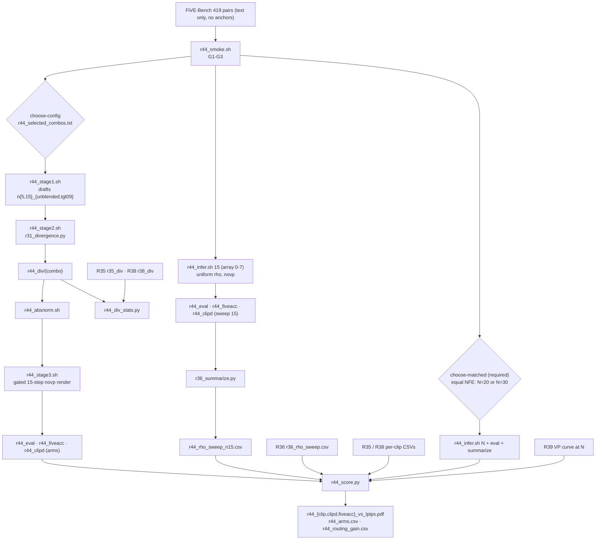

# R44: VP-Free Routing + Rho Sweep

## Context

R35/R38 show divergence routing against R36's VP uniform-rho curve, but every stage there runs with visual prompting. R44 asks whether the routing gain survives **without VP**: the same routed pipeline with a text-only instruction (`--vp_mode novp`, no anchor), compared against a **text-only uniform-rho curve**. The method config (draft N, divergence metric, anchoring regime) is not fixed yet. So all 8 combos are built, and only the ones chosen at `choose-config` run. The uniform sweep does not depend on the config and can run right after the smoke. **Equal NFE is mandatory**: a routed arm costs draft + render = 15 + N_d steps, so its headline reference is a text-only uniform curve at N = 15 + N_d (N=20 or N=30), chosen later at `choose-matched`, like the combo.

**Done when:** the text-only 8-rho curves at N=15 **and at the equal-NFE N** and the selected text-only arms are scored on all 419 pairs, and the three two-panel figures plus `r44_routing_gain.csv` put each combo's routing gain over its own modality's **equal-NFE** curve (headline; N=15 secondary) next to the VP gain. Without the equal-NFE curve the task is not done.

## Execution steps

| # | Step id | Type | What it does | Sets status |
|---|---------|------|--------------|-------------|
| — | *(prep)* | — | `/build-step` the 10 `todos` | `implemented` |
| 1 | `smoke` | sbatch | 2 clips, gates G1-G3 | |
| 2 | `wait-smoke` | manual | All gates pass | |
| 3 | `infer-sweep` | sbatch | Text-only rho sweep, N=15, array 0-7 | `running` |
| 4 | `wait-sweep` | manual | 419 dirs per rho | |
| 5 | `eval-sweep` | sbatch | Harness + FiVE-Acc arrays, CLIP-D job | |
| 6 | `wait-eval-sweep` | manual | CSV coverage, 0 errors | |
| 7 | `summarize-sweep` | local | `r44_rho_sweep_n15.csv` | |
| 8 | `choose-config` | manual | **User** writes `r44_selected_combos.txt` | |
| 9 | `stage1` | sbatch | Text-only drafts, one task per needed (N, regime) | `running` |
| 10 | `wait-stage1` | manual | 419 npz per run, `vp_mode == novp` | |
| 11 | `stage2` | sbatch | Divergence npz per selected combo | |
| 12 | `wait-stage2` | manual | 419 npz per combo | |
| 13 | `divstats` | local | Text-only vs VP divergence distributions | |
| 14 | `absnorm` | sbatch | CPU: absolute norm + rho maps | |
| 15 | `stage3` | sbatch | Gated 15-step text-only render | |
| 16 | `wait-stage3` | manual | 419 step14 dirs per combo | `finished` |
| 17 | `eval-arms` | sbatch | Harness + FiVE-Acc arrays, CLIP-D job | |
| 18 | `wait-eval-arms` | manual | CSV coverage, 0 errors | |
| 19 | `figures-interim` | local | Early look vs the N=15 curve only, `*_interim` outputs (not the result) | |
| 20 | `choose-matched` | manual | **User** picks the equal-NFE N: 20 (n5) or 30 (n15). Required | |
| 21 | `infer-matched` | sbatch | Text-only sweep at the equal-NFE N | |
| 22 | `wait-matched` | manual | 419 dirs per rho | |
| 23 | `eval-matched` | sbatch | Harness, FiVE-Acc, CLIP-D | |
| 24 | `wait-eval-matched` | manual | CSV coverage | |
| 25 | `figures` | local | Summarize N + two-panel figures + routing gain vs equal-NFE curves | `analyzed` |

```
/run-step R44 smoke            /run-step R44 choose-config    /run-step R44 stage3
/run-step R44 wait-smoke       /run-step R44 stage1           /run-step R44 wait-stage3
/run-step R44 infer-sweep      /run-step R44 wait-stage1      /run-step R44 eval-arms
/run-step R44 wait-sweep       /run-step R44 stage2           /run-step R44 wait-eval-arms
/run-step R44 eval-sweep       /run-step R44 wait-stage2      /run-step R44 figures-interim
/run-step R44 wait-eval-sweep  /run-step R44 divstats         /run-step R44 choose-matched … wait-eval-matched
/run-step R44 summarize-sweep  /run-step R44 absnorm          /run-step R44 figures
```

## Decisions

| Question | Choice |
|---|---|
| Config management | All 8 combos built: `{dino, lpips}` × `{n5, n15}` × `{unblended, tgt09}`. **Gate before launch**: nothing combo-dependent runs until the user writes `evaluation/r44_selected_combos.txt`. Every combo-dependent script reads that file, so no step command changes with the choice |
| Combo names | `{metric}_n{N}_{regime}`, method `r44_{combo}`; stage-1 runs `n{N}_{regime}`, shared by both metrics |
| VP counterpart per combo | `n15_tgt09` ↔ R35 `{metric}_first2` (τ = 0.9 is the same regime at N=15, R38 gate G1); `n15_unblended` ↔ R35 `{metric}_unblended`; `n5_*` ↔ R38 `{metric}_n5_*`. N=5 combos need R38's eval finished before `figures` |
| Text-only definition | `--vp_mode novp` and **no** `--first_frame_edit_dir`, in sweep, stage 1 and stage 3. Every other flag identical to R35/R36: `--step 15` (stage 3, sweep), `fg_boost 4`, `flow_shift 1.0`, `rollout_chunk_size 21`, `seed 0` |
| Uniform text-only curve | **Full R36 grid**, rho ∈ {2, 3, 4, 6, 8, 10, 20, 50}, N=15, 419 pairs. **rho=2 re-rendered**, not reused from R1 (old code, on `/projects`), as R36 did for R7 |
| Equal NFE (**mandatory**) | A routed arm costs draft + render = 15 + N_d model steps, so the headline reference is a uniform text-only curve at **N = 15 + N_d**: N=20 for n5 combos, N=30 for n15 combos. Which one is chosen later at `choose-matched`, like the combo; it is not skippable. The N=15 curve is kept as the secondary reference. VP side = R39's curve at the same N. A selection mixing n5 and n15 combos would need both sweeps |
| Divergence → rho | Unchanged from R35/R38: stage 2 `r31_divergence.py` (draft vs source, no anchor input), absolute norm `div_min 0`, `div_max` 0.65 DINO / 1.0 LPIPS, `budget_linear`, tau 2..50, `--step 15`. Not recalibrated for text-only; `r44_div_stats.csv` reports how far the text-only maps shift |
| Headline metric | **Routing gain** = arm's x − its own modality's **equal-NFE** uniform curve (N = 15 + N_d; N=15 gain reported as secondary), linearly interpolated at the arm's bg LPIPS (never extrapolated; `outside_range` flagged). Per combo: gain_text, gain_VP, gain_text − gain_VP, for x ∈ {CLIP-target, `clip_d_prompt`, FiVE-Acc yes-no} |
| Figures | `r44_{clip,clipd,fiveacc}_vs_lpips.pdf`: two panels, **VP \| text-only**, shared axes. Each panel shows its uniform curve (gray, ρ-labelled) plus the selected combos (hue = metric, marker = regime, fill = N). y = `lpips_unedit_part`. Plain per-clip mean over 419, never `_avg.csv` |
| Confound check | Without VP the draft itself changes, so the divergence maps do too. `divstats` compares text-only vs VP raw divergence per combo. Read it before interpreting a null gain |
| Smoke clips | `0001_bus` / edit1, `0034_cows` / edit2 (multi-window), as in R38 |
| Cost (L40S) | Sweep 8 × ~10.5 h ≈ **84 GPU-h**. Per N=15 combo: draft ~10.5 h (shared per run) + render ~10.5 h; N=5 draft ~4 h. One N=15 combo ≈ 21 GPU-h; all 8 ≈ 110 GPU-h. Equal-NFE sweep (required): ~110 h (N=20) / ~140–150 h (N=30), from R39's per-task estimates |
| Storage | `~/Data/dataggen/outputs/five_bench/r44_*`. Roughly 15 GB per full-bench render: sweep ≈ 120 GB, plus ~15 GB per draft run and ~15 GB per arm. R35 already hit `Errno 122` (quota) once |
| Node / partition | `--partition=L40S`, `--exclude=node01,node51,node52,node57`, `--mem=64G`, `PYTORCH_CUDA_ALLOC_CONF=expandable_segments:True` |
| Out of scope | Recalibrated `div_max` for text-only; tau grids; per-category breakdown; `pvp`; LongLive backbone |

## Step commands

### smoke

```bash
sbatch slurm_scripts/five_bench/r44_smoke.sh          # 1 GPU, ~1.5 h
```

### wait-smoke

```bash
grep -h "GATE\|blender_rate per step\|vp_mode=" logs/r44_smoke_*.out
```

### infer-sweep

```bash
sbatch --array=0-7 slurm_scripts/five_bench/r44_infer.sh 15
```

### wait-sweep

```bash
D=~/Data/dataggen/outputs/five_bench/r44_rho_sweep
for m in $D/r44_n15_rho*_novp; do
  echo -n "$(basename $m): $(ls -d $m/edit*/*/ | grep -vc '_resize/$') (expect 419), non-ok "
  for f in $m/edit*/_manifest.csv; do awk -F, 'NR>1 && $3!="ok"' "$f"; done | wc -l
done
grep -L "vp_mode=novp" logs/r44_infer_*.out
```

### eval-sweep

```bash
sbatch --array=0-7 slurm_scripts/five_bench/r44_eval.sh sweep 15
sbatch --array=0-7 slurm_scripts/five_bench/r44_fiveacc.sh sweep 15
sbatch slurm_scripts/five_bench/r44_clipd.sh sweep 15
```

### wait-eval-sweep

```bash
ls evaluation/csv/edit?_FiVE_r44_n15_rho*_novp_frame_stride8.csv | wc -l           # expect 48
ls evaluation/csv/edit?_FiVE_r44_fiveacc_n15_rho*_novp_frame_stride8.csv | wc -l   # expect 48
wc -l evaluation/csv/r44_clip_directional_sweep_n15.csv                            # expect 3353
grep -c "Error:\|out of memory" logs/r44_eval_*.metrics.log logs/r44_fiveacc_*.metrics.log
```

### summarize-sweep

```bash
python evaluation/r36_summarize.py \
  --harness_fmt 'r44_n15_rho{rho}_novp' \
  --fiveacc_fmt 'r44_fiveacc_n15_rho{rho}_novp' \
  --clipd_csv evaluation/csv/r44_clip_directional_sweep_n15.csv \
  --clipd_method_fmt 'r44_n15_rho{rho}_novp' \
  --out evaluation/csv/r44_rho_sweep_n15.csv
```

### choose-config

```bash
# e.g. one combo:
printf '%s\n' dino_n15_tgt09 > evaluation/r44_selected_combos.txt
bash slurm_scripts/five_bench/r44_combos.sh --combos
bash slurm_scripts/five_bench/r44_combos.sh --runs
```

### stage1

```bash
sbatch --array=0-$(( $(bash slurm_scripts/five_bench/r44_combos.sh --runs | wc -l) - 1 )) \
  slurm_scripts/five_bench/r44_stage1.sh
```

### wait-stage1

```bash
D=~/Data/dataggen/outputs/five_bench
for r in $(bash slurm_scripts/five_bench/r44_combos.sh --runs); do
  echo -n "$r: $(ls $D/r44_latents/$r/edit*/*.npz | wc -l) (expect 419) "
  for T in 1 2 3 4 5 6; do echo -n " e$T=$(ls $D/r44_latents/$r/edit$T/*.npz | wc -l)"; done; echo
done
grep -h "blender_rate per step\|vp_mode=" logs/r44_stage1_*.out | sort | uniq -c
```

### stage2

```bash
sbatch --array=0-$(( $(bash slurm_scripts/five_bench/r44_combos.sh --combos | wc -l) - 1 )) \
  slurm_scripts/five_bench/r44_stage2.sh
```

### wait-stage2

```bash
D=~/Data/dataggen/outputs/five_bench
for c in $(bash slurm_scripts/five_bench/r44_combos.sh --combos); do
  echo "$c: $(ls $D/r44_div/$c/edit*/*.npz | wc -l) (expect 419)"; done
grep -c "\[ERROR\]\|Traceback" logs/r44_stage2_*.out
```

### divstats

```bash
python evaluation/r44_div_stats.py       # -> evaluation/csv/r44_div_stats.csv
```

### absnorm

```bash
sbatch slurm_scripts/five_bench/r44_absnorm.sh        # selected combos, CPU node
```

### stage3

```bash
sbatch --array=0-$(( $(bash slurm_scripts/five_bench/r44_combos.sh --combos | wc -l) - 1 )) \
  slurm_scripts/five_bench/r44_stage3.sh
```

### wait-stage3

```bash
D=~/Data/dataggen/outputs/five_bench/r44_arms
for c in $(bash slurm_scripts/five_bench/r44_combos.sh --combos); do
  echo -n "r44_$c: $(ls -d $D/r44_$c/step14/edit*/*/ | wc -l) step14 dirs (expect 419), non-ok "
  for f in $D/r44_$c/_manifest_edit*.csv; do awk -F, 'NR>1 && $3!="ok"' "$f"; done | wc -l
done
```

### eval-arms

```bash
K=$(( $(bash slurm_scripts/five_bench/r44_combos.sh --combos | wc -l) - 1 ))
sbatch --array=0-$K slurm_scripts/five_bench/r44_eval.sh arms
sbatch --array=0-$K slurm_scripts/five_bench/r44_fiveacc.sh arms
sbatch slurm_scripts/five_bench/r44_clipd.sh arms
```

### wait-eval-arms

```bash
for c in $(bash slurm_scripts/five_bench/r44_combos.sh --combos); do
  echo "$c: $(ls evaluation/csv/edit?_FiVE_r44_${c}_frame_stride8.csv | wc -l) harness, $(ls evaluation/csv/edit?_FiVE_r44_fiveacc_${c}_frame_stride8.csv | wc -l) five_acc (expect 6/6)"
done
wc -l evaluation/csv/r44_clip_directional_arms.csv     # expect n_combos*419 + 1
grep -c "Error:\|out of memory" logs/r44_eval_*.metrics.log logs/r44_fiveacc_*.metrics.log
```

### figures-interim

```bash
python evaluation/r44_score.py --all --interim     # N=15 curve only -> *_interim outputs, not the result
```

### choose-matched

```bash
column -s, -t evaluation/csv/r38_arms.csv     # decide N=20 (n5 config) or N=30 (n15 config) -- required
bash slurm_scripts/five_bench/r44_combos.sh --runs   # every run's n{N_d} must give 15 + N_d == N
```

### infer-matched

```bash
sbatch --array=0-7 slurm_scripts/five_bench/r44_infer.sh <N>     # N = 20 or 30
```

### wait-matched

```bash
D=~/Data/dataggen/outputs/five_bench/r44_rho_sweep
for m in $D/r44_n<N>_rho*_novp; do echo "$(basename $m): $(ls -d $m/edit*/*/ | grep -vc '_resize/$') (expect 419)"; done
```

### eval-matched

```bash
sbatch --array=0-7 slurm_scripts/five_bench/r44_eval.sh sweep <N>
sbatch --array=0-7 slurm_scripts/five_bench/r44_fiveacc.sh sweep <N>
sbatch slurm_scripts/five_bench/r44_clipd.sh sweep <N>
```

### wait-eval-matched

```bash
ls evaluation/csv/edit?_FiVE_r44_n<N>_rho*_novp_frame_stride8.csv | wc -l           # expect 48
ls evaluation/csv/edit?_FiVE_r44_fiveacc_n<N>_rho*_novp_frame_stride8.csv | wc -l   # expect 48
wc -l evaluation/csv/r44_clip_directional_sweep_n<N>.csv                            # expect 3353
```

### figures

```bash
python evaluation/r36_summarize.py \
  --harness_fmt 'r44_n<N>_rho{rho}_novp' \
  --fiveacc_fmt 'r44_fiveacc_n<N>_rho{rho}_novp' \
  --clipd_csv evaluation/csv/r44_clip_directional_sweep_n<N>.csv \
  --clipd_method_fmt 'r44_n<N>_rho{rho}_novp' \
  --out evaluation/csv/r44_rho_sweep_n<N>.csv
python evaluation/r44_score.py --all --matched_n <N>
```

## Pipeline



## Code to touch

No pipeline code changes: `r31_stage1.py`, `r31_stage3.py` and `run_fivebench.py` already accept `--vp_mode novp` (forced when `--first_frame_edit_dir` is absent). `tgt0.9` already exists (R38). `r31_divergence.py` reads only the draft and the source.

**`slurm_scripts/five_bench/r44_combos.sh`** *(new, sourceable)*:

```bash
R44_ALL_COMBOS=(dino_n15_tgt09 dino_n15_unblended lpips_n15_tgt09 lpips_n15_unblended
                dino_n5_tgt09  dino_n5_unblended  lpips_n5_tgt09  lpips_n5_unblended)
R44_SELECTION=$REPO/evaluation/r44_selected_combos.txt
r44_parse() {   # $1 combo -> METRIC ARM N REGIME SCHED RUN
  IFS=_ read -r METRIC NTAG REGIME <<< "$1"
  N=${NTAG#n}; RUN="${NTAG}_${REGIME}"
  case $METRIC in dino) ARM=dino_patch ;; lpips) ARM=lpips ;; *) return 1 ;; esac
  case $REGIME in tgt09) SCHED=tgt0.9 ;; unblended) SCHED=zero ;; *) return 1 ;; esac
  case $N in 5|15) ;; *) return 1 ;; esac
}
r44_selected() { ... }   # non-empty, no comments/blank lines, every entry in R44_ALL_COMBOS, no duplicates; else exit 1
r44_runs()     { ... }   # unique RUN over r44_selected, stable order
# executed directly: --combos | --runs print one per line
```

**`slurm_scripts/five_bench/r44_smoke.sh`** *(new)* — 1 GPU, L40S, 3 h. Writes a 2-clip cases json to `$TMPDIR`; out root `~/Data/dataggen/outputs/five_bench/r44_smoke/`. Gates print `GATE<k> PASS|FAIL`:
- **G1** routed render = uniform render in text-only. `r31_stage3.py --vp_mode novp` on a **constant rho = 2 field** (copy the clip's `r35_rho/dino_first2` npz, fill with 2.0; same shape and frame count) vs `run_fivebench.py --vp_mode novp --blend_power 2`. sha256 of every final PNG. If they are not identical, print max |Δ| and mean LPIPS and FAIL, so the user decides. This licenses comparing the arms to the R44 curve.
- **G2** `r31_stage1.py --vp_mode novp` echoes: N=15 `zero` all 1s, `tgt0.9` `[0,0,1,…]`; N=5 `zero` all 1s, `tgt0.9` `[0,1,1,1,1]`.
- **G3** no anchor leak: stage-1 npz `vp_mode == "novp"`, log line `vp_mode=novp`, and the N=15 `tgt0.9` frames differ (sha256) from R35's VP `first2` frames for the same clip.

**`slurm_scripts/five_bench/r44_infer.sh`** *(new)* — copy of `r36_infer.sh`: `N=${1:-15}`, refuse N ∉ {15, 20, 30}; drop `--first_frame_edit_dir`, pass `--vp_mode novp`; `--step $N`; `METHOD=r44_n${N}_rho${R}_novp`; `OUT_ROOT=$FIVE_ROOT/r44_rho_sweep`; keep the skip-complete logic, count and manifest guards; `--exclude=node01,node51,node52,node57` (missing from r36_infer.sh). `--time=24:00:00` (partition max; R36 measured 11.5–12.8 h at N=15, R39 estimates ~14 h at N=20 and ~17.5–19 h at N=30), with skip-complete on resubmission.

**`slurm_scripts/five_bench/r44_eval.sh`, `r44_fiveacc.sh`** *(new)* — copies of the R36 two. `$1` = `sweep` (needs `$2` = N, array 0-7 over RHOS, dir `r44_rho_sweep/r44_n${N}_rho${R}_novp`) or `arms` (source `r44_combos.sh`, array over `r44_selected`, dir `r44_arms/r44_${COMBO}/step14`). Stem = method name (fiveacc: `r44_fiveacc_…`). Same metric lists, preflight and post-run guards.

**`slurm_scripts/five_bench/r44_clipd.sh`** *(new)* — merge of `r36_clipd.sh` / `r38_clipd.sh` with the same `sweep N | arms` modes. One `--methods name=dir` per target; out `evaluation/csv/r44_clip_directional_sweep_n${N}.csv` or `r44_clip_directional_arms.csv`; per-method 100/100/100/100/9/10 guard.

**`slurm_scripts/five_bench/r44_stage1.sh`** *(new)* — copy of `r38_stage1.sh`: source `r44_combos.sh`, `RUN=$(r44_runs | sed -n "$((TID+1))p")`, parse N and SCHED from it; drop `--first_frame_edit_dir`, pass `--vp_mode novp`; `--step $N --dump_steps $((N-1)) --measure_index $((N-1))`; out `r44_stage1/$RUN`, latents `r44_latents/$RUN`; same per-type guard plus a check that every npz says `vp_mode == novp`.

**`slurm_scripts/five_bench/r44_stage2.sh`** *(new)* — copy of `r38_stage2.sh`: combo from `r44_selected` by `TID`, `r44_parse` replaces the case table; `TARGET_ROOT=r44_stage1/$RUN/step$(printf %02d $((N-1)))`, `LATENT_DIR=r44_latents/$RUN`, `-o r44_div --arm_dir_name $COMBO`, five-bench env.

**`evaluation/r44_div_stats.py`** *(new)* — imports `pooled_d`, `DIV_MAX` from `r38_div_stats.py`. Reads the selection file. For each combo, one row for text-only (`r44_div/{combo}`) and one for the VP counterpart (`r35_div/{metric}_{first2|unblended}` for n15, `r38_div/{combo}` for n5): `modality, combo, N, regime, metric, mean, p50, p90, p99, sat_frac`. Writes `evaluation/csv/r44_div_stats.csv`.

**`slurm_scripts/five_bench/r44_absnorm.sh`** *(new)* — copy of `r38_absnorm.sh`; combos from `r44_selected` (positional args still override); roots `r44_div` → `r44_div_abs` → `r44_rho`; div_max by prefix.

**`slurm_scripts/five_bench/r44_stage3.sh`** *(new)* — copy of `r38_stage3.sh`: combo from `r44_selected` by `TID`; `METHOD=r44_${COMBO}`; drop `--first_frame_edit_dir`, pass `--vp_mode novp`; roots `r44_div_abs` / `r44_rho` → `r44_arms`; per-file manifest guard.

**`evaluation/r44_score.py`** *(new)* — imports `clip_index`, `load_harness`, `load_clipd`, `_check_coverage`, `r36_points` from `r35_score.py` and `interp_at` from `r39_pareto.py` (no copies).

```python
combos = read_selection()                            # hard-fail if missing
vp_curve   = r36_points("evaluation/csv/r36_rho_sweep.csv")
text_curve = r36_points("evaluation/csv/r44_rho_sweep_n15.csv")   # same schema (r36_summarize)
for c in combos:
    text_pt = arm_point(stem=f"r44_{c}", fiveacc=f"r44_fiveacc_{c}", clipd=("r44_clip_directional_arms.csv", f"r44_{c}"))
    vp_pt   = arm_point(**vp_counterpart(c))          # r35_{metric}_{first2|unblended} or r38_{c}; hard-fail if absent
    for x in X_METRICS:
        g_t, f_t = gain(text_pt, text_curve, x); g_v, f_v = gain(vp_pt, vp_curve, x)
        rows.append(dict(combo=c, x_metric=x, gain_text=g_t, flag_text=f_t,
                         gain_vp=g_v, flag_vp=f_v, gain_text_minus_vp=g_t - g_v, ...))
# Equal NFE is MANDATORY: --matched_n {20,30} is required unless --interim.
# Final run: add curves r44_rho_sweep_n{N}.csv (text) and R39's n{N} curve (VP); the
# gain_*_eqnfe columns (vs those curves) are the HEADLINE, the N=15 gains secondary.
# Hard-fail if either equal-NFE curve is missing, or if N != 15 + N_d for any selected combo.
# --interim: N=15 curves only, outputs r44_routing_gain_interim.csv (+ *_interim PDFs if
# plotted), titles marked "INTERIM -- no equal-NFE reference"; never writes the final names.
```

Plot per x-metric: `plt.subplots(1, 2, sharex=True, sharey=True)`, left VP, right text-only; uniform curve gray and ρ-labelled; combos with hue = metric, marker = regime, filled = N=15 / hollow = N=5. Writes `r44_arms.csv` (modality, combo, n_clips, three x metrics, `lpips_unedit_part`) and `r44_routing_gain.csv`.
