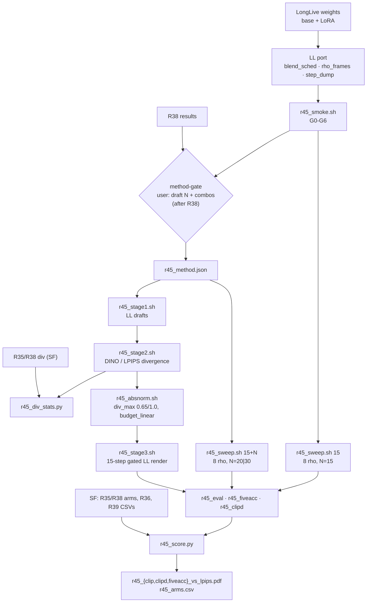

# R45: Routing Generalizes Beyond Self-Forcing

## Context

**The routing config is settled, inherited from R38's Self-Forcing decision (2026-10-07), not reselected on LongLive**: DINO · τ = 0.9 · draft N = 5 (`ll_dino_n5_tgt09`), matched N = 20. All 8 combos were still built ahead so the choice did not block the port; `evaluation/r45_method.json` records it.

Is the spatial divergence routing (R35 at draft N=15, R38 at N=5) a property of the Self-Forcing backbone, or does it transfer? R45 runs the same pipeline on **LongLive** (text + Visual Prompt). Each routed arm is read against a **same-backbone VP rho sweep**: the R36 analog at N=15 plus the R39 analog at the matched step count (15 + draft N). A user **method-gate** selects what runs. The N=15 sweep does not depend on that choice and starts right after the smoke test. The LongLive build in this repo is the stock StreamEdit code and has none of the routing machinery, so the port is the main build cost.

**Done when:** the selected LongLive combos and both LongLive sweeps are rendered and scored on all 419 pairs. The three two-panel Pareto figures place the SF and LL routing gains side by side. `r45_arms.csv` reports each arm's gain at matched bg LPIPS over its same-backbone curves. Answer: does routing sit above the same-backbone sweep curve on LL as it does on SF?

## Execution steps

| # | Step id | Type | What it does | Sets status |
|---|---------|------|--------------|-------------|
| — | *(prep)* | — | User downloads the weights; `/build-step` the other 12 `todos` (LL port, loader, selector, scripts) | `implemented` |
| 1 | `smoke` | sbatch | 2 clips, gates G0-G6 (SF regression, LL stock parity, rho plumbing, tgt0.9, VRAM, NFE, frame parity) | |
| 2 | `wait-smoke` | manual | All gates PASS | |
| 3 | `sweep15` | sbatch | LL VP rho sweep at N=15, array 0-7 | `running` |
| 4 | `method-gate` | manual | **User** picks draft N + combos → `r45_method.json` (after R38 is analyzed) | |
| 5 | `sweepM` | sbatch | LL VP rho sweep at N = 15 + draft N (20 or 30), array 0-7 | |
| 6 | `stage1` | sbatch | LL drafts for the selected (N, regime) runs | |
| 7 | `wait-stage1` | manual | 419 npz per run | |
| 8 | `stage2` | sbatch | Divergence npz per selected combo | |
| 9 | `wait-stage2` | manual | 419 npz per combo | |
| 10 | `divstats` | local | LL vs SF raw-divergence distribution + saturation | |
| 11 | `absnorm` | sbatch | CPU: absolute norm + rho fields (unchanged mapping) | |
| 12 | `stage3` | sbatch | Gated 15-step LL render per selected combo | |
| 13 | `wait-renders` | manual | Sweeps + routed arms complete | `finished` |
| 14 | `eval` | sbatch | 9-metric harness over the method table | |
| 15 | `fiveacc` | sbatch | `five_acc` over the method table: **one sequential, resumable job** (17 rows, ~30 min each, ~12 h), not an array | |
| 16 | `clipd` | sbatch | CLIP-directional, single job | |
| 17 | `wait-eval` | manual | CSV coverage, 0 errors | |
| 18 | `figures` | local | SF \| LL Pareto figures + `r45_arms.csv` | `analyzed` |

```
/run-step R45 smoke         /run-step R45 stage1        /run-step R45 stage3
/run-step R45 wait-smoke    /run-step R45 wait-stage1   /run-step R45 wait-renders
/run-step R45 sweep15       /run-step R45 stage2        /run-step R45 eval|fiveacc|clipd
/run-step R45 method-gate   /run-step R45 wait-stage2   /run-step R45 wait-eval
/run-step R45 sweepM        /run-step R45 divstats      /run-step R45 figures
                            /run-step R45 absnorm
```

## Decisions

| Question | Choice |
|---|---|
| Backbone config | **LongLive-native**: `configs/longlive_inference.yaml` (base + LoRA r256, `local_attn_size 12`, `sink_size 3`), VP as a **tripled first frame** (LL default), `fg_boost 2` (paper: ω=2 outside Ours(SF)), `flow_shift 1.0` pinned (overrides the config's 5.0 as SF runs do), seed 0, R7 anchors (`~/Data/dataggen/outputs/five_bench/anchors`) |
| Step count | **15** for the N=15 sweep and every stage-3 render. Paper: "15 steps for standard comparisons, 5 for long-video" applies to both backbones. The StreamGVE driver replaces LongLive's native 4-step grid with `np.arange(1000, 0, -1000/step)` |
| LL blend rate | Stock LL already follows **paper Eq. 4** (`r = 1 − t_{i−1}^ρ`, t_{i−1} = next timestep, since t_N = 1 → t_0 = 0): `causal_model.py:360` reads `shared_dict['current_timestep']`, which LL fills with `timestep_next` (`edit_causal_inference.py:317-318`). Same rate as SF, which keeps t_next under `current_timestep_next`. No change |
| Rho field | `budget_linear`, `tau_min 2`, `tau_max 50`, `--step 15`, `r31_rho_map.py` **unchanged**: its t_next grid is the grid LL's bridge uses. Per-token rate = `1 − t_next^ρ(f,p)` |
| Regimes | `zero` (unblended) and `tgt0.9` on the warped input t, as in R38. N=15 anchors t = 1.0, 0.933. N=5 anchors t = 1.0 |
| Normalisation | SF's absolute values: `div_min 0`, `div_max` **0.65 DINO / 1.0 LPIPS**, not recalibrated. They are scales on the perceptual metrics (settled 2026-09-24, `r31_div_abs.py:16-20`), not on the backbone, so both backbones use the **same d → m function**. Recalibrating on LL would tune the method to LL's results. `r45_div_stats.csv` logs the shift and saturation against SF. If LL's saturated fraction is > 2× SF's for a combo, flag it at `divstats` before stage 3 |
| Combo table (array idx) | 0 `ll_dino_n15_unblended` · 1 `ll_dino_n15_tgt09` · 2 `ll_lpips_n15_unblended` · 3 `ll_lpips_n15_tgt09` · 4 `ll_dino_n5_unblended` · 5 `ll_dino_n5_tgt09` · 6 `ll_lpips_n5_unblended` · 7 `ll_lpips_n5_tgt09`. Stage-1 runs: 0 `n15_unblended` · 1 `n15_tgt09` · 2 `n5_unblended` · 3 `n5_tgt09` |
| Open method | **Build all 8, gate the launch.** `evaluation/r45_method.json` (written at `method-gate` by `r45_select.py --set`) is the single source of truth. Every array is derived from it, and every GPU task refuses an unselected combo. Mixed-N selections need `--allow_mixed`. **Resolved 2026-10-07:** `ll_dino_n5_tgt09` only, draft N=5, matched N=20 -- inherited from R38's Self-Forcing decision, not reselected on LongLive |
| Sweeps | **Full** R36 grid ρ ∈ {2,3,4,6,8,10,20,50}. `sweep15` at N=15 runs right after smoke. `sweepM` at N = 15 + draft N (**20 if N=5, 30 if N=15**, the R39 single-pass logic) is gated on the method choice. Method names `ll_rho{R}_n{N}_vp` |
| SF reference | Same combos on SF: R35 arms (N=15) / R38 arms (N=5), R36 curve, R39 curve at the matched N. Read from their CSVs, nothing rerun |
| Fairness controls | Held identical across backbones: the 419-pair manifest, R7 anchors, seed 0, `flow_shift 1.0`, `--step 15` render, the ρ grid, `tau_min/tau_max`, `div_max`, the eval harness (stride 8, same FiVE-Acc VLM and CLIP-D code), plain per-clip mean, same selected combos and draft N (one `r45_method.json` drives both sides). Native per backbone (paper settings): `fg_boost` 4/2, VP single/tripled frame, checkpoint + LoRA. Native settings shift absolute scores, so **only within-backbone gains are compared across backbones, never absolute scores**. Checked by gates: per-clip frame counts equal SF's (G6 + `wait-renders`); LL NFE accounting for draft + render vs single pass at 15+N (G5), the counterpart of R39's SF check |
| Trigger matching | LL's `_find_phrase_token_indices_single` made **case-insensitive**, identical to SF's (user-requested 2026-10-06). Stock LL found no trigger tokens on 269/838 FiVE (prompt, trigger) pairs (32%), which leaves grounding and boosting off for that branch. This differs from the stock LL behaviour behind the paper's Ours(LL) numbers |
| Text encoder | LL's `WanTextEncoder` uses SF's `umt5_xxl_encoder_from_checkpoint` (fp16 on GPU, mmap; ~11 GB instead of ~23 GB fp32, which saturated memory), user-requested 2026-10-06. Both drivers then cast to bf16. The fp16 round trip flushes 4.7e-5 of the weights, so the text embeddings are **identical to SF's** and slightly different from stock LL's |
| Readout | Two-panel figures (SF \| LL), x = CLIP-target / `clip_d_prompt` / FiVE-Acc, y = `lpips_unedit_part`. **Routing gain** = x_arm − x_curve(y_arm), linear interpolation in y on the same-backbone curve. Reported against N=15 and against matched-N (**primary**: compute-fair). If y_arm is outside the curve's y-range, the gain is NaN with an `outside_range` flag, and the figure shows it. Plain per-clip mean over 419, never `_avg.csv` |
| Scope | All **419** pairs. Stages 1, 3 and the sweeps pass no `--cases_json`. Stage 2 uses `evaluation/r7_anchor_manifest.json` |
| Storage | `~/Data/dataggen/outputs/five_bench/r45_*`. ~15 GB per 419-clip render, ~17 GB per draft run. Typical (one N, 4 combos): sweeps 240 + drafts 34 + arms 60 ≈ **335 GB**. All 8 combos: ≈ 430 GB. R35 hit `Errno 122` once |
| Eval layout + queue cap | Selection = `ll_dino_n5_tgt09` → the eval table has **17 rows** (8 sweep N=15 + 8 sweep N=20 + 1 routed arm). `eval` = array 0-16 (17 entries), `clipd` = 1, **`fiveacc` = 1 sequential job** (user: fiveacc must be sequential) → **19 queue entries**, under the 30-job cap. An arrayed fiveacc would have been 17 + 17 + 1 = 35. All three can be submitted together |
| Output location | The R45 renders (and the R36/R39 reference frames) were moved to `/store/PERSO/skhairi/Outputs/five_bench/`, with symlinks under `~/Data/dataggen/outputs/five_bench/`. `/store` is mounted on only some nodes (gpu-gw, nodecpu12, node39; not nodemm06, node50), so a job on another node stops at its render-dir preflight. **2026-10-22: user restores `r45_sweep` and `r45_arms` to `/home`** (rsync to `$d.tmp`, file-count check, swap the symlink; the `/store` copy is kept). `r45_select.py framecheck` also reads `r36_rho_sweep/r36_rho2_vp` and `wait-renders` should be run from gpu-gw, or with that folder restored too |
| Compute | From R39 (~0.7 L40S GPU-h per step per 419 clips on SF): sweep15 ≈ 84 h, sweepM ≈ 112 h (N=20) / 168 h (N=30), drafts N × 0.7 h per run, stage 3 ≈ 10.5 h per combo. LL speed is measured in smoke (G4) and these numbers updated |
| Node / partition | `--partition=L40S`, `--exclude=node01,node51,node52,node57`, `PYTORCH_CUDA_ALLOC_CONF=expandable_segments:True` |
| Out of scope | Text-only (no-VP) LL arms (that is R44's axis); recalibrated `div_max`; tau grids; binary mapping (R41); FiVE-Bench-Correct anchors (R43) |

## Step commands

### smoke

```bash
sbatch slurm_scripts/five_bench/r45_smoke.sh          # 1 GPU, ~2 h
```

### wait-smoke

```bash
grep -h "GATE\|blender_rate per step\|peak_vram\|s/frame" logs/r45_smoke_*.out
```

### sweep15

```bash
sbatch --array=0-7 slurm_scripts/five_bench/r45_sweep.sh 15
```

### method-gate

```bash
# after R38 is analyzed; example: draft N=5, all four (metric, regime) combos
python evaluation/r45_select.py --set --draft_n 5 \
  --combos ll_dino_n5_unblended,ll_dino_n5_tgt09,ll_lpips_n5_unblended,ll_lpips_n5_tgt09
cat evaluation/r45_method.json
for s in stage1 stage2 stage3 sweepM eval; do echo "$s: $(python evaluation/r45_select.py $s)"; done
```

### sweepM

```bash
sbatch --array=0-7 slurm_scripts/five_bench/r45_sweep.sh $(python evaluation/r45_select.py sweepM)   # 20 or 30
```

### stage1

```bash
sbatch --array=$(python evaluation/r45_select.py stage1) slurm_scripts/five_bench/r45_stage1.sh
```

### wait-stage1

```bash
D=~/Data/dataggen/outputs/five_bench
for r in $(ls $D/r45_latents); do
  echo -n "$r: $(ls $D/r45_latents/$r/edit*/*.npz 2>/dev/null | wc -l) (expect 419) "
  for T in 1 2 3 4 5 6; do echo -n " e$T=$(ls $D/r45_latents/$r/edit$T/*.npz 2>/dev/null | wc -l)"; done; echo
done
grep -h "blender_rate per step" logs/r45_stage1_*.out | sort | uniq -c
```

### stage2

```bash
sbatch --array=$(python evaluation/r45_select.py stage2) slurm_scripts/five_bench/r45_stage2.sh
```

### wait-stage2

```bash
D=~/Data/dataggen/outputs/five_bench
for c in $(ls $D/r45_div); do echo "$c: $(ls $D/r45_div/$c/edit*/*.npz | wc -l) (expect 419)"; done
grep -c "\[ERROR\]" logs/r45_stage2_*.out
```

### divstats

```bash
python evaluation/r45_div_stats.py       # -> evaluation/csv/r45_div_stats.csv
```

### absnorm

```bash
sbatch slurm_scripts/five_bench/r45_absnorm.sh        # selected combos from r45_method.json, CPU node
```

### stage3

```bash
sbatch --array=$(python evaluation/r45_select.py stage3) slurm_scripts/five_bench/r45_stage3.sh
```

### wait-renders

```bash
D=~/Data/dataggen/outputs/five_bench
for d in $D/r45_sweep/n*/ll_* $D/r45_arms/r45_*; do
  n=$(ls -d $d/edit*/*/ $d/step14/edit*/*/ 2>/dev/null | grep -vc '_resize/$')
  bad=$(for f in $d/_manifest_edit*.csv $d/edit*/_manifest.csv; do [ -f "$f" ] && awk -F, 'NR>1 && $3!="ok"' "$f"; done | wc -l)
  echo "$(basename $d): $n dirs (expect 419), non-ok rows: $bad"
done
```

### eval

```bash
python evaluation/r45_select.py eval --table          # method table the array indexes
sbatch --array=$(python evaluation/r45_select.py eval) slurm_scripts/five_bench/r45_eval.sh
```

### fiveacc

```bash
sbatch slurm_scripts/five_bench/r45_fiveacc.sh          # ONE sequential job over every table row (resumable)
```

### clipd

```bash
sbatch slurm_scripts/five_bench/r45_clipd.sh          # single job, all methods in the table
```

### wait-eval

```bash
ls evaluation/csv/edit?_FiVE_r45_*_frame_stride8.csv | wc -l   # expect 2 x 6 x n_methods
grep -c "Error:\|out of memory" logs/r45_eval_*.metrics.log
wc -l evaluation/csv/r45_clip_directional.csv                  # expect n_methods*419 + 1
```

### figures

```bash
python evaluation/r45_score.py --all     # 3 PDFs + evaluation/csv/r45_arms.csv
```

## Pipeline



## Code to touch

**Weights** — downloaded by the user, no code. `/build-step` checks that `LongLive_StreamEdit/longlive_models/models/{longlive_base.pt,lora.pt}` and `LongLive_StreamEdit/wan_models/Wan2.1-T2V-1.3B` exist before anything that loads the model.

**`LongLive_StreamEdit/pipeline/utils.py`** — copy `_schedule_blend_rate` (SF `utils.py:24-78`), `build_rho_field_from_mask`, `blender_rate_from_rho` verbatim. `blender_rate_from_rho(rho, t)` is called with `t_next`, as in SF.

**`LongLive_StreamEdit/wan/modules/causal_model.py:360`** — replace the single line with SF's precedence (SF `causal_model.py:352-400`):
```python
if shared_dict.get('blend_off'):            blender_rate = 1.0
elif shared_dict.get('blender_rate') is not None:  blender_rate = shared_dict['blender_rate']   # blend_sched
elif <per-token rate installed in kv_cache>:      use it (rho field; raise if its complement is missing)
else:  blender_rate = 1 - shared_dict['current_timestep'] ** shared_dict['blend_power']          # stock LL
```
Keep the stock line as is: on LL the key `current_timestep` already holds t_next. `tgt<tau>` must take its `t_cur` from the loop variable (`current_timestep / 1000`), NOT from `shared_dict['current_timestep']`.

**`LongLive_StreamEdit/pipeline/edit_causal_inference.py`** — `inference(..., blend_sched=None, rho_frames=None, step_dump=None)` (named as SF's `rollout_inference` kwarg):
- `blend_sched`: per denoising index, `shared_dict['blender_rate'] = 1 - _schedule_blend_rate(blend_sched, i, n, t_cur=float(t)/1000)` (SF `:900-:910`), where `t` is the warped input timestep.
- `rho_frames` `[n_latent, 1560]`: for the block covering latent frames `[f0, f0+3)`, take `rho_frames[f0:f0+3]` (absolute index, VP frames excluded) and install `rate = 1 − t_next^ρ` and its complement on the current/prev KV entries via a port of `_inject_blend_rates_to_kv_cache` (SF `:1382`). Mutually exclusive with `blend_sched`, as in SF `:155-:175`.
- `step_dump`: append each step's x0 prediction for the block (SF R22 hook, `:292-:373`).

**`evaluation/backbone.py`** *(new, shared)* — `load_backbone(args) -> (pipeline, low_memory, device)`: `sf` = the current `run_fivebench.py` loader moved here unchanged; `ll` = `LongLive_StreamEdit/inference_edit_streamedit.py:40-147` (config, `timestep_shift = flow_shift`, arange grid, generator ckpt, LoRA via `configure_lora_for_model` + `peft.set_peft_model_state_dict`), bf16. `encode_vp(backbone, pipeline, src0, anchor)`: LL repeats each latent ×3 and sets `triple_first_frame=True`. `edit_call(backbone, pipeline, **kw)`: SF → `rollout_inference`, LL → `inference` (whole clip; LL's sink + local window bound the cache), same `(video, latents)` return incl. `step_dump`.

**`evaluation/run_fivebench.py`, `evaluation/r31_stage1.py`, `evaluation/r31_stage3.py`** — `--backbone {sf,ll}` (default `sf`); `--sf_root` / `--config_path` / `--checkpoint_path` defaults resolved from the backbone. All loading/VP/inference calls go through `evaluation/backbone.py`. Write `backbone` into the stage-1 npz and the manifest.

**`evaluation/r45_select.py`** *(new)* — `COMBOS` (8, order as in Decisions), `RUNS` (4). `--set --draft_n N --combos a,b,...` validates and writes `evaluation/r45_method.json` `{draft_n, combos, matched_n: 15+draft_n, set_at}`. Subcommands print: `stage1` → run indices of the selected combos; `stage2|stage3` → combo indices; `sweepM` → `matched_n`; `eval` → `0-{k-1}` over the method table (`--table` prints it: `ll_rho{R}_n15_vp` ×8, `ll_rho{R}_n{M}_vp` ×8, `r45_{combo}` per selection, each with its frame root); `check <id> <stage>` → exit 1 if not selected; `framecheck` → per-clip frame counts of every rendered method vs R36 `r36_rho2_vp`, exit 1 on any mismatch. Missing json ⇒ `SystemExit("run method-gate first")`.

**`slurm_scripts/five_bench/r45_smoke.sh`** *(new)* + **`evaluation/r45_smoke_parity.py`** *(new)* — 1 GPU, L40S, 3 h, clips `0001_bus`/edit1 and `0034_cows`/edit2, out root `~/Data/dataggen/outputs/five_bench/r45_smoke/`. Each gate prints `GATE<k> PASS|FAIL`:
- **G0** SF regression: `run_fivebench.py --backbone sf`, ρ=2, VP, on `0001_bus` == R36 `r36_rho2_vp` frames (sha256). Licenses the loader refactor.
- **G1** LL stock parity: stock LL `pipeline.inference(return_latents=True)` from a pristine `git worktree add $TMPDIR/ll_ref HEAD` vs the ported pipeline with every new kwarg `None`, two subprocesses, same seed/anchor, `torch.equal` on latents. The reference worktree gets the same text-encoder change (copy `wan/modules/t5.py`, `utils/wan_wrapper.py` and `inference_edit_streamedit.py` into it before the run; the checkpoint-load change is numerically a no-op but avoids the memory peak), so G1 isolates the routing port. Runs on **`0021_landing`/edit1 + `0025_baseball`/edit2** (90 frames), where stock and case-insensitive matching return the same non-empty trigger tokens on both prompts. `0001_bus` and `0034_cows` can't be used: stock finds no source-trigger tokens there.
- **G2** rho plumbing: uniform field ρ≡2 == scalar `blend_power 2` on LL (latents equal).
- **G3** `tgt0.9` == `first2` at N=15 on LL. Echoed vectors: N=15 `[0,0,1×13]`, N=5 `[0,1,1,1,1]`.
- **G4** longest FiVE clip at N=30 completes on L40S; log `peak_vram` (GB) and `s/frame`.
- **G5** NFE accounting on LL: count generator forwards (hook on `generator.forward`) for a draft at N=5 and N=15, the N=15 render, and single passes at N=20 and N=30, all on `0001_bus`. Log batch-2 vs batch-1 calls. PASS if draft(N) + render(15) − single(15+N) equals only the draft's clean-context forwards, as R39 found for SF.
- **G6** frame parity: per clip, the number of LL output frames == R36 `r36_rho2_vp` (SF) frames, and both equal `find_closest_num_frame(len(src))`.

**`slurm_scripts/five_bench/r45_sweep.sh`** *(new)* — copy of `r36_infer.sh`. `N=$1` (required, ∈ {15,20,30}), `METHOD=ll_rho${R}_n${N}_vp`, `OUT_ROOT=$FIVE_ROOT/r45_sweep/n$N`, `run_fivebench.py --backbone ll --step $N --fg_boost_factor 2`. Same skip/guard logic. `--time` scaled by N (20 h at 15).

**`slurm_scripts/five_bench/r45_stage1.sh`, `r45_stage2.sh`, `r45_absnorm.sh`, `r45_stage3.sh`** *(new)* — copies of the `r38_*` scripts. First line after env setup: `python evaluation/r45_select.py check $SLURM_ARRAY_TASK_ID <stage> || exit 1`. Stage 1: `RUNS`/`SCHEDS`/`NSTEPS` tables over the 4 runs, `--backbone ll --fg_boost_factor 2 --step $N --dump_steps $((N-1)) --measure_index $((N-1))`. Stage 2: combo → (arm, run, N) case table, `TARGET_ROOT=r45_stage1/$RUN/step$(printf %02d $((N-1)))`. Absnorm: reads the selected combos from the json, `div_max` by prefix, `r31_rho_map.py --mapping budget_linear --tau_min 2 --tau_max 50 --step 15` (as R38). Stage 3: `r31_stage3.py --backbone ll --fg_boost_factor 2 --step 15 --dump_steps 14`, per-file manifest guard.

**`slurm_scripts/five_bench/r45_eval.sh`, `r45_fiveacc.sh`, `r45_clipd.sh`** *(new)* — R38's three. `r45_eval.sh`: array id indexes `r45_select.py eval --table`. **`r45_fiveacc.sh`: ONE sequential job looping over every table row** (Qwen2.5-VL-7B, ~30 min per method; skips a method whose five_acc CSVs are already complete and valid, so a timed-out job is resubmitted as-is; continues past a failed row and exits non-zero at the end; `--array=i` / positional row ids rerun single rows). Stems `r45_{method}` / `r45_fiveacc_{method}`. `r45_clipd.sh` passes one `--methods` entry per table row → `evaluation/csv/r45_clip_directional.csv`.

**`evaluation/r45_div_stats.py`** *(new)* — import the stats helpers from `r38_div_stats.py`. Rows for the selected `r45_div/{combo}` plus the matching SF combos (`r35_div` N=15, `r38_div` N=5), with `backbone` and `N` columns.

**`evaluation/r45_score.py`** *(new)* — import `clip_index`, `load_harness`, `load_clipd`, `_check_coverage` from `r35_score.py`. Per x-metric, one figure with two panels sharing axes. **SF**: R36 curve (N=15), R39 curve at `matched_n`, SF arms for the selected (metric, regime) at `draft_n` (R35 if 15, R38 if 5). **LL**: `sweep15` curve, `sweepM` curve, R45 arms. Hue = metric, marker = regime, curves gray (solid N=15, dashed matched). `evaluation/csv/r45_arms.csv`: backbone, combo, N, n_clips, three x metrics, `lpips_unedit_part`, `gain_vs_n15`, `gain_vs_matched` (interpolated per x-metric). Hard-fail on missing CSVs for any selected combo. Adds an `outside_range` column.
