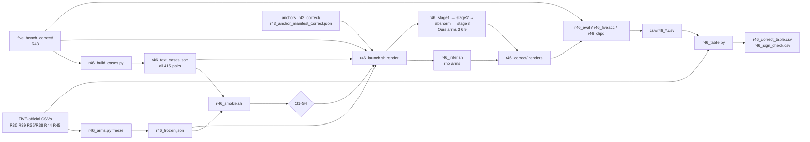

# R46: FiVE-Bench-Correct StreamEdit Inference

## Context
Run the StreamEdit arms on FiVE-Bench-Correct (R43: 415 pairs) with **every setting frozen from FiVE official**, so the Correct table checks the paper's conclusions instead of retuning them. FlowDirector arms are deferred until FlowDirector is implemented. The task waits for R43, R44, R45 and the routing-config decision, then launches all 12 arms at once.

**Done when:** all 12 arms are rendered on the Correct pairs and scored (9 metrics, FiVE-Acc, CLIP-D); `evaluation/csv/r46_correct_table.csv` holds the plain per-clip means; `evaluation/csv/r46_sign_check.csv` compares within-host rankings and Ours − baseline gains with FiVE official, and every sign flip is reported.

## Execution steps

| # | step id | type | waits for | sets status |
|---|---|---|---|---|
| — | *(prep)* arms-lib · cases-script · correct-flags · smoke-script · infer-script · ours-scripts · launch-script · eval-scripts · table-script | todos | — | `implemented` |
| 1 | `gate-deps` | manual | — | — |
| 2 | `freeze` | manual (user gives N_d + combo) | gate-deps | — |
| 3 | `build-cases` | local | freeze | — |
| 4 | `smoke` | sbatch | build-cases | — |
| 5 | `wait-smoke` | manual | smoke | — |
| 6 | `launch` | local (submits all render jobs) | wait-smoke | `running` |
| 7 | `wait-render` | manual | launch | `finished` |
| 8 | `launch-eval` | local (submits eval jobs) | wait-render | — |
| 9 | `wait-eval` | manual | launch-eval | — |
| 10 | `table` | local | wait-eval | — |
| 11 | `inspect` | manual | table | `analyzed` |

```
/build-step smoke R46
/build-step launch R46
/build-step launch-eval R46
/build-step table R46
/run-step R46 gate-deps
/run-step R46 freeze
/run-step R46 build-cases
/run-step R46 smoke
/run-step R46 wait-smoke
/run-step R46 launch
/run-step R46 wait-render
/run-step R46 launch-eval
/run-step R46 wait-eval
/run-step R46 table
/run-step R46 inspect
```

## Decisions

| Decision | Choice |
|---|---|
| Arms (idx · method) | **SF·TEXT** 1 `r46_sf_text_rho2_n15` · 2 `r46_sf_text_rho2_n{M}` · 3 `r46_sf_text_ours` · 10 `r46_sf_text_rhostar_n{M}`; **SF·VP** 4 `r46_sf_vp_rho2_n15` · 5 `r46_sf_vp_rho2_n{M}` · 6 `r46_sf_vp_ours` · 11 `r46_sf_vp_rhostar_n{M}`; **LL·VP** 7 `r46_ll_vp_rho2_n15` · 8 `r46_ll_vp_rho2_n{M}` · 9 `r46_ll_vp_ours` · 12 `r46_ll_vp_rhostar_n{M}`. M = 15 + N_d |
| Staging | All 12 arms in **one launch**, after every dependency is done (user choice) |
| Frozen settings | One file, `evaluation/r46_frozen.json`, written once at `freeze`: draft N_d, routing combo (metric {DINO, LPIPS} × regime {unblended, τ = 0.9}), ρ* per host. The same combo for all three Ours arms; never reselected on Correct or on LongLive |
| Best global ρ* rule | Per host, on FiVE official: the grid ρ ∈ {2,3,4,6,8,10,20,50} of the **matched-NFE** sweep (SF·VP: R39 at N=M; SF·TEXT: R44's matched sweep; LL·VP: R45 sweepM) whose plain per-clip mean `lpips_unedit_part` is closest to that host's Ours arm on FiVE official. Rendered at N = M. If ρ* = 2, the arm is a link to the matched-NFE ρ=2 arm, not a second render |
| Official counterparts | 1 `r44_n15_rho2_novp` · 2 `r44_n{M}_rho2_novp` · 3 `r44_{combo}` · 10 `r44_n{M}_rho{ρ*}_novp` · 4 `r36_rho2_vp` · 5 `r39_n{M}_rho2_vp` · 6 R35 (N_d=15) / R38 (N_d=5) arm of the combo · 11 `r39_n{M}_rho{ρ*}_vp` · 7 `ll_rho2_n15_vp` · 8 `ll_rho2_n{M}_vp` · 9 `r45_ll_{combo}` · 12 `ll_rho{ρ*}_n{M}_vp`. Used for the sign check only |
| Text-only render scope | **Every Correct pair** (user, 2026-10-07): after R43 most pairs changed in a field the method reads (objects re-spanned on most of types 3–4, edit5/edit6 object conventions, multi-edit pairs reduced to their masked edit), so partial reuse would save little and add a reuse/sha256 path. All 12 arms render all 415 pairs; no FiVE-official render is reused |
| VP render scope | Every Correct pair: every anchor in `anchors_r43_correct/` is new. Ours VP arms re-run draft + render |
| Inputs | `--edit_json_dir evaluation/five_bench_correct` for every render, draft and divergence call; VP anchors `~/Data/dataggen/outputs/five_bench/anchors_r43_correct`; VP divergence cases `evaluation/r43_anchor_manifest_correct.json`; text-only cases `evaluation/r46_text_cases.json` (all 415). Excluded pairs (edit4/0097, edit1/0082, edit1/0023, edit3/0051) are absent from the Correct files and so from every arm |
| Backbone settings | As on FiVE official: SF `fg_boost 4`, single VP frame; LL `fg_boost 2`, tripled VP frame, base + LoRA (R45). Both: `flow_shift 1.0`, seed 0, render `--step 15` for Ours, `div_max` 0.65 DINO / 1.0 LPIPS, `tau_min 2` / `tau_max 50`, `budget_linear` |
| Scoring | `evaluate.py` 9 metrics (stride 8, as R36) + FiVE-Acc with `--annotation_mapping_files evaluation/five_bench_correct/edit{1..6}_FiVE.json`; CLIP-D via `r33_clip_directional.py --edit_json_dir evaluation/five_bench_correct`. Plain per-clip mean, never `_avg.csv` |
| Sign check | Per host and per metric (CLIP-T, CLIP-D, FiVE-Acc, bg LPIPS, PSNR, SSIM): arm ranking on Correct vs FiVE official; Ours − matched ρ=2 and Ours − ρ* on both benchmarks; `sign_agrees` flag. Absolute scores are never compared across benchmarks |
| Storage | `~/Data/dataggen/outputs/five_bench/r46_correct/` (renders, drafts under `r46_correct/_stage1`, fields under `_div`, `_rho`). About 12 full renders (8 VP + 4 text-only, fewer if ρ* = 2 links an arm) + 3 drafts at ~15–17 GB each ≈ 200–230 GB |
| Compute | SF VP N=15 ≈ 12 h per arm (R36), N=20 ≈ 14 h, N=30 ≈ 19 h (R39); SF text-only arms are now full renders too (≈ the VP times); LongLive per R45's measured speed (G4). One array task per arm, L40S, `--time=24:00:00`, `--mem=64G`, `--exclude=node01,node51,node52,node57` |
| Out of scope | FlowDirector arms; text-only LongLive; re-choosing any setting on Correct; per-edit-type breakdown beyond what `r46_table.py` prints |

## Step commands

### gate-deps
```bash
grep -E '^\| \*\*R4[345]\*\*' daily.md | grep -o -E '`(planned|implemented|running|finished|analyzed)`'
ls ~/Data/dataggen/outputs/five_bench/anchors_r43_correct/edit*/ | wc -l
ls ~/Data/dataggen/outputs/five_bench/r44_rho_sweep/ ~/Data/dataggen/outputs/five_bench/r45_sweep/
```

### freeze
```bash
python evaluation/r46_arms.py freeze --draft_n <N> --combo <combo>
python evaluation/r46_arms.py table
```

### build-cases
```bash
python evaluation/r46_build_cases.py \
  --data_root ~/Data/FiVE-Fine-Grained-Video-Editing-Benchmark \
  --correct_dir evaluation/five_bench_correct \
  --out_dir evaluation
```

### smoke
```bash
sbatch slurm_scripts/five_bench/r46_smoke.sh
```

### wait-smoke
```bash
grep -E 'GATE[0-9] (PASS|FAIL)' logs/r46_smoke_*.out
tail -n 2 logs/r46_smoke_*.out
```

### launch
```bash
bash slurm_scripts/five_bench/r46_launch.sh render
```

### wait-render
```bash
tail -n 2 logs/r46_infer_*.out logs/r46_stage3_*.out
grep -l 'failures: [1-9]' logs/r46_infer_*.out logs/r46_stage*_*.out
python evaluation/r46_arms.py framecheck
```

### launch-eval
```bash
bash slurm_scripts/five_bench/r46_launch.sh eval
```

### wait-eval
```bash
tail -n 2 logs/r46_eval_*.out logs/r46_fiveacc_*.out logs/r46_clipd_*.out
ls evaluation/csv/r46_*.csv
```

### table
```bash
python evaluation/r46_table.py \
  --frozen evaluation/r46_frozen.json \
  --out_table evaluation/csv/r46_correct_table.csv \
  --out_sign evaluation/csv/r46_sign_check.csv
```

### inspect
```bash
column -s, -t < evaluation/csv/r46_correct_table.csv
column -s, -t < evaluation/csv/r46_sign_check.csv
```

## Pipeline



## Code to touch

| File | Change |
|---|---|
| `evaluation/r46_arms.py` | **New.** `ARMS` = the 12 rows of the Decisions table (idx, host sf/ll, cond text/vp, kind rho2_n15 / rho2_matched / ours / rhostar, method template, official counterpart template). `freeze`: loads the FiVE-official per-clip CSVs for each host's matched-NFE sweep and Ours arm, computes per-ρ plain per-clip mean `lpips_unedit_part`, picks ρ* = argmin \|L(ρ) − L(Ours)\| (ties → smaller ρ), writes `r46_frozen.json` and prints the per-ρ table it used. `table`, `get <idx> <field>`, `render-array` (ρ-type arms with a distinct (host, cond, N, ρ); duplicates map to the arm they copy), `ours-array` (→ `0-2`), `eval-array` (→ `0-11`), `framecheck` (per-clip frame count of every arm vs R36 `r36_rho2_vp`, exit 1 on mismatch). |
| `evaluation/r46_build_cases.py` | **New.** As in todo `cases-script`. Asserts every Correct pair exists in the released files and the per-type totals match `r43_anchor_manifest_correct.json`. |
| `evaluation/r31_stage1.py`, `evaluation/r31_stage3.py`, `evaluation/r31_divergence.py` | Add `--edit_json_dir` (default `data_root/edit_prompt`), used wherever `edit{T}_FiVE.json` is read. |
| `slurm_scripts/five_bench/r46_smoke.sh` + `evaluation/r46_check_smoke.py` | **New.** L40S, 4 h, out `r46_smoke/`. **G1** prompt pickup: text-only ρ=2 N=15 on 1 CHANGED pair through `--edit_json_dir five_bench_correct` differs from R44 `r44_n15_rho2_novp`. **G2** anchor pickup: SF VP ρ=2 N=15 on 1 pair differs from R36 `r36_rho2_vp`, and the log names `anchors_r43_correct`. **G3** LongLive path: LL VP ρ=2 N=15 on 1 pair completes, frame count == SF. **G4** Ours chain: SF VP stage 1 → 2 → absnorm → 3 on 1 pair with the frozen combo completes, field npz present. |
| `slurm_scripts/five_bench/r46_infer.sh` | **New**, clone of `r39_infer.sh` (as in todo `infer-script`). Header echoes arm idx, method, host, cond, N, ρ, anchor root, edit-json dir. |
| `slurm_scripts/five_bench/r46_stage1.sh`, `r46_stage2.sh`, `r46_absnorm.sh`, `r46_stage3.sh` | **New**, clones of `r38_*` (SF) / `r45_*` (LL) selecting host by array index; stage 1 `--step N_d --dump_steps N_d−1 --measure_index N_d−1` with the combo's regime (`--blend_sched zero` or `tgt0.9`); stage 3 `--step 15 --dump_steps 14`. |
| `slurm_scripts/five_bench/r46_launch.sh` | **New**, as in todo `launch-script`. Refuses to run if `r46_frozen.json` or the case files are missing. |
| `slurm_scripts/five_bench/r46_eval.sh`, `r46_fiveacc.sh`, `r46_clipd.sh` | **New**, clones of `r38_eval.sh` / `r38_fiveacc.sh` / `r38_clipd.sh` with the Correct annotation files and the 12-arm table. |
| `evaluation/r46_table.py` | **New**, as in todo `table-script`. |
