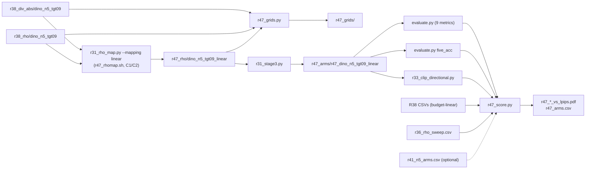

# R47: Linear vs Budget-Linear Rho

## Context

The divergence routing maps each token's normalised divergence `m` to a release exponent with a **budget-linear** map, which interpolates the source budget `A_disc` rather than the exponent. Because `A_disc(2)` is ~140x `A_disc(50)`, tokens only get released when m is close to 1. Add-object edits suffer most: 0011_lucia's dog gets a median tau of 8.7 and fails FiVE-Acc on every routing arm, while uniform rho >= 8 passes. R47 swaps in the naive **linear-in-the-exponent** map with the same endpoints, keeping everything upstream fixed. Measured offline, linear releases the dog (median tau 38.6) but also the background (bench median tau 2.1 -> 4.5, total source kept 0.879 -> 0.469 of the tau=2 level). The question is therefore whether linear lands above R36's VP curve at its own preservation level, not whether it edits more.

**Done when:** the linear arm is rendered and scored on all 419 pairs, the 419 grid pages exist, and the Pareto figures place it next to R38's budget-linear `dino_n5_tgt09` point and R36's VP rho curve.

## Execution steps

| # | Step id | Type | What it does | Sets status |
|---|---------|------|--------------|-------------|
| — | *(prep)* | — | `/build-step` the 6 `todos` | `implemented` |
| 1 | `rhomap` | local | Linear rho tree from R38's field + CPU checks C1/C2 | |
| 2 | `grids` | local | 419 pages: m / budget-linear rho / linear rho | |
| 3 | `stage3` | sbatch | Render the one linear arm, 419 pairs | `running` |
| 4 | `wait-stage3` | manual | 419 step14 dirs, 0 non-ok rows | `finished` |
| 5 | `eval` | sbatch | 9-metric harness | |
| 6 | `fiveacc` | sbatch | FiVE-Acc | |
| 7 | `clipd` | sbatch | CLIP-D | |
| 8 | `wait-eval` | manual | All CSVs complete | |
| 9 | `figures` | local | Pareto figures + `r47_arms.csv` | `analyzed` |

```
/run-step R47 rhomap   /run-step R47 grids     /run-step R47 stage3
/run-step R47 eval     /run-step R47 fiveacc   /run-step R47 clipd
/run-step R47 figures
```

## Decisions

| Topic | Decision |
|-------|----------|
| Question tested | Budget-linear vs linear-in-exponent m -> rho, with draft, divergence network, regime and normalisation held fixed |
| Config | Final method only: DINO, tau = 0.9 regime, N=5 draft (`dino_n5_tgt09`, R38). One arm |
| Mapping | `rho = 2 + 48*m` (`--mapping linear --tau_min 2 --tau_max 50`); same endpoints as budget-linear and R41's binary map. tau_min = 0 is out of scope |
| Inputs reused | `r38_div_abs/dino_n5_tgt09` (field, div_max 0.65), `r38_rho/dino_n5_tgt09` (budget-linear rho), R38's CSVs `r38_dino_n5_tgt09`, `r38_fiveacc_dino_n5_tgt09`, `r38_clip_directional.csv`; no new draft or divergence pass |
| Continuous reference | R38's stored budget-linear arm, not re-rendered |
| Checks | CPU only (C1 budget-linear regression vs `r38_rho`, C2 linear formula). No GPU smoke / render-parity gate (user decision): `Self-Forcing_StreamEdit/` is unmodified since R38; the only change on the render path is R45's `--backbone` refactor of `r31_stage3.py` (default `sf`), covered by R45 smoke G0 (sf == R36 `r36_rho2_vp`, sha256) |
| Naming | Arm `dino_n5_tgt09_linear`; rho `r47_rho/dino_n5_tgt09_linear`; renders `r47_arms/r47_dino_n5_tgt09_linear`; stems `r47_dino_n5_tgt09_linear`, `r47_fiveacc_dino_n5_tgt09_linear`; `r47_clip_directional.csv` |
| Scripts | Standalone `r47_*`, copied from R41's and reduced to one arm; R41 untouched |
| Render config | As R38 stage 3: vp, anchors, `--step 15`, `flow_shift 1.0`, `fg_boost 4`, `blend_power 2`, chunk 21, seed 0, `--dump_steps 14`, L40S |
| Nodes | GPU scripts `--exclude=node52` only |
| Evaluation | R35's three jobs, same metric lists: `eval` (9 metrics), `fiveacc`, `clipd` |
| Aggregation | Plain per-clip mean over 419, never `{stem}_avg.csv`; x = alignment, y = `lpips_unedit_part` |
| Figures | `r38_score.py`'s x-metric set; R36 curve + R38 budget-linear point + R47 linear point; R41 binary theta-curve overlaid only if `r41_n5_arms.csv` exists |
| Grids | All 419 pages, rows m / budget-linear rho / linear rho, 8 frames, `evaluation/figures/r47_grids/` |
| Disk | ~15 GB (one arm, measured on R35) |
| Out of scope | Other combos, N=15, tau_min sweep, div_max change, log-budget mapping, per-edit-type table, source-budget stats CSV |

## Step commands

### rhomap
```bash
bash slurm_scripts/five_bench/r47_rhomap.sh
```

### grids
```bash
python evaluation/r47_grids.py --cases evaluation/r7_anchor_manifest.json
```

### stage3
```bash
sbatch slurm_scripts/five_bench/r47_stage3.sh
```

### wait-stage3
```bash
grep -E 'step14 dirs total|non-ok manifest|failures:' logs/r47_stage3_<job_id>.out
grep -c Traceback logs/r47_stage3_<job_id>.err
```

### eval
```bash
sbatch slurm_scripts/five_bench/r47_eval.sh
```

### fiveacc
```bash
sbatch slurm_scripts/five_bench/r47_fiveacc.sh
```

### clipd
```bash
sbatch slurm_scripts/five_bench/r47_clipd.sh
```

### wait-eval
```bash
grep -h 'OK\|FAILED' logs/r47_eval_<job_id>.out logs/r47_fiveacc_<job_id>.out logs/r47_clipd_<job_id>.out
ls evaluation/csv/edit*_FiVE_r47_*dino_n5_tgt09_linear_frame_stride8.csv | wc -l   # expect 12
```

### figures
```bash
python evaluation/r47_score.py --all
```

## Pipeline



## Code to touch

| File | Change |
|------|--------|
| `evaluation/r31_rho_map.py` | Add `linear_tau(m, tau_min, tau_max)` and `--mapping linear`; docstring section like `binary`; budget_linear / binary unchanged |
| `slurm_scripts/five_bench/r47_rhomap.sh` | **new** — local bash; preflight, rho build, checks C1/C2, 419 guard |
| `evaluation/r47_grids.py` | **new** — 3 rows per page, helpers imported from `r31_stage3_grids.py` |
| `slurm_scripts/five_bench/r47_stage3.sh` | **new** — `r41_stage3.sh` reduced to one arm, no array, `--exclude=node52` |
| `slurm_scripts/five_bench/r47_eval.sh` | **new** — `r41_eval.sh` reduced to one arm |
| `slurm_scripts/five_bench/r47_fiveacc.sh` | **new** — `r41_fiveacc.sh` reduced to one arm |
| `slurm_scripts/five_bench/r47_clipd.sh` | **new** — `r41_clipd.sh` reduced to one method |
| `evaluation/r47_score.py` | **new** — loaders from `r35_score`; R36 + R38 + R47 (+ optional R41) points |

`linear_tau` sketch:

```python
def linear_tau(m: np.ndarray, tau_min: float, tau_max: float) -> np.ndarray:
    if tau_max <= tau_min:
        raise ValueError(f"tau_max must exceed tau_min, got {tau_min} / {tau_max}")
    m = np.asarray(m, dtype=np.float64)
    if np.isnan(m).any():
        raise ValueError("m contains NaN -- refusing to route a gate on it")
    return tau_min + (tau_max - tau_min) * np.clip(m, 0.0, 1.0)
```
