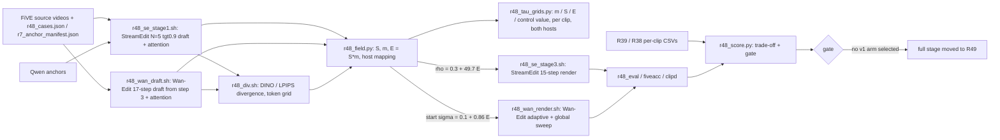

# R48: Common Adaptive Procedure on Two Hosts

## Context

Goal: run StreamEdit and Wan-Edit on FiVE-Bench with **one** adaptive procedure, so "draft-derived per-token edit control" is shown on two training-free editors with different release mechanisms (StreamEdit's Q/K-blend exponent ρ, Wan-Edit's FlowEdit start step). Stage 1: a short draft at σ ≈ 0.95 records cross-attention. Stage 2: selectivity-weighted Eq. 7 support S with soft decay, times the clipped draft–source divergence, mapped linearly to each host's knob. Stage 3: adaptive renders.

Background from the Wan-Edit pilot (8 edits, 2026-10-12/13): raw divergence is high on the background of Wan-Edit drafts; S removes it (outside median 0.00); at absolute div_max D varies inside S; a later draft start (σ 0.90) loses colour and object-swap edits, so the draft starts at σ 0.958.

Done when: subset (18 cases) scored on both hosts with the gate table written; if the gate passes, the selected arms scored on all 419 pairs against each host's matched-NFE global curve.

## Execution steps

| # | Step id | Type | Waits for | Sets status |
|---|---|---|---|---|
| 0 | *(prep)* todos `se-attn-hook`, `wan-start-map`, `wan-draft-script`, `wan-render-scripts`, `field`, `tau-grids-script`, `div-wan-fallback`, `slurm-smoke`, `slurm-se-stage1`, `slurm-wan-draft`, `slurm-div`, `slurm-se-stage3`, `slurm-wan-render`, `slurm-rest`, `score` | /build-step | — | implemented |
| 1 | `smoke` | sbatch | — | — |
| 2 | `wait-smoke` | manual | smoke | — |
| 3 | `se-stage1` | sbatch | wait-smoke | running |
| 4 | `wan-draft` | sbatch | wait-smoke | — |
| 4b | `wan-baselines` | sbatch | wait-smoke | — |
| 4c | `wait-wan-baselines` | manual | wan-baselines | — |
| 5 | `wait-drafts` | manual | se-stage1, wan-draft | — |
| 6 | `div` | sbatch | wait-drafts | — |
| 7 | `field` | local | div | — |
| 7b | `tau-grids` | local | field | — |
| 8 | `se-stage3` | sbatch | field | — |
| 9 | `wan-render` | sbatch | field | — |
| 10 | `wait-render` | manual | se-stage3, wan-render, wait-wan-baselines | finished |
| 11 | `eval` | sbatch ×3 | wait-render | — |
| 12 | `wait-eval` | manual | eval | — |
| 13 | `gate` | local | wait-eval | analyzed |
| 14 | `gate-decision` | manual | gate | — |
| — | *(full stage: moved to R49 on 2026-10-16)* | — | — | — |

Invoke: `/run-step R48 smoke`, then `/run-step R48` for each next pending step.

## Decisions

| Item | Choice |
|---|---|
| Hosts | StreamEdit VP+SF (Qwen anchors, headline config) · Wan-Edit (FlowEdit, Wan2.1-T2V-1.3B, text only, 41 frames, 832×480, `--seed_noise`, base_seed 0, n_avg 1) |
| Draft, StreamEdit | N = 5, `--blend_sched tgt0.9` (≡ σ 0.95 on t = 1, .8, .6, .4, .2), all other flags as `r38_stage1.sh`; must be bit-identical to `r38_latents/n5_tgt09` |
| Draft, Wan-Edit | 17-step grid (shift 5), start step 3 (σ 0.958), 14 active steps |
| Attention recorded | src branch → `src_word` tokens, trg branch → `trg_word` tokens (`evaluation/r48_cases.json` / `r7_anchor_manifest.json`), per token, mean over heads and **the first 20 blocks** (StreamEdit's own `mask_layers = range(20)`; on the bus clip 20 blocks beat all 30: StreamEdit Eq. 7 IoU 0.62 vs 0.51, Wan-Edit 0.85 vs 0.84; the last blocks dilute localisation), plus total mass on real prompt tokens; token indices via `find_phrase_token_indices` (StreamEdit utils) on both hosts |
| Attention window | draft calls with σ ∈ [0.55, 0.9]: StreamEdit t = 0.8, 0.6 (2 calls); Wan-Edit 17-grid steps 7–13 (σ 0.876 … 0.605; step 6 = 0.901 excluded) |
| Support S | per branch: w_p = 1 − H(A_p/ΣA_p)/log N; A_T = Σ w_p A_p / Σ w_p; Eq. 7 M = H(A_T − (prompt mass − Σ_p A_p)/(n_prompt − n_phrase)); union M_src ∪ M_trg; per latent frame S = 1 on M, exp(−0.5·d) outside (d = Euclidean distance in tokens), 0 if the frame's M is empty |
| Divergence | draft vs source, R31 token grid, temporal mean per VAE group; absolute m = clip(d, 0, div_max)/div_max, div_min = 0 |
| div_max | DINO 0.55, LPIPS 0.75 — rule: ≈ 91st percentile of in-object d on the StreamEdit draft (dino/lpips_n5_tgt09, 419 edits, FiVE masks; diagnostic only, fixed before any R48 render) |
| Field | E = S · m |
| Mapping, StreamEdit | ρ = 0.3 + 49.7·E (linear); ρ_min = 0.3 instead of 0, because ρ = 0 never releases (pins tokens to source K/Q to t = 0, a degenerate oracle setting per `blender_rate_from_rho`) |
| Floor matching rule | hosts are compared by the release noise level t_½ = 0.5^(1/ρ), where StreamEdit's source weight t^ρ falls to 0.5; Wan-Edit's floor σ 0.1 ↔ ρ = ln 0.5 / ln 0.1 = 0.30, so E → 0 means "released at σ 0.1" on both hosts; the top end is not matched (ρ 50 ↔ t_½ 0.986 vs Wan σ 0.95): each host keeps its tested maximum |
| Mapping, Wan-Edit | start σ = 0.1 + 0.86·E (ceiling fixed to 0.96) → nearest step on the final 50-step grid (σ 0.958 = step 9 … σ 0.093 = step 49); E = 1 lands exactly on step 9, the step already used throughout this project as the high-editability reference (the oracle/pilot `g9` drafts); V^Δ zeroed before a token's start; loop runs from step 9 |
| Arms (both hosts) | C4 `dino_SD`, C4 `lpips_SD`, C2 `dino_D` (E = m, no S), C3 `S` (E = S) |
| NFE | StreamEdit 5 + 15 = 20; Wan-Edit 14 + 41 = 55 active steps worst case (×4 calls) — draft starts step 3 (σ 0.958), final ceiling is now step 9 (σ 0.958), the SAME noise level on both schedules; this is still an assumed worst case (some token hits E = 1 in every clip), not yet measured from data |
| Baselines, StreamEdit | R39 global-ρ sweep at 20 NFE and R38 `dino_n5_tgt09` (no S, budget-linear, 0.65) — existing per-clip CSVs filtered to the subset, no re-render |
| Baselines, Wan-Edit | two curves over the SAME σ_g grid {0.95, 0.92, 0.85, 0.75, 0.6, 0.4}: **native** (`sample_steps`=50 fixed, skip = round(50·(1−t)), t from the shift inversion; NFE varies per point; σ_g=0.92 lands on skip=15 exactly, recovering the official default -- no separate default point) and **matched** (`sample_steps` chosen so exactly 55 steps are active, restricted to σ_g ∈ {0.95, 0.92, 0.85} → N = 69/79/104, ≤ ×2.1 the native budget; 0.75/0.6/0.4 are covered by the native curve only -- matching 55 active steps there needs N ≥ 147) |
| Subset | `evaluation/r48_cases.json`, 18 edits (types 1:1, 2:9, 3:2, 4:2, 5:3, 6:1) = `evaluation/cases.json` minus 0034_cows, 0091_A_hawk, 0068_planes-water, 0040_tennis (all type 2) |
| Gate (pre-registered) | per host, on the subset, read from `r48_*_deltas.csv` (R39-style: each arm's FiVE-Acc/CLIP-D minus the host curve linearly interpolated at the arm's own bg LPIPS; flagged `outside_range`/`nonmonotone`/`no_curve` same as R39, never extrapolated): a C4 arm's delta is not positive on the primary metrics (alignment = FiVE-Acc, CLIP-D), C4's delta ≥ C2's delta with no FiVE-Acc loss (S helps), C4's delta ≥ C3's delta with no bg loss (D helps); user writes passing (host, arm) pairs to `evaluation/r48_selected_arms.txt` |
| Short videos (Wan-Edit) | 7 of the 100 benchmark videos have fewer than 41 source frames (25, 34, 35 x3, 38, 40): Wan-Edit reads min(41, n) frames and renders 4*((n-1)//4)+1 of them (33 / 37 / 25 for these), i.e. 28 of the 419 pairs (edit types 1-4; none in the 18-clip subset). Every Wan-Edit script therefore uses the clip's own frame count instead of a fixed 41 / 11 latent frames: the render skip-check and assertion (`r48_wan_common.expected_frames`), the draft's attention grid, the divergence (`r31_divergence.py --n_latent_frames 0` = per clip from the draft frames, used by `r48_div.sh`), and the completeness check `r48_units.py --missing`. Verified on 0072_dog-agility (25 frames) and 0015_car-shadow (40 -> 37). |
| Wan-Edit baselines | the 9 global configs depend on neither the drafts, the field nor the gate, so they start right after `wait-smoke`: `wan-baselines` (the 18 subset clips, ~7 GPU-h, ~1.2 h wall-clock, feeds the subset gate) and `wan-baselines-full` (all 419 pairs, ~155 GPU-h), which can run at the same time. Each config has its OWN directory per mode (`{config}_subset`, `{config}_full`): the full run re-renders the 18 subset clips (~4% extra) so every clip of the full benchmark comes from one job and its complete 419-clip guard, with no reuse of earlier renders. `wan-render` / `full-render` only render the adaptive arms (array ids 9+). Risk accepted: if the matched curve (3 early-start points) does not span the adaptive arms' LPIPS, extra matched points are added later (configs are independent and resumable). |
| Full run | **moved to R49 (2026-10-16)**: no v1 arm goes to the full benchmark (gate-decision); the full drafts, divergence, Wan-Edit full baselines and full renders/eval are planned in R49 |
| Figures | x = alignment, y = preservation, plain per-clip mean (never `_avg.csv`) |
| Outputs | `~/Data/dataggen/outputs/five_bench/r48_{se_attn,wan_draft,div,field,se_arms,wan_arms}/`, `evaluation/csv/r48_*.csv`, `evaluation/figures/r48_*` |
| Slurm | `--partition=L40S`, `--exclude=node52` only; StreamEdit stages in `streamgve`, divergence/field/Wan-Edit in `five-bench` |
| Out of scope | LongLive, TXT+SF, UniEdit-Flow, FlowDirector; tuning λ, window or div_max after seeing renders |

## Step commands

### smoke
```bash
sbatch slurm_scripts/five_bench/r48_smoke.sh
```

### wait-smoke
```bash
grep -E 'GATE G[1-5]' logs/r48_smoke_<job_id>.out; grep -c Traceback logs/r48_smoke_<job_id>.err
```

### se-stage1
```bash
sbatch slurm_scripts/five_bench/r48_se_stage1.sh subset
```

### wan-draft
```bash
sbatch slurm_scripts/five_bench/r48_wan_draft.sh subset
```

### wan-baselines
```bash
sbatch --array=0-8 slurm_scripts/five_bench/r48_wan_render.sh subset
```

### wait-wan-baselines
```bash
grep -E 'dirs total|failures:' logs/r48_wan_render_<job_id>_*.out; grep -l Traceback logs/r48_wan_render_<job_id>_*.err
```

### wait-drafts
```bash
grep -E 'attn npz total|bit-identical|failures:' logs/r48_se_stage1_*.out logs/r48_wan_draft_*.out
```

### div
```bash
sbatch slurm_scripts/five_bench/r48_div.sh subset
```

### field
```bash
HF_HUB_OFFLINE=1 ~/anaconda3/envs/five-bench/bin/python evaluation/r48_field.py --mode subset --cases evaluation/r48_cases.json
```

### tau-grids
```bash
~/anaconda3/envs/five-bench/bin/python evaluation/r48_tau_grids.py --mode subset --cases evaluation/r48_cases.json
```

### se-stage3
```bash
sbatch slurm_scripts/five_bench/r48_se_stage3.sh subset
```

### wan-render
```bash
sbatch --array=9-12 slurm_scripts/five_bench/r48_wan_render.sh subset
```

### wait-render
```bash
grep -E 'dirs total|failures:' logs/r48_se_stage3_*.out logs/r48_wan_render_*.out; grep -l Traceback logs/r48_se_stage3_*.err logs/r48_wan_render_*.err
```

### eval
```bash
sbatch slurm_scripts/five_bench/r48_eval.sh subset
sbatch slurm_scripts/five_bench/r48_fiveacc.sh subset
sbatch slurm_scripts/five_bench/r48_clipd.sh subset
```

### wait-eval
```bash
grep -E 'scored rows|MISSING|Error:|OOM' logs/r48_eval_*.out logs/r48_fiveacc_*.out logs/r48_clipd_*.out logs/r48_eval_serial_*.out logs/r48_fiveacc_serial_*.out (eval array chunks log to logs/r48_eval_<job>_<unit>.out)
```

### gate
```bash
~/anaconda3/envs/five-bench/bin/python evaluation/r48_score.py --mode subset
```

### gate-decision
```bash
cat evaluation/r48_selected_arms.txt
```

## Pipeline



## Code to touch

| File | Change |
|---|---|
| `Self-Forcing_StreamEdit/pipeline/edit_causal_inference.py` | opt-in `attn_record` (default None): forward hooks on every block's `cross_attn` active only at draft calls with t ∈ [0.55, 0.9]; batch is [src; trg] → recompute q, k with the module's own layers, softmax over the 512 context tokens in 4096-query chunks; accumulate per-token maps (src → tok_src, trg → tok_trg) and prompt-token mass, mean over heads/first-20 blocks/calls, written per latent frame using the same frame indexing as `union_out` (frames re-generated by a later rollout window keep the map of the window whose output is kept) |
| `evaluation/r31_stage1.py` | `--attn_out_dir` (default None) → passes `attn_record`; writes `{dir}/edit{T}/{video}.npz` with keys `src_tokens`, `trg_tokens` [nT, F, 30, 52], `src_prompt`, `trg_prompt` [F, 30, 52], `idx_src`, `idx_trg`, `n_prompt_src`, `n_prompt_trg`, `steps_t` |
| `wan-edit/wan/text2video.py` | `edit(..., route_start_map=None)`: if set, `noise_pred = noise_pred * (i >= route_start_map)` (int map [1, F, 60, 104]); `route_mask` / `route_skip_out` untouched |
| `wan-edit/edit.py` | `--route_start_map` (npz, int [F, 30, 52] → repeat 2×2 → [1, F, 60, 104]); asserts min ≥ `skip_timesteps` |
| `evaluation/r48_wan_sched.py` | Wan-Edit σ grid for any (sample_steps, shift 5) from the host's own scheduler; σ → nearest step; for each σ_g in the grid, BOTH the native skip at `sample_steps`=50 AND (for σ_g ∈ {0.95, 0.92, 0.85} only) the `sample_steps` giving 55 active steps; prints both tables and asserts σ(9) = 0.958, σ(49) = 0.093 at 50 steps, and the full native table skip(0.95)=10, skip(0.92)=15 (official default), skip(0.85)=23, skip(0.75)=31, skip(0.6)=38, skip(0.4)=44, all at 50 steps (verified against the real `FlowUniPCMultistepScheduler`, 2026-10-13) |
| `evaluation/r48_wan_common.py` | shared Wan-Edit plumbing for r48_wan_draft.py / r48_wan_render.py: load `wan-edit/edit.py` as a module, build the pipeline once, case lookup from edit{T}_FiVE.json (prompts + `source_object`/`target_object` trigger words, same source as r31_stage1.py), PNG frame dump |
| `evaluation/r48_smoke_checks.py` | the Python gates of r48_smoke.sh: g1 (hooked StreamEdit draft == R38 stored latents), g2g3 (Wan hooks read-only; all-9 start map == skip 9, in process), g4mk/g4 (constant rho=2 field via the real writer == global rho=2 run), g5 (seam/freeze metrics: far-background motion relative to the source's, biggest frame jump, vs the global run) |
| `evaluation/r48_wan_draft.py` | port of the pilot recorder (`wan_attn_record17tok_skip.py`): loads Wan-Edit once, loops cases, read-only hooks, `--sample_steps 17 --skip_timesteps 3 --seed_noise`, phrases from `src_word` / `trg_word`; writes draft PNG frames in `edit_video` layout + attention npz in the StreamEdit schema (window steps 7–13 only); asserts 4·14 model calls |
| `evaluation/r48_wan_render.py` | arms from `r48_field` start maps (`--skip_timesteps 9 --route_start_map`) or global σ_g (`sample_steps` / skip from `r48_wan_sched.py`); PNG frames in `edit_video` layout + mp4; array index = arm |
| `evaluation/r31_divergence.py` | `--n_latent_frames` fallback when `--latent_dir` has no npz (Wan drafts: 11 latent frames for 41 pixel frames) |
| `evaluation/r48_tau_grids.py` | port of `r31_stage3_grids.py --which tau` to two hosts: per clip, per metric arm, one page with rows **d** (raw, unclipped divergence -- shows saturation directly) / **m** (clipped & normalised, `clip(d,0,div_max)/div_max`) / **S** (support) / **E = S·m** (support-conditioned divergence, what is actually mapped) / **host control value** (ρ or start step), over the SAME evenly-subsampled pixel frames; control-value colorbar annotated with its value at E = 0.5, computed from the npz's own stored mapping constants (`rho_min`/`rho_max` for StreamEdit, `sigma_floor`/`sigma_scale` for Wan-Edit) -- never hardcoded, same reason as `_tau_at_m_half`; `--mode {subset,full}`, `--host {se,wan,both}`, `--selected` (only the (host, arm) pairs of evaluation/r48_selected_arms.txt, i.e. the arms that passed the gate; errors if the file is missing; used by full-tau-grids on all 419 pairs); output `evaluation/figures/r48_tau_grids/{host}/{arm}/` (subset) or `evaluation/figures/r48_tau_grids_full/...` (full), so the two never overwrite. Runs no model (CPU, reads already-written npz). |
| `evaluation/r48_field.py` | **one pure function** `compute_E(attn_src, attn_trg, prompt_src, prompt_trg, idx_src, idx_trg, d, div_max, n_prompt_src, n_prompt_trg) -> (S, m, E)` (the two ints are Eq. 7's prompt lengths), taking plain arrays, no host argument and no host branch inside it -- selectivity, Eq. 7, soft decay, clip/normalize, E = S*m, identical bytes in and out whichever host's npz is fed in. The ONLY host-specific code is two call sites after it returns: `E -> rho = 0.3 + 49.7*E` (StreamEdit writer) and `E -> start step` (Wan-Edit writer) -- each under 5 lines, with host doc/text clearly separated from `compute_E`. Reads attention npz + divergence npz, builds arms C2/C3/C4; StreamEdit → ρ npz in the format `r31_stage3.py --rho_dir` reads (same keys as `r31_rho_map.py`), Wan-Edit → int start-step npz; per-case figure (draft, S, **d raw**, m clipped, E) for 4 fixed cases; prints S coverage and share of m mass outside S per host |
| `evaluation/r48_score.py` | merges metric / five_acc / clipd CSVs per host; filters R39 + R38 per-clip rows to the subset. **StreamEdit pareto:** R39 N=20 rho-sweep curve (reused via `r35_score`/`r39_pareto` loaders, no re-render) + C2/C3/C4 arms as points, marker = metric (dino/lpips), fill = arm (C2 filled, C3 hollow, C4 half); one PDF per x metric (FiVE-Acc full, CLIP-D), `r39_pareto.py` pattern. **Wan-Edit pareto:** same layout but TWO curves (no existing sweep to reuse, both built from this task's own CSVs): native (gray, 6 points, `sample_steps`=50) and matched (coloured like the arms, 3 points, σ_g ∈ {0.95, 0.92, 0.85}); deltas are computed against the matched curve, never the native one. Matched-deltas CSV per host (arm value minus its curve interpolated at the arm's own bg LPIPS, same flags as R39); prints the GATE table computed from it |
| `slurm_scripts/five_bench/r48_smoke.sh` | 2 cases (0001_bus e1, 0011_lucia e5): G1 StreamEdit hooked draft bit-identical to `r38_latents/n5_tgt09`; G2 Wan hooked draft bit-identical to unhooked; G3 Wan `--route_start_map` all = 9 bit-identical to global skip 9; G4 StreamEdit ρ npz constant 2 via `r48_field` writer bit-identical to the global ρ = 2 run; G5 `dino_SD` rendered with ρ_min = 0.3 (the plan's map) and ρ_min = 0 (ρ = 50·E) per case, both checked for seam/freeze artefacts — frame-diff spikes at chunk boundaries and far-background temporal change vs the global run; logged as the record of why 0 was not used (G5 PASS = ρ_min 0.3 arm clean); G6 feed the SAME synthetic (attn_src, attn_trg, prompt_src, prompt_trg, idx_src, idx_trg, d) array, once tagged se and once tagged wan, through `compute_E` and assert S, m, E are bit-identical across the two calls -- proves stage 2 has no hidden host branch |
| `slurm_scripts/five_bench/r48_se_stage1.sh` | `r38_stage1.sh` task `n5_tgt09` + `--attn_out_dir`; MODE subset → `--cases_json evaluation/r48_cases.json`; post-run 22/419 guards + latent bit-identity vs R38 |
| `slurm_scripts/five_bench/r48_wan_draft.sh` | runs `r48_wan_draft.py`, explicit `~/anaconda3/envs/five-bench/bin/python`, MODE → cases file |
| `slurm_scripts/five_bench/r48_div.sh` | array over {se, wan} × {dino, lpips}: `r31_divergence.py --temporal_reduce mean --no-save_native` into `r48_div/{host}_{metric}` |
| `slurm_scripts/five_bench/r48_se_stage3.sh` | `r31_stage3.py --rho_dir r48_field/se_{arm}`, flags as `r38_stage3.sh`; array over arms (subset: 4; full: lines of `r48_selected_arms.txt`) |
| `slurm_scripts/five_bench/r48_wan_render.sh` | array over Wan configs: ids 0-8 = the 9 baselines (`--array=0-8`: mode subset by wan-baselines, mode full by wan-baselines-full), ids 9+ = the adaptive arms (subset: `--array=9-12`; full: the `wan` lines of r48_selected_arms.txt). Every config has its own `{config}_{mode}` dir. A baseline task never reads r48_selected_arms.txt |
| `slurm_scripts/five_bench/r48_{eval,fiveacc,clipd}.sh` | copies of `r31_eval.sh` / `r38_fiveacc.sh` / `r38_clipd.sh` over both hosts' arm dirs; MODE subset adds `--cases_json evaluation/r48_cases.json` (`--cases` for clipd) |
| `slurm_scripts/five_bench/r48_{eval,fiveacc}_serial.sh` | the SERIAL variants of r48_eval.sh / r48_fiveacc.sh: one job loops the units (`r48_units.py --count`) and runs the real array script once per unit with SLURM_ARRAY_TASK_ID set by hand, so guards/CSVs/logs are identical to the array version; used when the per-user job cap (QOSMaxSubmitJobPerUserLimit) refuses the 17-task arrays. Failed units are counted, not fatal (`[serial] unit failures: N`). `sbatch [--dependency=...] r48_eval_serial.sh subset|full` |
| `evaluation/r48_units.py` | the list of renders to score, shared by r48_eval/fiveacc/clipd.sh and r48_score.py: fixed order (StreamEdit arms, the 9 Wan baselines, Wan arms; subset 17, full from r48_selected_arms.txt); the baseline units point at `{config}_{mode}` like every other unit, `--missing DIR --cases FILE` lists case clips with no complete render (the scorers' preflight), base name `{host}_{config with . -> p}_{mode}` (a dot would confuse evaluate.py's CSV suffixing), `--count`, `--index N` |


## v2: moved to R49 (2026-10-16)

The v2 idea (inverse-response controls, demand = S · max of the two clipped divergence maps) moved to [R49](r49-inverse-response-adaptive-editing_3a9c51d7.plan.md). R48 keeps only what already ran under it: the completed todos `v2-explore-sched`, `v2-explore-render`, `v2-explore-slurm-render` (code in `r48_wan_sched.py`, `r48_wan_render.py`, `r48_wan_render.sh explore`) and the `v2-global` step (job 1042816: `native_s0.978`, `native_s1` on the 18 clips), whose renders R49 scores. R48 remains the pre-registered v1 (linear-map) result. On 2026-10-16 the full stage (full drafts and divergence, the 9 Wan-Edit global configs on 419 pairs, full renders, eval and score) also moved to R49; R48 is closed at the subset.
