# R49: Inverse-Response Adaptive Editing (StreamEdit + Wan)

## Context

Run one draft-derived per-token procedure on two training-free video editors. Stage 1 runs the host once at high editability and records cross-attention. Stage 2 turns the attention support and the draft–source divergence (the larger of the clipped DINO and LPIPS maps) into a per-token demand q, then inverts each host's exposure response, read from the host's own code, to get its native control (StreamEdit ρ, Wan-Edit start step). Stage 3 runs the host again with those per-token controls.

Done when: on the 18 clips of `evaluation/r49_cases.json`, StreamEdit (1 arm) and Wan-Edit (floors s_min 9 and 5) are rendered, scored against each host's official baseline and equal-compute curves, and the frame grids, field pages and pareto/deltas exist. For each host whose full gate says go (`se-full-gate`, `wan-full-gate`): the same on all 419 pairs (also reported on the 401 pairs outside the 18 clips), StreamEdit on the lab cluster and Wan-Edit on Jean Zay, each scored on its own.

## Execution steps

| # | Step id | Type | Waits for | Sets status |
|---|---|---|---|---|
| 0 | *(prep)* todos `se-stage1-sbatch`, `wan-draft-sbatch`, `div-sbatch`, `field-script`, `field-sbatch`, `se-stage3-sbatch`, `wan-render-script`, `wan-render-sbatch`, `newclip-baselines-sbatch`, `ref-render-sbatch`, `units-module`, `eval-sbatch`, `score-script`, `grids-script`, `post-sbatch`, `chain-driver`, `m59-driver` | /build-step | — | implemented |
| 1 | `chain` | local (submits 12 Slurm entries) | — | running |
| 2 | `wait-chain` | manual | chain | finished |
| 3 | `matched59` | local (submits 5 Slurm entries, run last) | chain | — |
| 4 | `wait-matched59` | manual | matched59 | — |
| 5 | `score` | local | wait-chain, wait-matched59 | analyzed |
| — | *(prep)* todos `se-stage3-full`, `field-full`, `se-chain-driver`, `units-full`, `eval-full` (→ `se-full-chain`); `wan-render-py-full`, `wan-render-sbatch-full`, `native0978-full-sbatch`, `units-full-v2`, `eval-full-array`, `wan-chain-driver`, `scratch-links-script` (→ `wan-full-chain`); `fetch-outputs-script` (→ `wan-full-fetch`); `score-full` | /build-step | — | — |
| | **StreamEdit track — lab cluster (L40S); no Wan-Edit dependency** | | | |
| 6 | `se-full-gate` | manual (user decision) | wait-chain | — |
| 7 | `se-full-draft` | sbatch | se-full-gate | — |
| 8 | `se-full-chain` | local (submits div → field → render → eval with afterok on the draft) | se-full-draft | — |
| 9 | `wait-se-full-chain` | manual | se-full-chain | — |
| 10 | `se-full-score` | local | wait-se-full-chain | — |
| | **Wan-Edit track — Jean Zay (H100), run there, recorded here; no StreamEdit dependency** | | | |
| 11 | `wan-full-gate` | manual (user decision + R50 PASS) | wait-matched59 | — |
| 12 | `wan-full-chain` | manual (JZ: one driver submits draft → div 2-3 → field → `max_s5`; 7 native + 4 matched-59 renders; evals as arrays) | wan-full-gate | — |
| 13 | `wait-wan-full-chain` | manual (JZ) | wan-full-chain | — |
| 14 | `wan-full-fetch` | manual (lab frontal: CSVs into `evaluation/csv`; scratch outputs moved to the lab store, counts compared) | wait-wan-full-chain | — |
| 15 | `wan-full-score` | local | wan-full-fetch | — |
| | **End — both hosts read together, no compute** | | | |
| 16 | `full-verdict` | manual | se-full-score, wan-full-score | analyzed |

Steps 1–5 ran both hosts in one chain (already submitted); everything after them is per host.

Invoke: `/run-step R49 wait-chain`, `/run-step R49 wait-matched59`, `/run-step R49 score`, then per host `/run-step R49 se-full-gate` … and `/run-step R49 wan-full-gate` ….

## Decisions

| Item | Choice |
|---|---|
| Clips | `evaluation/r49_cases.json`: 18 clips (types 1:1, 2:9, 3:3, 4:2, 5:3) = the R48 subset minus `0042_gym-ball` (type 6) plus `0004_car-roundabout`, edit 3, grey → yellow Mini Cooper; `evaluation/r49_new_clip.json` holds that one clip. R48's own case file is untouched |
| Reuse | StreamEdit curves: R39 N=20, official R36 ρ=2 and R38 per-clip CSVs (full benchmark, filtered to the 18 clips). Wan-Edit global renders: the 17 clips shared with R48 are reused from `r48_wan_arms/{config}_subset`; only the new clip is rendered there (`r49_newclip_baselines.sh`, resumable) |
| Draft, StreamEdit | N = 5, `--blend_sched tgt0.9` (≡ σ 0.95 on t = 1, .8, .6, .4, .2), other flags as `r38_stage1.sh`; attention at t = 0.8, 0.6; must be bit-identical to `r38_latents/n5_tgt09`; re-run on the 18 clips into `r49_se_stage1` / `r49_se_attn` |
| Draft, Wan-Edit | 17-step grid (shift 5) from step 3 (σ 0.958), 14 active steps, text only, 41 frames 832×480, seed 0; attention at steps 7–13; re-run on the 18 clips into `r49_wan_draft` |
| Attention | first 20 blocks, mean over heads and window steps; trigger tokens via `find_phrase_token_indices` |
| Support S | selectivity-weighted Eq. 7, union of source and target branches, per-frame decay exp(−0.5·dist); frame-0 support left as is |
| Divergence | D_DINO = DINOv3 ViT-B/16, D_LPIPS = LPIPS, on the 30×52 token grid; m_dino = clip(D_dino, 0, 0.55)/0.55, m_lpips = clip(D_lpips, 0, **1.0**)/1.0; div = max(m_dino, m_lpips); no per-video normalisation |
| Demand | q = S · div ∈ [0, 1] |
| StreamEdit control | ρ = U⁻¹(q) over [2, 50], U(ρ) = (B(2) − B(ρ))/(B(2) − B(50)), B(ρ) = mean_i t_i^ρ on the real 15-step `t_next` grid ≡ `budget_linear_tau(q, t_next, 2, 50)`; q = 0 → ρ = 2 (stock) |
| Wan-Edit control | n = round(50·q) (half to even), start s = 50 − n, clipped to s ≥ s_min; s = 50 → never edited |
| Arms | StreamEdit `max`; Wan-Edit `max_s9` (s_min 9, σ 0.958, 14 + 41 = 55 active steps) and `max_s5` (s_min 5, σ 0.978, 14 + 45 = 59) on the 18 clips. **Full stage: Wan-Edit `max_s5` only** (user, 2026-10-20; both floors edit equally on the 18 clips, `max_s5` has the higher CLIP-D, 0.2128 vs 0.2079); its equal-compute reference is matched-59 |
| Wan draft | stays the 17-step grid from step 3 (σ 0.958); drafts from step 2 (σ 0.974) and step 1 (σ 0.988) were tested on the 18 clips and rejected (object/background divergence ratio 2.2× → 1.6× → 1.3×; `evaluation/figures/r49_draft_skip/draft_step3_2_1.pdf`) |
| Official baselines | StreamEdit stock: ρ = 2, N = 15, VP (`r36_rho2_vp`); Wan-Edit stock: N = 50, skip 15 (`native_s0.92`) |
| Reference arm | R48's `dino_SD` (linear map, ρ_min 0.3, LPIPS reference 0.75) on both hosts: the 17 shared clips reused from `r48_se_arms` / `r48_wan_arms`, the new clip rendered by `r49_ref_render.sh` from fields computed with `r48_field.py` on the r49 drafts |
| Curves | StreamEdit: R39 N=20 (equal NFE). Wan-Edit: native N=50 (σ 0.95 … 0.4) plus `native_s0.978` (the global start at s = 5, the same start as s_min 5), matched-55 (N 69 / 79 / 104) for `max_s9`, matched-59 for `max_s5`: σ_g 0.95 / 0.92 / 0.85 at N = 75 / 85 / 111, skip 16 / 26 / 52 (real start σ 0.948 / 0.919 / 0.850) |
| Metrics | FiVE harness (bg LPIPS/PSNR/SSIM, CLIP-T, …), FiVE-Acc, CLIP-D; plain per-clip mean over the 18 clips (never `_avg.csv`); figures x = alignment, y = preservation |
| Grids | frame grids per host (middle and last frame, cells labelled bg LPIPS / FiVE-Acc) and 36 field pages; no grids on the full set |
| Chain | `chain` submits 12 entries with afterok: newclip baselines (GPU, serial, no dependency), StreamEdit draft, Wan draft → divergence (GPU, serial over 4 names) → field (CPU) → StreamEdit render, Wan render array 0-1, reference render → eval base (afterok newclip baselines, reference render), eval main (afterok both renders) → post (CPU). `matched59` submits the m59 render array 0-2 → eval m59 → post, the render `afterok` on the main post job so it runs last |
| Slurm | lab cluster: `--partition=L40S` (GPU) / `CPU`, `--exclude=node52` only; StreamEdit stages in `streamgve`, everything else in `five-bench`; serial loops inside one job instead of arrays where the per-user submit cap matters. Jean Zay: headers and interpreter rewritten by `jz/r50_port.sh` (R50) |
| Host split (full stage) | StreamEdit on the lab cluster (L40S, `streamgve`; its curves R39 / R36 / R38 are L40S already); Wan-Edit, all of it (draft, divergence, field, 9 baselines, `max_s5`, matched-59, eval), on Jean Zay (H100, `five-bench` rebuilt by R50) after R50's 18-clip check passes (part of `wan-full-gate`) (user, 2026-10-20). Each host's arms, baselines and curves come from one platform; full-stage numbers are never mixed with the 18-clip L40S Wan numbers in one table or figure; tables and figures carry the platform |
| Wan full-stage configs | (user, 2026-10-20) adaptive `max_s5`; native curve N = 50, 7 points: `native_s0.978` (uniform start at step 5 = the floor of `max_s5`, 45 active steps) and `native_s0.95 / 0.92 (official) / 0.85 / 0.75 / 0.6 / 0.4`; equal-NFE curve matched-59, 4 points: `matched59_s0.978` (N 66, skip 7, real σ 0.9766), `s0.95` (75/16), `s0.92` (85/26), `s0.85` (111/52); matched-55 dropped (it only serves `max_s9`, not in the full stage); not rerun on the 18 clips |
| Wan full-stage outputs (user, 2026-10-21) | every Wan-Edit output folder of the full stage (drafts, divergence, field, all 12 render arms, preflight/repro) is written to Jean Zay `$SCRATCH` (the full stage is ~220k PNG files, which `$WORK`'s 500k-file quota cannot hold next to the env and the bundle), through symlinks under `$WORK/Data/dataggen/outputs/five_bench/` so no job script changes (`scratch-links-script`); eval CSVs stay in the repo's `evaluation/csv` on `$WORK`; after the evals, `wan-full-fetch` moves the folders to the lab store and the CSVs here; `$SCRATCH` has no per-user line in `idr_quota_user` and, per the IDRIS disk-space page (user, 2026-10-21), only very large security quotas shared by all users (4.6 PB), so the 500k-file `$WORK` limit does not apply; IDRIS purges unused scratch files after a retention period (30 days from my memory, to be confirmed on that page), so fetch right after `wait-wan-full-chain` and delete the scratch copy only after the counts match |
| Jean Zay job sizing | 20 h limit: evals run one unit per array task (~5 h harness + <1 h FiVE-Acc per 419-pair unit on L40S); renders are resumable, a timed-out render task is resubmitted alone (matched59_s0.85 at N = 111 is the longest); the R50 18-clip reproduction gives the H100 per-clip times |
| Full stage | gated per host (`se-full-gate` after `wait-chain`; `wan-full-gate` after `wait-matched59` and R50 PASS), each host scored separately (`r49_score.py --mode full --host se|wan`), `full-verdict` reads both: R48's scripts for the full drafts (`r48_se_stage1.sh` here, `r48_wan_draft.sh` on Jean Zay), the divergence (`r48_div.sh full`, array 0-1 = StreamEdit here, 2-3 = Wan on Jean Zay) and the 9 Wan-Edit global configs on 419 pairs (`r48_wan_render.sh full`, array 0-8, ~155 L40S GPU-h, on Jean Zay); R49 field (`--hosts se` / `--hosts wan`), renders, matched-59, eval (groups `se` / `wan` / `base` / `m59`) and score in `full` mode (outputs end in `_full`); the Wan CSVs come back by rsync for scoring; the claim is read on the 401 pairs outside the 18 clips as well as on all 419 |
| Outputs | `~/Data/dataggen/outputs/five_bench/r49_{se_stage1,se_attn,wan_draft,div,field,se_arms,wan_arms}/`, `evaluation/csv/r49_*.csv`, `evaluation/figures/r49_{pareto,grids}/` |
| Out of scope | mean / DINO-only / LPIPS-only arms; the Wan-Edit global start sweep above σ 0.978; tuning λ, κ or the ρ range after seeing renders |

## Step commands

### chain
```bash
bash slurm_scripts/five_bench/r49_chain.sh
```

### wait-chain
```bash
cat logs/r49_chain_jobs.txt
squeue -u $USER
grep -E 'failures|unit failures' logs/r49_*.out
```

### matched59
```bash
bash slurm_scripts/five_bench/r49_matched59.sh
```

### wait-matched59
```bash
tail -n 3 logs/r49_chain_jobs.txt
squeue -u $USER
grep -E 'dirs total|failures' logs/r49_wan_render_<job>_*.out logs/r49_eval_all_<job>.out
```

### score
```bash
~/anaconda3/envs/five-bench/bin/python evaluation/r49_score.py
~/anaconda3/envs/five-bench/bin/python evaluation/r49_grids.py
```

### se-full-gate
```bash
grep -E '^(host|se)' evaluation/csv/r49_deltas.csv
xdg-open evaluation/figures/r49_pareto/se_five_acc.png    # and se_clip_d_prompt.png, r49_grids/frames_se.png
```

### se-full-draft
```bash
sbatch slurm_scripts/five_bench/r48_se_stage1.sh full
```

### se-full-chain
```bash
bash slurm_scripts/five_bench/r49_se_full_chain.sh 1052246     # 1052246 = the running r48_se_stage1.sh full draft
cat logs/r49_se_full_chain_jobs.txt
```

### wait-se-full-chain
```bash
cat logs/r49_se_full_chain_jobs.txt
squeue -u $USER
grep -E 'bit-identical|failures|unit failures|dirs total' logs/r48_se_stage1_1052246.out logs/r48_div_<div>_*.out logs/r49_field_<field>.out logs/r49_se_stage3_<render>.out logs/r49_eval_all_<eval>.out
```

### se-full-score
```bash
~/anaconda3/envs/five-bench/bin/python evaluation/r49_score.py --mode full --host se
```

### wan-full-gate
```bash
grep -E '^(host|wan)' evaluation/csv/r49_deltas.csv
xdg-open evaluation/figures/r49_pareto/wan_five_acc.png   # and wan_clip_d_prompt.png, r49_grids/frames_wan.png
grep -A3 'jz-compare' daily.md          # R50 Run log: PASS
# on Jean Zay, after git pull of the full-stage scripts:
bash jz/r50_port.sh                     # [r50_port] leftovers: 0
```

### wan-full-chain
```bash
# on Jean Zay (ssh zay), in the clone
cd $WORK/StreamEdit_new && git pull && bash jz/r50_port.sh        # [r50_port] leftovers: 0
bash slurm_scripts/five_bench/r49_wan_full_chain.sh
cat logs/r49_wan_full_chain_jobs.txt
```

### wait-wan-full-chain
```bash
# on Jean Zay
cat logs/r49_wan_full_chain_jobs.txt
squeue -u $USER
grep -hE 'failures|unit failures|dirs total' logs/r48_wan_draft_*.out logs/r48_div_*.out logs/r49_field_*.out logs/r48_wan_render_*.out logs/r49_wan_render_*.out logs/r49_eval_all_*.out | sort | uniq -c
```

### wan-full-fetch
```bash
# lab frontal (gpu-gw), inside tmux; JZ_HOST / JZ_REPO from jz/r50_jz.env
source jz/r50_jz.env
rsync -av --include='*_full*.csv' --include='r49_clip_directional_*_full*.csv' --exclude='*' \
  "$JZ_HOST:$JZ_REPO/evaluation/csv/" evaluation/csv/
bash jz/r50_fetch_outputs.sh 2>&1 | tee logs/r50_fetch.log     # scratch -> lab store; '[r50_fetch] failures: 0'
```

### wan-full-score
```bash
~/anaconda3/envs/five-bench/bin/python evaluation/r49_score.py --mode full --host wan
```

### full-verdict
```bash
cat evaluation/csv/r49_full_se_deltas.csv evaluation/csv/r49_full_wan_deltas.csv
ls evaluation/figures/r49_full_pareto/
```

## Pipeline

```mermaid
flowchart LR
  V[FiVE videos + r49_cases.json] --> S1[r49_se_stage1.sh: StreamEdit draft + attention]
  V --> WD[r49_wan_draft.sh: Wan-Edit draft + attention]
  S1 --> DV[r49_div.sh: DINO / LPIPS divergence]
  WD --> DV
  DV --> F[r49_field.py: S, div = max, q, rho / start step]
  S1 --> F
  WD --> F
  F --> SE[r49_se_stage3.sh: StreamEdit render, arm max]
  F --> WR[r49_wan_render.sh arms: max_s9, max_s5]
  F --> RR[r49_ref_render.sh: R48 dino_SD, new clip]
  NB[r49_newclip_baselines.sh: 10 global Wan configs, new clip] --> EB
  RR --> EB[r49_eval_all.sh base: 12 units]
  SE --> EM[r49_eval_all.sh main: 3 units]
  WR --> EM
  EB --> P[r49_post.sh: r49_score.py + r49_grids.py]
  EM --> P
  P -->|afterok, last| M59[r49_matched59.sh: matched-59 Wan curve, N 75/85/111]
  M59 --> E59[r49_eval_all.sh m59]
  E59 --> P2[r49_post.sh again: adds the matched-59 curve]
  P --> SG{se-full-gate}
  SG -->|go, lab L40S| SEF[StreamEdit full: r48 draft, then r49_se_full_chain.sh: div 0-1 -> r49_field.sh se full -> r49_se_stage3 full -> eval se]
  SEF --> SS[r49_score.py --mode full --host se]
  P2 --> WG{wan-full-gate: go + R50 PASS}
  WG -->|Jean Zay H100| WF[r49_wan_full_chain.sh: draft -> div 2-3 -> r49_field.sh wan full -> max_s5; 7 native incl. native_s0.978 + official; matched-59 x4 incl. s0.978; eval wan / base x7 / m59 x4]
  WF --> FE[wan-full-fetch: CSVs back by rsync]
  FE --> WS[r49_score.py --mode full --host wan]
  SS --> FV{full-verdict}
  WS --> FV
```



## Code to touch

| File | Change |
|---|---|
| `slurm_scripts/five_bench/r49_se_stage1.sh` | new: `r48_se_stage1.sh` with CASES = `evaluation/r49_cases.json`, roots `r49_se_stage1` / `r49_se_attn`; guards per type (1/9/3/2/3/0) + z_trg bit-identity with `r38_latents/n5_tgt09` |
| `slurm_scripts/five_bench/r49_wan_draft.sh` | new: `r48_wan_draft.sh` with CASES = `r49_cases.json`, roots `r49_wan_draft/{attn,frames}`; runs `evaluation/r48_wan_draft.py` unchanged |
| `slurm_scripts/five_bench/r49_div.sh` | new: one job looping `r31_divergence.py` over se_dino, se_lpips, wan_dino, wan_lpips (the four `r48_div.sh` array tasks, same flags, `--n_latent_frames 0` for Wan), drafts from the r49 roots, out `r49_div`; per-type npz guards |
| `evaluation/r49_field.py` | new: imports `r48_field` (`compute_E`, `_load_d`, GRID constants), `r30_b_map.t_next_schedule`, `r31_rho_map.budget_linear_tau`; own `DIV_MAX = {dino: 0.55, lpips: 1.0}`; writes `r49_field/se_max/edit{T}/{vid}.npz` (rho [F, 1560], rho_min 2, rho_max 50, step 15, flow_shift 1 + fields) and `r49_field/wan_max_s{9,5}/edit{T}/{vid}.{npz,npy}` (start_step int, wan_n 50, s_min + fields); CLI `--cases --attn_se --attn_wan --div_root --out_root`; `--selftest` |
| `slurm_scripts/five_bench/r49_field.sh` | new: `#SBATCH --partition=CPU`; selftest, then `r49_field.py` on `r49_cases.json`, then `r48_field.py --arms dino_SD --cases evaluation/r49_new_clip.json` with the r49 attention / divergence roots and `--out_root r48_field`; guards: 18 npz per r49 dir (+ .npy for the two wan dirs), 1 reference npz per host |
| `slurm_scripts/five_bench/r49_se_stage3.sh` | new: copy of `r48_se_stage3.sh` for the single arm max: `--rho_dir r49_field/se_max`, METHOD `r49_max_subset`, out `r49_se_arms`, cases `r49_cases.json`, same render flags |
| `evaluation/r49_wan_render.py` | new: like `r48_wan_render.py`; `--config max_s9 / max_s5` (adaptive: loop skip 9 / 5, start map from `r49_field/wan_{arm}`, `load_route_start_map(map, 0, skip)` keeps its min ≥ skip check) or `matched59_s{0.95,0.92,0.85}` (global: `r48_wan_sched.matched_n(sg, 59)`, start σ asserted against the real scheduler within 0.015) |
| `slurm_scripts/five_bench/r49_wan_render.sh` | new: MODE `arms` (array 0-1 → max_s9, max_s5; preflight 18 start maps) or `m59` (array 0-2 → matched59 configs); post-run guard via `r48_units.py --missing` with `r49_cases.json` |
| `slurm_scripts/five_bench/r49_newclip_baselines.sh` | new: one GPU job, loop over the 9 `r48_wan_sched.py --list` configs plus `native_s0.978`: `r48_wan_render.py --config C --mode subset --cases evaluation/r49_new_clip.json --out_root r48_wan_arms`; counts failures, checks the new clip's frame dir in each config |
| `slurm_scripts/five_bench/r49_ref_render.sh` | new: one GPU job; StreamEdit dino_SD for the new clip (`r31_stage3.py --rho_dir r48_field/se_dino_SD --cases_json evaluation/r49_new_clip.json --method r48_dino_SD_subset`, flags as `r48_se_stage3.sh`), then `r48_wan_render.py --config adapt_dino_SD --mode subset --cases evaluation/r49_new_clip.json`; checks both clip dirs exist |
| `evaluation/r49_units.py` | new: `--group main` = 3 units, `--group base` = 12 units (9 baselines, native_s0.978, se_r48_dino_SD, wan_r48_dino_SD), `--group m59` = 3 units; TSV like `r48_units.py` |
| `slurm_scripts/five_bench/r49_eval_all.sh` | new: argument GROUP (main / base / m59); serial loop over `r49_units.py --group GROUP` with the `r48_eval.sh` and `r48_fiveacc.sh` evaluate.py calls (`--cases_json evaluation/r49_cases.json`), stems `r49_{base}` / `r49_fiveacc_{base}`, then `r33_clip_directional.py --cases evaluation/r49_cases.json` over the group → `r49_clip_directional_{GROUP}.csv`; prints `[r49_eval] unit failures: N` |
| `evaluation/r49_score.py` | new: reuses `r48_score` loaders (`unit_values`, `mean_point`, `interp_at`, `paired_ci`, `plot`) with the 18-clip scope from `r49_cases.json`; Wan figure draws the native, matched-55 and (if its CSVs exist) matched-59 curves; writes `r49_points.csv`, `r49_deltas.csv`, `evaluation/figures/r49_pareto/{se,wan}_{five_acc,clip_d_prompt}.{pdf,png}` |
| `evaluation/r49_grids.py` | new: frame grids (`evaluation/figures/r49_grids/frames_{se,wan}.png`, one row per clip) and field pages (`evaluation/figures/r49_grids/fields/{host}/e{T}_{vid}.png`), styled like the R48 contact sheets and `r48_tau_grids.py` |
| `slurm_scripts/five_bench/r49_post.sh` | new: `#SBATCH --partition=CPU`; runs `r49_score.py` then `r49_grids.py`; checks the CSVs, figure dirs and 36 field pages exist |
| `slurm_scripts/five_bench/r49_chain.sh` | new: `sbatch --parsable` each stage with `--dependency=afterok:<ids>` as in Decisions → Chain; writes `logs/r49_chain_jobs.txt` (one `<stage> <id>` per line: newclip_baselines, se_stage1, wan_draft, div, field, se_stage3, wan_render, ref_render, eval_base, eval_main, post) |
| `slurm_scripts/five_bench/r49_matched59.sh` | new: reads the main `post` id from `logs/r49_chain_jobs.txt`; submits `r49_wan_render.sh m59` (array 0-2, `afterok:<post>`) → `r49_eval_all.sh m59` → `r49_post.sh`, appends its ids; on a refused submission prints the stage and exits non-zero |
| `slurm_scripts/five_bench/r49_field.sh` | full mode + hosts: optional `HOSTS` (default `se wan`) and `MODE` (default subset); full = r7 manifest, r48 attention/divergence roots, out `r49_field_full`, no r48_field reference; guards per listed host with 18 / 419 |
| `slurm_scripts/five_bench/r49_se_full_chain.sh` | new: `DRAFT_JOB` argument; afterok chain `r48_div.sh full` (array 0-1) → `r49_field.sh se full` → `r49_se_stage3.sh full` → `r49_eval_all.sh se full`; ids to `logs/r49_se_full_chain_jobs.txt` |
| `slurm_scripts/five_bench/r49_se_stage3.sh` | full mode: optional MODE argument (default subset); full = r7 manifest without `--cases_json` (as `r48_se_stage3.sh`), field `r49_field_full/se_max`, METHOD `r49_max_full`, 419-pair guards |
| `evaluation/r49_wan_render.py` | full mode: `--mode subset|full` (default subset) → output `{config}_{mode}`; `MATCHED59` += 0.978 appended (index 3) |
| `slurm_scripts/five_bench/r49_wan_render.sh` | full mode: optional second argument subset|full (default subset); full cases, `--mode full`, guard with `r48_units.py --mode full --missing` |
| `evaluation/r49_units.py` | full mode: `--mode subset|full` (default subset); `_full` dirs and base names; full-mode groups by host: `se` = se_max, `wan` = wan_max_s5, `base` = the 9 R48 Wan-Edit configs `{config}_full`, `m59` = matched59 `_full` |
| `slurm_scripts/five_bench/r49_eval_all.sh` | full mode: optional second argument (default subset); r7 counts, no `--cases_json`, CLIP-D `--fullbench`, `r49_clip_directional_{group}_full.csv`; groups `se`, `wan`, `base`, `m59` |
| `slurm_scripts/five_bench/r48_wan_render.sh` | new MODE `explore_full`: r7 manifest, `--mode full`, `--list_explore` index 0 = `native_s0.978` → `r48_wan_arms/native_s0.978_full` |
| `evaluation/r49_units.py` | full Wan groups v2: `base` = 6 native + `native_s0.978` (7), `m59` = 4 incl. `matched59_s0.978` |
| `slurm_scripts/five_bench/r49_eval_all.sh` | full mode as a Slurm array: task i scores unit i only, CLIP-D `r49_clip_directional_{group}_full_{base}.csv` |
| `jz/r50_scratch_links.sh` | new (Jean Zay): symlinks the Wan output folders under `$WORK/Data/dataggen/outputs/five_bench` to `$SCRATCH/five_bench_out/`, so job scripts are unchanged |
| `jz/r50_fetch_outputs.sh` | new (lab frontal): rsync scratch outputs to `/store/PERSO/skhairi/Outputs/jz_five_bench/` (resumable, no --delete), compare file counts and bytes per folder, print (not run) the commands that free the scratch copy; no links into `~/Data` (platforms stay separate) |
| `slurm_scripts/five_bench/r49_wan_full_chain.sh` | new (Jean Zay): draft → div 2-3 → field → `max_s5`; 6 native + `native_s0.978` + 4 matched-59 renders; evals `wan`, `base` array 0-6, `m59` array 0-3, each afterok on its renders; ids to `logs/r49_wan_full_chain_jobs.txt` |
| `evaluation/r49_score.py` | full mode: `--mode full --host se|wan` (one host per run), scope 419 + the 401 outside the 18 clips; se: R39/R36/R38 curves + se_max (L40S); wan: base + m59 curves + wan_max_s5 vs matched-59 (H100, fetched CSVs); `platform` column and figure titles; R48 references skipped; `r49_full_{host}_points.csv`, `r49_full_{host}_deltas.csv`, `figures/r49_full_pareto/{host}_*` |
