# R50: Jean Zay H100 Setup Kit

## Context

Run the Wan-Edit half of R49 on Jean Zay (H100); StreamEdit stays on the lab cluster (L40S). The port must work in one pass and be checked at every step. Code arrives by a shallow clone of the repo. Python is the IDRIS H100 module matching our `five-bench` env (every Wan-side job runs in that env), plus a small pinned pip overlay. Weights, data and our CSVs are copied byte for byte from this cluster by rsync and verified with SHA-256. One script rewrites the hard-coded paths and Slurm headers from one config file. An offline job confirms every model loads on a compute node. H100 will not reproduce L40S bit for bit, so the check is on what the paper claims: the 18-clip paired delta of `max_s5` against the official Wan-Edit baseline must fall inside our L40S confidence interval.

Done when: on Jean Zay, the checksums verify, the overlay leaves no version mismatches, the port reports no leftovers, the preflight passes offline, and the reproduced Wan-Edit paired deltas (`max_s5 − native_s0.92`) lie inside the L40S 95% CIs for FiVE-Acc, CLIP-D, bg LPIPS and bg PSNR. The R49 full stage itself stays in R49.

## Execution steps

| # | Step id | Type | Waits for | Sets status |
|---|---|---|---|---|
| 0 | *(prep)* todos `env-template-file`, `gitignore-edit`, `readme-file`, `bundle-script`, `push-script`, `setup-script`, `verify-script`, `overlay-script`, `div-hosts-edit`, `field-hosts-edit`, `units-group-edit`, `eval-group-edit`, `official-render-sbatch`, `port-script`, `preflight-py`, `preflight-sbatch`, `preflight-case-file`, `repro-chain-script`, `compare-script` | /build-step | — | implemented |
| 1 | `fill-config` | manual (this cluster) | — | — |
| 2 | `make-bundle` | local | fill-config | — |
| 3 | `push` | manual (lab frontal) | make-bundle | running |
| 4 | `jz-clone-setup` | manual (Jean Zay) | push | — |
| 5 | `jz-overlay` | manual (Jean Zay) | jz-clone-setup | — |
| 6 | `jz-port` | manual (Jean Zay) | jz-overlay | — |
| 7 | `jz-preflight` | manual (Jean Zay) | jz-port | — |
| 8 | `jz-repro` | manual (Jean Zay) | jz-preflight | finished |
| 9 | `jz-compare` | manual (Jean Zay) | jz-repro | analyzed |

Invoke: `/run-step R50 make-bundle`, `/run-step R50 push`, then the Jean Zay steps in order (`/run-step R50 jz-clone-setup` … `jz-compare`) after running their commands there.

## Decisions

| Item | Choice |
|---|---|
| Host split | Wan-Edit (draft, divergence, field, renders, baselines, matched-NFE, eval) on Jean Zay H100; StreamEdit on the lab cluster L40S (user, 2026-10-20). Each host's arms, baselines and curves come from one platform, so every within-host comparison is same-platform |
| Target | Jean Zay H100 partition (`gpu_p6`) for every job, headers as in the IDRIS `exec_batch` H100 example: `-C h100`, `--gres=gpu:1`, `--cpus-per-task=24`, `--hint=nomultithread`, `module purge` + `module load arch/h100`; `-A omt@h100` (required: first `sbatch` on 2026-10-21 failed with "Multiple accounts available (omt@a100, omt@h100, omt@v100)"; the earlier "no -A" decision was wrong); the short CPU-only `r49_field.sh` also runs there with 1 GPU |
| Site values | only in `jz/r50_jz.env` (from `jz/r50_jz.env.example`, git-ignored): host, `$WORK` path, account `omt@h100`, QOS `qos_gpu_h100-t3` (confirmed by the user), CPUs per GPU 24 (IDRIS example), module name |
| Code | `git clone --depth 1` of `skhairi2k/StreamEdit_new` on the frontal into `$WORK/StreamEdit_new`; byte-identity checked with `CODE.sha256` |
| Python | IDRIS module `arch/h100` + `pytorch-gpu/py3/2.5.1` (torch 2.5.1, as our `five-bench`); every other package that differs from our `pip freeze` pinned to our version with `pip install --user --no-deps` into `$WORK/pyenv/five-bench` (the module's own transformers 4.55.4 is shadowed by our pin); torch build from IDRIS, not byte-identical to ours; `streamgve` not needed (no StreamEdit job on Jean Zay). Measured on the module (2026-10-21): python 3.12.7 (lab 3.11.14), torch 2.5.1 + CUDA 12.4, C++ ABI True, flash-attn 2.7.4.post1 already shipped (= our pin), numpy 1.26.x (its torch is compiled against it). Therefore numpy and OpenCV (4.12+ needs numpy>=2) stay the module's, and peft 0.18.1 is added (diffusers 0.36 refuses the module's peft 0.14; 0.17.x does not import with transformers 5.3). Python 3.12 vs 3.11 is one more platform difference that `r50_compare` has to tolerate |
| Why not conda-pack | `$WORK` inode quota: 500k, 253k used; unpacked `five-bench` alone is 121k files; modules live on shared storage and cost no user inodes |
| Interpreter | wrapper `$WORK/pyenv/five-bench/python` (loads `arch/h100` + the module, sets `PYTHONUSERBASE`, `exec python "$@"`), substituted for our env's python path in the job scripts |
| Editable installs | none: `pyiqa` is reached by putting `$WORK/code/iqa_cli` on `PYTHONPATH` in the interpreter wrapper (same effect as the lab's editable install, no build step); `cotracker` skipped (no motion-fidelity metric in R49) |
| Weights | rsync of our own copies (byte-identical, no Hugging Face token needed): Wan2.1-T2V-1.3B (17 GB; Wan-Edit loads it from `Self-Forcing_StreamEdit/wan_models`), HF cache entries DINOv3 ViT-B/16 (0.3 GB), CLIP ViT-L/14 (1.6 GB), Qwen2.5-VL-7B-Instruct (16 GB), the torch hub cache (1.1 GB: DINO ViT-B/8, AlexNet/VGG for LPIPS, RAFT, pyiqa NIQE); ~36 GB |
| Data | FiVE-Bench `videos`, `images`, `bmasks`, `edit_prompt` (~0.4 GB), a FROZEN COPY of the 23 CSVs `r50_compare.py` reads (the live `evaluation/csv` is never linked: running evals create and delete files there, which broke the first re-push) as the read-only compare reference `$WORK/r50_ref/evaluation_csv` (the repo's `evaluation/csv` on Jean Zay is a separate copy that jobs overwrite), `iqa_cli` (19 MB) |
| Inode budget on `$WORK` | ~246k free: bundle ~16.4k (FiVE data 16k files, 23 CSVs, caches), overlay ~5–15k (measured by the overlay step), outputs ~500 files per clip-edit and arm |
| Layout on Jean Zay | `$WORK/{StreamEdit_new, pyenv, weights, cache, Data, code, r50_ref}`; `~/Data` and `~/.cache/{huggingface,torch}` are symlinks into `$WORK`, so the Python code runs unchanged; outputs under `$WORK/Data/dataggen/outputs/five_bench` |
| Transfer | direct rsync from this cluster (`jz/r50_push.sh`, resumable, `--partial`, `--copy-unsafe-links`) of `$LOCAL_STAGE`, a folder of symlinks to our files (no copy here) |
| Script port | `jz/r50_port.sh` edits only the Wan-side job scripts and `config.yaml`: repo path (this clone, absolute; log paths too), interpreter → wrapper, Slurm headers (`-C h100`, `--gres=gpu:1`, QOS, `--cpus-per-task`, no `--exclude`, no `--mem`, `--time` ≤ 20 h), offline flags; must report 0 leftovers; rerun it on scripts added later (R49 full-stage Wan scripts) |
| Host-only R49 jobs | `r49_div.sh` and `r49_field.sh` get an optional `HOSTS` argument (default `se wan` = unchanged behaviour on the lab cluster); Jean Zay calls them with `wan` |
| Offline check | `HF_HUB_OFFLINE=1`, `TRANSFORMERS_OFFLINE=1`; preflight loads every model once on a compute node and runs a one-clip Wan-Edit draft |
| Reproduction | Wan-Edit side of R49 on the 18 clips: draft, divergence, field, `max_s5` (the full-stage arm) and the official baseline `native_s0.92`, eval of both (group `wan_pair`); `max_s9`, the other baselines and matched-59 are not rerun |
| Pass criterion | H100 ≠ L40S bit for bit (kernels, bf16 accumulation order, torch build; integer start steps and VLM yes/no can flip near boundaries); PASS when, for FiVE-Acc, CLIP-D, bg LPIPS and bg PSNR, the Jean Zay paired delta `max_s5 − native_s0.92` lies inside the L40S 95% CI of the same delta (L40S bg LPIPS: −0.018); per-arm platform shifts reported with CIs |
| Out of scope | StreamEdit on Jean Zay, the R49 full stage (stays in R49), refactoring the method code, a separate repo |

## Step commands

### fill-config
```bash
cp jz/r50_jz.env.example jz/r50_jz.env
${EDITOR:-vi} jz/r50_jz.env
git check-ignore jz/r50_jz.env
```

### make-bundle
```bash
bash jz/r50_make_bundle.sh
```

### push
```bash
# on the lab cluster's frontal (ssh zay works only from there), inside tmux
cd ~/Code/StreamEdit_bigchantier
bash jz/r50_push.sh --dry-run | tail -n 5
bash jz/r50_push.sh 2>&1 | tee logs/r50_push.log
```

### jz-clone-setup
```bash
# on the Jean Zay frontal
git clone --depth 1 git@github.com:skhairi2k/StreamEdit_new.git $WORK/StreamEdit_new
cd $WORK/StreamEdit_new
cp $WORK/r50_stage/r50_jz.env jz/r50_jz.env
bash jz/r50_setup_dirs.sh
bash jz/r50_verify.sh
```

### jz-overlay
```bash
cd $WORK/StreamEdit_new
bash jz/r50_pip_overlay.sh
idr_quota_user
```

### jz-port
```bash
cd $WORK/StreamEdit_new
bash jz/r50_port.sh
git diff --stat
```

### jz-preflight
```bash
cd $WORK/StreamEdit_new
sbatch slurm_scripts/five_bench/r50_preflight.sh
tail -n 20 logs/r50_preflight_<job>.out
```

### jz-repro
```bash
cd $WORK/StreamEdit_new
bash jz/r50_repro_chain.sh
squeue -u $USER
grep -E 'failures' logs/r49_*.out logs/r50_*.out
```

### jz-compare
```bash
cd $WORK/StreamEdit_new
$WORK/pyenv/five-bench/python evaluation/r50_compare.py
```

## Pipeline

```mermaid
flowchart LR
  CFG[jz/r50_jz.env] --> MB[r50_make_bundle.sh: Wan weights, caches, FiVE data, our CSVs, five-bench freeze + SHA-256]
  MB --> PU[r50_push.sh: rsync to Jean Zay $WORK]
  GIT[GitHub: StreamEdit_new] --> CL[clone --depth 1 on the frontal]
  PU --> SU[r50_setup_dirs.sh + r50_verify.sh]
  CL --> SU
  MOD[IDRIS arch/h100 + pytorch-gpu/py3/2.5.1] --> OV[r50_pip_overlay.sh: pinned pip --user + wrapper]
  SU --> OV
  OV --> PO[r50_port.sh: paths, Slurm headers, offline flags]
  PO --> PF[r50_preflight.sh: models offline + one-clip Wan draft]
  PF --> WD[r49_wan_draft] --> DV[r49_div.sh wan] --> FI[r49_field.sh wan] --> MX[r49_wan_render.sh arms: max_s5]
  PF --> OF[r50_wan_official.sh: native_s0.92]
  MX --> EV[r49_eval_all.sh wan_pair]
  OF --> EV
  EV --> CO[r50_compare.py: paired deltas vs L40S CIs]
  CO --> R49[R49 Wan full stage on Jean Zay]
```



## Code to touch

| File | Change |
|---|---|
| `jz/r50_jz.env.example` | new: commented template of every site value with its default |
| `.gitignore` | add `jz/r50_jz.env` |
| `jz/r50_README.md` | new: host split, ordered procedure, the check after each step, inode budget, recovery notes |
| `jz/r50_make_bundle.sh` | new: symlink stage of the Wan weights, the three HF cache entries, the torch hub cache, FiVE data subset, `ref/evaluation_csv` (a frozen COPY of the 23 CSVs `r50_compare.py` reads, hashed once: the live folder is written by running evals), `iqa_cli`; `five-bench` package lists into `freeze/`; `MANIFEST.sha256` over the stage (parallel `sha256sum`), `CODE.sha256` over tracked + new files of `slurm_scripts/five_bench`, `evaluation`, `Self-Forcing_StreamEdit`, `wan-edit`, `jz` with an uncommitted-code warning |
| `jz/r50_push.sh` | new: `rsync -a --copy-unsafe-links --partial --info=progress2` of `$LOCAL_STAGE` to `$JZ_HOST:$JZ_WORK/r50_stage/` plus the filled env file; `--meta` sends only CODE.sha256, MANIFEST.sha256, freeze/ and r50_jz.env (seconds): every refresh after `r50_setup_dirs.sh` must use it, because setup moves the big folders out of the stage and a full push re-sends all 38 GB |
| `jz/r50_setup_dirs.sh` | new (built, tested on a fake tree): `mv` the stage folders into `$JZ_WORK/{weights,cache,Data,code}` and the read-only reference `$JZ_WORK/r50_ref/evaluation_csv` (MANIFEST / CODE checklists, `freeze/` and `r50_jz.env` stay in the stage); links `~/Data`, `~/.cache/{huggingface,torch}`, `Self-Forcing_StreamEdit/wan_models`; seeds a writable `evaluation/csv` only when empty; creates `$WORK/Data/dataggen/outputs/five_bench` and `logs/`; idempotent, reports CONFLICT and never overwrites; `R50_ENV` overrides the config for tests |
| `jz/r50_verify.sh` | new (built, tested): maps the stage-relative manifest paths to their final locations and runs `sha256sum -c` with 8 parallel readers; then `CODE.sha256` against the clone, naming every differing / missing file; then the layout (links, FiVE videos, Wan weights, `evaluation/csv`); `--code-only` hashes just the repo files (after a `git pull`); prints `[r50_verify] failures: N` |
| `jz/r50_pip_overlay.sh` | built (tested end to end on a fake module: plan, real `pip install`, real flash-attn wheel download, wrapper, verify; idempotent rerun; failing pin; lab guard): loads `arch/h100` + `$JZ_MODULE`, refuses python < 3.10; plans from the stage freeze (every pin that is missing or differs, except torch family / nvidia-* / pip / setuptools / wheel; `name @ file://` lines tolerated); `pip install --user --no-deps --ignore-installed --prefer-binary` into `PYTHONUSERBASE=$WORK/pyenv/five-bench` (bulk, then one by one to name failures); flash-attn from the prebuilt wheel named from the module's torch / CUDA / python / C++ ABI (`$WORK/pyenv/wheels/` first, else GitHub release, never compiled); wrapper `$WORK/pyenv/five-bench/python` (module purge + load, `PYTHONPATH` = overlay first + `$WORK/code/iqa_cli`, so subprocesses such as the NIQE call see it); verification through the wrapper (versions, no shadowing, key imports from the overlay, `pip check` for our packages) and `overlay.txt`; `--dry-run` plans only AND reports the flash-attn wheel it needs (exact file name; `HTTP 200` reachable, `404` none published for this torch / CUDA / python / ABI, `000` GitHub unreachable; the last two count as failures), so the module's python / torch / ABI and the flash-attn situation are known before anything is installed (replaces the manual three-command check); ends with `installed N, mismatches M, files F` and `failures: K`; 2026-10-21 first real run on Jean Zay (module: python 3.12.7, torch 2.5.1 cu124, C++ ABI True, numpy 1.26.x) exposed two things the lab env cannot: numpy 2.x breaks the module's torch<->numpy bridge, and diffusers 0.36 refuses the module's peft 0.14 -> numpy and OpenCV are now LEFT TO THE MODULE (OpenCV 4.10.0.84 only if the module has none), peft 0.18.1 is added when the module's is < 0.17 (0.17.x does not import with transformers 5.3), anything of that kind already in the overlay is removed first, verify gained a real torch<->numpy round trip (warnings recorded) and imports of numpy / scipy / pandas / cv2 / PIL / torchvision, and `pip check` counts only complaints made BY packages we installed (full list in `overlay_pipcheck.txt`) |
| `slurm_scripts/five_bench/r49_div.sh` | built: optional first argument `HOSTS` (`"se wan"` default = unchanged; `se` or `wan`), bad values refused; the loop skips the other host's names (Jean Zay calls `r49_div.sh wan`) |
| `slurm_scripts/five_bench/r49_field.sh` | optional `HOSTS` argument (default `se wan`); `--hosts` to `r49_field.py` and `r48_field.py`; guard checks only those hosts' outputs |
| `evaluation/r49_units.py` | built: subset group `wan_pair` = `wan_max_s5` (`r49_wan_arms/max_s5_subset`) + `wan_native_s0p92` (`r48_wan_arms/native_s0.92_subset`); unit stems `r49_wan_max_s5` / `r49_wan_native_s0p92` are exactly the lab CSVs' that `r50_compare.py` reads; other groups unchanged |
| `slurm_scripts/five_bench/r49_eval_all.sh` | built: `wan_pair` accepted in subset mode (usage line and group case; CLIP-D → `r49_clip_directional_wan_pair.csv`); refused in full mode; the other groups' arguments are unchanged |
| `slurm_scripts/five_bench/r50_wan_official.sh` | built: `native_s0.92` (the official Wan-Edit) on the 18 clips with `r48_wan_render.py --mode subset --cases r49_cases.json` into `r48_wan_arms/native_s0.92_subset` (same call as `r49_newclip_baselines.sh`), resumable, `r48_units.py --missing` guard, prints the render wall time; starts with `REPO=` so the port picks it up |
| `jz/r50_port.sh` | new (built, tested on a scratch copy of the real scripts): per-file rules for `r48_wan_draft/div/wan_render`, `r49_wan_draft/div/field/wan_render/eval_all`, `r50_wan_official`, `r50_preflight`, `r49_wan_full_chain` and `jz/r50_repro_chain.sh` (missing ones skipped): `REPO=` → this clone, interpreter → `$JZ_WORK/pyenv/five-bench/python`, `#SBATCH` partition / exclude / mem / cpus / gres / hint / qos / account lines → one H100 block (`-C h100`, `--gres=gpu:1`, `--cpus-per-task`, `--hint=nomultithread`, `--qos`, optional `-A`), `--time` capped at 20 h, `TRANSFORMERS_OFFLINE=1` added, `config.yaml` paths → `$JZ_WORK/code`; then `bash -n` and a leftover grep (`leftovers: N`, must be 0); idempotent; `--check` changes nothing; refuses to run on the lab cluster (repo under `/home/ids`, `/projects`, `/store`, `/scratch` or missing `$JZ_WORK`); drivers added later must start with a `REPO=` line |
| `evaluation/r50_preflight.py` | new: offline report of versions + the file each is imported from, then seven checks that use the real jobs' own loaders: `cuda`, `flash_attn` (tiny `flash_attn_func`), `dinov3` (`r31_divergence.load_dinov3`), `lpips_alex` (`r30_divergence.load_lpips`), `clip_d` (`r33_clip_directional.Clip`), `harness` (the FiVE `MetricsCalculator` exactly as `evaluate.py` builds it: CLIPScore, PSNR, LPIPS-squeeze, SSIM, DINO ViT-B/8 via `torch.hub`, Qwen2.5-VL with flash attention; asserts `five_acc_calculator` is not None because the constructor swallows a failed Qwen load and `five_acc` would silently be NaN; short generation), `niqe` (the harness' own `inference_iqa.py` subprocess); OK/FAIL table, `model failures: N`; `--device cpu`, `--only`, `--skip` |
| `slurm_scripts/five_bench/r50_preflight.sh` | new (lab-style header, rewritten by `jz/r50_port.sh`): node info (GPU, granted CPUs / memory), torch / transformers through `$PY_FB`, `r50_preflight.py`, then one real Wan-Edit draft (`r48_wan_draft.py` on `r50_preflight_case.json`) into `$D/r50_preflight/<jobid>/` with its wall time printed (the per-clip cost for extrapolating the full stage); `failures: N`; `sbatch --qos=qos_gpu_h100-dev` starts sooner |
| `evaluation/r50_preflight_case.json` | new (built): the `0076_A_rabbit` (edit 2) entry copied verbatim from `r49_cases.json` |
| `jz/r50_repro_chain.sh` | built (dry-run tested with a fake `sbatch`): guards (JZ_WORK exists, scripts ported, wrapper present, data and Wan weights linked), then `afterok` chain `r49_wan_draft` → `r49_div.sh wan` → `r49_field.sh wan` → `r49_wan_render.sh arms --array=1`; `r50_wan_official.sh` with no dependency; `r49_eval_all.sh wan_pair` afterok both renders; ids and the git commit to `logs/r50_repro_jobs.txt`; refuses a second chain |
| `evaluation/r50_compare.py` | built (tested: null case, realistic noise, a +0.05 bg LPIPS regression, missing inputs): reuses `r48_score.unit_values` / `paired_ci` (the lab's own loaders and bootstrap, 2000 resamples, seed 0); for FiVE-Acc, CLIP-D, bg LPIPS, bg PSNR: the paired delta `wan_max_s5 - wan_native_s0p92` on Jean Zay vs the lab's 95% CI (PASS = inside for all four), plus the platform shift of each delta and of each arm with CIs, the 3 clips that moved most, a NOTE for metrics whose lab effect is not distinguishable from 0 (FiVE-Acc and CLIP-D here: a weak check), and a cross-check of the recomputed lab means against `r49_deltas.csv`; `evaluation/csv/r50_compare.csv` (`kind` = delta / arm_shift / worst_clip); exit 0 PASS, 1 FAIL, 2 inputs missing |
