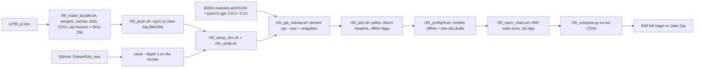

# R50: Jean Zay H100 Setup Kit

## Context

Move R49 to Jean Zay (H100) so its full stage can run there, in one pass that is checked at every step. Code arrives by a shallow clone of the repo. Python comes from the IDRIS H100 PyTorch modules, which match our torch versions, plus a small pinned pip overlay. Weights, data and baseline CSVs are copied byte for byte from this cluster by rsync and verified with SHA-256. One script rewrites the hard-coded paths and Slurm headers from one config file. An offline job confirms every model loads on a compute node, and the R49 main arms are reproduced on the 18 clips and compared with our results.

Done when: on Jean Zay, the checksums verify, the overlay leaves no version mismatches, the port reports no leftovers, the preflight passes offline, and the reproduced R49 main arms (StreamEdit `max`, Wan-Edit `max_s9`, `max_s5`) match our 18-clip metrics within the tolerances. The R49 full stage itself stays in R49.

## Execution steps

| # | Step id | Type | Waits for | Sets status |
|---|---|---|---|---|
| 0 | *(prep)* todos `env-template-file`, `gitignore-edit`, `readme-file`, `bundle-script`, `push-script`, `setup-script`, `verify-script`, `overlay-script`, `port-script`, `preflight-py`, `preflight-sbatch`, `preflight-case-file`, `repro-chain-script`, `compare-script` | /build-step | — | implemented |
| 1 | `fill-config` | manual (this cluster) | — | — |
| 2 | `make-bundle` | local | fill-config | — |
| 3 | `push` | local | make-bundle | running |
| 4 | `jz-clone-setup` | manual (Jean Zay) | push | — |
| 5 | `jz-overlay` | manual (Jean Zay) | jz-clone-setup | — |
| 6 | `jz-port` | manual (Jean Zay) | jz-overlay | — |
| 7 | `jz-preflight` | manual (Jean Zay) | jz-port | — |
| 8 | `jz-repro` | manual (Jean Zay) | jz-preflight | finished |
| 9 | `jz-compare` | manual (Jean Zay) | jz-repro | analyzed |

Invoke: `/run-step R50 fill-config`, `/run-step R50 make-bundle`, `/run-step R50 push`, then the Jean Zay steps in order (`/run-step R50 jz-clone-setup` … `jz-compare`) after running their commands there.

## Decisions

| Item | Choice |
|---|---|
| Target | Jean Zay H100 partition (`-C h100`, `-A <project>@h100`); CPU jobs on the CPU partition with `<project>@cpu` |
| Site values | only in `jz/r50_jz.env` (from `jz/r50_jz.env.example`, git-ignored): host, `$WORK` path, accounts, QOS (default `qos_gpu_h100-t3`), CPU partition (default `cpu_p1`), CPUs per GPU (default 24), the two module names — QOS / partition / CPU defaults to confirm against the IDRIS documentation |
| Code | `git clone --depth 1` of `skhairi2k/StreamEdit_new` on the frontal into `$WORK/StreamEdit_new`; byte-identity of the files R49 runs checked with `CODE.sha256` |
| Python environments | IDRIS modules under `arch/h100`: `pytorch-gpu/py3/2.8.0` (torch 2.8.0, CUDA 12.8) for `streamgve`, `pytorch-gpu/py3/2.5.1` for `five-bench`; every other package that differs from our `pip freeze` is pinned to our version with `pip install --user --no-deps` into `$WORK/pyenv/<env>` (module ships e.g. transformers 4.55.4 / diffusers 0.35.0, ours 5.12.0 / 0.31.0); torch builds come from IDRIS, so they are not byte-identical to ours |
| Why not conda-pack | `$WORK` inode quota: 500k, 253k used; the unpacked envs are 286k files (streamgve 165k, five-bench 121k); modules live on shared storage and cost no user inodes |
| Interpreter | per env a wrapper `$WORK/pyenv/<env>/python` (loads `arch/h100` + the module, sets `PYTHONUSERBASE`, `exec python "$@"`), so job scripts keep one interpreter variable per env and can use both envs in one job |
| Weights | rsync of our own copies (byte-identical, no Hugging Face token needed): Wan2.1-T2V-1.3B (17 GB), Self-Forcing `self_forcing_dmd.pt` (5.3 GB), HF cache entries DINOv3 ViT-B/16 (0.3 GB), CLIP ViT-L/14 (1.6 GB), Qwen2.5-VL-7B-Instruct (16 GB), the torch hub cache (1.2 GB: DINO ViT-B/8, AlexNet/VGG for LPIPS, pyiqa); ~42 GB into `$WORK/weights` and `$WORK/cache` |
| Data | FiVE-Bench `videos`, `images`, `bmasks`, `edit_prompt` (1.3 GB, 17k files), Qwen anchors (229 MB), `evaluation/csv` (56 MB, 7k files, git-ignored), `iqa_cli` (19 MB) |
| Inode budget on `$WORK` | ~246k free: bundle ~25k, overlay ~10–30k (measured by the overlay step), outputs ~500 files per clip-edit (R49 subset: ~9k for 18 clips) |
| Layout on Jean Zay | `$WORK/{StreamEdit_new, pyenv, weights, cache, Data, code}`; `~/Data` and `~/.cache/{huggingface,torch}` are symlinks into `$WORK`, so the Python code runs unchanged; outputs under `$WORK/Data/dataggen/outputs/five_bench` |
| Transfer | direct rsync from this cluster (`jz/r50_push.sh`, resumable, `--partial`), staged in `$LOCAL_STAGE` with hard links so nothing is copied twice here |
| Script port | `jz/r50_port.sh` edits only job scripts and `config.yaml`: repo path, interpreters → wrappers, Slurm headers (`-C h100`, account, QOS, `--cpus-per-task`, no `--exclude`, no `--mem`, `--time` ≤ 20 h), offline flags; must report 0 leftovers |
| Offline check | `HF_HUB_OFFLINE=1`, `TRANSFORMERS_OFFLINE=1`; preflight loads every model once on a compute node and runs a one-clip draft on each host |
| Reproduction | R49 main path on the 18 clips (drafts, divergence, field, StreamEdit `max`, Wan-Edit `max_s9` + `max_s5`, eval of those 3 units); baselines and reference arms are not rerun (they reuse R48 renders that stay here) |
| Tolerances | mean over the 18 clips per metric: bg LPIPS ≤ 0.01, bg PSNR ≤ 0.5 dB, CLIP-D ≤ 0.01, FiVE-Acc ≤ 0.06 (one clip); different GPUs and torch builds are not bit-identical |
| Out of scope | the R49 full stage (stays in R49), refactoring or cleaning the method code, a separate repo |

## Step commands

### fill-config
```bash
cp jz/r50_jz.env.example jz/r50_jz.env
${EDITOR:-vi} jz/r50_jz.env
git check-ignore jz/r50_jz.env
```

### make-bundle
```bash
bash jz/r50_make_bundle.sh
```

### push
```bash
bash jz/r50_push.sh
```

### jz-clone-setup
```bash
# on the Jean Zay frontal
git clone --depth 1 git@github.com:skhairi2k/StreamEdit_new.git $WORK/StreamEdit_new
cd $WORK/StreamEdit_new
cp $WORK/r50_stage/r50_jz.env jz/r50_jz.env
bash jz/r50_setup_dirs.sh
bash jz/r50_verify.sh
```

### jz-overlay
```bash
cd $WORK/StreamEdit_new
bash jz/r50_pip_overlay.sh
idr_quota_user
```

### jz-port
```bash
cd $WORK/StreamEdit_new
bash jz/r50_port.sh
git diff --stat
```

### jz-preflight
```bash
cd $WORK/StreamEdit_new
sbatch slurm_scripts/five_bench/r50_preflight.sh
tail -n 20 logs/r50_preflight_<job>.out
```

### jz-repro
```bash
cd $WORK/StreamEdit_new
bash jz/r50_repro_chain.sh
squeue -u $USER
grep -E 'failures' logs/r49_*.out
```

### jz-compare
```bash
cd $WORK/StreamEdit_new
$WORK/pyenv/five-bench/python evaluation/r50_compare.py
```

## Pipeline



## Code to touch

| File | Change |
|---|---|
| `jz/r50_jz.env.example` | new: commented template of every site value with its default |
| `.gitignore` | add `jz/r50_jz.env` |
| `jz/r50_README.md` | new: ordered procedure, the check after each step, inode budget, recovery notes |
| `jz/r50_make_bundle.sh` | new: stage weights, the three HF cache entries, the torch hub cache, data subset, anchors, `evaluation/csv`, `iqa_cli` under `$LOCAL_STAGE` (hard links via `cp -al` / `rsync --link-dest`); `pip freeze --exclude-editable` and `pip list --editable` of both envs into `freeze/`; `MANIFEST.sha256` over the stage, `CODE.sha256` over the repo files R49 runs (job scripts, `evaluation/r48_*.py`, `r49_*.py`, `r31_*.py`, `r30_b_map.py`, `r33_clip_directional.py`, `fivebench/`, `backbone.py`, case files, the modified `Self-Forcing_StreamEdit` and `wan-edit` files) |
| `jz/r50_push.sh` | new: `rsync -a --partial --info=progress2` of `$LOCAL_STAGE` to `$JZ_HOST:$JZ_WORK/r50_stage/` plus the filled env file |
| `jz/r50_setup_dirs.sh` | new: move stage contents into `$JZ_WORK/{weights,cache,Data,code}`, create the `~/Data`, `~/.cache/*`, `wan_models`, `checkpoints` and `evaluation/csv` links; idempotent |
| `jz/r50_verify.sh` | new: `sha256sum -c` on both manifests, failure count |
| `jz/r50_pip_overlay.sh` | new: per env, module freeze vs ours → `pip install --user --no-deps --no-cache-dir` of every differing package (torch/torchvision/torchaudio/triton/`nvidia-*` excluded) into `$JZ_WORK/pyenv/<env>`, editable installs with `-e`, the `python` wrapper, then `pip check` + freeze re-compare through the wrapper, `overlay.txt`, summary lines with installed / mismatches / file count |
| `jz/r50_port.sh` | new: `sed` rewrites listed in Decisions (Script port) on the R49/R48/R50 job scripts and `evaluation/fivebench/config.yaml`, then the leftover grep and count |
| `evaluation/r50_preflight.py` | new: version report + offline load and one forward pass per model (DINOv3, LPIPS, CLIP ViT-L/14, Qwen2.5-VL-7B, DINO ViT-B/8 via `torch.hub` cached repo, pyiqa NIQE), OK/FAIL table |
| `slurm_scripts/five_bench/r50_preflight.sh` | new: GPU job running both wrappers' torch/CUDA checks, `r50_preflight.py` and one-clip StreamEdit + Wan-Edit drafts into `$D/r50_preflight` |
| `evaluation/r50_preflight_case.json` | new: the `0076_A_rabbit` (edit 2) case from `r49_cases.json` |
| `jz/r50_repro_chain.sh` | new: `afterok` chain of `r49_se_stage1.sh`, `r49_wan_draft.sh`, `r49_div.sh`, `r49_field.sh`, `r49_se_stage3.sh`, `r49_wan_render.sh arms` (array 0-1), `r49_eval_all.sh main`; ids to `logs/r50_repro_jobs.txt` |
| `evaluation/r50_compare.py` | new: per-clip Jean Zay vs local CSVs for the 3 main units (`r48_score` loaders), mean differences vs the tolerances, worst 3 clips, `evaluation/csv/r50_compare.csv`, PASS/FAIL |
