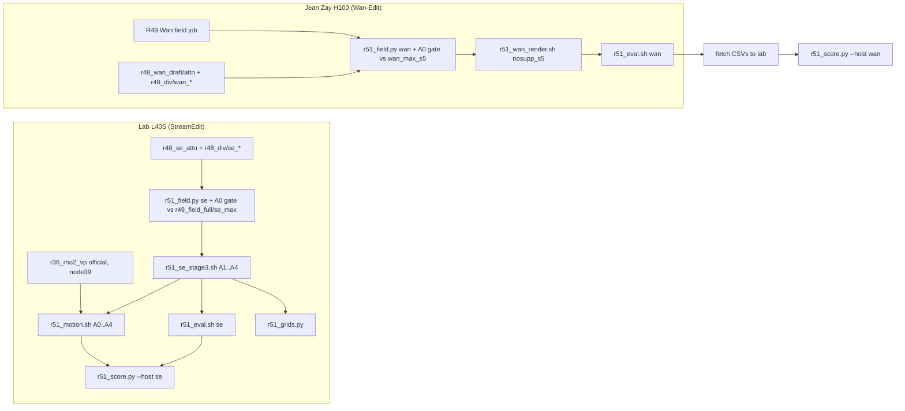

# R51: Demand Component Ablation

## Context

R49's demand is q = S · max(d_DINO/0.55, d_LPIPS/1.0), mapped to each host's control by the exposure inverse. R51 asks whether each factor of q is needed by changing **only q** and keeping everything else as in R49's full stage: drafts, attention, divergence, mapping, render flags. On StreamEdit the arms are A1 no divergence (q = S), A2 DINO only, A3 LPIPS only and A4 no support. On Wan-Edit only A4 runs: that host has no mask of its own, so the support should matter there. A0 is R49's full method, already rendered on both hosts. A1 releases at ρ = 50 over the whole mask, so it may score well on FiVE alignment while damaging source motion. FiVE's `motion_fidelity_score_edit_part` is therefore added for every StreamEdit arm and the official baseline.

Done when: StreamEdit A1–A4 are rendered and scored on the 419 pairs (lab L40S), with motion fidelity for A0–A4 and the official ρ = 2; Wan-Edit A4 is rendered and scored on the 419 pairs on Jean Zay, with CSVs fetched; the trade-off figures per host and the StreamEdit grids exist.

## Execution steps

| # | Step id | Type | Waits for | Sets status |
|---|---|---|---|---|
| 0 | *(prep)* todos `field-script`, `field-sbatch`, `units-module`, `se-render-sbatch`, `eval-sbatch`, `motion-sbatch`, `se-chain-driver`, `wan-render-adapt`, `wan-render-sbatch`, `wan-chain-driver`, `jz-port-list`, `jz-scratch-list`, `jz-fetch-list`, `score-script`, `grids-script` | /build-step | — | implemented |
| 1 | `se-chain` | local (submits field → render → eval + motion on the lab cluster) | — | running |
| 2 | `wan-chain` | manual (Jean Zay; field afterok R49's Wan field job) | — | — |
| 3 | `wait-se-chain` | manual | se-chain | — |
| 4 | `wait-wan-chain` | manual (Jean Zay) | wan-chain | — |
| 5 | `wan-fetch` | manual (gpu-gw) | wait-wan-chain | — |
| 6 | `score` | local | wait-se-chain, wan-fetch | finished |
| 7 | `grids` | local | wait-se-chain | — |
| 8 | `verdict` | manual | score, grids | analyzed |

Steps 1 and 2 are independent and can be submitted the same day.

Invoke: `/run-step R51 se-chain`, `/run-step R51 wan-chain`, `/run-step R51 wait-se-chain`, `/run-step R51 wait-wan-chain`, `/run-step R51 wan-fetch`, `/run-step R51 score`, `/run-step R51 grids`, `/run-step R51 verdict`.

## Decisions

| Item | Choice |
|---|---|
| Arms (StreamEdit) | A1 `nodiv` q = S · A2 `dino` q = S·m_dino · A3 `lpips` q = S·m_lpips · A4 `nosupp` q = max(m_dino, m_lpips); A0 = R49 `se_max` (`r49_se_arms/r49_max_full`), not re-rendered |
| Arms (Wan-Edit) | A4 `nosupp_s5` only (floor s_min = 5, as `max_s5`); A0 = R49 `max_s5` full |
| Inputs | R49 full-stage inputs: attention `r48_se_attn` / `r48_wan_draft/attn`, divergence `r48_div/{se,wan}_{dino,lpips}`; caps DINO 0.55, LPIPS 1.0; λ = 0.5; m_* = clip(d, 0, cap)/cap; no new draft |
| Mapping | unchanged: `r49_field.se_rho` (budget-linear on [2, 50], 15-step t_next) and `r49_field.wan_start` (n = round(50q), s ≥ 5) |
| A0 gate | the field job first recomputes A0 with the new code and requires bit-equality with `r49_field_full/se_max` (`rho`) or `r49_field_full/wan_max_s5` (`.npy` start maps) on every pair; any mismatch fails the job before a render is submitted |
| Dropped | R52's B2 (binary mask): ≡ A1 up to the support edge (user, 2026-10-22); no DINO-only / LPIPS-only / no-divergence arms on Wan-Edit |
| Render (StreamEdit) | flags identical to `r49_se_stage3.sh full`: VP + Qwen anchors, step 15, flow_shift 1.0, fg_boost 4, blend_power 2, chunk 21, seed 0, dump step 14; NFE 5 + 15 = 20 |
| Render (Wan-Edit) | `r49_wan_render.py`, N = 50, loop start 5, per-token start map; out `r51_wan_arms/nosupp_s5_full` |
| Metrics | FiVE harness (the 9 metrics of `r49_eval_all.sh`), FiVE-Acc, CLIP-D; plus `motion_fidelity_score` and `motion_fidelity_score_edit_part` (CoTracker alone, no Qwen) on StreamEdit A0–A4 and official ρ = 2 |
| Official ρ = 2 renders | `r36_rho_sweep/r36_rho2_vp` lives on `/store` → its motion unit is pinned to `node39` (has the mount), with a preflight `[ -d ]` that fails fast |
| Scoring | plain per-clip means over 419 and over the 401 outside `r49_cases.json` (never `_avg.csv`); figures x = alignment (FiVE-Acc, CLIP-D, CLIP-T), y = bg LPIPS; StreamEdit read against R39 N = 20 (equal NFE) and R36 N = 15 (native); Wan-Edit against matched-59 and the native N = 50 sweep; no paired CIs (user choice) |
| Grids | StreamEdit only, the 18 clips of `r49_cases.json` (fixed, not cherry-picked), source / official / A0–A4, middle + last frame |
| Platforms | StreamEdit on lab L40S (`streamgve` render, `five-bench` eval), Wan-Edit on Jean Zay H100; separate tables and figures, platform written on each |
| Slurm | lab: `--partition=L40S` / `CPU`, `--exclude=node52`, renders 20 h, evals 12 h, motion 12 h, one unit per array task; Jean Zay: headers rewritten by `jz/r50_port.sh` |
| Outputs | `$D/r51_field_full/{se_nodiv,se_dino,se_lpips,se_nosupp,wan_nosupp_s5}/`, `$D/r51_se_arms/r51_{arm}_full/step14/`, `$D/r51_wan_arms/nosupp_s5_full/`, `evaluation/csv/*r51_*`, `evaluation/figures/r51_*`, `evaluation/figures/r51_grids/` |

## Step commands

### se-chain
```bash
bash slurm_scripts/five_bench/r51_se_chain.sh
cat logs/r51_se_chain_jobs.txt
```

### wan-chain
```bash
# on Jean Zay (ssh zay from gpu-gw), in the clone
git pull
bash jz/r50_port.sh
bash jz/r50_scratch_links.sh
bash slurm_scripts/five_bench/r51_wan_chain.sh --dry-run
bash slurm_scripts/five_bench/r51_wan_chain.sh
cat logs/r51_wan_chain_jobs.txt
```

### wait-se-chain
```bash
cat logs/r51_se_chain_jobs.txt
squeue -u $USER
grep -H 'A0 gate' logs/r51_field_*.out
grep -hE 'failures|unit failures' logs/r51_*.out | sort | uniq -c
```

### wait-wan-chain
```bash
# on Jean Zay
cat logs/r51_wan_chain_jobs.txt
sacct -j "$(grep -v '^#' logs/r51_wan_chain_jobs.txt | awk '{print $2}' | paste -sd,)" --format=JobID,State,Elapsed
grep -H 'A0 gate' logs/r51_field_*.out
grep -hE 'failures|unit failures' logs/r51_*.out | sort | uniq -c
```

### wan-fetch
```bash
# on gpu-gw
bash jz/r50_fetch_outputs.sh r51_field_full r51_wan_arms
source jz/r50_jz.env
rsync -av "$JZ_HOST:$JZ_WORK/StreamEdit_new/evaluation/csv/" evaluation/csv/ --include='*r51*wan_nosupp_s5_full*' --exclude='*'
```

### score
```bash
python evaluation/r51_score.py --host se
python evaluation/r51_score.py --host wan
```

### grids
```bash
python evaluation/r51_grids.py
```

### verdict
```bash
column -s, -t < evaluation/csv/r51_points_se.csv
column -s, -t < evaluation/csv/r51_points_wan.csv
column -s, -t < evaluation/csv/r51_motion.csv
ls evaluation/figures/r51_*.pdf evaluation/figures/r51_grids/
```

## Pipeline



## Code to touch

| File | Change |
|---|---|
| `evaluation/r51_field.py` (new) | Imports `r49_field` (`se_rho`, `wan_start`, `R48.compute_E`, `R48._load_d`, `DIV_MAX`, `t_next_schedule`). `ARMS = {"max": lambda S, md, ml: S*max(md, ml), "nodiv": S, "dino": S*md, "lpips": S*ml, "nosupp": max(md, ml)}`, each clipped to [0, 1]. Per pair: load attention + both divergences once, compute S, m_dino, m_lpips, then each arm's q. `--hosts se\|wan`, `--arms` (se default nodiv dino lpips nosupp; wan default nosupp), `--gate_ref DIR`: recompute `max` and assert `np.array_equal` with the reference `rho` (se) / start `.npy` (wan, s_min 5) on every pair, print `[r51_field] A0 gate PASS n/n` or exit 1 before writing anything. Writes `{out_root}/{host}_{arm}[_s5]/edit{T}/{vid}.npz` in r49_field's format (+ `.npy` for wan) with `arm` and `q` stored. `--selftest`: arm formulas on toy arrays, `nosupp` ≥ `max` elementwise, `nodiv` = S. |
| `slurm_scripts/five_bench/r51_field.sh` (new) | CPU, 4 cpus, 32G, 2 h; `HOST` arg; full mode only (`r7_anchor_manifest.json`); roots as `r49_field.sh full`; runs selftest → gate (`--gate_ref $D/r49_field_full`) → field; guard: 419 npz per arm dir (+ 419 `.npy` for wan); `failures: N`. |
| `evaluation/r51_units.py` (new) | Same interface as `r49_units.py` (`--group`, `--count`, `--index`, TSV `base dir host config`). Groups: `se` = 4 units `r51_se_arms/r51_{arm}_full/step14`; `wan` = `r51_wan_arms/nosupp_s5_full`; `motion` = A1..A4 dirs, A0 `r49_se_arms/r49_max_full/step14` (index 4), official `r36_rho_sweep/r36_rho2_vp` (index 5, last). Base names `se_{arm}_full`, stems `r51_{base}` / `r51_fiveacc_{base}` / `r51_motion_{base}`. |
| `slurm_scripts/five_bench/r51_se_stage3.sh` (new) | Copy of `r49_se_stage3.sh` full mode; `ARMS=(nodiv dino lpips nosupp)`, task id → arm; `--rho_dir $D/r51_field_full/se_${ARM}`, `--method r51_${ARM}_full`, `--out_root $D/r51_se_arms`; same preflight and post-run guards. |
| `slurm_scripts/five_bench/r51_eval.sh` (new) | Copy of `r49_eval_all.sh` full mode restricted to one unit per array task of `r51_units.py --group GROUP` (`se` or `wan`); same 9 harness metrics, FiVE-Acc, CLIP-D (`r33_clip_directional.py --fullbench`, out `r51_clip_directional_{base}.csv`); same Wan-only `--missing` preflight and `check_rows`. |
| `slurm_scripts/five_bench/r51_motion.sh` (new) | L40S, 64G, 12 h; one unit of group `motion` per array task; preflight `[ -d "$DIR" ]` (fails with a "/store not mounted on $(hostname)" message); `evaluate.py --metrics motion_fidelity_score motion_fidelity_score_edit_part`, stem `r51_motion_{base}`, full bench; row-count guard per edit type (no NaN in the two columns). |
| `slurm_scripts/five_bench/r51_se_chain.sh` (new) | Refuses if `logs/r51_se_chain_jobs.txt` exists; submits `field` (`r51_field.sh se`), `render` (`--array=0-3`, afterok field), `eval` (`r51_eval.sh se`, `--array=0-3`, afterok render), `motion` (`--array=0-4`, afterok render), `motion_official` (`--array=5 --nodelist=node39`, no dependency); writes `<stage> <id>` lines headed by the commit. |
| `evaluation/r49_wan_render.py` | `ADAPT` gets `"nosupp_s5": 5`; the field lookup `wan_{arm}` then reads `wan_nosupp_s5` under `--field_root`. |
| `slurm_scripts/five_bench/r51_wan_render.sh` (new) | Single job (no array): preflight 419 `.npy` under `$D/r51_field_full/wan_nosupp_s5`; `r49_wan_render.py --config nosupp_s5 --mode full --cases evaluation/r7_anchor_manifest.json --field_root $D/r51_field_full --out_root $D/r51_wan_arms`; resumable; `r48_units.py --missing` post-run guard. |
| `slurm_scripts/five_bench/r51_wan_chain.sh` (new) | Jean Zay only (same `$WORK`, ported-script and `$SCRATCH`-link guards as `r49_wan_full_chain.sh`); reads `field <id>` from `logs/r49_wan_full_chain_jobs.txt` (fatal if absent); submits `field` (`r51_field.sh wan`, afterok that id), `render` (afterok field), `eval` (`r51_eval.sh wan`, `--array=0`, afterok render); `--dry-run`; `logs/r51_wan_chain_jobs.txt`, refuses if it exists. |
| `jz/r50_port.sh` | `SCRIPTS` += `r51_field`, `r51_wan_render`, `r51_eval`, `r51_wan_chain`. |
| `jz/r50_scratch_links.sh` | `FOLDERS` += `r51_field_full`, `r51_wan_arms`. |
| `jz/r50_fetch_outputs.sh` | `ALL` += `r51_field_full`, `r51_wan_arms`. |
| `evaluation/r51_score.py` (new) | Reuses `r49_score` helpers (`point`, `plot`, curve loading). `--host se`: A0 (R49 CSVs) + A1–A4 + official, R39 N = 20 and R36 N = 15 curves; figures `r51_se_{five_acc,clip_d,clip_tgt}.pdf`; `r51_points_se.csv` (per-arm means on 419 and 401); `r51_motion.csv` (MFS and MFS-edit per unit, 419 and 401, plus per edit type). `--host wan`: A0 `max_s5` full + A4, native N = 50 and matched-59 curves from the fetched R49 full CSVs; `r51_wan_*.pdf`, `r51_points_wan.csv`. |
| `evaluation/r51_grids.py` (new) | Reuses `r49_grids` frame-reading and labelling helpers; one PNG `evaluation/figures/r51_grids/frames_se.png` (18 rows × 7 columns, middle + last frame per cell), cell labels from the 419-pair CSVs filtered to the clip. |
