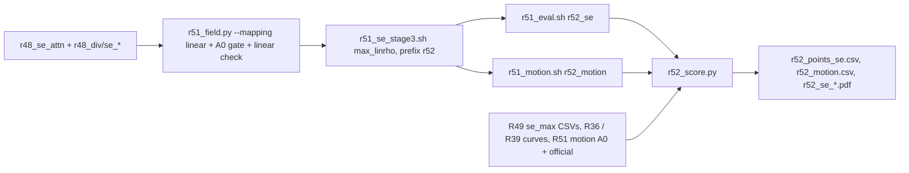

# R52: Exposure-Inverse Mapping Ablation

## Context

Claim 1 says inverting the host's own exposure response is what turns a demand q into the right control. On StreamEdit the inverse gives budget-linear ρ on [2, 50]. R52 keeps R49's q and everything else from the full stage, and replaces only the map with the obvious alternative: linear in the exponent, ρ = 2 + 48q (B1). At mid demand the two maps differ the most. On the 15-step grid, q = 0.5 gives ρ = 26 under B1 against ρ = 4.46 under the inverse. B1 is read against R49's `se_max` (A0, = B0) at equal NFE. Wan-Edit gets no B1: its exposure inverse already is linear in the native step knob. B2 was dropped because R51's A1 covers it. R52 supersedes R47, which asked the same question on R38's DINO-only field.

Done when: B1 is rendered and scored on the 419 pairs (harness, FiVE-Acc, CLIP-D, motion fidelity) on the lab L40S, and the trade-off figure places it against A0, the official ρ = 2 and the R39 / R36 curves.

## Execution steps

| # | Step id | Type | Waits for | Sets status |
|---|---|---|---|---|
| 0 | *(prep)* todos `field-mapping-flag`, `field-sbatch-args`, `render-sbatch-args`, `units-r52-groups`, `eval-sbatch-prefix`, `motion-sbatch-prefix`, `se-chain-driver`, `score-script` (after R51's StreamEdit todos are built) | /build-step | — | implemented |
| 1 | `se-chain` | local (submits field → render → eval + motion on the lab cluster) | — | running |
| 2 | `wait-se-chain` | manual | se-chain | finished |
| 3 | `score` | local | wait-se-chain | — |
| 4 | `verdict` | manual | score | analyzed |

Invoke: `/run-step R52 se-chain`, `/run-step R52 wait-se-chain`, `/run-step R52 score`, `/run-step R52 verdict`.

## Decisions

| Item | Choice |
|---|---|
| Arm | B1 `max_linrho`: q = S·max(m_dino, m_lpips) exactly as R49 (caps 0.55 / 1.0, λ 0.5, inputs `r48_se_attn`, `r48_div/se_*`), ρ = 2 + 48q (= R47's mapping, `--tau_min 2 --tau_max 50`) |
| Reference | A0 = B0 = R49 `se_max` full (`r49_se_arms/r49_max_full`), not re-rendered; official ρ = 2, N = 15 (`r36_rho2_vp`) |
| Hosts | StreamEdit only; no Wan-Edit arm (inverse ≡ linear in steps there); B2 dropped (≡ R51 A1) |
| Pipeline | R51's scripts, generalised by R52's todos (mapping flag, arm/root/prefix args, stem-prefix column); R52's own driver `r52_se_chain.sh`; R51's default behaviour unchanged |
| Field checks | the field job runs R51's A0 gate (inverse recompute bit-equal to `r49_field_full/se_max`) and a linear check: every B1 npz has ρ = 2 + 48q (max abs error < 1e-4), ρ(0) = 2, ρ(1) = 50 |
| Render | flags identical to `r49_se_stage3.sh full` (VP + anchors, step 15, flow_shift 1.0, fg_boost 4, blend_power 2, chunk 21, seed 0, dump step 14); NFE 5 + 15 = 20 |
| Metrics | 9 harness metrics, FiVE-Acc, CLIP-D, `motion_fidelity_score` + `motion_fidelity_score_edit_part`; A0 and official motion come from R51's `motion` group |
| Scoring | plain per-clip means over 419 and over the 401 outside `r49_cases.json`; figures x = alignment (FiVE-Acc, CLIP-D, CLIP-T), y = bg LPIPS, with R39 N = 20 (equal NFE) and R36 N = 15 (native); no CIs, no per-type table, no grids (user choice) |
| Ordering | R52's build runs after R51's StreamEdit scripts exist; R52 can be submitted before, with or after R51's chain (its renders depend only on R49 inputs); its score needs R51's motion units for A0 / official |
| R47 | marked `dropped` (superseded by R52) when this plan is accepted |
| Slurm | `--partition=L40S` / `CPU`, `--exclude=node52`; render 20 h, eval 12 h, motion 12 h |
| Outputs | `$D/r52_field_full/se_max_linrho/`, `$D/r52_se_arms/r52_max_linrho_full/step14/`, `evaluation/csv/*r52_*`, `evaluation/figures/r52_se_*.pdf` |

## Step commands

### se-chain
```bash
bash slurm_scripts/five_bench/r52_se_chain.sh
cat logs/r52_se_chain_jobs.txt
```

### wait-se-chain
```bash
cat logs/r52_se_chain_jobs.txt
squeue -u $USER
grep -hE 'A0 gate|linear check' logs/r51_field_*.out | tail -2
grep -hE 'failures|unit failures' $(ls -t logs/r51_*_*.out | head -8) | sort | uniq -c
```

### score
```bash
python evaluation/r52_score.py
```

### verdict
```bash
column -s, -t < evaluation/csv/r52_points_se.csv
column -s, -t < evaluation/csv/r52_motion.csv
ls evaluation/figures/r52_se_*.pdf
```

## Pipeline



## Code to touch

| File | Change |
|---|---|
| `evaluation/r51_field.py` | `--mapping {inverse, linear}`; `linear_rho(q) = RHO_MIN + (RHO_MAX - RHO_MIN) * q`; under linear the output dir is `se_{arm}_linrho` and the npz stores `mapping="linear_in_rho"`; the gate always recomputes the inverse `max`; after writing, a linear check reloads every written npz and asserts `abs(rho - (2 + 48 q)).max() < 1e-4` (prints `linear check PASS n/n`); selftest adds the three linear endpoints. |
| `slurm_scripts/five_bench/r51_field.sh` | positional args after HOST: `MAPPING` (default `inverse`), `ARMS` (quoted list, default per host), `OUT` (default `$D/r51_field_full`); guard loops over the arm dirs implied by ARMS + MAPPING. |
| `slurm_scripts/five_bench/r51_se_stage3.sh` | positional args `ARMS` (default `nodiv dino lpips nosupp`, indexed by `SLURM_ARRAY_TASK_ID`, task 0 when not an array), `FIELD_ROOT`, `PREFIX`; field dir `$FIELD_ROOT/se_$ARM`, method `${PREFIX}_${ARM}_full`, out root `$D/${PREFIX}_se_arms`. |
| `evaluation/r51_units.py` | TSV gains `stem_prefix` (5th column); R51 groups emit `r51`; groups `r52_se` and `r52_motion` = `(se, max_linrho, $D/r52_se_arms/r52_max_linrho_full/step14)` with prefix `r52`. |
| `slurm_scripts/five_bench/r51_eval.sh` | reads 5 columns; stems and CLIP-D file built from `stem_prefix`. |
| `slurm_scripts/five_bench/r51_motion.sh` | reads 5 columns; motion stem built from `stem_prefix`. |
| `slurm_scripts/five_bench/r52_se_chain.sh` (new) | refuses if `logs/r52_se_chain_jobs.txt` exists; `field` = `r51_field.sh se linear "max" $D/r52_field_full`; `render` = `r51_se_stage3.sh "max_linrho" $D/r52_field_full r52` (afterok field); `eval` = `r51_eval.sh r52_se --array=0` and `motion` = `r51_motion.sh r52_motion --array=0` (both afterok render); writes `<stage> <id>` lines headed by the commit. |
| `evaluation/r52_score.py` (new) | reuses `r49_score` helpers (`point`, `plot`, R39 / R36 curve loading, official and `se_max` full CSVs); B1 from `r52_*` CSVs; per-clip means on 419 and 401; motion table joins `r52_motion_se_max_linrho_full` with R51's `r51_motion_*` stems for A0 and official (fails clearly if those are missing). |
