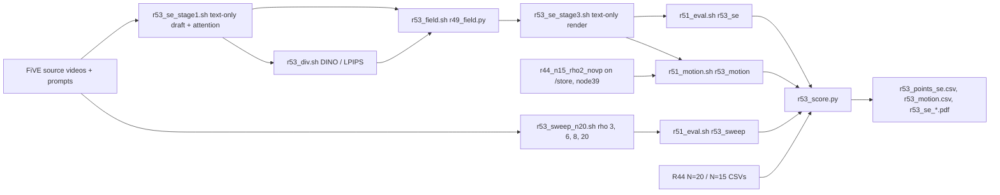

# R53: se_max Without Visual Prompting

## Context

R49's StreamEdit results use visual prompting (VP): an edited first frame (the Qwen anchor) conditions the render. Wan-Edit, the second host, is text-only. R53 runs the same procedure on StreamEdit with text only, which tests whether se_max's gain comes from the VP anchor. It also gives the two hosts the same conditioning. R44's text-only draft records neither attention nor LPIPS divergence, so stage 1 is rerun with the recorder on, and the field and render follow R49 exactly. The text-only references come from R44: the N = 15 ρ sweep (8 points) and the equal-NFE N = 20 sweep, which only has ρ 2, 4, 10, 50. R53 adds ρ 3, 6, 8, 20 at N = 20 so the equal-NFE curve is as dense as R39's VP curve.

Done when: se_max_novp and the four extra N = 20 sweep points are rendered and scored on the 419 pairs (harness, FiVE-Acc, CLIP-D; motion fidelity for se_max_novp and the text-only official ρ = 2), and the trade-off figures place se_max_novp on the text-only N = 20 and N = 15 curves.

## Execution steps

| # | Step id | Type | Waits for | Sets status |
|---|---|---|---|---|
| 0 | *(prep)* todos `stage1-sbatch`, `div-sbatch`, `field-sbatch`, `render-sbatch`, `sweep-sbatch`, `units-r53-groups`, `se-chain-driver`, `score-script` (after R51's and R52's script changes) | /build-step | — | implemented |
| 1 | `se-chain` | local (submits 9 queue entries on the lab cluster) | — | running |
| 2 | `wait-se-chain` | manual | se-chain | finished |
| 3 | `score` | local | wait-se-chain | — |
| 4 | `verdict` | manual | score | analyzed |

Invoke: `/run-step R53 se-chain`, `/run-step R53 wait-se-chain`, `/run-step R53 score`, `/run-step R53 verdict`.

## Decisions

| Item | Choice |
|---|---|
| Conditioning | text only: `--vp_mode novp`, no `--first_frame_edit_dir` in draft and render (R44's convention) |
| Draft | N = 5, `--blend_sched tgt0.9`, seed 0, flow_shift 1, fg_boost 4, blend_power 2, chunk 21, attention recorder at r31_stage1.py defaults (first 20 blocks, σ window [0.55, 0.9]); no bit-identity check against `r44_latents` (user choice; the recorder was shown read-only on VP in R48) |
| Divergence | DINOv3 and LPIPS via `r31_divergence.py`, same flags as `r48_div.sh` (temporal mean, seed 0) |
| Field | `r49_field.py` unchanged: caps DINO 0.55, LPIPS 1.0, λ 0.5, q = S·max, ρ = budget-linear inverse on [2, 50] |
| Render | flags of `r49_se_stage3.sh full` minus VP: step 15, flow_shift 1.0, fg_boost 4, blend_power 2, chunk 21, seed 0, dump step 14; NFE 5 + 15 = 20 |
| References | equal NFE: text-only N = 20 curve = R44 ρ 2, 4, 10, 50 (`r44_n20_rho{R}_novp`) + R53 ρ 3, 6, 8, 20 (`r53_n20_rho{R}_novp`); native: R44 N = 15, 8 ρ; official text-only = `r44_n15_rho2_novp` |
| Sweep renders | uniform text-only, N = 20, flags of `r44_infer.sh`; out `$D/r53_rho_sweep` (on /home, not /store) |
| Metrics | 9 harness metrics, FiVE-Acc, CLIP-D on se_max_novp and the 4 sweep points; motion fidelity (`motion_fidelity_score`, `_edit_part`) on se_max_novp and the text-only official |
| Official renders on /store | `r44_rho_sweep` is a /store link → its motion unit is pinned to `node39` (fail-fast preflight, as R51) |
| Scoring | plain per-clip means over 419 and over the 401 outside `r49_cases.json`; figures x = alignment (FiVE-Acc, CLIP-D, CLIP-T), y = bg LPIPS; no CIs, no R44 routed arm, no VP-vs-text demand stats, no grids (user choice) |
| Reuse | eval / motion through R51's `r51_eval.sh` / `r51_motion.sh` with R52's stem-prefix column; R53 builds after R51 and R52's script changes |
| Queue | 9 entries; the driver prints the current queue count before submitting (the per-user submit cap was hit at ~10 entries in R44/R45) |
| Slurm | `--partition=L40S` / `CPU`, `--exclude=node52`; draft 12 h, renders 20 h (sweep at N = 20: 24 h, R39 measured ~14 h), eval 12 h, motion 12 h |
| Outputs | `$D/r53_se_stage1/`, `$D/r53_se_attn/`, `$D/r53_div/se_{dino,lpips}/`, `$D/r53_field_full/se_max/`, `$D/r53_se_arms/r53_max_novp_full/step14/`, `$D/r53_rho_sweep/r53_n20_rho{3,6,8,20}_novp/`, `evaluation/csv/*r53_*`, `evaluation/figures/r53_se_*.pdf` |

## Step commands

### se-chain
```bash
bash slurm_scripts/five_bench/r53_se_chain.sh
cat logs/r53_se_chain_jobs.txt
```

### wait-se-chain
```bash
cat logs/r53_se_chain_jobs.txt
squeue -u $USER
grep -hE 'failures|unit failures' logs/r53_*.out | sort | uniq -c
grep -hE 'failures|unit failures' $(ls -t logs/r51_eval_*.out logs/r51_motion_*.out | head -11) | sort | uniq -c
```

### score
```bash
python evaluation/r53_score.py
```

### verdict
```bash
column -s, -t < evaluation/csv/r53_points_se.csv
column -s, -t < evaluation/csv/r53_motion.csv
ls evaluation/figures/r53_se_*.pdf
```

## Pipeline



## Code to touch

| File | Change |
|---|---|
| `slurm_scripts/five_bench/r53_se_stage1.sh` (new) | Copy of `r48_se_stage1.sh` full mode: `--vp_mode novp`, drop `--first_frame_edit_dir` and the R38 bit-identity block; `OUT=$D/r53_se_stage1`, `ATTN=$D/r53_se_attn`; post-run guard: 419 attention npz, 419 latents, and a python check that every latent npz records `vp_mode == novp` (as `r44_stage1.sh`). |
| `slurm_scripts/five_bench/r53_div.sh` (new) | Array 0-1 → `ARM`/`NAME` = `se_dino` / `se_lpips` exactly as `r48_div.sh` tasks 0-1; `TARGET_ROOT=$D/r53_se_stage1/frames/n5_tgt09/step04`, `--latent_dir $D/r53_se_stage1/latents`, `--out_root $D/r53_div`; full bench; 419-npz guard. |
| `slurm_scripts/five_bench/r53_field.sh` (new) | CPU, 4 cpus, 32G, 2 h; selftest then `r49_field.py --hosts se --cases evaluation/r7_anchor_manifest.json --attn_se $D/r53_se_attn --div_root $D/r53_div --out_root $D/r53_field_full`; guard 419 npz under `se_max`. |
| `slurm_scripts/five_bench/r53_se_stage3.sh` (new) | Copy of `r49_se_stage3.sh` full mode: `--vp_mode novp`, no `--first_frame_edit_dir`; `FIELD_DIR=$D/r53_field_full/se_max`, `METHOD=r53_max_novp_full`, `OUT_ROOT=$D/r53_se_arms`; same preflight and guards. |
| `slurm_scripts/five_bench/r53_sweep_n20.sh` (new) | Copy of `r44_infer.sh` fixed at N = 20: `RHOS=(3 6 8 20)`, `--array=0-3`, 24 h; `OUT_ROOT=$D/r53_rho_sweep`, `METHOD=r53_n20_rho${R}_novp`; same run_fivebench.py flags and guards. |
| `evaluation/r51_units.py` | Groups `r53_se` = `(se, max_novp, $D/r53_se_arms/r53_max_novp_full/step14)`; `r53_sweep` = `(se, n20_rho{R}_novp, $D/r53_rho_sweep/r53_n20_rho{R}_novp)` for R in 3, 6, 8, 20; `r53_motion` = se_max_novp then `(se, n15_rho2_novp, $D/r44_rho_sweep/r44_n15_rho2_novp)`; prefix `r53`. |
| `slurm_scripts/five_bench/r53_se_chain.sh` (new) | Refuses if `logs/r53_se_chain_jobs.txt` exists; prints `squeue -u $USER -h | wc -l`; submits `stage1`, `div` (`--array=0-1`, afterok stage1), `field` (afterok div), `render` (afterok field), `eval` (`r51_eval.sh r53_se --array=0`, afterok render), `motion` (`r51_motion.sh r53_motion --array=0`, afterok render), `motion_official` (`--array=1 --nodelist=node39`), `sweep` (`--array=0-3`), `eval_sweep` (`r51_eval.sh r53_sweep --array=0-3`, afterok sweep); writes `<stage> <id>` lines headed by the commit. |
| `evaluation/r53_score.py` (new) | Reuses `r49_score` helpers (`point`, `plot`); text-only curves from R44 CSVs (`r44_n15_rho{R}_novp`, `r44_n20_rho{R}_novp`, `r44_fiveacc_*`, `r44_clip_directional_sweep_n{15,20}.csv`) merged with R53's N = 20 points by ρ; se_max_novp and official from `r53_*`; per-clip means on 419 and 401; motion table from the two `r53_motion_*` stems. |
