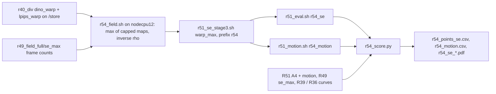

# R54: Draft-Free Max-Div Routing Ablation

## Context

R40 showed that propagating the anchor's divergence map by optical flow, instead of measuring it per frame on a draft, edits less at equal preservation. The warp cannot follow content that enters the frame later. R40 used R35's pipeline (one metric per arm, cap 0.65), so its numbers cannot sit next to R49's. R54 repeats the test in R49's terms. It takes R40's two warped maps, already reduced to the token grid, and normalises each by R49's cap. The max is taken per token, as R49 does, and mapped by R49's exposure inverse. A draft-free arm cannot have the attention support, since S comes from the draft. Its exact counterpart is therefore R51's A4 (same q, per-frame draft, no support), and R54 vs A4 isolates "per-frame draft vs flow-warped anchor". This only applies with VP, so it is a StreamEdit-only supplementary result.

Done when: the warped-max arm is rendered and scored on the 419 pairs (harness, FiVE-Acc, CLIP-D, motion fidelity) on the lab L40S, and the trade-off figure places it against A4, A0, the official ρ = 2 and the R39 / R36 curves.

## Execution steps

| # | Step id | Type | Waits for | Sets status |
|---|---|---|---|---|
| 0 | *(prep)* todos `field-script`, `field-sbatch`, `units-r54-groups`, `eval-sbatch-groups`, `motion-sbatch-groups`, `se-chain-driver`, `score-script` (after R51's and R52's script changes) | /build-step | — | implemented |
| 1 | `se-chain` | local (submits field → render → eval + motion on the lab cluster) | — | running |
| 2 | `wait-se-chain` | manual | se-chain | finished |
| 3 | `score` | local | wait-se-chain | — |
| 4 | `verdict` | manual | score | analyzed |

Invoke: `/run-step R54 se-chain`, `/run-step R54 wait-se-chain`, `/run-step R54 score`, `/run-step R54 verdict`.

## Decisions

| Item | Choice |
|---|---|
| Maps | R40's raw warped `d`, reused as is: `r40_div/dino_warp` and `r40_div/lpips_warp` (frame-0 map between source frame 0 and the VP anchor → RAFT-large backward-flow composition on the source → 16×16 area mean → VAE temporal mean; DINOv3 ViT-B/16 and LPIPS alex, the same functions as R49's divergence) |
| Demand | q = max(clip(d_dino, 0, 0.55)/0.55, clip(d_lpips, 0, 1.0)/1.0) per token, after the per-metric reduction (R49's order); no support S (a draft-free arm has no draft attention) |
| Mapping | `r49_field.se_rho`: budget-linear inverse on [2, 50], 15-step `t_next`, flow_shift 1.0 |
| Pairing | R54 is read against R51's A4 (q = max, per-frame draft, no support); A0 and official as context |
| Field job | CPU, pinned to `nodecpu12` (mounts `/store`, where `r40_div` lives); output on /home so the render runs on any L40S; frame-count check against `r49_field_full/se_max` |
| Render | `r51_se_stage3.sh` with R52's arguments: arm `warp_max`, field root `$D/r54_field_full`, prefix `r54`; flags identical to `r49_se_stage3.sh full` (VP + Qwen anchors, step 15, flow_shift 1.0, fg_boost 4, blend_power 2, chunk 21, seed 0, dump step 14); NFE 15 (no draft) |
| Metrics | 9 harness metrics, FiVE-Acc, CLIP-D, `motion_fidelity_score` + `_edit_part`; A4, A0 and official motion come from R51 |
| Scoring | plain per-clip means over 419 and over the 401 outside `r49_cases.json`; figures x = alignment (FiVE-Acc, CLIP-D, CLIP-T), y = bg LPIPS; no CIs, no disocclusion split (user choice) |
| Reuse | eval / motion / render through R51's scripts with R52's arguments and stem-prefix column; R54 builds after R51 and R52's script changes |
| Placement | supplementary, StreamEdit + VP only (no anchor to warp in text-only or on Wan-Edit) |
| Slurm | `CPU` (field, nodecpu12) / `L40S` (render 20 h, eval 12 h, motion 12 h), `--exclude=node52` on GPU jobs |
| Outputs | `$D/r54_field_full/se_warp_max/`, `$D/r54_se_arms/r54_warp_max_full/step14/`, `evaluation/csv/*r54_*`, `evaluation/figures/r54_se_*.pdf` |

## Step commands

### se-chain
```bash
bash slurm_scripts/five_bench/r54_se_chain.sh
cat logs/r54_se_chain_jobs.txt
```

### wait-se-chain
```bash
cat logs/r54_se_chain_jobs.txt
squeue -u $USER
grep -hE 'frame-count check|failures' logs/r54_field_*.out
grep -hE 'failures|unit failures' $(ls -t logs/r51_se_stage3_*.out logs/r51_eval_*.out logs/r51_motion_*.out | head -3) | sort | uniq -c
```

### score
```bash
python evaluation/r54_score.py
```

### verdict
```bash
column -s, -t < evaluation/csv/r54_points_se.csv
column -s, -t < evaluation/csv/r54_motion.csv
ls evaluation/figures/r54_se_*.pdf
```

## Pipeline



## Code to touch

| File | Change |
|---|---|
| `evaluation/r54_field.py` (new) | Imports `r49_field` (`se_rho`, `DIV_MAX`, `RHO_MIN`, `RHO_MAX`, `SE_STEP`, `SE_FLOW_SHIFT`) and `t_next_schedule`. Per pair of `--cases`: load `d` from `{warp_root}/dino_warp/edit{T}/{vid}.npz` and `.../lpips_warp/...`; assert both `[F, 1560]`, finite, and `F == np.load(r49_field_full/se_max/...)["n_latent_frames"]`; `m_* = clip(d, 0, cap)/cap`; `q = maximum(m_dino, m_lpips)`; `rho = se_rho(q, t_next).reshape(F, -1)`; save `rho, rho_min, rho_max, step, flow_shift, arm="warp_max", q, m_dino, m_lpips, d_dino, d_lpips, div_max_*` to `{out_root}/se_warp_max/edit{T}/{vid}.npz`; print `frame-count check PASS n/n` and `failures: N`. `--selftest`: toy maps, q = max of the capped maps, ρ(q = 0) = 2, ρ(q = 1) = 50. |
| `slurm_scripts/five_bench/r54_field.sh` (new) | `--partition=CPU --nodelist=nodecpu12`, 4 cpus, 32G, 2 h; preflight `[ -d /store/PERSO/skhairi/Outputs/five_bench/r40_div ]` and 419 npz under each arm (fails with "/store not mounted on $(hostname)"); selftest; `r54_field.py --cases evaluation/r7_anchor_manifest.json --warp_root $D/r40_div --ref_root $D/r49_field_full --out_root $D/r54_field_full`; guard 419 npz. |
| `evaluation/r51_units.py` | Groups `r54_se` and `r54_motion` = `(se, warp_max, $D/r54_se_arms/r54_warp_max_full/step14)`, stem prefix `r54`. |
| `slurm_scripts/five_bench/r51_eval.sh` | the usage `case` accepts `r54_se` (R51 / R52 / R53 groups unchanged; the group names are validated there). |
| `slurm_scripts/five_bench/r51_motion.sh` | the usage `case` accepts `r54_motion` (same reason). |
| `slurm_scripts/five_bench/r54_se_chain.sh` (new) | Refuses if `logs/r54_se_chain_jobs.txt` exists; submits `field` (`r54_field.sh`), `render` (`r51_se_stage3.sh warp_max $D/r54_field_full r54`, afterok field), `eval` (`r51_eval.sh r54_se --array=0`) and `motion` (`r51_motion.sh r54_motion --array=0`), both afterok render; writes `<stage> <id>` lines headed by the commit. |
| `evaluation/r54_score.py` (new) | Reuses `r49_score` helpers (`point`, `plot`, R39 / R36 curve loading, official and `se_max` full CSVs); A4 from R51's `r51_*se_nosupp_full*` stems (fails clearly if missing); R54 from `r54_*`; per-clip means on 419 and 401; motion table joins `r54_motion_se_warp_max_full` with R51's motion stems for A4, A0 and official. |
