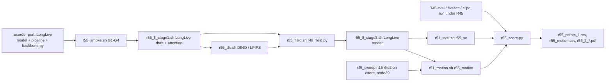

# R55: se_max on LongLive (optional)

## Context

Optional: run only once R51–R54 are done and compute is left. R55 checks that R49's StreamEdit procedure carries over to StreamEdit's second backbone, LongLive. LongLive is also distilled from Wan2.1-T2V-1.3B, so this is a robustness check, not a new host. It uses R45's LongLive settings, so R45's ρ sweeps are like-for-like references. The draft follows Self-Forcing's logic exactly: N = 5, only the t = 1 call anchored, target released from t = 0.8. R49's support needs the cross-attention recorder, which exists only on Self-Forcing, so it is ported to LongLive and gated by a 2-clip smoke test. R45's own baselines are rendered but not scored; R45's pending eval steps are run under R45, and R55's scoring waits on them.

Done when: se_max_ll is rendered and scored on the 419 pairs (harness, FiVE-Acc, CLIP-D; motion fidelity for se_max_ll and the official LongLive ρ = 2), and the trade-off figures place it on R45's N = 20 and N = 15 LongLive curves.

## Execution steps

| # | Step id | Type | Waits for | Sets status |
|---|---|---|---|---|
| 0 | *(prep)* todos `ll-model-recorder`, `ll-pipeline-recorder`, `backbone-ll-attn`, `stage1-help-text`, `smoke-sbatch`, then `stage1-sbatch`, `div-sbatch`, `field-sbatch`, `render-sbatch`, `units-r55-groups`, `chain-driver`, `score-script` (after R51 and R52's script changes) | /build-step | — | implemented |
| 1 | `smoke` | sbatch | — | — |
| 2 | `wait-smoke` | manual | smoke | — |
| 3 | `chain` | local (submits 7 queue entries on the lab cluster) | wait-smoke | running |
| 4 | `wait-chain` | manual | chain | finished |
| 5 | `r45-check` | manual (R45's eval done under R45) | wait-chain | — |
| 6 | `score` | local | r45-check | — |
| 7 | `verdict` | manual | score | analyzed |

Invoke: `/run-step R55 smoke`, `/run-step R55 wait-smoke`, `/run-step R55 chain`, `/run-step R55 wait-chain`, `/run-step R55 r45-check`, `/run-step R55 score`, `/run-step R55 verdict`.

## Decisions

| Item | Choice |
|---|---|
| Backbone | LongLive (`--backbone ll`), VP with Qwen anchors (LongLive triples the VP frame, as in R45) |
| Draft | N = 5, `--blend_sched tgt0.9` (t = 1, .8, .6, .4, .2; only the t = 1 call anchored, target released from t = 0.8, as on Self-Forcing), fg_boost 2, flow_shift 1, chunk 21, seed 0; attention recorder at r31_stage1.py defaults (first 20 blocks, σ window [0.55, 0.9]) |
| Recorder port | Self-Forcing's R48 recorder moved to LongLive's model and edit pipeline; `attn_record` no longer refused on ll; Self-Forcing behaviour unchanged (smoke G3) |
| Smoke gate | 2 clips (0001_bus e1, 0011_lucia e5): G1 recorder read-only (latents bit-identical on vs off), G2 attention shapes / finiteness, G3 Self-Forcing regression vs `r48_se_attn`, G4 divergence + field build; the full chain is submitted only after all PASS |
| Divergence / field | DINOv3 + LPIPS as `r48_div.sh`; `r49_field.py` unchanged (caps 0.55 / 1.0, λ 0.5, q = S·max, budget-linear inverse on [2, 50] on the 15-step t_next grid, which R45's stage 3 already uses for LongLive) |
| Render | `r31_stage3.py --backbone ll`, step 15, flow_shift 1.0, fg_boost 2, blend_power 2, chunk 21, seed 0, dump step 14; NFE 5 + 15 = 20 |
| References | R45 LongLive VP sweeps: N = 20 (equal NFE, 8 ρ) and N = 15 (native, 8 ρ, ρ = 2 = official LongLive), scored under R45's own plan (`wait-renders` → `eval` → `fiveacc` → `clipd`); R55 does not score them |
| Metrics | 9 harness metrics, FiVE-Acc, CLIP-D on se_max_ll; motion fidelity on se_max_ll and official LongLive ρ = 2 |
| Official renders on /store | `r45_sweep` is a /store link → its motion unit is pinned to `node39` (fail-fast preflight) |
| Scoring | plain per-clip means over 419 and over the 401 outside `r49_cases.json`; figures x = alignment (FiVE-Acc, CLIP-D, CLIP-T), y = bg LPIPS; no CIs, no grids, no go/no-go step (user choice) |
| Reuse | eval / motion through R51's scripts with R52's stem-prefix column; R55 builds after R51 and R52's changes |
| Slurm | `--partition=L40S` / `CPU`, `--exclude=node52`; smoke 2 h, draft 12 h, render 20 h, eval 12 h, motion 12 h |
| Outputs | `$D/r55_smoke/`, `$D/r55_ll_stage1/`, `$D/r55_ll_attn/`, `$D/r55_div/se_{dino,lpips}/`, `$D/r55_field_full/se_max/`, `$D/r55_ll_arms/r55_max_ll_full/step14/`, `evaluation/csv/*r55_*`, `evaluation/figures/r55_ll_*.pdf` |

## Step commands

### smoke
```bash
sbatch slurm_scripts/five_bench/r55_smoke.sh
```

### wait-smoke
```bash
squeue -u $USER
grep -E 'G[1-4]|failures' logs/r55_smoke_*.out
grep -c Traceback logs/r55_smoke_*.err
```

### chain
```bash
bash slurm_scripts/five_bench/r55_chain.sh
cat logs/r55_chain_jobs.txt
```

### wait-chain
```bash
cat logs/r55_chain_jobs.txt
squeue -u $USER
grep -hE 'failures|unit failures' logs/r55_*.out | sort | uniq -c
grep -hE 'failures|unit failures' $(ls -t logs/r51_eval_*.out logs/r51_motion_*.out | head -3) | sort | uniq -c
```

### r45-check
```bash
for N in 15 20; do for R in 2 3 4 6 8 10 20 50; do
  for T in 1 2 3 4 5 6; do f=evaluation/csv/edit${T}_FiVE_r45_ll_rho${R}_n${N}_vp_frame_stride8.csv; [ -s "$f" ] || echo "MISSING $f"; done
done; done
ls evaluation/csv/ | grep -E 'r45_(fiveacc|clip_directional)' | head
```

### score
```bash
python evaluation/r55_score.py
```

### verdict
```bash
column -s, -t < evaluation/csv/r55_points_ll.csv
column -s, -t < evaluation/csv/r55_motion.csv
ls evaluation/figures/r55_ll_*.pdf
```

## Pipeline



## Code to touch

| File | Change |
|---|---|
| `LongLive_StreamEdit/wan/modules/model.py` | Port the R48 recorder from `Self-Forcing_StreamEdit/wan/modules/model.py`: when an `attn_record` dict is passed and the call's σ is inside `window`, accumulate trigger-token cross-attention for the source and target branches over the first `n_blocks_used` blocks into `accum_src_tok`, `accum_trg_tok`, `accum_src_prompt`, `accum_trg_prompt`, normalised as on Self-Forcing; `None` → no extra op. |
| `LongLive_StreamEdit/pipeline/edit_causal_inference.py` | `inference(..., attn_record=None)`; pass it to the denoising calls exactly as Self-Forcing's `edit_causal_inference.py` does (lines tagged R48), including the per-window copy of `window` / `n_blocks_used`; account for the tripled VP frame when indexing frames. |
| `evaluation/backbone.py` | Remove `"attn_record"` from `_SF_ONLY`; forward `attn_record` in the ll branch of `edit_call`. |
| `evaluation/r31_stage1.py` | `--attn_out_dir` help: "both backbones". |
| `slurm_scripts/five_bench/r55_smoke.sh` (new) | L40S, 2 h; two `r31_stage1.py --backbone ll` runs (recorder on / off) on the 2 clips into `$D/r55_smoke/{on,off}`; G1 `np.array_equal` on latents; G2 attention keys and shapes vs latent frame count, 1560 tokens, finite; G3 `r31_stage1.py --backbone sf` with recorder on 0001_bus e1 vs `r48_se_attn/edit1/0001_bus.npz` (`np.array_equal`); G4 `r31_divergence.py` (dino, lpips) + `r49_field.py` on the smoke roots, q finite in [0, 1]; `failures: N`. |
| `slurm_scripts/five_bench/r55_ll_stage1.sh` (new) | Copy of `r48_se_stage1.sh` full mode with `--backbone ll --fg_boost_factor 2`, drop the R38 bit-identity block; `OUT=$D/r55_ll_stage1`, `ATTN=$D/r55_ll_attn`; guards: 419 attention + 419 latent npz. |
| `slurm_scripts/five_bench/r55_div.sh` (new) | Array 0-1 = `se_dino` / `se_lpips` as `r48_div.sh`; `TARGET_ROOT=$D/r55_ll_stage1/frames/n5_tgt09/step04`, `--latent_dir $D/r55_ll_stage1/latents`, `--out_root $D/r55_div`; 419-npz guard. |
| `slurm_scripts/five_bench/r55_field.sh` (new) | CPU, 4 cpus, 32G, 2 h; selftest, then `r49_field.py --hosts se --cases evaluation/r7_anchor_manifest.json --attn_se $D/r55_ll_attn --div_root $D/r55_div --out_root $D/r55_field_full`; 419-npz guard. |
| `slurm_scripts/five_bench/r55_ll_stage3.sh` (new) | Copy of `r49_se_stage3.sh` full mode with `--backbone ll --fg_boost_factor 2`; `FIELD_DIR=$D/r55_field_full/se_max`, `METHOD=r55_max_ll_full`, `OUT_ROOT=$D/r55_ll_arms`; same guards. |
| `evaluation/r51_units.py` | Groups `r55_se` = `(se, max_ll, $D/r55_ll_arms/r55_max_ll_full/step14)`; `r55_motion` = that unit, then `(se, ll_rho2_n15_vp, $D/r45_sweep/n15/ll_rho2_n15_vp)`; prefix `r55`. |
| `slurm_scripts/five_bench/r55_chain.sh` (new) | Refuses if `logs/r55_chain_jobs.txt` exists; prints the queue count; submits `stage1`, `div` (`--array=0-1`, afterok stage1), `field` (afterok div), `render` (afterok field), `eval` (`r51_eval.sh r55_se --array=0`) and `motion` (`r51_motion.sh r55_motion --array=0`), both afterok render, `motion_official` (`--array=1 --nodelist=node39`); writes `<stage> <id>` lines headed by the commit. |
| `evaluation/r55_score.py` (new) | Reuses `r49_score` helpers (`point`, `plot`); LongLive curves from R45's CSVs (`r45_ll_rho{R}_n{15,20}_vp`, `r45_fiveacc_*`, R45 CLIP-D), official = ρ 2 at N = 15; se_max_ll from `r55_*`; per-clip means on 419 and 401; motion table from the two `r55_motion_*` stems; fails clearly if an R45 CSV is missing. |
