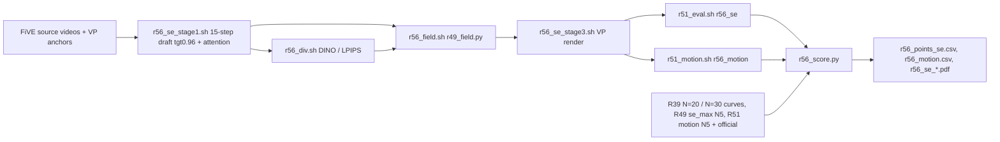

# R56: Draft-Budget Ablation (StreamEdit)

## Context

The method's draft is defined by a noise level, not a step count: the target is released at the first grid point at or below σ_d = 0.96. On StreamEdit's 5-step draft grid that point is σ = 0.8 (R49's `tgt0.9`, which anchors the same calls as `tgt0.96`). R56 gives the draft its full budget: 15 steps, same rule. The finer grid then releases at σ = 0.933 (only t = 1.0 anchored). Divergence, field and render are R49's, unchanged. The ablation is read at matched compute. se_max with the 15-step draft costs 15 + 15 = 30 NFE and is placed on R39's uniform-ρ N = 30 curve, which is already rendered and scored. It sits next to se_max with the 5-step draft (20 NFE) on R39's N = 20 curve. Two outcomes are possible. If the gain over the matched curve grows, the procedure scales with draft compute. If it holds, the short draft suffices. Colour / material / add-object edits (types 3–5) are the main readout, since `method.tex` notes the 5-step draft barely changes colour edits. StreamEdit only: a full-length Wan-Edit draft (~86 active steps with the render) would need a new matched curve on Jean Zay.

Done when: se_max with the 15-step draft is rendered and scored on the 419 pairs (harness, FiVE-Acc, CLIP-D, motion fidelity) on the lab L40S, and the trade-off figure and per-type means place both draft budgets on their matched-NFE curves.

## Execution steps

| # | Step id | Type | Waits for | Sets status |
|---|---|---|---|---|
| 0 | *(prep)* todos `stage1-sbatch`, `div-sbatch`, `field-sbatch`, `render-sbatch`, `units-r56-groups`, `eval-sbatch-groups`, `motion-sbatch-groups`, `chain-driver`, `score-script` | /build-step | — | implemented |
| 1 | `se-chain` | local (submits 6 queue entries = 7 tasks on the lab cluster) | — | running |
| 2 | `wait-se-chain` | manual | se-chain | finished |
| 3 | `score` | local | wait-se-chain | — |
| 4 | `verdict` | manual | score | analyzed |

Invoke: `/run-step R56 se-chain`, `/run-step R56 wait-se-chain`, `/run-step R56 score`, `/run-step R56 verdict`.

## Decisions

| Item | Choice |
|---|---|
| Draft | StreamEdit, VP + Qwen anchors, N = 15, `--blend_sched tgt0.96` (anchors t > 0.96: only t = 1.0; release from t = 0.933), fg_boost 4, blend_power 2, flow_shift 1, chunk 21, seed 0, `--dump_steps 14 --measure_index 14` (the final x0), attention recorder at r31_stage1.py defaults (first 20 blocks, σ window [0.55, 0.9]) |
| Release rule | σ_d = 0.96 on every host and grid: StreamEdit 5-step draft releases at 0.8, 15-step at 0.933, Wan-Edit 17-step draft starts at 0.958; any σ_d in [0.96, 0.97) gives identical drafts. R49's N = 5 runs (`tgt0.9`) anchor the same calls as `tgt0.96`, so they are not rerun |
| Draft check | guards only (no stored draft uses this schedule: R35 rendered `first2` / `unblended`, R44 `unblended` / `tgt0.9`); counts, (vp, tgt0.96, 15) in every latent, and the echoed per-step blender_rate [0, 1 × 14] |
| Divergence / field / render | unchanged from R49: DINOv3 + LPIPS (`r31_divergence.py`, temporal mean), `r49_field.py` (caps 0.55 / 1.0, λ 0.5, q = S·max, budget-linear inverse on the 15-step render grid), `r49_se_stage3.sh` flags |
| Matched compute | se_max N15 (30 NFE) vs R39 uniform ρ N = 30 (8 ρ, scored); se_max N5 = R49's `se_max` full (20 NFE) vs R39 N = 20; official = stock ρ = 2, N = 15 (`r36_rho2_vp`) |
| Metrics | 9 harness metrics, FiVE-Acc, CLIP-D, `motion_fidelity_score` + `_edit_part` (N5 and official motion from R51's units) |
| Scoring | plain per-clip means over 419, over the 401 outside `r49_cases.json`, and per edit type (1–6); figures x = alignment (FiVE-Acc, CLIP-D, CLIP-T), y = bg LPIPS; no curve-gap interpolation per type, no CIs (user choice) |
| Out of scope | Wan-Edit full-length draft (needs a matched ~86-step curve on Jean Zay); other draft lengths |
| Queue | 7 tasks; the driver refuses when the queue plus 7 exceeds the per-user cap (30) |
| Slurm | `--partition=L40S` / `CPU`, `--exclude=node52`; draft 20 h (R38 measured ~109 s / clip at N = 15), render 20 h, eval 12 h, motion 12 h |
| Outputs | `$D/r56_se_stage1/`, `$D/r56_se_attn/`, `$D/r56_div/se_{dino,lpips}/`, `$D/r56_field_full/se_max/`, `$D/r56_se_arms/r56_max_n15_full/step14/`, `evaluation/csv/*r56_*`, `evaluation/figures/r56_se_*.pdf` |

## Step commands

### se-chain
```bash
bash slurm_scripts/five_bench/r56_se_chain.sh
cat logs/r56_se_chain_jobs.txt
```

### wait-se-chain
```bash
cat logs/r56_se_chain_jobs.txt
squeue -u $USER
grep -hE 'failures|unit failures' logs/r56_*.out | sort | uniq -c
grep -m2 -i 'blender_rate\|blend' logs/r56_se_stage1_*.out
```

### score
```bash
python evaluation/r56_score.py
```

### verdict
```bash
column -s, -t < evaluation/csv/r56_points_se.csv
column -s, -t < evaluation/csv/r56_motion.csv
ls evaluation/figures/r56_se_*.pdf
```

## Pipeline



## Code to touch

| File | Change |
|---|---|
| `slurm_scripts/five_bench/r56_se_stage1.sh` (new) | Copy of `r48_se_stage1.sh` full mode: `METHOD=n15_tgt096`, `--step 15 --blend_sched tgt0.96 --dump_steps 14 --measure_index 14`, VP + anchors and the other R48 flags unchanged, `--attn_out_dir $D/r56_se_attn`, `OUT=$D/r56_se_stage1`; drop the R38 bit-identity block; guards: 419 attention + 419 latents, every latent records `vp_mode == vp`, `blend_sched == tgt0.96`, `n_steps == 15`, attention present per latent. |
| `slurm_scripts/five_bench/r56_div.sh` (new) | Copy of `r53_div.sh` with `TARGET_ROOT=$D/r56_se_stage1/frames/n15_tgt096/step14`, `--latent_dir $D/r56_se_stage1/latents`, `OUT=$D/r56_div`. |
| `slurm_scripts/five_bench/r56_field.sh` (new) | Copy of `r53_field.sh` with `--attn_se $D/r56_se_attn --div_root $D/r56_div --out_root $D/r56_field_full`. |
| `slurm_scripts/five_bench/r56_se_stage3.sh` (new) | Copy of `r49_se_stage3.sh` full mode: `FIELD_DIR=$D/r56_field_full/se_max`, `METHOD=r56_max_n15_full`, `OUT_ROOT=$D/r56_se_arms`; render flags unchanged (VP + anchors, step 15, fg_boost 4, blend_power 2, chunk 21, seed 0, dump 14). |
| `evaluation/r51_units.py` | Groups `r56_se` and `r56_motion` = `(se, max_n15, $D/r56_se_arms/r56_max_n15_full/step14)`; `STEM_PREFIX` gains both with `r56`; earlier groups byte-identical. |
| `slurm_scripts/five_bench/r51_eval.sh` | the usage `case` accepts `r56_se`. |
| `slurm_scripts/five_bench/r51_motion.sh` | the usage `case` accepts `r56_motion`. |
| `slurm_scripts/five_bench/r56_se_chain.sh` (new) | Refuses if `logs/r56_se_chain_jobs.txt` exists, if the R51 scripts lack the R56 groups, or if `squeue -r` count + 7 > cap (`R56_QUEUE_CAP`, default 30); submits `stage1`, `div` (`--array=0-1`, afterok stage1), `field` (afterok div), `render` (afterok field), `eval` (`r51_eval.sh r56_se --array=0`) and `motion` (`r51_motion.sh r56_motion --array=0`), both afterok render; writes `<stage> <id>` lines headed by the commit. |
| `evaluation/r56_score.py` (new) | Reuses `r51_score` helpers (`plot`, `write_csv`, `scopes_and_names`, `motion_table`) and `r48_score.unit_values`. Arms: N5 = `r49_se_max_full` (A0 stems), N15 = `r56_se_max_n15_full`; curves R39 `r39_n{20,30}_rho{R}_vp` (harness, `r39_fiveacc_*`, `r39_clip_directional.csv`); official `r36_rho2_vp`. Points CSV rows for scopes 419, 401 and `type1`..`type6` (per-type means of each arm and curve point). Motion items: N15 `r56_motion_se_max_n15_full`, N5 `r51_motion_se_max_full`, official `r51_motion_se_r36_rho2_vp_full`; fails with one clear message when an input is missing. |
