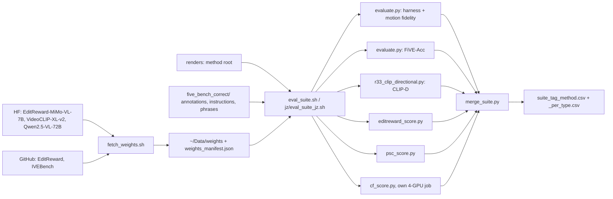

# R57: Unified Metric Pipeline for Future Runs

## Context
Every task so far cloned its own `rN_eval.sh` / `rN_fiveacc.sh` / `rN_clipd.sh`, and motion fidelity silently returned NaN because CoTracker's source folder had disappeared from the `five-bench` editable install (now restored). R57 builds one shared entry point that every future task calls on FiVE-Bench-Correct, adding motion fidelity, EditReward (Wu et al., ICLR 2026), and IVEBench's Phrase Semantic Consistency and Content Fidelity (Chen et al., ICLR 2026) to the metrics already computed.

**Done when:** a 3-clip smoke on each platform runs end to end with every metric non-NaN, and the user adopts the suite as the default evaluation.

## Execution steps

| # | step id | type | waits for | sets status |
|---|---|---|---|---|
| — | *(prep)* fetch-weights-script · editreward-env · editreward-script · psc-script · cf-script · merge-script · suite-sbatch · suite-jz-sbatch · editreward-jz-overlay · smoke-cases-json | todos | — | `implemented` |
| 1 | `fetch-weights` | local | — | — |
| 2 | `make-env` | local (conda env `editreward`) | fetch-weights | — |
| 3 | `smoke-lab` | launcher → 3 sbatch (1× L40S metrics, 4× L40S CF, CPU merge; 3 clips) | make-env | `running` |
| 4 | `check-smoke-lab` | manual | smoke-lab | — |
| 5 | `jz-sync` | manual (user on the frontal and Jean Zay) | check-smoke-lab | — |
| 6 | `smoke-jz` | manual (user on Jean Zay, dev qos) | jz-sync | `finished` |
| 7 | `adopt` | manual | smoke-jz | `analyzed` |

```
/build-step fetch-weights R57
/build-step make-env R57
/build-step smoke-lab R57
/build-step smoke-jz R57
/run-step R57 fetch-weights
/run-step R57 make-env
/run-step R57 smoke-lab
/run-step R57 check-smoke-lab
/run-step R57 jz-sync
/run-step R57 smoke-jz
/run-step R57 adopt
```

## Decisions

| Decision | Choice |
|---|---|
| Scope | Future runs only, on **FiVE-Bench-Correct** (415 pairs, `--edit_json_dir evaluation/five_bench_correct`); finished runs are not re-scored; existing metric code and envs are not modified |
| Metric set | FiVE harness (`structure_distance`, `psnr/lpips/mse/ssim_unedit_part`, `clip_similarity_source_image`, `clip_similarity_target_image`, `clip_similarity_target_image_edit_part`, `niqe_target_image`) + `motion_fidelity_score`, `motion_fidelity_score_edit_part` + FiVE-Acc (`five_acc_yes_no`, `five_acc_multi_choice`) + CLIP-D (`r33_clip_directional.py`) + EditReward + PSC + CF. No R37 distance-weighted metrics |
| Frames | The harness's frames for every per-frame metric: every 8th frame of the clip (`--frame_stride 8`, no `--max_frames`); PSC does NOT use them: it takes IVEBench's own sampling (8 frames evenly over the whole clip, 224 px, ImageNet normalisation), the setting VideoCLIP-XL-v2 / IVEBench's PSC are validated at. CF uses IVEBench's own video preparation (all frames → 25-fps MP4 → at most 20 frames, longest side 426 px, 5 fps) so the judge sees what IVEBench validated |
| CF | IVEBench's Content Fidelity (`metrics/fidelity/content_fidelity.py` at the pinned commit): `Qwen/Qwen2.5-VL-72B-Instruct` gets the source video, the edited video and the edit instruction, and rates 1–5 whether the edited video preserves everything except the edit itself. The 72B judge is IVEBench's setting (`path.yml`; the paper does not give the size); smaller judges were declined because IVEBench's human-correlation numbers do not cover them. Code reused from the clone, not re-written: its prompt, video preparation, bundled `qwen_vl_utils` and the checkpoint's `generation_config` (temperature 1e-6, effectively greedy). Run in five-bench (transformers 5.3.0) with two fixes that restore IVEBench's 4.49 behaviour, both checked on the lab on 2026-10-26 (processor + meta-device model, no weights): `use_fast=False` (5.3.0 defaults to the fast image processor, "may produce slightly different outputs"), and `video_metadata` with `fps=2.0` on the processor call (4.49's default fps is 2.0 → `second_per_grid_ts` 1.0 → rope time interval 2; 5.3.0 assumes 24 fps → 0.083 → `int()` → interval 0, every frame of a video at the same temporal position). Requires an ffmpeg with libx264 (IVEBench hard-codes it): imageio-ffmpeg's static 7.0.2 from five-bench; `~/anaconda3/bin/ffmpeg` (4.3) has no libx264. The module is loaded without running `fidelity/__init__.py`, which would import IVEBench's semantic and motion fidelity code: a stub `fidelity` package is placed in `sys.modules` with `metrics/fidelity` as its path. Instruction = FiVE-Bench-Correct `instruction`, as for EditReward. IVEBench drops unparseable answers from the mean (score −1); here they become NaN and fail the merge. Range 1–5; plain per-clip mean, all six edit types. **CF measures preservation only:** an unedited copy of the source gets 5, so it always appears next to an editability metric (EditReward, PSC, FiVE-Acc) and is never reported on its own |
| CF compute | 147 GB bf16 → `device_map=auto` on 4× L40S (lab, one node) or 2× H100 (Jean Zay, one node), in its own job running in parallel with the 1-GPU metrics job, so the other stages do not hold 4 GPUs |
| EditReward | `TIGER-Lab/EditReward-MiMo-VL-7B-SFT-2508`. Per frame: (source frame t, instruction, edited frame t), mean over frames. Reported score = the repo's fused score: the config's `pooling_strategy: mean`, i.e. the mean over the two heads (instruction following, visual quality) of logits[:, 0]; both heads kept as columns. The inferencer needs the base model `XiaomiMiMo/MiMo-VL-7B-SFT-2508` locally (it builds model + processor from it, then loads the checkpoint). No fixed range: compared across methods only. Instruction = FiVE-Bench-Correct `instruction` (no keep-pose suffix) |
| PSC | IVEBench's Phrase Semantic Consistency with `alibaba-pai/VideoCLIP-XL-v2`: types 1–5 `psc = s(V_edit, target_object)` (edit5: the added object). Type 6 (no target phrase): `psc = s(V_src, source_object) − s(V_edit, source_object)`, the drop of the removed object's score versus the source video (≈ 0 when nothing was removed). Phrases = R43's `source_object` / `target_object`. Benchmark-level PSC = mean over types 1–5; the edit6 removal score is reported separately, never averaged with them |
| Averaging | Plain per-clip mean per edit type and overall, from the per-clip CSV; never `_avg.csv` |
| Platforms | Lab L40S, env `five-bench`; Jean Zay H100, env `five-bench` (IDRIS module `pytorch-gpu/py3/2.5.1` + R50 pip overlay). `HF_HUB_OFFLINE=1` on both; weights fetched once on the lab and pushed with `jz/r50_push.sh`. Numbers of one host never mix platforms. If VideoCLIP-XL-v2's code is incompatible with `five-bench`'s transformers 5.3.0, the smoke fails and the env question goes back to the user |
| Envs | Everything in `five-bench` except EditReward, which runs in its own env `editreward` built from its pins (transformers 4.57.0, trl 0.8.6, python 3.10, torch 2.5.1): it does not import under transformers 5.3.0 (`DistributedTensorGatherer` / `SequentialDistributedSampler` / `nested_concat` gone from `transformers.trainer`, `trl` and `peft` absent, `self.visual` not on `Qwen2_5_VLForConditionalGeneration`), and shimming it would give unvalidated scores. Envs are never merged: the stage calls the env's python by absolute path. Jean Zay: a second pip overlay `$WORK/pyenv/editreward` on the same IDRIS module, built by the R50 overlay script with `R50_ENVDIR` |
| Smoke renders | Any existing render on local disk (the smoke tests the pipeline, not a method): lab `r49_se_arms/r49_max_full/step14`; Jean Zay `r49_wan_arms/wan_native_s0p92_full` |
| Errors | Each stage keeps the existing gates: per-type row-count guard and `grep -c 'Error:'` (evaluate.py swallows metric exceptions); the merge exits 1 on any NaN |
| Naming | Shared, reusable files are unprefixed: `evaluation/eval_suite/*`, `slurm_scripts/five_bench/eval_suite*.sh`, `jz/eval_suite*_jz.sh`; outputs `evaluation/csv/suite_{tag}_{method}.csv` and `_per_type.csv`. R57-only files and tags carry `r57_` |
| Out of scope | Re-scoring finished runs; R37 distance-weighted metrics; a user study; IVEBench's other MLLM judge (IS, instruction satisfaction) |

## Step commands

### fetch-weights
```bash
bash evaluation/eval_suite/fetch_weights.sh
```

### make-env
```bash
bash evaluation/eval_suite/make_editreward_env.sh
```

### smoke-lab
```bash
# launcher: submits metrics (1x L40S) + cf (4x L40S) in parallel, then merge (CPU, afterok both)
bash slurm_scripts/five_bench/eval_suite.sh --method r49_max_full \
  --root ~/Data/dataggen/outputs/five_bench/r49_se_arms/r49_max_full/step14 --layout edit_video \
  --cases evaluation/r57_smoke_cases.json --tag r57_smoke_lab
```

### check-smoke-lab
```bash
for S in metrics cf merge; do tail -n 3 logs/eval_suite_${S}_{job_id}.out; grep -c 'Error:' logs/eval_suite_${S}_{job_id}.out; done
column -s, -t < evaluation/csv/suite_r57_smoke_lab_r49_max_full.csv | less -S
```

### jz-sync
```bash
# Jean Zay (ssh zay): room for ~185 GB?
idrquota -w
# lab frontal, in tmux
bash jz/r50_push.sh
# Jean Zay (ssh zay)
cd $JZ_REPO && git pull && bash jz/eval_suite_editreward_overlay.sh
# through the five-bench wrapper
python -c 'import cotracker'
python -c 'import imageio_ffmpeg, subprocess; e = imageio_ffmpeg.get_ffmpeg_exe(); print(e); print("libx264" in subprocess.run([e, "-encoders"], capture_output=True, text=True).stdout)'
```

### smoke-jz
```bash
# Jean Zay
bash jz/eval_suite_jz.sh --qos qos_gpu_h100-dev --method wan_native_s0p92 \
  --root ~/Data/dataggen/outputs/five_bench/r49_wan_arms/wan_native_s0p92_full --layout edit_video \
  --cases evaluation/r57_smoke_cases.json --tag r57_smoke_jz
```

### adopt
```bash
column -s, -t < evaluation/csv/suite_r57_smoke_lab_r49_max_full.csv | less -S
column -s, -t < evaluation/csv/suite_r57_smoke_jz_wan_native_s0p92.csv | less -S
```

## Pipeline



## Code to touch

| File | Change |
|---|---|
| `evaluation/eval_suite/fetch_weights.sh` | **New** (first version built 2026-10-26 without CF; extend it). `huggingface-cli download TIGER-Lab/EditReward-MiMo-VL-7B-SFT-2508`, its base `XiaomiMiMo/MiMo-VL-7B-SFT-2508` (pin `d5281c5ee88b4d696f6e0f3e73b2ae9efc1d9da3`, 16.6 GB), `alibaba-pai/VideoCLIP-XL-v2` and `Qwen/Qwen2.5-VL-72B-Instruct` (pin `89c86200743eec961a297729e7990e8f2ddbc4c5`, 147 GB) at pinned revisions into `~/Data/weights/<repo>`; `git clone` TIGER-AI-Lab/EditReward into `~/Code/EditReward` and RyanChenYN/IVEBench into `~/Code/IVEBench` (pin `2dcf8900ee65197f43854c76f61c66a32bb8dbfc`) at pinned commits; write `evaluation/eval_suite/weights_manifest.json` (repo, revision, path, sha256 per weight file). Idempotent: skips what is already present and matches the manifest. |
| `evaluation/eval_suite/make_editreward_env.sh` | **New.** `conda create -n editreward python=3.10`; torch 2.5.1 / torchvision 0.20.1 / torchaudio 2.5.1 from the cu121 index (as five-bench, known to run on the L40S nodes); EditReward's README runtime list with `transformers==4.57.0`, `trl==0.8.6`; `pip install -e ~/Code/EditReward`; flash-attn only if a prebuilt wheel for torch 2.5 / cu12 / cp310 exists (optional in EditReward). Writes `evaluation/eval_suite/freeze/editreward.txt`; verifies the import and the two pins; skips the create when the env exists and the pins match. |
| `evaluation/eval_suite/editreward_score.py` | **New.** Runs with `~/anaconda3/envs/editreward/bin/python`. Args `--root --layout --edit_json_dir --data_root --cases --frame_stride 8 --out`. Loads the checkpoint offline through ~/Code/EditReward's `EditRewardInferencer` (config copied with `model_name_or_path` = the local MiMo base; cwd = the clone during construction, the config carries repo-relative paths); for each pair: source frames `images/<video>/` and edited frames from the method root, same stride as evaluate.py, edited frames resized to the source size; per frame score (source, instruction, edited); mean of each head over frames; `editreward` = mean of the two heads, cross-checked once against the repo's fused output. Frames in batches of `--batch_size` (8); bf16. Resumable. |
| `evaluation/eval_suite/psc_score.py` | **New.** Same args, five-bench. IVEBench's `VideoCLIPEvaluator.compute_similarity(frames_dir, phrase)` from the pinned clone (stub `compliance` package; 8 frames evenly over the whole clip, 224 px, ImageNet normalisation; offline weights `~/Data/weights/VideoCLIP-XL-v2/VideoCLIP-XL-v2.bin`); `s(V, phrase)` = its video-text cosine. Types 1–5: `s(V_edit, target_object)`; type 6: `s(V_src, source_object) − s(V_edit, source_object)`. |
| `evaluation/eval_suite/cf_score.py` | **New.** Same args as `editreward_score.py` (plus `--ivebench_dir ~/Code/IVEBench`, `--model_path ~/Data/weights/Qwen2.5-VL-72B-Instruct`; no `--frame_stride`). Puts `<ivebench>/metrics` on `sys.path`, registers a stub `fidelity` package (`types.ModuleType`, `__path__ = [<ivebench>/metrics/fidelity]`) so `fidelity/__init__.py` is not executed, then imports `fidelity.content_fidelity.QwenVLContentFidelityEvaluator`. A subclass overrides `_load_model` only to add `use_fast=False` to `AutoProcessor.from_pretrained`, and wraps `self.processor` so that every call with `videos` also gets `video_metadata=[VideoMetadata(total_num_frames=len(v), fps=2.0) for v in videos]` and `do_sample_frames=False`, then asserts `second_per_grid_ts == 1.0`; `evaluate_video` and its prompt are untouched. Prints transformers version, ffmpeg path and its libx264 check at start. Per pair: `evaluate_video(images/<video>/, <edited frames dir>, instruction)`; the source and edited frames dirs must hold `%05d.jpg/png` as IVEBench's ffmpeg call expects (if they do not, symlink them into a temp dir with that naming). Writes `cf` (NaN when IVEBench returns −1) and `cf_raw`. Exit 1 on any NaN after all pairs are written. |
| `evaluation/eval_suite/merge_suite.py` | **New.** Inputs: the per-type harness and FiVE-Acc CSVs (`edit{T}_FiVE_{stem}_frame_stride8.csv`), the CLIP-D CSV, the EditReward, PSC and CF CSVs; key = (edit_type, video_name). Writes the per-pair table and the per-type table (plain per-clip means; PSC overall over types 1–5, `psc_removal` for type 6; CF over all six types; `cf_raw` kept only in the per-pair table). Fails on a missing column, a row-count mismatch or a NaN. |
| `slurm_scripts/five_bench/eval_suite.sh` + `eval_suite_{metrics,cf,merge}.sh` | **New.** `eval_suite.sh` is a bash launcher (common args) that `sbatch`es the metrics and cf jobs, then the merge job with `--dependency=afterok:<metrics>:<cf>`, and prints the three ids. `eval_suite_metrics.sh`, built from `r49_eval_all.sh`'s structure: L40S, `--gres=gpu:1`, `--exclude=node52`, `--mem=64G`, `--time=20:00:00`, five-bench python, `HF_HUB_OFFLINE=1`; stages harness (all metrics incl. motion fidelity) → FiVE-Acc → CLIP-D (`--fullbench --edit_json_dir` or `--cases`) → EditReward (`~/anaconda3/envs/editreward/bin/python`) → PSC, each followed by its count guard and `Error:` gate. `eval_suite_cf.sh`: L40S, `--nodes=1 --gres=gpu:4`, `--exclude=node52`, `--mem=256G`, `--time=20:00:00`, `HF_HUB_OFFLINE=1`, five-bench python by absolute path; ffmpeg = `imageio_ffmpeg.get_ffmpeg_exe()` linked as `ffmpeg` into `$TMPDIR/ffbin` (or a per-job dir under the repo's scratch) placed first on PATH, job exits 1 if its `-encoders` lacks libx264; `cf_score.py` with count guard and `Error:` gate. `eval_suite_merge.sh`: `CPU` partition, `merge_suite.py`. Logs `logs/eval_suite_{metrics,cf,merge}_%j.{out,err}`. |
| `jz/eval_suite_jz.sh` + `jz/eval_suite_{metrics,cf,merge}_jz.sh` | **New**, Jean Zay clone of the lab launcher and jobs: `-A omt@h100`, `--qos` from the launcher's command line, `module load pytorch-gpu/py3/2.5.1` + the R50 overlay, paths from `jz/r50_jz.env`, weights from the pushed stage; EditReward stage through `$WORK/pyenv/editreward/python`; cf job on `--gres=gpu:2` (one node), ffmpeg from `imageio_ffmpeg.get_ffmpeg_exe()` in the five-bench overlay with the same libx264 check; merge on the CPU account. |
| `jz/r50_pip_overlay.sh` | One line: `ENVDIR=${R50_ENVDIR:-$WORK/pyenv/five-bench}` (default unchanged, so R50's overlay is unaffected). |
| `jz/eval_suite_editreward_overlay.sh` | **New.** `R50_FREEZE=$WORK/r50_stage/freeze/editreward.txt R50_ENVDIR=$WORK/pyenv/editreward bash jz/r50_pip_overlay.sh`, then through `$WORK/pyenv/editreward/python`: transformers 4.57.0 and trl 0.8.6 imported from the overlay, `from EditReward import EditRewardInferencer` with the pushed EditReward clone on PYTHONPATH. Ends with `failures: N`. |
| `evaluation/r57_smoke_cases.json` | **New.** `[{"video_name": "0001_bus", "edit_type": 1}, {"video_name": "0007_guitar-violin", "edit_type": 5}, {"video_name": "0048_hike", "edit_type": 6}]`. |
