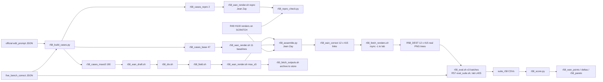

# R58: Wan-Edit on FiVE-Bench-Correct

## Context
FiVE-Bench-Correct is the main benchmark of the paper (supervisor, 2026-10-23), so Wan-Edit's R49 arms must be reported on its 415 pairs: the native sweep (official Wan-Edit = native_s0.92), the equal-NFE matched-59 curve and the adaptive max_s5. Wan-Edit is text-only, so a clip whose prompts and trigger words are unchanged by Correct renders exactly as in R49. Generation is therefore limited to the pairs whose inputs changed, while evaluation is redone on all 415 pairs, because Correct changed the FiVE-Acc questions, objects and instructions the metrics read.

Rendering stays on Jean Zay H100 next to the R49 renders it reuses. Every Wan-Edit config is scored on the lab L40S with the same R57 suite as the StreamEdit, AnyV2V and ContextFlow rows, so no main-table number depends on the scoring platform (user, 2026-10-27).

**Done when:** 12 configs × 415 pairs are scored with R57's suite on the lab L40S, and `r58_wan_points.csv` / `r58_wan_deltas.csv` / `r58_pareto/` are read.

## Execution steps

| # | step id | type | runs on | waits for | sets status |
|---|---|---|---|---|---|
| — | *(prep)* assemble-script · fetch-renders-script · eval-lab-launcher · fetch-folders · score-script (others completed) | todos | lab (code) | — | `implemented` |
| 1 | `build-cases` | local | lab | — | — |
| 2 | `jz-sync` | manual | lab → **Jean Zay** | build-cases | — |
| 3 | `repro-render` | manual | **Jean Zay** | jz-sync | — |
| 4 | `repro-check` | manual | **Jean Zay** | repro-render | — |
| 5 | `wan-chain` | manual | **Jean Zay** | repro-check | `running` |
| 6 | `wait-chain` | manual | **Jean Zay** | wan-chain | `finished` |
| 7 | `assemble` | manual | **Jean Zay** | wait-chain | — |
| 8 | `probe-mounts` | manual | lab frontal + L40S node | — | — |
| 9 | `fetch-renders` | manual (user, tmux) | lab frontal | assemble, probe-mounts | — |
| 10 | `wait-r57` | manual | lab | R57 lab smoke | — |
| 11 | `eval-1` | local (submits eval_suite jobs) | **lab L40S** | fetch-renders, wait-r57 | — |
| 12 | `eval-2` | local | **lab L40S** | eval-1 | — |
| 13 | `eval-3` | local | **lab L40S** | eval-2 | — |
| 14 | `wait-eval` | manual | lab | eval-3 | — |
| 15 | `score` | local | lab | wait-eval | — |
| 16 | `archive` | manual (user, tmux) | lab frontal | wait-eval | — |
| 17 | `analyze` | manual | lab | score | `analyzed` |

```
/build-step assemble R58
/build-step fetch-renders R58
/build-step eval-1 R58
/build-step score R58
/build-step archive R58
/run-step R58 wait-chain
/run-step R58 assemble
/run-step R58 probe-mounts
/run-step R58 fetch-renders
/run-step R58 wait-r57
/run-step R58 eval-1
/run-step R58 eval-2
/run-step R58 eval-3
/run-step R58 wait-eval
/run-step R58 score
/run-step R58 archive
/run-step R58 analyze
```

## Decisions

| Decision | Choice |
|---|---|
| Benchmark | FiVE-Bench-Correct, 415 pairs (`evaluation/r43_anchor_manifest_correct.json`, annotations `evaluation/five_bench_correct/`); the 4 excluded pairs drop out. The uncommitted edits to `edit1_FiVE.json` / `edit6_FiVE.json` are committed before `build-cases`; the regeneration sets are computed from the committed files |
| Regeneration sets | Computed from the JSON files (official vs Correct), not from `r43_correct_diff.csv`. Baselines (11 configs): the **47** pairs with a changed `source_prompt` / `target_prompt` (the only fields their render reads). max_s5: the **190** pairs with a changed prompt **or** `source_object` / `target_object` (the draft's attention support reads the trigger tokens). Checked 2026-10-26: 47 / 166 / 190 |
| Configs (12) | native N=50: `native_s0.95`, `s0.92` (official Wan-Edit), `s0.85`, `s0.75`, `s0.6`, `s0.4`, `s0.978`; matched-59: `matched59_s0.95`, `s0.92`, `s0.85`, `s0.978`; adaptive `max_s5` |
| Equal NFE | 59 = 14-step draft + 45 active render steps from the s_min 5 floor: fixed by construction, so it holds on Correct unchanged |
| Settings | Frozen from R49's full stage: draft = 17-step grid from step 3 (σ 0.958), seed 0; div = DINOv3 + LPIPS, temporal mean; field = `r49_field.py` (absolute caps, per clip); render seeds as R49 |
| Render platform | **Jean Zay H100**, R50 `five-bench` overlay, for every render, the gate and the assembly (reused R49 renders are H100 too); no Wan-Edit render is ever made on L40S |
| Eval platform | **Lab L40S**, R57 `eval_suite.sh` (envs `five-bench` + `editreward` of the lab), for **all 12 configs**, the same suite and platform as every other main-table row; Jean Zay's `jz/eval_suite_jz.sh` is not used for R58 |
| No overwrite | No existing video is written, moved or deleted. New renders only in new folders (`r58_wan_arms`, `r58_repro`; the render script refuses any other output root); the renderers skip clips that already have their PNGs; `r58_assemble.py` only creates symlinks inside `r58_wan_correct` and stops on any conflict; `wait-chain` checks that no file in `r48_wan_arms` / `r49_wan_arms` is newer than the chain submission; the fetch scripts never delete |
| Reuse gate | Before mixing new and reused renders: 2 unchanged pairs re-rendered with `native_s0.92` (r48 renderer) and `matched59_s0.92` (r49 renderer); PASS iff max \|diff\| ≤ 2/255 on every frame. FAIL stops the task (decision with the user: full re-render) |
| Output dirs (Jean Zay) | New renders under `$D/r58_wan_arms/{config}_full/`; draft `$D/r58_wan_draft`, divergence `$D/r58_div`, field `$D/r58_field`, repro `$D/r58_repro`, assembly `$D/r58_wan_correct`; all on `$SCRATCH` via `r50_scratch_links.sh`. The R48/R49 renders must stay on `$SCRATCH` until `fetch-renders` passes (IDRIS purge) |
| Assembly (two folders → one root) | Per config, `$D/r58_wan_correct/{config}/edit{T}/{video}` is a symlink on Jean Zay to the new render (`r58_wan_arms`) if the pair is in the regen set, else to the R49 render (`r48_wan_arms` / `r49_wan_arms`) |
| Transfer | `jz/r58_fetch_renders.sh` on gpu-gw: `rsync -aL` of each assembled tree, so the lab holds one ordinary 415-clip tree of real PNGs per config at `R58_DEST/{config}` (default `/work/PERSO/skhairi/five_bench/r58_wan_correct`, ~9.3 GB per config, ~110 GB total; not `/store`, which L40S nodes cannot all read, and not `~/Data`, near the home quota); PNG count per clip checked against `r58_assembly.csv` |
| Evaluation | `eval_suite.sh --root R58_DEST/{config} --layout edit_video --tag r58 --method wan_{config}_correct` (dot → `p`), all 415 pairs, `--allow_nan motion_fidelity_score_edit_part` → `evaluation/csv/suite_r58_wan_{config}_correct.csv`; submitted in 3 batches of 4 configs (12 jobs each) to stay under the 30-task lab queue cap, headline configs first (native_s0.92, native_s0.978, matched59_s0.92, max_s5) |
| Averaging / plots | Plain per-clip mean from the suite CSV, never `_avg.csv`; Pareto plots with x = alignment, y = preservation |
| Readout | max_s5 vs matched-59 (equal NFE, headline), vs native_s0.92 (official) and native_s0.978 (same floor); paired bootstrap 95% CI; per edit type; regenerated vs reused split as a sanity check |
| Out of scope | StreamEdit arms on Correct (separate tasks); the R51 A4 Wan arm; re-rendering unchanged pairs; Jean Zay scoring |

## Step commands

### build-cases
```bash
python evaluation/r58_build_cases.py
```

### jz-sync
```bash
# lab: commit + push (Correct JSONs, r58_cases_*.json, the R58 scripts)
# Jean Zay (ssh zay), in $JZ_REPO:
git checkout -- slurm_scripts evaluation/fivebench/config.yaml && git pull
bash jz/r50_verify.sh --code-only
bash jz/r50_port.sh
bash jz/r50_scratch_links.sh
ls ~/Data/dataggen/outputs/five_bench/r48_wan_arms/native_s0.92_full/edit1 | wc -l   # 100
```

### repro-render
```bash
# Jean Zay
sbatch -A omt@h100 --qos=qos_gpu_h100-dev --time=01:00:00 --array=0-1 slurm_scripts/five_bench/r58_wan_render.sh repro
```

### repro-check
```bash
# Jean Zay
$WORK/pyenv/five-bench/python evaluation/r58_repro_check.py
```

### wan-chain
```bash
# Jean Zay
bash slurm_scripts/five_bench/r58_wan_chain.sh --dry-run
bash slurm_scripts/five_bench/r58_wan_chain.sh
```

### wait-chain
```bash
# Jean Zay, queue empty
grep -h failures logs/r58_*.out | sort | uniq -c
```

### assemble
```bash
# Jean Zay
$WORK/pyenv/five-bench/python evaluation/r58_assemble.py
```

### probe-mounts
```bash
# lab frontal (gpu-gw)
mkdir -p /work/PERSO/skhairi/five_bench/r58_wan_correct && df -h /work/PERSO/skhairi
srun -p L40S --exclude=node52 --gres=gpu:1 -t 00:05:00 ls -d /work/PERSO/skhairi/five_bench/r58_wan_correct
```

### fetch-renders
```bash
# lab frontal (gpu-gw), in tmux
bash jz/r58_fetch_renders.sh --check
bash jz/r58_fetch_renders.sh
```

### wait-r57
```bash
ls slurm_scripts/five_bench/eval_suite.sh
ls evaluation/csv/suite_r57_smoke_lab_*.csv
```

### eval-1
```bash
bash slurm_scripts/five_bench/r58_eval.sh native_s0.92 native_s0.978 matched59_s0.92 max_s5
```

### eval-2
```bash
bash slurm_scripts/five_bench/r58_eval.sh native_s0.95 native_s0.85 native_s0.75 native_s0.6
```

### eval-3
```bash
bash slurm_scripts/five_bench/r58_eval.sh native_s0.4 matched59_s0.95 matched59_s0.85 matched59_s0.978
```

### wait-eval
```bash
cat logs/r58_eval_jobs.txt
ls evaluation/csv/suite_r58_wan_*_correct.csv | wc -l   # 12
```

### score
```bash
python evaluation/r58_score.py
```

### archive
```bash
# lab frontal (gpu-gw), in tmux
bash jz/r50_fetch_outputs.sh r58_wan_draft r58_div r58_field r58_wan_arms
```

### analyze
```bash
# read evaluation/csv/r58_wan_points.csv, evaluation/csv/r58_wan_deltas.csv, evaluation/figures/r58_pareto/
```

## Pipeline



## Code to touch

| File | Change | Todo |
|---|---|---|
| `evaluation/r48_wan_common.py` | `load_cases(cases_path, anno_dir=None)`: `anno_dir or FIVE / "edit_prompt"` | `anno-dir-common` ✅ |
| `evaluation/r48_wan_draft.py` | `--anno_dir` (default None) → `C.load_cases(a.cases, a.anno_dir)` | `anno-dir-draft` ✅ |
| `evaluation/r48_wan_render.py` | `--anno_dir` (default None) → `C.load_cases` | `anno-dir-render48` ✅ |
| `evaluation/r49_wan_render.py` | `--anno_dir` (default None) → `C.load_cases` | `anno-dir-render49` ✅ |
| `evaluation/r58_build_cases.py` (new) | Regen sets from JSON comparison → 3 case files + `r58_regen_sets.csv`; count asserts 47 / 190 / 2 | `cases-script` ✅ |
| `slurm_scripts/five_bench/r58_wan_render.sh` (new) | `correct` (array 0-11, config → renderer + case file) and `repro` (array 0-1) modes; all with `--anno_dir evaluation/five_bench_correct --mode full` | `render-sbatch` ✅ |
| `slurm_scripts/five_bench/r58_wan_draft.sh` (new) | Clone of `r48_wan_draft.sh` on the 190 cases → `$D/r58_wan_draft` | `draft-sbatch` ✅ |
| `slurm_scripts/five_bench/r58_div.sh` (new) | Clone of `r48_div.sh` wan tasks (array 0-1) → `$D/r58_div` | `div-sbatch` ✅ |
| `slurm_scripts/five_bench/r58_field.sh` (new) | `r49_field.py --hosts wan` on r58 roots → `$D/r58_field` | `field-sbatch` ✅ |
| `slurm_scripts/five_bench/r58_wan_chain.sh` (new) | Clone of `r49_wan_full_chain.sh`: 5 submissions, afterok chain for max_s5 | `chain-driver` ✅ |
| `evaluation/r58_repro_check.py` (new) | Pixel comparison repro vs R49 render, PASS ≤ 2/255 → `r58_repro_check.csv` | `repro-check-script` ✅ |
| `evaluation/r58_assemble.py` (new) | Symlink tree `$D/r58_wan_correct/{config}` over 415 pairs + `r58_assembly.csv` (runs on Jean Zay) | `assemble-script` |
| `jz/r58_fetch_renders.sh` (new) | gpu-gw: fetch `r58_assembly.csv`, then `rsync -aL` per config → `R58_DEST/{config}`; free-space preflight; per-clip PNG count check; `--check`; `failures: N` | `fetch-renders-script` |
| `slurm_scripts/five_bench/r58_eval.sh` (new) | Lab launcher: `eval_suite.sh` per config given as argument, tag `r58`, queue-cap and duplicate guards, job ids → `logs/r58_eval_jobs.txt` | `eval-lab-launcher` |
| `jz/r50_port.sh` | SCRIPTS += the 5 `r58_*.sh` job scripts | `port-list` ✅ |
| `jz/r50_scratch_links.sh` | FOLDERS += `r58_wan_draft r58_div r58_field r58_wan_arms r58_repro r58_wan_correct` | `scratch-folders` ✅ |
| `jz/r50_fetch_outputs.sh` | ALL += `r58_wan_draft r58_div r58_field r58_wan_arms` (archive only) | `fetch-folders` |
| `evaluation/r58_score.py` (new) | Points (overall + per type), deltas with paired bootstrap, Pareto PDFs | `score-script` |

`r58_wan_render.sh` index → (config, renderer, cases):

```
0-5  native_s0.95 s0.92 s0.85 s0.75 s0.6 s0.4   r48_wan_render.py   r58_cases_base.json
6    native_s0.978                               r48_wan_render.py   r58_cases_base.json
7-10 matched59_s0.95 s0.92 s0.85 s0.978          r49_wan_render.py   r58_cases_base.json
11   max_s5 (--field_root $D/r58_field)          r49_wan_render.py   r58_cases_maxs5.json
repro 0 native_s0.92 / 1 matched59_s0.92         r48 / r49           r58_cases_repro.json -> $D/r58_repro
```
