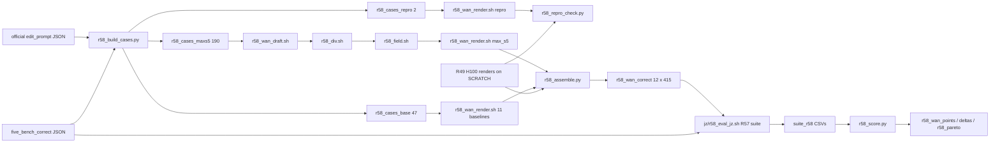

# R58: Wan-Edit on FiVE-Bench-Correct

## Context
FiVE-Bench-Correct is the main benchmark of the paper (supervisor, 2026-10-23), so Wan-Edit's R49 arms must be reported on its 415 pairs: the native sweep (official Wan-Edit = native_s0.92), the equal-NFE matched-59 curve and the adaptive max_s5. Wan-Edit is text-only, so a clip whose prompts and trigger words are unchanged by Correct renders exactly as in R49. Generation is therefore limited to the pairs whose inputs changed, while evaluation is redone on all 415 pairs, because Correct changed the FiVE-Acc questions, objects and instructions the metrics read.

**Platform: Jean Zay.** Every render, the gate, the assembly and the evaluation run on Jean Zay H100 (`ssh zay`, run by the user and pasted back), next to the R49 Wan renders they reuse; the lab only builds the case lists (`build-cases`) and scores the fetched CSVs (`score`).

**Done when:** 12 configs × 415 pairs are scored with R57's suite on Jean Zay, and `r58_wan_points.csv` / `r58_wan_deltas.csv` / `r58_pareto/` are read.

## Execution steps

| # | step id | type | runs on | waits for | sets status |
|---|---|---|---|---|---|
| — | *(prep)* anno-dir-common · anno-dir-draft · anno-dir-render48 · anno-dir-render49 · cases-script · render-sbatch · draft-sbatch · div-sbatch · field-sbatch · chain-driver · repro-check-script · assemble-script · eval-jz-launcher · port-list · scratch-folders · fetch-folders · score-script | todos | lab (code) | — | `implemented` |
| 1 | `build-cases` | local | lab | — | — |
| 2 | `jz-sync` | manual (user: push on lab, then pull + port + scratch links) | lab → **Jean Zay** | build-cases | — |
| 3 | `repro-render` | manual (user, dev qos) | **Jean Zay** | jz-sync | — |
| 4 | `repro-check` | manual (user) | **Jean Zay** | repro-render | — |
| 5 | `wan-chain` | manual (user, chain driver) | **Jean Zay** | repro-check | `running` |
| 6 | `wait-chain` | manual | **Jean Zay** | wan-chain | `finished` |
| 7 | `assemble` | manual (user) | **Jean Zay** | wait-chain | — |
| 8 | `eval` | manual (user; needs R57 `adopt`) | **Jean Zay** | assemble | — |
| 9 | `wait-eval` | manual | **Jean Zay** | eval | — |
| 10 | `fetch` | manual (user) | lab frontal | wait-eval | — |
| 11 | `score` | local | lab | fetch | — |
| 12 | `analyze` | manual | lab | score | `analyzed` |

```
/build-step build-cases R58
/build-step repro-render R58
/build-step wan-chain R58
/build-step assemble R58
/build-step eval R58
/build-step score R58
/run-step R58 build-cases
/run-step R58 jz-sync
/run-step R58 repro-render
/run-step R58 repro-check
/run-step R58 wan-chain
/run-step R58 wait-chain
/run-step R58 assemble
/run-step R58 eval
/run-step R58 wait-eval
/run-step R58 fetch
/run-step R58 score
/run-step R58 analyze
```

## Decisions

| Decision | Choice |
|---|---|
| Benchmark | FiVE-Bench-Correct, 415 pairs (`evaluation/r43_anchor_manifest_correct.json`, annotations `evaluation/five_bench_correct/`); the 4 excluded pairs drop out. The uncommitted edits to `edit1_FiVE.json` / `edit6_FiVE.json` are committed before `build-cases`; the regeneration sets are computed from the committed files |
| Regeneration sets | Computed from the JSON files (official vs Correct), not from `r43_correct_diff.csv`. Baselines (11 configs): the **47** pairs with a changed `source_prompt` / `target_prompt` (the only fields their render reads). max_s5: the **190** pairs with a changed prompt **or** `source_object` / `target_object` (the draft's attention support reads the trigger tokens). Checked 2026-10-26: 47 / 166 / 190 |
| Configs (12) | native N=50: `native_s0.95`, `s0.92` (official Wan-Edit), `s0.85`, `s0.75`, `s0.6`, `s0.4`, `s0.978`; matched-59: `matched59_s0.95`, `s0.92`, `s0.85`, `s0.978`; adaptive `max_s5` |
| Equal NFE | 59 = 14-step draft + 45 active render steps from the s_min 5 floor: fixed by construction, so it holds on Correct unchanged |
| Settings | Frozen from R49's full stage: draft = 17-step grid from step 3 (σ 0.958), seed 0; div = DINOv3 + LPIPS, temporal mean; field = `r49_field.py` (absolute caps, per clip); render seeds as R49 |
| Platform | **Jean Zay H100**, R50 `five-bench` overlay, for every render, the gate, the assembly and every eval (reused R49 renders are H100 too); never mixed with L40S numbers. Lab: case lists and scoring only |
| No overwrite | No existing video is written, moved or deleted. New renders only in new folders (`r58_wan_arms`, `r58_repro`; the render script refuses any other output root); the renderers skip clips that already have their PNGs; `r58_assemble.py` only creates symlinks inside `r58_wan_correct` and stops on any conflict; `wait-chain` checks that no file in `r48_wan_arms` / `r49_wan_arms` is newer than the chain submission |
| Reuse gate | Before mixing new and reused renders: 2 unchanged pairs re-rendered with `native_s0.92` (r48 renderer) and `matched59_s0.92` (r49 renderer); PASS iff max \|diff\| ≤ 2/255 on every frame. FAIL stops the task (decision with the user: full re-render) |
| Output dirs | New renders under `$D/r58_wan_arms/{config}_full/` (separate root, so the resumable renderers cannot skip a changed pair because its official render exists); draft `$D/r58_wan_draft`, divergence `$D/r58_div`, field `$D/r58_field`, repro `$D/r58_repro`; all on `$SCRATCH` via `r50_scratch_links.sh` |
| Assembly (two folders → one root) | Per config, `$D/r58_wan_correct/{config}/edit{T}/{video}` is a symlink to the clip folder: the new render (`r58_wan_arms`) if the pair is in the regen set, else the R49 render (`r48_wan_arms` / `r49_wan_arms`). The eval gets `--root $D/r58_wan_correct/{config} --layout edit_video` and sees one ordinary 415-clip tree (the FiVE harness lists folders with `os.listdir` / `glob`, which follow symlinks; no `os.walk`). No copy, so the R49 renders must still be on `$SCRATCH` until `wait-eval` (IDRIS purge) |
| Evaluation | R57 unified suite on Jean Zay (`jz/eval_suite_jz.sh`), all 415 pairs per config, `--tag r58`, method name `wan_{config}_correct` (dot → `p`) → `evaluation/csv/suite_r58_wan_{config}_correct.csv`. Blocked until R57 is adopted |
| Averaging / plots | Plain per-clip mean from the suite CSV, never `_avg.csv`; Pareto plots with x = alignment, y = preservation |
| Readout | max_s5 vs matched-59 (equal NFE, headline), vs native_s0.92 (official) and native_s0.978 (same floor); paired bootstrap 95% CI; per edit type; regenerated vs reused split as a sanity check |
| Out of scope | StreamEdit arms on Correct (separate tasks); the R51 A4 Wan arm; re-rendering unchanged pairs |

## Step commands

### build-cases
```bash
python evaluation/r58_build_cases.py
```

### jz-sync
```bash
# lab: commit + push (Correct JSONs, r58_cases_*.json, the R58 scripts)
# Jean Zay (ssh zay), in $JZ_REPO:
git checkout -- slurm_scripts evaluation/fivebench/config.yaml && git pull
bash jz/r50_verify.sh --code-only
bash jz/r50_port.sh
bash jz/r50_scratch_links.sh
ls ~/Data/dataggen/outputs/five_bench/r48_wan_arms/native_s0.92_full/edit1 | wc -l   # 100
```

### repro-render
```bash
# Jean Zay
sbatch -A omt@h100 --qos=qos_gpu_h100-dev --time=01:00:00 --array=0-1 slurm_scripts/five_bench/r58_wan_render.sh repro
```

### repro-check
```bash
# Jean Zay
$WORK/pyenv/five-bench/python evaluation/r58_repro_check.py
```

### wan-chain
```bash
# Jean Zay
bash slurm_scripts/five_bench/r58_wan_chain.sh --dry-run
bash slurm_scripts/five_bench/r58_wan_chain.sh
```

### wait-chain
```bash
# Jean Zay, queue empty
grep -h failures logs/r58_*.out | sort | uniq -c
```

### assemble
```bash
# Jean Zay
$WORK/pyenv/five-bench/python evaluation/r58_assemble.py
```

### eval
```bash
# Jean Zay, after R57 adopt
bash jz/r58_eval_jz.sh --qos qos_gpu_h100-t3
```

### wait-eval
```bash
# Jean Zay
ls evaluation/csv/suite_r58_wan_*_correct.csv | wc -l   # 12
```

### fetch
```bash
# lab frontal (gpu-gw), in tmux
rsync -av "zay:/lustre/fswork/projects/rech/omt/upx85tg/StreamEdit_new/evaluation/csv/suite_r58_*" \
          "zay:/lustre/fswork/projects/rech/omt/upx85tg/StreamEdit_new/evaluation/csv/r58_*" evaluation/csv/
bash jz/r50_fetch_outputs.sh r58_wan_draft r58_div r58_field r58_wan_arms
```

### score
```bash
python evaluation/r58_score.py
```

### analyze
```bash
# read evaluation/csv/r58_wan_points.csv, evaluation/csv/r58_wan_deltas.csv, evaluation/figures/r58_pareto/
```

## Pipeline



## Code to touch

| File | Change |
|---|---|
| `evaluation/r48_wan_common.py` | `load_cases(cases_path, anno_dir=None)`: `anno_dir or FIVE / "edit_prompt"` |
| `evaluation/r48_wan_draft.py` | `--anno_dir` (default None) → `C.load_cases(a.cases, a.anno_dir)` |
| `evaluation/r48_wan_render.py` | `--anno_dir` (default None) → `C.load_cases` |
| `evaluation/r49_wan_render.py` | `--anno_dir` (default None) → `C.load_cases` |
| `evaluation/r58_build_cases.py` (new) | Regen sets from JSON comparison → 3 case files + `r58_regen_sets.csv`; count asserts 47 / 190 / 2 |
| `slurm_scripts/five_bench/r58_wan_render.sh` (new) | `correct` (array 0-11, config → renderer + case file) and `repro` (array 0-1) modes; all with `--anno_dir evaluation/five_bench_correct --mode full` |
| `slurm_scripts/five_bench/r58_wan_draft.sh` (new) | Clone of `r48_wan_draft.sh` on the 190 cases → `$D/r58_wan_draft` |
| `slurm_scripts/five_bench/r58_div.sh` (new) | Clone of `r48_div.sh` wan tasks (array 0-1) → `$D/r58_div` |
| `slurm_scripts/five_bench/r58_field.sh` (new) | `r49_field.py --hosts wan` on r58 roots → `$D/r58_field` |
| `slurm_scripts/five_bench/r58_wan_chain.sh` (new) | Clone of `r49_wan_full_chain.sh`: 5 submissions, afterok chain for max_s5, jobs file `logs/r58_wan_chain_jobs.txt`; refuses to run unless `r58_repro_check.csv` has every row `pass=1` and the R49 render dirs exist |
| `evaluation/r58_repro_check.py` (new) | Pixel comparison repro vs R49 render, PASS ≤ 2/255 → `r58_repro_check.csv` |
| `evaluation/r58_assemble.py` (new) | Symlink tree `$D/r58_wan_correct/{config}` over 415 pairs + `r58_assembly.csv` |
| `jz/r58_eval_jz.sh` (new) | Loop of `jz/eval_suite_jz.sh` over the 12 configs, tag `r58` |
| `jz/r50_port.sh` | SCRIPTS += the 5 `r58_*.sh` job scripts |
| `jz/r50_scratch_links.sh` | FOLDERS += `r58_wan_draft r58_div r58_field r58_wan_arms r58_repro r58_wan_correct` |
| `jz/r50_fetch_outputs.sh` | ALL += `r58_wan_draft r58_div r58_field r58_wan_arms` |
| `evaluation/r58_score.py` (new) | Points (overall + per type), deltas with paired bootstrap, Pareto PDFs |

`r58_wan_render.sh` index → (config, renderer, cases):

```
0-5  native_s0.95 s0.92 s0.85 s0.75 s0.6 s0.4   r48_wan_render.py   r58_cases_base.json
6    native_s0.978                               r48_wan_render.py   r58_cases_base.json
7-10 matched59_s0.95 s0.92 s0.85 s0.978          r49_wan_render.py   r58_cases_base.json
11   max_s5 (--field_root $D/r58_field)          r49_wan_render.py   r58_cases_maxs5.json
repro 0 native_s0.92 / 1 matched59_s0.92         r48 / r49           r58_cases_repro.json -> $D/r58_repro
```
