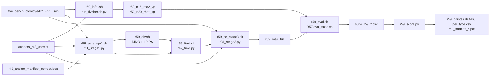

# R59: StreamEdit on FiVE-Bench-Correct

## Context

FiVE-Bench-Correct is now the main-paper benchmark (official FiVE moves to the supplementary). R59 produces the StreamEdit (Self-Forcing + visual prompting) rows of that table: native baseline, equal-NFE baseline (as R39's uniform-ρ curve at N=20), and se_max (R49). All Correct VP anchors were regenerated from the corrected instructions (R43), so every arm is re-rendered on all 415 pairs, including se_max's stage-1 draft.

Done when: the 10 arms are rendered on the 415 Correct pairs, scored with the R57 unified suite, and the per-type means, paired deltas and trade-off figures are written.

## Execution steps

| Step | Type | Waits for | Sets status |
|---|---|---|---|
| `render-baselines` | sbatch | — | `running` |
| `se-chain` | local (submits 4 afterok jobs) | — | `running` |
| `wait-renders` | manual | `render-baselines`, `se-chain` | `finished` |
| `wait-r57` | manual | R57 lab smoke | — |
| `eval` | local (submits eval_suite jobs) | `wait-renders`, `wait-r57` | — |
| `wait-eval` | manual | `eval` | — |
| `score` | local | `wait-eval` | — |
| `verdict` | manual | `score` | `analyzed` |

*(prep)* `/build-step render-baselines R59` · `/build-step se-chain R59` · `/build-step eval R59` · `/build-step score R59`

```
/run-step R59 render-baselines
/run-step R59 se-chain
/run-step R59 wait-renders
/run-step R59 wait-r57
/run-step R59 eval
/run-step R59 wait-eval
/run-step R59 score
/run-step R59 verdict
```

## Decisions

| Decision | Choice |
|---|---|
| Pairs | The 415 FiVE-Bench-Correct pairs only (98/100/99/99/9/10); no new prompts |
| Prompts / anchors | **Every arm, including se_max's draft and render, reads the Correct prompts and trigger words, never the official ones**: `--edit_json_dir evaluation/five_bench_correct`; anchors `~/Data/dataggen/outputs/five_bench/anchors_r43_correct/` (keep-pose suffix only in the anchors' instruction); case list `evaluation/r43_anchor_manifest_correct.json` |
| Prompt provenance | Each entry point records the strings it actually used in a `_prompts*.json` sidecar; `r59_check_prompts.py` checks them against the Correct JSONs inside every R59 job and fails the job on any mismatch |
| R57 dependency | Eval only: renders and the se chain start now; `eval` waits for R57's lab smoke |
| Native baseline | `r59_n15_rho2_vp`: N=15, ρ=2, VP, fg_boost 4, flow_shift 1.0, chunk 21, seed 0 (R36/R39 sampler) |
| Equal-NFE baseline | `r59_n20_rho2_vp` = the official ρ at N=20 (= se_max's 5 + 15 steps); the 8-ρ curve `r59_n20_rho{2,3,4,6,8,10,20,50}_vp` is the matched-compute uniform-ρ trade-off, as R39 |
| Max adaptive | se_max = R49 unchanged: 5-step `tgt0.9` VP draft (`n5_tgt09`) + attention recorder, max(DINO/0.55, LPIPS/0.75) demand, inverse-response ρ field (`r49_field.py`), 15-step render; method `r59_max_full`; 20 NFE (the routing config is never re-selected on Correct) |
| Reuse | None: every anchor changed, so no R39/R49 render or draft is reused |
| Platform / env | Lab L40S, `streamgve` for renders, `five-bench` for divergence/field; `--exclude=node52` only |
| Metrics | R57 unified suite (harness, motion fidelity, FiVE-Acc, CLIP-D, EditReward, PSC, CF) via `eval_suite.sh`, tag `r59`; eval waits on R57's lab smoke |
| Aggregation | Plain per-clip mean, overall and per edit type, from `suite_r59_*.csv`; never `_avg.csv`; paired deltas with 95% bootstrap CIs over clips |
| Figures | x = alignment (FiVE-Acc, CLIP-D, EditReward, PSC), y = preservation (`lpips_unedit_part`, CF) |
| Seeds | Single seed 0 (as all prior StreamEdit arms) |
| Output roots | Renders `~/Data/dataggen/outputs/five_bench/r59_rho_sweep/`, `r59_se_stage1/`, `r59_se_attn/`, `r59_div/`, `r59_field_full/`, `r59_se_arms/`; CSVs `evaluation/csv/suite_r59_*.csv`, `evaluation/csv/r59_{points,deltas,per_type}.csv`; figures `evaluation/figures/r59_tradeoff_*.pdf` |
| Compute | 9 render tasks (~12 h at N=15, ~14 h at N=20) + se chain (~1 draft + 2 div + CPU field + 1 render); 14 queue tasks, under the 30-task cap. Eval: 10 × (1-GPU metrics + 4×L40S CF + merge) |
| Out of scope | LongLive, text-only arms, official-FiVE re-scoring, the N=30 curve, Wan-Edit (R58) |

## Step commands

### render-baselines
```bash
quota -s 2>/dev/null | tail -2     # ~150 GB to write
sbatch slurm_scripts/five_bench/r59_infer.sh
```

### se-chain
```bash
bash slurm_scripts/five_bench/r59_se_chain.sh
cat logs/r59_se_chain_jobs.txt
```

### wait-renders
```bash
squeue -u $USER -h -o '%i %j %T' | grep r59
grep -h 'r59_check_prompts' logs/r59_infer_*.out logs/r59_se_stage1_*.out logs/r59_se_stage3_*.out
grep -h 'failures:' logs/r59_infer_*.out logs/r59_se_stage1_*.out logs/r59_div_*.out logs/r59_field_*.out logs/r59_se_stage3_*.out
D=~/Data/dataggen/outputs/five_bench
for M in $D/r59_rho_sweep/r59_*_vp $D/r59_se_arms/r59_max_full/step14; do echo "$M $(ls -d $M/edit*/*/ | grep -vc '_resize/$')"; done
```

### wait-r57
```bash
ls slurm_scripts/five_bench/eval_suite.sh
grep -i '`r57' daily.md | grep -o '`[a-z]*`$'
```

### eval
```bash
bash slurm_scripts/five_bench/r59_eval.sh
cat logs/r59_eval_jobs.txt
```

### wait-eval
```bash
for J in $(awk '{print $2}' logs/r59_eval_jobs.txt); do sacct -j $J -X -n -o JobID,State; done
for F in evaluation/csv/suite_r59_*.csv; do echo "$F $(($(wc -l < $F) - 1))"; done
```

### score
```bash
python evaluation/r59_score.py
```

### verdict
```bash
column -s, -t < evaluation/csv/r59_points.csv | less -S
column -s, -t < evaluation/csv/r59_deltas.csv | less -S
column -s, -t < evaluation/csv/r59_per_type.csv | less -S
```

## Pipeline



## Code to touch

| File | Change | Todo |
|---|---|---|
| `evaluation/r31_stage1.py` | Add `--edit_json_dir` (default `{data_root}/edit_prompt`); read `edit{T}_FiVE.json` from it at line ~297 (today it is hard-coded, so se_max's draft would read the official prompts and trigger words). Write `{latent_dir}/_prompts_edit{T}.json`: `{edit_json, sha256, anchor_dir, cases: {video: {source_prompt, target_prompt, source_object, target_object, anchor}}}` from the same `e` passed to `bb.edit_call` (line ~411) | `stage1-edit-json-arg` |
| `evaluation/r31_stage3.py` | Same flag at the `edit_json` read (line ~203); same sidecar at `{out_root}/{method}/_prompts_edit{T}.json` from the `e` at line ~328 | `stage3-edit-json-arg` |
| `evaluation/run_fivebench.py` | Same sidecar at `{out_root}/{method}/edit{T}/_prompts.json` (the flag already exists, line 72); no change to rendering or to `_manifest.csv` | `runner-prompt-sidecar` |
| `evaluation/r59_check_prompts.py` *(new)* | Load the sidecars + Correct JSONs + official JSONs; fail on any string/anchor/sha mismatch or a missing or extra video; print `[r59_check_prompts] OK n/415, k differ from official` | `prompt-check-script` |
| `slurm_scripts/five_bench/r59_infer.sh` *(new)* | From `r39_infer.sh`: `CONFIGS` = task 0 → (15, 2); tasks 1–8 → (20, ρ) for ρ ∈ {2,3,4,6,8,10,20,50}; `METHOD=r59_n${N}_rho${R}_vp`; `--edit_json_dir evaluation/five_bench_correct`, `ANCHOR_ROOT=$FIVE_ROOT/anchors_r43_correct`, `OUT_ROOT=$FIVE_ROOT/r59_rho_sweep`; `EXPECTED` read from the Correct JSONs; skip-complete logic and count/manifest guards kept; a skipped (already complete) edit type must still pass the prompt check; post-run `r59_check_prompts.py` per edit type | `infer-sbatch` |
| `slurm_scripts/five_bench/r59_se_stage1.sh` *(new)* | From `r48_se_stage1.sh` full / `r56_se_stage1.sh`: `METHOD=n5_tgt09`, `SCHED=tgt0.9`, `STEPS=5`, `--dump_steps 4 --measure_index 4`, Correct cases/JSONs/anchors, out `r59_se_stage1`, `r59_se_attn`; guards check (vp, tgt0.9, 5) and run `r59_check_prompts.py` on the stage-1 sidecars | `stage1-sbatch` |
| `slurm_scripts/five_bench/r59_div.sh` *(new)* | From `r56_div.sh`: target `r59_se_stage1/frames/n5_tgt09/step4`, latents `r59_se_stage1/latents`, Correct manifest, out `r59_div/se_{dino,lpips}` | `div-sbatch` |
| `slurm_scripts/five_bench/r59_field.sh` *(new)* | From `r56_field.sh`: Correct manifest, `--attn_se r59_se_attn --div_root r59_div --out_root r59_field_full` | `field-sbatch` |
| `slurm_scripts/five_bench/r59_se_stage3.sh` *(new)* | From `r49_se_stage3.sh` full: field `r59_field_full/se_max`, `METHOD=r59_max_full`, out `r59_se_arms`, `--edit_json_dir evaluation/five_bench_correct`, anchors `anchors_r43_correct`; expected counts from the Correct manifest; `r59_check_prompts.py` on the render sidecars | `render-sbatch` |
| `slurm_scripts/five_bench/r59_se_chain.sh` *(new)* | From `r56_se_chain.sh`: stage1 → div → field → render with `afterok`; cap check (queue + 5 ≤ 30, `R59_QUEUE_CAP` override); refuses if `logs/r59_se_chain_jobs.txt` exists; no eval stage (eval waits for R57) | `chain-driver` |
| `slurm_scripts/five_bench/r59_eval.sh` *(new)* | Loop over the 10 (method, root) pairs → `bash slurm_scripts/five_bench/eval_suite.sh --method M --root R --layout edit_video --cases evaluation/r43_anchor_manifest_correct.json --tag r59`; preflight: `eval_suite.sh` present, 415 clip dirs per root; append `<method> <job ids>` to `logs/r59_eval_jobs.txt`, refuse if it exists | `eval-driver` |
| `evaluation/r59_score.py` *(new)* | Load `suite_r59_{method}.csv` × 10; per-clip mean overall + per type; paired deltas (se_max − native, se_max − N20 ρ=2) with 10k bootstrap 95% CIs (seed 0); figures: N=20 ρ curve (line, labelled ρ), native and se_max points, x = alignment, y = preservation; write `r59_points.csv`, `r59_deltas.csv`, `r59_per_type.csv`, `r59_tradeoff_{five_acc,clip_d,editreward,psc}.pdf` | `score-script` |
