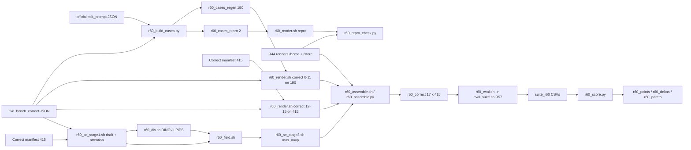

# R60: StreamEdit Text-Only on FiVE-Correct

## Context
FiVE-Bench-Correct is the paper's main benchmark (supervisor, 2026-10-23). This task covers the text-only StreamEdit rows (Self-Forcing, `--vp_mode novp`): the native N=15 ρ curve (the official setting is ρ = 2), the equal-NFE N=20 ρ curve, and the adaptive se_max_novp (5-step draft + 15-step render = 20 NFE). Text-only renders read only `source_prompt`, `target_prompt`, `source_object` and `target_object`, so a pair whose four fields Correct left unchanged renders exactly as on official FiVE. The uniform-ρ configs R44 rendered are therefore re-rendered only on the changed pairs. The 4 N=20 ρ values R44 lacks (3/6/8/20) and se_max_novp have no official render to reuse (R53, which was to produce them, is dropped), so they run on all 415 pairs. Every config is evaluated again on all 415 pairs, because Correct changed the FiVE-Acc questions, objects and instructions that the metrics read.

**Done when:** 17 configs × 415 pairs are scored with R57's lab suite, and `r60_points.csv` / `r60_deltas.csv` / `r60_pareto/` have been read.

## Execution steps

| # | step id | type | waits for | sets status |
|---|---|---|---|---|
| — | *(prep)* stage1-anno-flag · stage3-anno-flag · cases-script · render-sbatch · stage1-sbatch · div-sbatch · field-sbatch · stage3-sbatch · chain-driver · repro-check-script · assemble-script · assemble-sbatch · eval-launcher · score-script | todos | — | `implemented` |
| 1 | `build-cases` | local | — | — |
| 2 | `repro-render` | sbatch (L40S, array 0-1) | build-cases | — |
| 3 | `wait-repro` | manual | repro-render | — |
| 4 | `repro-check` | srun (CPU, nodecpu12) | wait-repro | — |
| 5 | `render-chain` | local (submits 21 tasks) | repro-check | `running` |
| 6 | `wait-chain` | manual | render-chain | `finished` |
| 7 | `assemble` | sbatch (CPU, nodecpu12) | wait-chain | — |
| 8 | `wait-assemble` | manual | assemble | — |
| 9 | `eval` | local (batches; needs R57 `adopt`) | wait-assemble | — |
| 10 | `wait-eval` | manual | eval | — |
| 11 | `score` | local | wait-eval | — |
| 12 | `analyze` | manual | score | `analyzed` |

```
/build-step build-cases R60
/build-step repro-render R60
/build-step repro-check R60
/build-step render-chain R60
/build-step assemble R60
/build-step eval R60
/build-step score R60
/run-step R60 build-cases
/run-step R60 repro-render
/run-step R60 wait-repro
/run-step R60 repro-check
/run-step R60 render-chain
/run-step R60 wait-chain
/run-step R60 assemble
/run-step R60 wait-assemble
/run-step R60 eval
/run-step R60 wait-eval
/run-step R60 score
/run-step R60 analyze
```

## Decisions

| Decision | Choice |
|---|---|
| Benchmark | FiVE-Bench-Correct, 415 pairs (`evaluation/r43_anchor_manifest_correct.json`, annotations `evaluation/five_bench_correct/`). The uncommitted edits to `edit1_FiVE.json` / `edit6_FiVE.json` are committed before `build-cases`, and the regen set is computed from the committed files |
| Regen set (R44 configs) | Computed from the JSON files (official vs Correct): pairs with a changed `source_prompt`, `target_prompt`, `source_object` or `target_object` = **190** (47 prompt + 143 trigger-word only; per type 15/32/54/70/9/10; edit5 and edit6 entirely). Unlike Wan's baselines (47), StreamEdit's cross-attention grounding/boosting reads the trigger words in every arm. Checked 2026-10-26 |
| Configs (17) | `n15_rho{2,3,4,6,8,10,20,50}` (native; `n15_rho2` = official text-only), `n20_rho{2,3,4,6,8,10,20,50}` (equal NFE; `n20_rho2` = equal-NFE official), `max_novp` (se_max text-only) |
| Reuse sources (225 unchanged pairs) | `n15_*` and `n20_rho{2,4,10,50}` ← `$D/r44_rho_sweep/r44_{config}_novp` (all on /store except `n15_rho2`). `n20_rho{3,6,8,20}` have no official render (R53 dropped): rendered on all 415 by R60 |
| se_max_novp | Own run on all 415 (user's choice; R53 dropped): R53's settings, via copies of its never-run `r53_*.sh` scripts, so R60's chain is their first run (N=5 `tgt0.9` draft, seed 0, attention recorder at defaults, DINOv3 + LPIPS divergence with temporal mean, `r49_field.py` unchanged, render N=15 at `dump_steps 14`) plus the Correct annotations |
| Render settings | As R44: `--vp_mode novp`, no anchor, fg_boost 4, flow_shift 1.0, chunk 21, seed 0; only `--edit_json_dir` and `--cases_json` are added |
| Reuse gate | 2 unchanged pairs (first of edit1 and of edit4) rendered again with `n15_rho2` and `n20_rho2` and compared against R44's renders; PASS iff max \|diff\| ≤ 2/255 on every frame. A FAIL stops the task and goes back to the user to decide (full 415 re-render) |
| Platform | Lab L40S, env `streamgve` for every render, `five-bench` for divergence / field / eval; all reused renders are L40S + streamgve too |
| /store | Reused /store clips are **copied** into `$D/r60_correct/` (≈ 11 configs × 225 clips ≈ 90 GB), on nodecpu12, so that eval needs no node pin. /home sources and new renders are symlinked |
| Output dirs | `$D/r60_rho_sweep/r60_{config}_novp/`, `$D/r60_repro/`, `$D/r60_se_stage1/`, `$D/r60_se_attn/`, `$D/r60_div/`, `$D/r60_field/`, `$D/r60_se_arms/r60_max_novp_correct/step14/`, assembled `$D/r60_correct/{config}/` (`D=~/Data/dataggen/outputs/five_bench`) |
| Evaluation | R57 unified suite on the lab (`eval_suite.sh`), all 415 pairs per config, `--tag r60`, method `r60_{config}_correct` → `evaluation/csv/suite_r60_r60_{config}_correct.csv`. Blocked until R57 is adopted |
| Queue | Per-user cap ~30 tasks: the chain driver and eval launcher refuse to exceed it; base (16) and max (5) can be submitted separately, and eval in config batches (3 jobs each) |
| Averaging / plots | Plain per-clip mean from the suite CSV, never `_avg.csv`; Pareto plots with x = alignment, y = preservation |
| Readout | max_novp vs `n20_rho2` (equal NFE, headline) and vs `n15_rho2` (official), placed on both curves; paired bootstrap 95% CI; per edit type; regen-vs-reused split as a sanity check |
| Out of scope | VP StreamEdit on Correct (R59), LongLive, Wan-Edit (R58), any text-only run on official FiVE (R53 dropped) |

## Step commands

### build-cases
```bash
python evaluation/r60_build_cases.py
```

### repro-render
```bash
sbatch --array=0-1 slurm_scripts/five_bench/r60_render.sh repro
```

### wait-repro
```bash
sacct -j {job_id} --format=JobID,State,Elapsed
grep -h failures logs/r60_render_{job_id}_*.out
```

### repro-check
```bash
srun --partition=CPU --nodelist=nodecpu12 --cpus-per-task=2 --mem=8G --time=00:30:00 \
  ~/anaconda3/envs/five-bench/bin/python evaluation/r60_repro_check.py
```

### render-chain
```bash
bash slurm_scripts/five_bench/r60_chain.sh --dry-run
bash slurm_scripts/five_bench/r60_chain.sh            # or --only base / --only max if the queue is busy
cat logs/r60_chain_jobs.txt
```

### wait-chain
```bash
squeue -u $USER
grep -h failures logs/r60_*.out | sort | uniq -c
```

### assemble
```bash
sbatch slurm_scripts/five_bench/r60_assemble.sh
```

### wait-assemble
```bash
tail -n 5 logs/r60_assemble_{job_id}.out
```

### eval
```bash
bash slurm_scripts/five_bench/r60_eval.sh max_novp n15_rho2 n20_rho2
# then, as the queue frees, the other 14 configs in batches, e.g.:
bash slurm_scripts/five_bench/r60_eval.sh n15_rho3 n15_rho4 n15_rho6
```

### wait-eval
```bash
ls evaluation/csv/suite_r60_r60_*_correct.csv | wc -l   # 17
for f in evaluation/csv/suite_r60_r60_*_correct.csv; do echo "$f $(($(wc -l < $f) - 1))"; done   # 415 each
```

### score
```bash
python evaluation/r60_score.py
```

### analyze
```bash
column -s, -t < evaluation/csv/r60_deltas.csv | less -S
ls evaluation/figures/r60_pareto/
```

## Pipeline



## Code to touch

| File | Change |
|---|---|
| `evaluation/r31_stage1.py` | `--edit_json_dir` (default None → `data_root / "edit_prompt"`), used at the `edit_json` read |
| `evaluation/r31_stage3.py` | `--edit_json_dir` (default None → `data_root / "edit_prompt"`), used at the `edit_json` read |
| `evaluation/r60_build_cases.py` (new) | Regen set from the JSON comparison → `r60_cases_regen.json`, `r60_cases_repro.json`, `r60_regen_sets.csv`; asserts 190 (15/32/54/70/9/10) and 2 |
| `slurm_scripts/five_bench/r60_render.sh` (new) | `correct` (array 0-15: index → (N, ρ, case file)) and `repro` (array 0-1) modes; `--edit_json_dir evaluation/five_bench_correct --cases_json <case file>`; expected per-type counts read from the case file |
| `slurm_scripts/five_bench/r60_se_stage1.sh` (new) | `r53_se_stage1.sh` with the Correct manifest, `--edit_json_dir`, `r60_se_stage1` / `r60_se_attn`, 415 guards |
| `slurm_scripts/five_bench/r60_div.sh` (new) | `r53_div.sh` with the Correct manifest and `r60_*` roots, 415 guard |
| `slurm_scripts/five_bench/r60_field.sh` (new) | `r53_field.sh` with the Correct manifest and `r60_*` roots, 415 guard |
| `slurm_scripts/five_bench/r60_se_stage3.sh` (new) | `r53_se_stage3.sh` with the Correct manifest, `--edit_json_dir`, `r60_field/se_max`, method `r60_max_novp_correct` |
| `slurm_scripts/five_bench/r60_chain.sh` (new) | `--only base\|max\|all`, `--dry-run`, queue-cap check (30); base array 0-15 + afterok chain stage1 → div → field → stage3; `logs/r60_chain_jobs.txt` |
| `evaluation/r60_repro_check.py` (new) | Pixel comparison of the repro renders vs R44 (`n15_rho2` /home, `n20_rho2` /store), PASS ≤ 2/255 → `r60_repro_check.csv` |
| `evaluation/r60_assemble.py` (new) | `$D/r60_correct/{config}` over 415 pairs: link new renders (all 415 for `n20_rho{3,6,8,20}` and `max_novp`), link /home reuse, copy /store reuse; PNG-count check; `r60_assembly.csv` |
| `slurm_scripts/five_bench/r60_assemble.sh` (new) | CPU job pinned to nodecpu12, /store preflight, runs `r60_assemble.py` |
| `slurm_scripts/five_bench/r60_eval.sh` (new) | Loop of `eval_suite.sh` over the given configs, tag `r60`, refuses existing CSVs and queue overflow, `logs/r60_eval_jobs.txt` |
| `evaluation/r60_score.py` (new) | Points (overall + per type), deltas with paired bootstrap, Pareto PDFs |

`r60_render.sh correct` index → config:

```
0-7   N=15  rho 2 3 4 6 8 10 20 50   r60_cases_regen.json (190)              -> r60_n15_rho{R}_novp
8-11  N=20  rho 2 4 10 50            r60_cases_regen.json (190)              -> r60_n20_rho{R}_novp
12-15 N=20  rho 3 6 8 20             r43_anchor_manifest_correct.json (415)  -> r60_n20_rho{R}_novp
repro 0 n15_rho2 / 1 n20_rho2 on r60_cases_repro.json -> $D/r60_repro
```
