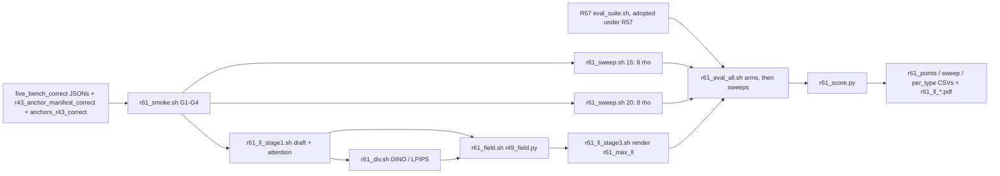

# R61: StreamEdit LongLive on FiVE-Correct

## Context

FiVE-Bench-Correct is now the main-paper benchmark (official FiVE moves to the supplementary), so every StreamEdit arm has to be rendered and scored on Correct. R61 covers the LongLive VP host, with three arms: native baseline (official LongLive, ρ = 2, N = 15), equal-NFE baseline (ρ = 2, N = 20) and max adaptive (se_max_ll, R55's method, NFE 5 + 15 = 20). It also re-runs R45's full 8-ρ sweeps at N = 15 and N = 20 on Correct, so the adaptive point is read against same-benchmark curves. All 415 pairs are re-rendered, because every Correct anchor was regenerated. R55's LongLive attention recorder is reused as is; its smoke (job 1057789) passed G1–G4.

Done when: the 16 sweep methods and se_max_ll are rendered on the 415 pairs, scored through R57's unified suite, and the trade-off figures place se_max_ll on the N = 15 and N = 20 Correct curves.

## Execution steps

| # | Step id | Type | Waits for | Sets status |
|---|---|---|---|---|
| 0 | *(prep)* `stage1-json-dir`, `stage3-json-dir`, `smoke-cases-json`, `smoke-sbatch`, `sweep-sbatch`, `stage1-sbatch`, `div-sbatch`, `field-sbatch`, `stage3-sbatch`, `chain-driver`, `eval-driver`, `score-script` | /build-step | — | implemented |
| 1 | `smoke` | sbatch (node39) | — | done |
| 2 | `wait-smoke` | manual | smoke | done |
| 3 | `sweep-n15` | sbatch (array 0-7) | wait-smoke | running |
| 4 | `sweep-n20` | sbatch (array 0-7) | wait-smoke | — |
| 5 | `se-chain` | local (submits 5 queue entries) | wait-smoke | — |
| 6 | `wait-renders` | manual | sweep-n15, sweep-n20, se-chain | finished |
| 7 | `r57-check` | manual (R57 adopted, under R57) | — | — |
| 8 | `eval-arms` | local (3 × R57 launcher) | wait-renders, r57-check | — |
| 9 | `eval-sweeps` | local (14 × R57 launcher) | eval-arms | — |
| 10 | `wait-eval` | manual | eval-sweeps | — |
| 11 | `score` | local | wait-eval | — |
| 12 | `verdict` | manual | score | analyzed |

Invoke: `/run-step R61 smoke`, `/run-step R61 wait-smoke`, `/run-step R61 sweep-n15`, `/run-step R61 sweep-n20`, `/run-step R61 se-chain`, `/run-step R61 wait-renders`, `/run-step R61 r57-check`, `/run-step R61 eval-arms`, `/run-step R61 eval-sweeps`, `/run-step R61 wait-eval`, `/run-step R61 score`, `/run-step R61 verdict`.

## Decisions

| Item | Choice |
|---|---|
| Benchmark | FiVE-Bench-Correct, 415 pairs (98 / 100 / 99 / 99 / 9 / 10), prompts from `evaluation/five_bench_correct/`, cases `evaluation/r43_anchor_manifest_correct.json`; no R42 new prompts |
| Anchors | `$D/anchors_r43_correct` (R7 generator, corrected instruction + keep-pose suffix); `$D = ~/Data/dataggen/outputs/five_bench` |
| Render scope | all 415 pairs for every method, no reuse of official-FiVE renders (all anchors changed) |
| Backbone settings | `--backbone ll`, VP, fg_boost 2, flow_shift 1.0, chunk 21, seed 0 re-seeded per pair (as R45 / R55) |
| Native baseline | ρ = 2, N = 15 = `r61_ll_rho2_n15` (index 0 of the N = 15 sweep) |
| Equal-NFE baseline | ρ = 2, N = 20 = `r61_ll_rho2_n20` (index 0 of the N = 20 sweep) |
| Max adaptive | `r61_max_ll`: R55's procedure unchanged (N_d = 5, `--blend_sched tgt0.9`, recorder at r31_stage1 defaults, DINOv3 + LPIPS divergence, `r49_field.py` q = S·max, 15-step render, dump step 14); NFE 20 |
| ρ sweeps | ρ ∈ {2, 3, 4, 6, 8, 10, 20, 50} at N = 15 and N = 20 → 16 methods `r61_ll_rho{R}_n{N}` |
| Correct plumbing | shared `--edit_json_dir` on `r31_stage1.py` / `r31_stage3.py` (default unchanged, reused by R59 / R60); `r31_divergence.py` and `r49_field.py` read no prompts, so they are unchanged |
| Benchmark freeze | sweep script and chain driver refuse to run with uncommitted changes to the Correct JSONs or manifest, and log the commit |
| Consistency with R59/R60 (2026-10-27) | R61's scripts follow the pattern R59/R60 settled on after this plan was written: (1) the prompt-provenance sidecar (`r59_check_prompts.py`, already baked into `r31_stage1.py` / `r31_stage3.py` / `run_fivebench.py`) is checked after every render, not just written; (2) the chain driver enforces the per-user Slurm submit cap (30 tasks, `R61_QUEUE_CAP` override) before submitting anything, as `r59_se_chain.sh` / `r60_chain.sh` do |
| Attention recorder empty-side fix (2026-10-28) | R59's rerun (job 1068493, 2026-10-28) found that FiVE-Correct has pairs with an empty `source_object` (pure addition, edit5) or empty `target_object` (pure removal, edit6, e.g. our own smoke pair `0042_gym-ball`) and fixed Self-Forcing's `wan/modules/model.py` recorder to skip an empty side (`if len(idx) == 0: continue`) instead of asserting. This was never ported to LongLive's `wan/modules/model.py` (still had the old unconditional `assert len(idx) > 0`), which would have crashed R61's smoke G3/G4 and the real stage1/stage3 runs on edit5/edit6. Ported verbatim 2026-10-28, confirmed no running job used LongLive at the time |
| `/store` is frontal-only, not per-node (corrected 2026-10-28) | Smoke job 1067713 failed its preflight: `$D/r45_sweep` (G2's comparison reference) is a `/store`-backed symlink, and `/store` turned out to be readable only on the lab frontal, never from any compute node (node39, where this job was pinned specifically for it, does NOT have it either — the earlier memory note was wrong). Fix: the smoke script no longer reads `r45_sweep` live; it reads a STAGED copy at `$D/r61_ref/ll_rho2_n15_vp`, which the user copies from the frontal before submitting (2 clips, see the script's header comment); the `--nodelist=node39` pin was removed as pointless |
| `run_fivebench.py`'s `--edit_json_dir` resolved post-chdir (fixed 2026-10-29) | Smoke job 1072463 (after the `/store` fix above) failed G2/G3 with `FileNotFoundError` on `LongLive_StreamEdit/evaluation/five_bench_correct/edit{1,6}_FiVE.json`: `run_fivebench.py:267` resolved `--edit_json_dir` to an absolute path AFTER `bb.activate()` chdirs into the backbone build dir, so the smoke script's relative `evaluation/five_bench_correct` resolved against the wrong cwd. Every sibling path arg (`data_root`, `out_root`, `first_frame_edit_dir`, `cases_json`, ...) is deliberately resolved before that chdir; `edit_json_dir` was missed when R59 added the flag. `r61_sweep.sh` and R59's own scripts were unaffected because they already pass a `$REPO`-absolute path, but the bug was in shared code, so fixed at the source (moved the resolution into the pre-chdir block). Also found and fixed a vacuous pass in the smoke script's own G2 comparison gate: it exited 0 whenever both render dirs were missing (`n_checked == 0`), instead of failing; now requires every clip to actually be checked |
| Metrics | R57 unified suite only (harness incl. motion fidelity, FiVE-Acc, CLIP-D, EditReward, PSC, CF), tag `r61`; scoring blocked until R57 is adopted |
| Eval order | 3 main arms first, then the 14 other sweep methods |
| Scoring | plain per-clip means over 415; figures x = alignment (FiVE-Acc, CLIP-D, CLIP-T, EditReward, PSC), y = bg LPIPS; no CIs |
| Platform | lab L40S, `streamgve` for generation; R57 lab launcher for eval; nothing on Jean Zay |
| Slurm | `--partition=L40S` / `CPU`, `--exclude=node52`; smoke 3 h pinned to node39; sweep 24 h per task; draft 12 h; render 20 h |
| Outputs | `$D/r61_smoke/`, `$D/r61_sweep/n{15,20}/r61_ll_rho{R}_n{N}/`, `$D/r61_ll_stage1/`, `$D/r61_ll_attn/`, `$D/r61_div/se_{dino,lpips}/`, `$D/r61_field/se_max/`, `$D/r61_ll_arms/r61_max_ll/step14/`, `evaluation/csv/suite_r61_*.csv`, `evaluation/csv/r61_*.csv`, `evaluation/figures/r61_ll_*.pdf` |

## Step commands

### smoke
```bash
sbatch slurm_scripts/five_bench/r61_smoke.sh
```

### wait-smoke
```bash
squeue -u $USER
grep -E 'G[1-4]|failures' logs/r61_smoke_*.out
grep -c Traceback logs/r61_smoke_*.err
```

### sweep-n15
```bash
sbatch --array=0-7 slurm_scripts/five_bench/r61_sweep.sh 15
```

### sweep-n20
```bash
sbatch --array=0-7 slurm_scripts/five_bench/r61_sweep.sh 20
```

### se-chain
```bash
bash slurm_scripts/five_bench/r61_chain.sh
cat logs/r61_chain_jobs.txt
```

### wait-renders
```bash
squeue -u $USER
grep -hE 'failures' logs/r61_sweep_*.out logs/r61_ll_stage*_*.out logs/r61_div_*.out logs/r61_field_*.out | sort | uniq -c
D=~/Data/dataggen/outputs/five_bench
for N in 15 20; do for R in 2 3 4 6 8 10 20 50; do
  echo "n${N} rho${R}: $(ls -d $D/r61_sweep/n${N}/r61_ll_rho${R}_n${N}/edit*/*/ 2>/dev/null | grep -vc '_resize/$')"
done; done
echo "max_ll: $(ls -d $D/r61_ll_arms/r61_max_ll/step14/edit*/*/ | wc -l)"
```

### r57-check
```bash
grep -n '| \*\*R57\*\*' daily.md | grep -o '`[a-z]*` |$'
ls slurm_scripts/five_bench/eval_suite.sh
```

### eval-arms
```bash
bash slurm_scripts/five_bench/r61_eval_all.sh arms
cat logs/r61_eval_jobs.txt
```

### eval-sweeps
```bash
bash slurm_scripts/five_bench/r61_eval_all.sh sweeps
cat logs/r61_eval_jobs.txt
```

### wait-eval
```bash
squeue -u $USER
for f in evaluation/csv/suite_r61_*.csv; do case $f in *_per_type.csv) continue;; esac; echo "$f $(($(wc -l < $f) - 1))"; done
```

### score
```bash
python evaluation/r61_score.py
```

### verdict
```bash
column -s, -t < evaluation/csv/r61_points.csv
column -s, -t < evaluation/csv/r61_per_type.csv
ls evaluation/figures/r61_ll_*.pdf
```

## Pipeline



## Code to touch

| File | Change |
|---|---|
| `evaluation/r31_stage1.py` | `--edit_json_dir` (default `data_root/edit_prompt`); `edit_json = Path(args.edit_json_dir).expanduser() / f"edit{T}_FiVE.json" if args.edit_json_dir else data_root / "edit_prompt" / ...`, as `run_fivebench.py:267`; print it in the header. |
| `evaluation/r31_stage3.py` | Same flag and header line. |
| `evaluation/r61_smoke_cases.json` (new) | Two entries copied from `r43_anchor_manifest_correct.json`: `edit1/0001_bus`, `edit6/0042_gym-ball`. |
| `slurm_scripts/five_bench/r61_smoke.sh` (new) | L40S, 3 h, `--nodelist=node39`; preflight `ls $D/r45_sweep/n15/ll_rho2_n15_vp/edit1`; G1 Python check of counts / pair sets / anchor files; G2 `run_fivebench.py` ll ρ=2 N=15 into `$D/r61_smoke/sweep`, frames compared with `r45_sweep` (must differ), grep the Correct `target_prompt` of 0042 in the log; G3 stage1 → `r31_divergence.py` (dino, lpips) → `r49_field.py` → stage3 into `$D/r61_smoke/{stage1,attn,div,field,arms}`, q finite in [0, 1], frame counts equal G2's; G4 stage1 default path on 0001_bus e1 with `$D/anchors`, latents `np.array_equal` to `$D/r55_smoke/on`; `failures: N`. |
| `slurm_scripts/five_bench/r61_sweep.sh` (new) | Copy of R59's `r59_infer.sh` with `--backbone ll`, `ANCHOR_ROOT=$FIVE_ROOT/anchors_r43_correct`, `fg_boost_factor 2` (LongLive-native, not SF's 4), `METHOD=r61_ll_rho${R}_n${STEPS}`, `OUT_ROOT=$FIVE_ROOT/r61_sweep/n${STEPS}`, array 0-7 (one `$1` value per sbatch call instead of R59's single 9-task array); `git diff --quiet HEAD` freeze check + commit echo before the loop; `r59_check_prompts.py` after each edit type and once over all types, as R59. **Built 2026-10-26.** |
| `slurm_scripts/five_bench/r61_ll_stage1.sh` (new) | Copy of R59's `r59_se_stage1.sh` with `--backbone ll`, Correct cases/anchors, `fg_boost_factor 2` (R55's LongLive setting), `OUT=$D/r61_ll_stage1`, `ATTN=$D/r61_ll_attn`, `EXPECT` from the cases file; `r59_check_prompts.py` on the stage-1 sidecar, as R59. |
| `slurm_scripts/five_bench/r61_div.sh` (new) | Copy of R59's `r59_div.sh` (backbone-agnostic) with `CASES=evaluation/r43_anchor_manifest_correct.json`, `r61_ll_stage1` targets / latents, `--out_root $D/r61_div`, 415 guard; no prompt guard, as R59. |
| `slurm_scripts/five_bench/r61_field.sh` (new) | Copy of R59's `r59_field.sh` (backbone-agnostic) with Correct cases, `--attn_se $D/r61_ll_attn --div_root $D/r61_div --out_root $D/r61_field`, 415 guard. |
| `slurm_scripts/five_bench/r61_ll_stage3.sh` (new) | Copy of R59's `r59_se_stage3.sh` with `--backbone ll`, Correct anchors, `fg_boost_factor 2`, `FIELD_DIR=$D/r61_field/se_max`, `METHOD=r61_max_ll`, `OUT_ROOT=$D/r61_ll_arms`, `EXPECT` from the cases file; `r59_check_prompts.py` on the stage-3 sidecar, as R59. |
| `slurm_scripts/five_bench/r61_chain.sh` (new) | As R59's `r59_se_chain.sh` / R60's `r60_chain.sh`: refuses if `logs/r61_chain_jobs.txt` exists or the Correct files are uncommitted; checks the per-user Slurm submit cap (queue + 7 tasks > 30, `R61_QUEUE_CAP` override) before submitting anything; `logs/r61_chain_jobs.txt`. |
| `slurm_scripts/five_bench/r61_eval_all.sh` (new) | `case $1 in arms|sweeps)`; method → root map (`$D/r61_sweep/n{N}/r61_ll_rho{R}_n{N}`, `$D/r61_ll_arms/r61_max_ll/step14`); 415-dir guard per root; loop over R57's `eval_suite.sh` with `--layout edit_video --edit_json_dir evaluation/five_bench_correct --tag r61`; parse the three printed job ids into `logs/r61_eval_jobs.txt`. |
| `evaluation/r61_score.py` (new) | Load the 17 `suite_r61_{method}.csv`; validate rows / NaN; per-clip means; write the four CSVs; plot with `r49_score`'s `plot` helper (x alignment, y `lpips_unedit_part`), N = 15 and N = 20 sweep curves, three marked points. |
