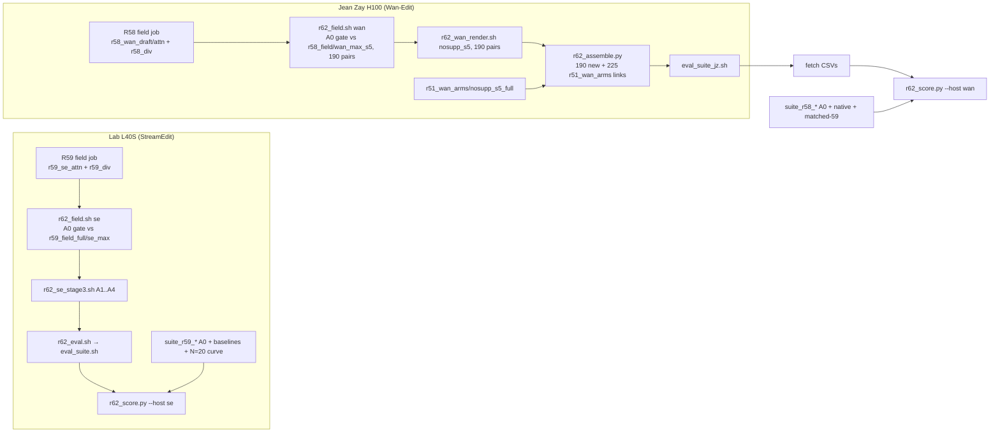

# R62: R51's Component Ablation on FiVE-Bench-Correct

## Context

FiVE-Bench-Correct is now the main-paper benchmark, so R51's demand ablation (the paper's main ablation table) has to be reported on Correct too. R62 mirrors R51. It changes only q = S · max(m_DINO, m_LPIPS) and keeps the drafts, attention, divergence, mapping and render flags of the Correct full method: R59's se_max on StreamEdit and R58's max_s5 on Wan-Edit. Those runs are A0. R51's field code first recomputes A0 and must match their fields bit for bit.

Done when: StreamEdit A1–A4 are rendered on the 415 Correct pairs (lab L40S), and Wan-Edit A4 is rendered on R58's 190 changed pairs and assembled to 415 (Jean Zay H100). Both are scored with the R57 suite, and `r62_points_{se,wan}.csv`, `r62_deltas_{se,wan}.csv` and the figures are read against R51.

## Execution steps

| # | Step id | Type | Runs on | Waits for | Sets status |
|---|---|---|---|---|---|
| 0 | *(prep)* `field-sbatch`, `se-render-sbatch`, `se-chain-driver`, `wan-render-sbatch`, `wan-chain-driver`, `jz-port-list`, `jz-scratch-list`, `jz-fetch-list`, `assemble-script`, `se-eval-driver`, `score-script` | /build-step | lab (code) | — | `implemented` |
| 1 | `se-chain` | local (field afterok R59's field job → render array 0-3) | lab | — | `running` |
| 2 | `wan-chain` | manual (field afterok R58's field job → render) | **Jean Zay** | R58 `wan-chain` submitted | — |
| 3 | `wait-se-renders` | manual | lab | se-chain | — |
| 4 | `wait-wan-chain` | manual | **Jean Zay** | wan-chain | — |
| 5 | `wan-assemble` | manual | **Jean Zay** | wait-wan-chain, wait-se-renders | `finished` |
| 6 | `se-eval` | local (needs R57 lab smoke) | lab | wait-se-renders | — |
| 7 | `wan-eval` | manual (needs R57 on Jean Zay) | **Jean Zay** | wan-assemble | — |
| 8 | `wait-se-eval` | manual | lab | se-eval | — |
| 9 | `wan-fetch` | manual | Jean Zay → lab | wan-eval | — |
| 10 | `score` | local | lab | wait-se-eval, wan-fetch | — |
| 11 | `verdict` | manual | lab | score | `analyzed` |

```
/build-step se-chain R62
/build-step wan-chain R62
/build-step wan-assemble R62
/build-step se-eval R62
/build-step wan-fetch R62
/build-step score R62
/run-step R62 se-chain
/run-step R62 wan-chain
/run-step R62 wait-se-renders
/run-step R62 wait-wan-chain
/run-step R62 wan-assemble
/run-step R62 se-eval
/run-step R62 wan-eval
/run-step R62 wait-se-eval
/run-step R62 wan-fetch
/run-step R62 score
/run-step R62 verdict
```

## Decisions

| Item | Choice |
|---|---|
| Benchmark | FiVE-Bench-Correct, 415 pairs (98/100/99/99/9/10), `evaluation/r43_anchor_manifest_correct.json`, annotations `evaluation/five_bench_correct/`; no new prompts |
| Arms (StreamEdit) | Mirror R51: A1 `nodiv` q = S · A2 `dino` q = S·m_dino · A3 `lpips` q = S·m_lpips · A4 `nosupp` q = max(m_dino, m_lpips); A0 = R59 `r59_max_full`, not re-rendered |
| Arms (Wan-Edit) | Mirror R51: A4 `nosupp_s5` only (s_min 5); A0 = R58 `max_s5` (assembled `r58_wan_correct/max_s5`) |
| Inputs | Reused from R59 / R58, no new draft: StreamEdit attention `r59_se_attn`, divergence `r59_div/se_{dino,lpips}`; Wan-Edit attention `r58_wan_draft/attn`, divergence `r58_div/wan_{dino,lpips}`; caps and λ as `r49_field` (shared code) |
| A0 gate | `r51_field.py --gate_ref`: recomputed A0 must equal `r59_field_full/se_max` (`rho`, 415/415) or `r58_field/wan_max_s5` (`.npy`, 190/190) bit for bit, else the field job writes nothing and exits 1 |
| Dependency | The StreamEdit field waits afterok on R59's field job (`logs/r59_se_chain_jobs.txt`, 1066779); the Wan-Edit field waits afterok on R58's field job (`logs/r58_wan_chain_jobs.txt` on Jean Zay); both drivers refuse if the upstream field did not complete |
| Wan-Edit regeneration | Only R58's 190 pairs of `r58_cases_maxs5.json` (prompt or trigger object changed). The other 225 have the same Correct and official inputs, so they link to R51's `r51_wan_arms/nosupp_s5_full` render. Mixing old and new renders relies on R58's reproducibility gate (`repro-check` PASS) |
| No overwrite | New renders only under `$D/r62_se_arms`, `$D/r62_wan_arms`; `r62_wan_correct` holds symlinks only; R51 / R58 / R59 folders are never written |
| Render (StreamEdit) | Flags identical to `r59_se_stage3.sh`: VP + `anchors_r43_correct`, `--edit_json_dir evaluation/five_bench_correct`, step 15, flow_shift 1.0, fg_boost 4, blend_power 2, chunk 21, seed 0, dump step 14; NFE 5 + 15 = 20; prompt-sidecar check in every task |
| Render (Wan-Edit) | `r49_wan_render.py --config nosupp_s5 --mode full --anno_dir evaluation/five_bench_correct`, N = 50, loop start 5, per-token start map |
| Metrics | R57 unified suite (harness incl. motion fidelity, FiVE-Acc, CLIP-D, EditReward, PSC, CF), tag `r62`; lab `eval_suite.sh` for StreamEdit, `jz/eval_suite_jz.sh` for Wan-Edit; blocked until R57 is adopted on each platform |
| Reference | Points table A0–A4 next to R59's native (`r59_n15_rho2_vp`) and equal-NFE (`r59_n20_rho2_vp`) baselines, and next to R58's `native_s0.92` / `matched59_s0.92`. The figures also draw R59's N = 20 uniform-ρ curve and R58's native / matched-59 curves: they are already rendered there, so this needs no extra render |
| Aggregation | Plain per-clip mean from `suite_*.csv` (never `_avg.csv`), overall and per edit type; Wan-Edit also split regenerated vs reused; no paired CIs (as R51); figures x = alignment, y = preservation |
| Platforms | StreamEdit lab L40S (`streamgve` render, `five-bench` field / eval); Wan-Edit Jean Zay H100; separate tables, never mixed |
| Slurm | Lab: `L40S` / `CPU`, `--exclude=node52`, render 20 h; 5 queue tasks, checked against the 30-task cap; Jean Zay headers rewritten by `jz/r50_port.sh` |
| Outputs | `$D/r62_field/{se_nodiv,se_dino,se_lpips,se_nosupp,wan_nosupp_s5}/`, `$D/r62_se_arms/r62_{arm}_full/step14/`, `$D/r62_wan_arms/nosupp_s5_full/`, `$D/r62_wan_correct/nosupp_s5/`, `evaluation/csv/suite_r62_*.csv`, `evaluation/csv/r62_{points,deltas}_{se,wan}.csv`, `evaluation/csv/r62_wan_assembly.csv`, `evaluation/figures/r62_*.pdf` |
| Compute / storage | StreamEdit 4 renders × ~12 h L40S, ~60 GB; Wan-Edit 190 pairs ≈ 4–5 h H100; eval 5 × (1-GPU metrics + CF on 4×L40S / 2×H100 + merge) |
| Out of scope | R52's B1 on Correct, qualitative grids (R51's official-FiVE grids stand), Wan-Edit A1–A3, re-scoring R51 on official FiVE |

## Step commands

### se-chain
```bash
cat logs/r59_se_chain_jobs.txt
bash slurm_scripts/five_bench/r62_se_chain.sh
cat logs/r62_se_chain_jobs.txt
```

### wan-chain
```bash
# on Jean Zay (ssh zay from gpu-gw), in the clone
cat logs/r58_wan_chain_jobs.txt
git pull
bash jz/r50_port.sh
bash jz/r50_scratch_links.sh
bash slurm_scripts/five_bench/r62_wan_chain.sh --dry-run
bash slurm_scripts/five_bench/r62_wan_chain.sh
cat logs/r62_wan_chain_jobs.txt
```

### wait-se-renders
```bash
squeue -u $USER -h -o '%i %j %T' | grep r62
grep -H 'A0 gate' logs/r62_field_*.out
grep -h 'r59_check_prompts' logs/r62_se_stage3_*.out
grep -hE 'failures:' logs/r62_field_*.out logs/r62_se_stage3_*.out | sort | uniq -c
D=~/Data/dataggen/outputs/five_bench
for A in nodiv dino lpips nosupp; do echo "$A $(ls -d $D/r62_se_arms/r62_${A}_full/step14/edit*/*/ | wc -l)"; done
```

### wait-wan-chain
```bash
# on Jean Zay
cat logs/r62_wan_chain_jobs.txt
sacct -j "$(grep -v '^#' logs/r62_wan_chain_jobs.txt | awk '{print $2}' | paste -sd,)" --format=JobID,State,Elapsed
grep -H 'A0 gate' logs/r62_field_*.out
grep -hE 'failures:' logs/r62_field_*.out logs/r62_wan_render_*.out | sort | uniq -c
```

### wan-assemble
```bash
# on Jean Zay
$WORK/pyenv/five-bench/python evaluation/r62_assemble.py
```

### se-eval
```bash
ls slurm_scripts/five_bench/eval_suite.sh
bash slurm_scripts/five_bench/r62_eval.sh
cat logs/r62_eval_jobs.txt
```

### wan-eval
```bash
# on Jean Zay
bash jz/eval_suite_jz.sh --qos qos_gpu_h100-t3 --method wan_nosupp_s5_correct \
  --root ~/Data/dataggen/outputs/five_bench/r62_wan_correct/nosupp_s5 --layout edit_video --tag r62
```

### wait-se-eval
```bash
for J in $(awk '{print $2}' logs/r62_eval_jobs.txt); do sacct -j $J -X -n -o JobID,State; done
for F in evaluation/csv/suite_r62_r62_*_full.csv; do echo "$F $(($(wc -l < $F) - 1))"; done
```

### wan-fetch
```bash
# on the lab frontal (tmux)
source jz/r50_jz.env
rsync -av "$JZ_HOST:$JZ_WORK/StreamEdit_new/evaluation/csv/" evaluation/csv/ --include='suite_r62_wan_*' --include='r62_wan_assembly.csv' --exclude='*'
bash jz/r50_fetch_outputs.sh r62_field r62_wan_arms
```

### score
```bash
python evaluation/r62_score.py --host se
python evaluation/r62_score.py --host wan
```

### verdict
```bash
column -s, -t < evaluation/csv/r62_points_se.csv | less -S
column -s, -t < evaluation/csv/r62_deltas_se.csv | less -S
column -s, -t < evaluation/csv/r62_points_wan.csv | less -S
column -s, -t < evaluation/csv/r62_deltas_wan.csv | less -S
ls evaluation/figures/r62_*.pdf
```

## Pipeline



## Code to touch

| File | Change |
|---|---|
| `slurm_scripts/five_bench/r62_field.sh` (new) | Built from `r51_field.sh` (CPU, 4 cpus, 32G, 2 h) but calls `r51_field.py` directly with explicit roots per HOST. `se`: `--cases evaluation/r43_anchor_manifest_correct.json --attn_root $D/r59_se_attn --div_root $D/r59_div --gate_ref $D/r59_field_full --arms nodiv dino lpips nosupp`. `wan`: `--cases evaluation/r58_cases_maxs5.json --attn_root $D/r58_wan_draft/attn --div_root $D/r58_div --gate_ref $D/r58_field --arms nosupp`. Both `--out_root $D/r62_field`. Selftest first; guard N npz per arm dir = len(cases) (+ N `.npy` for wan); `failures: N`. |
| `slurm_scripts/five_bench/r62_se_stage3.sh` (new) | Clone of `r59_se_stage3.sh`: `ARMS=(nodiv dino lpips nosupp)`, task id → arm, `FIELD_DIR=$D/r62_field/se_${ARM}`, `METHOD=r62_${ARM}_full`, `OUT_ROOT=$D/r62_se_arms`, logs `r62_se_stage3_%A_%a`; every other flag and guard is unchanged (Correct cases / edit JSONs / anchors, `r59_check_prompts.py` on `_prompts_edit*.json`). |
| `slurm_scripts/five_bench/r62_se_chain.sh` (new) | Refuses if `logs/r62_se_chain_jobs.txt` exists or the queue + 5 tasks > `${R62_QUEUE_CAP:-30}`; reads `field <id>` from `logs/r59_se_chain_jobs.txt`; dependency `afterok:<id>` if `squeue -j <id>` knows it, else `sacct` must say COMPLETED (submit with no dependency), else exit 1; submits `field` (`r62_field.sh se`), `render` (`--array=0-3`, afterok field); writes `<stage> <id>` lines headed by the commit. |
| `slurm_scripts/five_bench/r62_wan_render.sh` (new) | As in todo `wan-render-sbatch`; built from `r51_wan_render.sh` with the Correct case file and `--anno_dir`; output-root guard as `r58_wan_render.sh`. |
| `slurm_scripts/five_bench/r62_wan_chain.sh` (new) | Jean Zay only; `$WORK` / ported-script / `$SCRATCH`-link guards copied from `r51_wan_chain.sh`; upstream id from `logs/r58_wan_chain_jobs.txt` (`field <id>`), afterok if queued, else require 190 `.npy` in `$D/r58_field/wan_max_s5`; submits `field` (`r62_field.sh wan`) → `render` (afterok); `--dry-run`; `logs/r62_wan_chain_jobs.txt`, refuses if it exists. |
| `jz/r50_port.sh` | `SCRIPTS` += `r62_field`, `r62_wan_render`, `r62_wan_chain`. |
| `jz/r50_scratch_links.sh` | `FOLDERS` += `r62_field`, `r62_wan_arms`, `r62_wan_correct`. |
| `jz/r50_fetch_outputs.sh` | `ALL` += `r62_field`, `r62_wan_arms`. |
| `evaluation/r62_assemble.py` (new) | Imports `r58_assemble`'s helpers (symlink creation, expected PNG count via `r48_wan_common.expected_frames`, conflict rule) with one config `nosupp_s5`: new root `$D/r62_wan_arms/nosupp_s5_full`, reuse root `$D/r51_wan_arms/nosupp_s5_full`, regen set `r58_cases_maxs5.json`, out `$D/r62_wan_correct/nosupp_s5`, cases the Correct manifest. If `r58_assemble.py` does not expose them as functions, factor them out there with no behaviour change. Writes `evaluation/csv/r62_wan_assembly.csv` (case_id, source new\|reused, n_png). |
| `slurm_scripts/five_bench/r62_eval.sh` (new) | Built from `r59_eval.sh`: 4 methods `r62_{arm}_full` over `$D/r62_se_arms/r62_{arm}_full/step14`, `--layout edit_video --cases evaluation/r43_anchor_manifest_correct.json --tag r62`; preflight 415 clip dirs per root; ids to `logs/r62_eval_jobs.txt`, refuses if it exists. |
| `evaluation/r62_score.py` (new) | As in todo `score-script`; reuses `r59_score.py` / `r58_score.py` loaders and plotting where they exist, otherwise `r49_score` helpers (`point`, `plot`); every input CSV must have 415 rows. |
