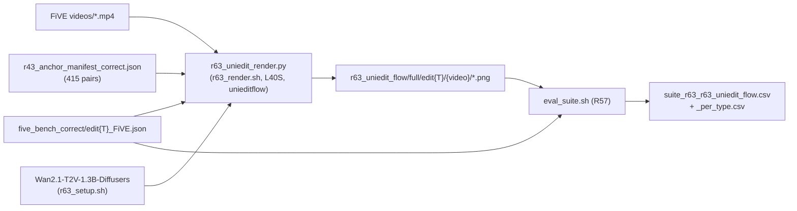

# R63: UniEdit-Flow on FiVE-Correct

## Context
FiVE-Bench-Correct is the paper's main benchmark (supervisor, 2026-10-23), so every external method in the main table has to be rendered and scored on Correct. Its rows can no longer be copied from StreamEdit's official-FiVE table. R63 covers UniEdit-Flow (ICLR'26), native baseline only. It runs on the same Wan2.1-T2V-1.3B backbone as Wan-Edit and uses the same frame convention, with the 415 Correct pairs and the corrected source/target prompts. The adaptive UniEdit-Flow host (a per-token α) is not part of this task.

**Done when:** all 415 Correct pairs are rendered (98/100/99/99/9/10 per type), scored with R57's lab suite, and `suite_r63_r63_uniedit_flow_per_type.csv` has been read and recorded in the Run log.

## Execution steps

| # | Step id | Type | Wait for | Sets status | What |
|---|---------|------|----------|-------------|------|
| *(prep)* | — | — | — | `implemented` | `/build-step setup R63`, `/build-step smoke R63` (todos `setup-script`, `render-script`, `render-sbatch`) |
| 1 | `setup` | local | — | — | opencv in `unieditflow`, Diffusers weights at a pinned revision, env freeze |
| 2 | `smoke` | sbatch | `setup` | — | 3 clips (edit1 / edit5 / edit6) |
| 3 | `check-smoke` | manual | `smoke` | — | frame counts, timing, visual check |
| 4 | `render` | sbatch | `check-smoke` | `running` | 6-task array, one edit type per task, 415 pairs |
| 5 | `wait-render` | manual | `render` | `finished` | 415 complete clips |
| 6 | `eval` | local | `wait-render` | — | R57 lab suite (3 jobs) |
| 7 | `wait-eval` | manual | `eval` | — | 415-row suite CSV |
| 8 | `analyze` | manual | `wait-eval` | `analyzed` | read per-type means, Run log |

```
/run-step R63 setup
/run-step R63 smoke
/run-step R63 check-smoke
/run-step R63 render
/run-step R63 wait-render
/run-step R63 eval
/run-step R63 wait-eval
/run-step R63 analyze
```

## Decisions

| Decision | Choice |
|----------|--------|
| Arms | Native baseline only. The adaptive per-token α host is a separate, later task |
| Hyperparameters | Repo video default: α 0.8, ω 5.0, 25 steps, flow_shift 3 (edit starts at σ ≈ 0.920) |
| NFE per clip | ⌊0.8·25⌋ = 20 inversion steps (batch 1) + 20 edit steps (batch 2: src + trg) = 60 DiT sample-passes |
| Backbone | `Wan-AI/Wan2.1-T2V-1.3B-Diffusers` @ `0fad780a534b6463e45facd96134c9f345acfa5b`, VAE fp32, transformer bf16 (as the demo) |
| Frames / resolution | Wan-Edit convention: first min(41, n_src) frames of `videos/{video}.mp4`, cv2 resize to 832×480, truncated to 4k+1 (`r48_wan_common.expected_frames`) |
| Prompts | `source_prompt` / `target_prompt` from `evaluation/five_bench_correct/edit{T}_FiVE.json`. The Correct `negative_prompt` is unused (guidance_scale 1.0; ω carries the guidance, as in the official code) |
| Inversion prompt | `""` (unconditional), as in `demo_wan_video_edit.py` |
| Seed | `seed_everything(0)` per pair (re-seeded per pair, the R20 lesson). Inversion + Euler editing has no sampled noise, so the seed should not matter |
| Pairs | 415, from `evaluation/r43_anchor_manifest_correct.json`. All rendered, since no UniEdit-Flow render exists to reuse |
| Platform / env | Lab L40S, existing env `unieditflow`, checked against the official README on 2026-10-26: python 3.10, conda pytorch 2.4.1 / torchvision 0.19.1 / torchaudio 2.4.1, pytorch-cuda 12.4 (exact match); diffusers 0.33.1 (README requires ≥ 0.33.0.dev0 for Wan); transformers 4.51.3, accelerate 1.15.0, protobuf 7.36.2, sentencepiece 0.2.2 (unpinned upstream). Only addition: `opencv-python-headless==4.10.0.84`. SDPA attention. Never run on H100 for this host |
| Smoke set | `evaluation/r57_smoke_cases.json`: edit1/0001_bus, edit5/0007_guitar-violin, edit6/0048_hike |
| Output | `~/Data/dataggen/outputs/five_bench/r63_uniedit_flow/{smoke,full}/edit{T}/{video}/00000.png` (`edit_video` layout) + `_manifest_edit{T}.csv` |
| Evaluation | R57 lab suite, `--method r63_uniedit_flow --tag r63`, Correct annotations (default), plain per-clip means |
| Out of scope | Official-FiVE render (supp table), α/ω sweep, full-length clips, adaptive α, FlowDirector (R64) |

## Step commands

### setup
```bash
bash slurm_scripts/five_bench/r63_setup.sh
```

### smoke
```bash
sbatch --time=02:00:00 slurm_scripts/five_bench/r63_render.sh smoke
```

### check-smoke
```bash
grep -h -E "failures|missing" logs/r63_render_<job_id>_*.out
find ~/Data/dataggen/outputs/five_bench/r63_uniedit_flow/smoke -mindepth 2 -maxdepth 2 -type d -exec sh -c 'echo "$1 $(ls "$1" | wc -l)"' _ {} \;
cat ~/Data/dataggen/outputs/five_bench/r63_uniedit_flow/smoke/_manifest_edit*.csv
```

### render
```bash
sbatch --array=0-5 slurm_scripts/five_bench/r63_render.sh full
```

### wait-render
```bash
sacct -j <job_id> --format=JobID,State,Elapsed
grep -h -E "failures|missing" logs/r63_render_<job_id>_*.out
for t in 1 2 3 4 5 6; do echo "edit$t $(ls ~/Data/dataggen/outputs/five_bench/r63_uniedit_flow/full/edit$t | wc -l)"; done
```

### eval
```bash
bash slurm_scripts/five_bench/eval_suite.sh --method r63_uniedit_flow \
  --root ~/Data/dataggen/outputs/five_bench/r63_uniedit_flow/full --layout edit_video \
  --tag r63 --allow_nan motion_fidelity_score_edit_part
```

### wait-eval
```bash
wc -l evaluation/csv/suite_r63_r63_uniedit_flow.csv
cat evaluation/csv/suite_r63_r63_uniedit_flow_per_type.csv
```

### analyze
```bash
cat evaluation/csv/suite_r63_r63_uniedit_flow_per_type.csv
```

## Pipeline



## Code to touch

| File | Change |
|------|--------|
| `slurm_scripts/five_bench/r63_setup.sh` (new) | pip-install `opencv-python-headless==4.10.0.84` into `unieditflow`; `hf download` the Diffusers weights at the pinned revision; import check; write `evaluation/r63_unieditflow_freeze.txt` |
| `evaluation/r63_uniedit_render.py` (new) | The demo's encode → invert → edit → decode, model loaded once, looped over Correct pairs with the Wan-Edit frame loader; resumable, per-type manifest, `--verify` |
| `slurm_scripts/five_bench/r63_render.sh` (new) | `smoke` (3 clips) / `full` (array 0-5 → edit type) wrapper around the driver, with a post-run `--verify` count guard |

Driver per pair (pseudocode):
```python
seed_everything(args.seed)
frames = load_frames_wanedit(FIVE / "videos" / f"{video}.mp4", n=min(41, n_src))   # cv2, 832x480, RGB
frames = frames[: expected_frames(n_src)]                                          # 4k+1
lat = encode_video(pipe, vae, frames_as_pil)
pipe.scheduler = inv_sched        # UniInvEulerScheduler(shift=3), alpha=0.8
z = pipe(prompt="", height=480, width=832, num_frames=len(frames), num_inference_steps=25,
         guidance_scale=1.0, output_type="latent", latents=lat).frames
init, prompts = pack_edit_input(z, src_prompt, trg_prompt)
pipe.scheduler = edit_sched       # UniEditEulerScheduler(shift=3), alpha=0.8, omega=5.0
out = pipe(prompt=prompts, ..., latents=init).frames
video = decode_video(pipe, vae, out[:1])   # both slots identical: step() concatenates the fused update twice
save_pngs(video, out_root / f"edit{T}" / video_name)
```
