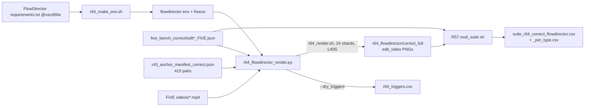

# R64: FlowDirector on FiVE-Correct

## Context

Render **FlowDirector** (Li et al., CVPR 2026) on the **415 FiVE-Bench-Correct** pairs (R43) as the text-only external baseline for the main-paper table, then score it with the **R57 unified suite**. FlowDirector is FlowEdit on Wan2.1-T2V-1.3B plus its attention-guided masking and DAG guidance. We run the released V1 code unchanged: per our notes, it differs from the paper (no MAD-FC ϕ/ζ, source CFG 3.5).

**Done when:** 415/415 clips are rendered on the lab L40S in the official-README env, and `evaluation/csv/suite_r64_correct_flowdirector.csv` (plus `_per_type.csv`) has 415 complete rows that pass the range sanity check.

## Execution steps

| # | Step id | Type | Waits for | Sets status | What |
|---|---------|------|-----------|-------------|------|
| *(prep)* | `env-script`, `render-script`, `render-sbatch` | todos | — | `implemented` | built by `/build-step` |
| 1 | `make-env` | local | — | — | env audit + rebuild with flash-attn, freeze |
| 2 | `check-triggers` | local | make-env | — | tokenizer-only check that FlowDirector finds every trigger span |
| 3 | `smoke` | srun | check-triggers | — | 3 clips (edit1 / edit5 / edit6), per-clip time, visual check |
| 4 | `render` | sbatch | smoke | `running` | 24-shard L40S array over the 415 pairs |
| 5 | `wait-render` | manual | render | `finished` | array COMPLETED, 415/415 complete dirs |
| 6 | `eval` | local | wait-render | — | R57 suite launcher (metrics → CF → merge) |
| 7 | `wait-eval` | manual | eval | `analyzed` | 415-row suite CSV, sanity check |

```
/build-step make-env R64
/build-step render R64
/run-step R64 make-env
/run-step R64 check-triggers
/run-step R64 smoke
/run-step R64 render
/run-step R64 wait-render
/run-step R64 eval
/run-step R64 wait-eval
```

## Decisions

| Decision | Choice |
|----------|--------|
| Platform / env | Lab L40S only (one platform per host); conda env `flowdirector` |
| Env alignment | Existing env (created 2026-10-09) follows the README exactly (py 3.12 + `requirements.txt`, `pip check` clean, pinned scipy 1.15.2 / scikit-image 0.25.2 / xfuser 0.4.3.post3 match), but resolved torch 2.14.1+cu130 and **has no flash-attn**. The README calls flash-attn optional, but `wan/modules/model.py` calls `flash_attention()` directly, which `assert FLASH_ATTN_2_AVAILABLE` → it cannot render as is |
| Env fix | Rebuild in place: torch 2.5.1+cu121 / torchvision 0.20.1 pinned (within `torch>=2.4.0`) + prebuilt flash-attn 2.7.4.post1 (same pair as five-bench on L40S), rest from `requirements.txt`. Old freeze kept in `evaluation/r64_env/` |
| Code | `~/Code/FlowDirector` @ `cecd56e` (V1, clean tree), called as a library; no edits to upstream |
| Hyperparameters | `script-edit-single-gpu.sh` defaults: `t2v-1.3B`, 832×480, unipc, 50 steps, shift 12, n_max 40, n_min 0, src CFG 3.5, tar CFG 10.5, n_avg 4, worse_avg 2, omega 2.75, window 11, decay 0.25; tmd window/stride = `edit()` defaults (11 / 8) |
| Seed | `base_seed 0` per clip (`edit()` calls `torch.manual_seed(seed)` itself), same as our Wan-Edit renders |
| Negative prompt | FlowDirector's default (`sample_neg_prompt`, released script passes none); FiVE's `negative_prompt` not used |
| Frames | First `min(41, n)` source frames, trimmed to 4k+1 (`r48_wan_common.expected_frames`: 41 for 93/100 videos, 25–37 for the 7 short ones), same protocol as Wan-Edit; resize = FlowDirector's own `INTER_AREA` to 832×480 |
| Trigger words | `source_words` / `target_words` = R43 `source_object` / `target_object`, passed as the **verbatim span of the prompt** they match case-insensitively (FlowDirector's `find_subtokens_range` is case-sensitive: `A gray rabbit` vs `…a gray rabbit…`). Edit6 has an empty target → `None` (source mask only, native behaviour). Unmatched spans are logged in `r64_triggers.csv`, not fixed by hand |
| Pairs | 415 FiVE-Bench-Correct pairs (`evaluation/r43_anchor_manifest_correct.json`, annotations `evaluation/five_bench_correct/`); official FiVE and R42 new prompts out of scope |
| Sharding | 24 shards × ~18 clips, `--time 10:00:00`, resumable. Estimate: ~18 DiT forwards per active step (n_avg 4 × 4 + 2) vs 4 for Wan-Edit (166 s/clip) → ~14 min/clip, ~100 GPU-h total; smoke step confirms before the array |
| Outputs | `~/Data/dataggen/outputs/five_bench/r64_flowdirector/{smoke,correct_full}/edit{T}/{video}/00000.png` (edit_video layout) |
| Evaluation | R57 suite, `--method flowdirector --tag r64_correct` → `evaluation/csv/suite_r64_correct_flowdirector.csv` + `_per_type.csv`; needs R57 `analyzed` first |
| Out of scope | Per-token n_max / adaptive FlowDirector arm, matched-NFE arm, official FiVE table, the paper's (non-released) MAD-FC settings |

## Step commands

### make-env

```bash
bash evaluation/r64_make_env.sh
cat evaluation/r64_env/flowdirector_freeze.txt | grep -i -E '^(torch|flash|transformers|diffusers)='
```

### check-triggers

```bash
~/anaconda3/envs/flowdirector/bin/python evaluation/r64_flowdirector_render.py --dry_triggers \
  --cases evaluation/r43_anchor_manifest_correct.json --out_csv evaluation/csv/r64_triggers.csv
column -s, -t < evaluation/csv/r64_triggers.csv | awk 'NR==1 || /False/' | less -S
```

### smoke

```bash
srun --partition=L40S --gres=gpu:1 --mem=64G --time=02:00:00 --exclude=node52 \
  ~/anaconda3/envs/flowdirector/bin/python evaluation/r64_flowdirector_render.py \
  --cases evaluation/r57_smoke_cases.json --out_root ~/Data/dataggen/outputs/five_bench/r64_flowdirector/smoke
ls ~/Data/dataggen/outputs/five_bench/r64_flowdirector/smoke/edit*/* | head
```

### render

```bash
sbatch slurm_scripts/five_bench/r64_render.sh
```

### wait-render

```bash
sacct -j <job_id> -X --format=JobID,State,Elapsed,NodeList
grep -h 'failures:' logs/r64_render_<job_id>_*.out
~/anaconda3/envs/flowdirector/bin/python evaluation/r64_flowdirector_render.py --missing \
  --cases evaluation/r43_anchor_manifest_correct.json
```

### eval

```bash
bash slurm_scripts/five_bench/eval_suite.sh --method flowdirector \
  --root ~/Data/dataggen/outputs/five_bench/r64_flowdirector/correct_full --layout edit_video \
  --tag r64_correct
```

### wait-eval

```bash
grep -c 'Error:' logs/eval_suite_metrics_<id1>.out logs/eval_suite_cf_<id2>.out logs/eval_suite_merge_<id3>.out
column -s, -t < evaluation/csv/suite_r64_correct_flowdirector_per_type.csv | less -S
```

## Pipeline



## Code to touch

| File | Change |
|------|--------|
| `evaluation/r64_make_env.sh` | **New** (todo `env-script`). See the todo text. Sketch: `pip freeze > r64_env/flowdirector_pre_r64_freeze.txt` → `conda env remove -n flowdirector` → `conda create -n flowdirector python=3.12` → `pip install torch==2.5.1 torchvision==0.20.1 --index-url .../cu121` → `pip install -r requirements.txt -c <(echo torch==2.5.1; echo torchvision==0.20.1)` → `pip install flash-attn==2.7.4.post1 --no-build-isolation` → checks (`pip check`, `importlib.metadata` vs each requirement line, `FLASH_ATTN_2_AVAILABLE`, `git -C ~/Code/FlowDirector rev-parse HEAD` == cecd56e and `git status --porcelain` empty) → freeze. Exits non-zero on any failed check |
| `evaluation/r64_flowdirector_render.py` | **New** (todo `render-script`). Reuses `r48_wan_common` (`FIVE`, `CKPT`, `SIZE`, `FRAME_NUM`, `load_cases(anno_dir=evaluation/five_bench_correct)`, `save_frames`, `source_frame_count`, `expected_frames`). FD module loaded like `load_cli()` from `~/Code/FlowDirector/edit.py` (`sys.argv` = the released script's flags + `--base_seed 0`, parsed by its `_parse_args`, so the defaults come from one place). Args: `--cases --out_root (default …/r64_flowdirector/correct_full) --shard --n_shards --dry_triggers --out_csv --missing`. Per clip: `want = expected_frames(source_frame_count(vid))`; skip if `want` PNGs exist; `pipe.load_video_frames` replaced by a bound wrapper with identical cv2 read / BGR→RGB / `INTER_AREA` / `/127.5−1` that stops after `want` frames, then `vae.video_encode`; trigger span: `i = prompt.lower().find(obj.lower())` → `prompt[i:i+len(obj)]`, else `obj` (logged); `pipe.edit(target_prompt, size=SIZE_CONFIGS[size], frame_num=want, shift, sample_solver, sampling_steps, guide_scale, tar_guide_scale, seed=0, offload_model=False, source_video_path, source_prompt, nmax_step, nmin_step, n_avg, worse_avg, omega, source_words, target_words, window_size, decay_factor)`; assert frames written == `want`; per-clip try/except with a FAILED line, exit 1 if any failed. `--dry_triggers`: only builds `HuggingfaceTokenizer` from `CKPT/google/umt5-xxl` and calls `WanT2V.find_subtokens_range` exactly as `edit()` does (unbound, `self=None`); CSV columns `edit_type, video_name, source_words, target_words, src_found, tgt_found, case_fixed`. `--missing`: prints clips without `want` PNGs |
| `slurm_scripts/five_bench/r64_render.sh` | **New** (todo `render-sbatch`). `#SBATCH --partition=L40S --gres=gpu:1 --mem=64G --time=10:00:00 --array=0-23 --exclude=node52 --output=logs/r64_render_%A_%a.out`; `N_SHARDS=24`; runs the driver with `--shard $SLURM_ARRAY_TASK_ID --n_shards $N_SHARDS`; post-run guard = `--missing` restricted to the shard, prints `failures: N`, exits non-zero on any |
