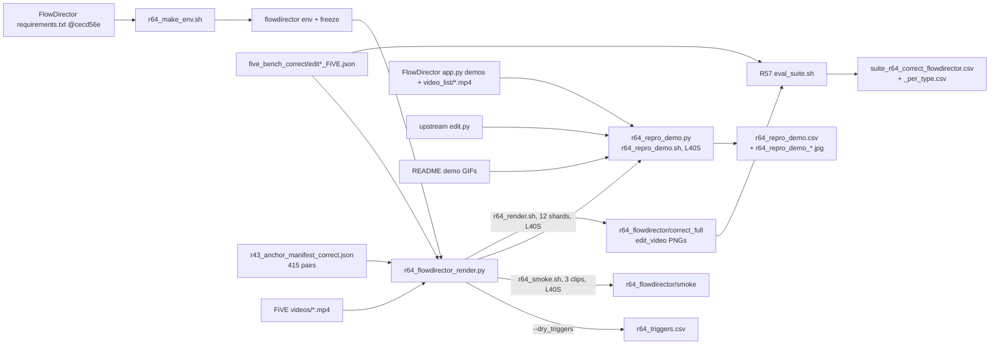

# R64: FlowDirector on FiVE-Correct

## Context

Render **FlowDirector** (Li et al., CVPR 2026) on the **415 FiVE-Bench-Correct** pairs (R43) as the text-only external baseline for the main-paper table, then score it with the **R57 unified suite**. FlowDirector is FlowEdit on Wan2.1-T2V-1.3B plus its attention-guided masking and DAG guidance. We run the released **V1** code unchanged. V1 implements the arXiv v1 method (Jun 2025: attention mask SAFC + DAG guidance); the paper's v2 (Dec 2025, CVPR) adds MAD-FC, DA-FC and a frozen noise, whose code ("V2") is not released. Because the smoke clips drifted far from the source video, a reproduction check on the authors' own demos gates the full render.

**Done when:** 415/415 clips are rendered on the lab L40S in the official-README env, and `evaluation/csv/suite_r64_correct_flowdirector.csv` (plus `_per_type.csv`) has 415 complete rows that pass the range sanity check.

## Execution steps

| # | Step id | Type | Waits for | Sets status | What |
|---|---------|------|-----------|-------------|------|
| *(prep)* | `env-script`, `render-script`, `render-sbatch`, `smoke-sbatch`, `repro-script`, `repro-sbatch` | todos | — | `implemented` | built by `/build-step` |
| 1 | `make-env` | local | — | — | env audit, torch → 2.8.0 + flash-attn 2.8.3.post1 wheel, freeze |
| 2 | `check-triggers` | local | make-env | — | tokenizer-only check that FlowDirector finds every trigger span |
| 3 | `smoke` | sbatch | check-triggers | — | 3 clips (edit1 / edit5 / edit6) on L40S |
| 4 | `wait-smoke` | manual | smoke | — | job COMPLETED, 3 complete clips, per-clip time, visual check |
| 5 | `repro-demo` | sbatch | check-triggers | — | 4 authors' demos through upstream `edit.py`, then through our driver (~1 h 40) |
| 6 | `wait-repro` | manual | repro-demo | — | driver ≡ upstream; upstream vs README GIFs; go / stop |
| 7 | `render` | sbatch | wait-smoke, wait-repro | `running` | 12-shard L40S array over the 415 pairs |
| 8 | `wait-render` | manual | render | `finished` | array COMPLETED, 415/415 complete dirs |
| 9 | `eval` | local | wait-render | — | R57 suite launcher (metrics → CF → merge) |
| 10 | `wait-eval` | manual | eval | `analyzed` | 415-row suite CSV, sanity check |

```
/build-step make-env R64
/build-step render R64
/build-step smoke R64
/build-step repro-demo R64
/run-step R64 make-env
/run-step R64 check-triggers
/run-step R64 smoke
/run-step R64 wait-smoke
/run-step R64 repro-demo
/run-step R64 wait-repro
/run-step R64 render
/run-step R64 wait-render
/run-step R64 eval
/run-step R64 wait-eval
```

## Decisions

| Decision | Choice |
|----------|--------|
| Platform / env | Lab L40S only (one platform per host); conda env `flowdirector` |
| Env alignment | Existing env (created 2026-10-09) follows the README exactly (py 3.12 + `requirements.txt`, `pip check` clean, pinned scipy 1.15.2 / scikit-image 0.25.2 / xfuser 0.4.3.post3 match), but resolved torch 2.14.1+cu130 and **has no flash-attn**. The README calls flash-attn optional, but `wan/modules/model.py` calls `flash_attention()` directly, which `assert FLASH_ATTN_2_AVAILABLE` → it cannot render as is |
| Env fix | Keep the existing env; change only torch → 2.8.0 / torchvision 0.23.0 (cu128) and add the prebuilt flash-attn 2.8.3.post1 wheel (same pair as streamgve on L40S). Flash-attn 2 publishes wheels only for torch 2.4–2.8 / CUDA 12 (v2.8.3.post2), so torch 2.14 would need an unsupported source build. Old freeze kept in `evaluation/r64_env/` |
| Faithfulness | The authors' env is unknown beyond `requirements.txt` (lower bounds + 3 pins, no lockfile); any env meeting those bounds with flash-attn is equally faithful. Ours is recorded (freeze) and is the only env any FlowDirector number comes from. Paper wording: "official code (commit cecd56e) with its released default settings; torch 2.8.0, flash-attn 2.8.3.post1, L40S" |
| Code | `~/Code/FlowDirector` @ `cecd56e` (V1, clean tree), called as a library; no edits to upstream |
| Hyperparameters | `script-edit-single-gpu.sh` defaults: `t2v-1.3B`, 832×480, unipc, 50 steps, shift 12, n_max 40, n_min 0, src CFG 3.5, tar CFG 10.5, n_avg 4, worse_avg 2, omega 2.75, window 11, decay 0.25; tmd window/stride = `edit()` defaults (11 / 8) |
| Seed | **42** = the released script's `--base_seed` (`edit()` calls `torch.manual_seed(seed)` per clip). Paper-wide rule (2026-11-02): every method runs the seed fixed by its released code (StreamEdit 0, FlowDirector 42, AnyV2V 8888, UniEdit-Flow 8: seed-independent, verified pixel-identical at 0 vs 8), seed 0 where the release leaves it random (Wan-Edit, ContextFlow). The 3 smoke clips (job 1074396) were rendered at seed 0 and are not reused |
| Negative prompt | FlowDirector's default (`sample_neg_prompt`, released script passes none); FiVE's `negative_prompt` not used |
| Frames | First `min(41, n)` source frames, trimmed to 4k+1 (`r48_wan_common.expected_frames`: 41 for 93/100 videos, 25–37 for the 7 short ones), same protocol as Wan-Edit; resize = FlowDirector's own `INTER_AREA` to 832×480 |
| Trigger words | `source_words` / `target_words` = R43 `source_object` / `target_object`, passed as the **verbatim span of the prompt** they match case-insensitively (FlowDirector's `find_subtokens_range` is case-sensitive: `A gray rabbit` vs `…a gray rabbit…`). Edit6 has an empty target → `None` (source mask only, native behaviour). Unmatched spans are logged in `r64_triggers.csv`, not fixed by hand |
| Pairs | 415 FiVE-Bench-Correct pairs (`evaluation/r43_anchor_manifest_correct.json`, annotations `evaluation/five_bench_correct/`); official FiVE and R42 new prompts out of scope |
| Sharding | **12** shards, interleaved `cases[i::12]` (7 × 35 + 5 × 34 clips), `--time 10:00:00`, resumable. Measured ~665 s/clip on L40S (smoke) → ≤ 6.5 h per shard, ~77 GPU-h total. Was 24 shards × ~18 clips until 2026-11-02, halved so the array fits the user's submit limit |
| Outputs | `~/Data/dataggen/outputs/five_bench/r64_flowdirector/{smoke,correct_full}/edit{T}/{video}/00000.png` (edit_video layout) |
| Evaluation | R57 suite, `--method flowdirector --tag r64_correct` → `evaluation/csv/suite_r64_correct_flowdirector.csv` + `_per_type.csv`; needs R57 `analyzed` first |
| Reproduction check | The 4 demos with full prompts in `app.py` (bear → dinosaur, black swan → white duck, silver jeep → Porsche car, woman + red baseball cap: the last one has empty source words, like FiVE edit5); upstream `edit.py` untouched with its own seed 42; our driver on the same inputs, same seed. References = README GIFs (`bear_g_03`, `blackswan_02`, `jeep_01`, `woman_02`; 41 frames, 832×480). Driver ≡ upstream is conclusive about our code; upstream ≈ GIF is conclusive about the env; a mismatch is not (GIFs committed 2025-05-30, a week before the code, from the authors' internal code/settings) |
| Out of scope | Per-token n_max / adaptive FlowDirector arm, matched-NFE arm, official FiVE table, the paper's (non-released) MAD-FC settings |

## Step commands

### make-env

```bash
bash evaluation/r64_make_env.sh
cat evaluation/r64_env/flowdirector_freeze.txt | grep -i -E '^(torch|flash|transformers|diffusers)='
```

### check-triggers

```bash
~/anaconda3/envs/flowdirector/bin/python evaluation/r64_flowdirector_render.py --dry_triggers \
  --cases evaluation/r43_anchor_manifest_correct.json --out_csv evaluation/csv/r64_triggers.csv
column -s, -t < evaluation/csv/r64_triggers.csv | awk 'NR==1 || /False/' | less -S
```

### smoke

```bash
sbatch slurm_scripts/five_bench/r64_smoke.sh
```

### wait-smoke

```bash
squeue -j <job_id>; sacct -j <job_id> -X --format=JobID,State,Elapsed,NodeList
grep -E '\] ok |FAILED|failures:' logs/r64_smoke_<job_id>.out
ls ~/Data/dataggen/outputs/five_bench/r64_flowdirector/smoke/edit*/* | head
```

### repro-demo

```bash
sbatch slurm_scripts/five_bench/r64_repro_demo.sh
```

### wait-repro

```bash
squeue -j <job_id>; grep -E 'ok |FAILED|failures:' logs/r64_repro_demo_<job_id>.out
column -s, -t < evaluation/csv/r64_repro_demo.csv
ls evaluation/figures/r64_repro_demo_*.jpg
```

### render

```bash
sbatch slurm_scripts/five_bench/r64_render.sh
```

### wait-render

```bash
sacct -j <job_id> -X --format=JobID,State,Elapsed,NodeList
grep -h 'failures:' logs/r64_render_<job_id>_*.out
~/anaconda3/envs/flowdirector/bin/python evaluation/r64_flowdirector_render.py --missing \
  --cases evaluation/r43_anchor_manifest_correct.json
```

### eval

```bash
bash slurm_scripts/five_bench/eval_suite.sh --method flowdirector \
  --root ~/Data/dataggen/outputs/five_bench/r64_flowdirector/correct_full --layout edit_video \
  --tag r64_correct
```

### wait-eval

```bash
grep -c 'Error:' logs/eval_suite_metrics_<id1>.out logs/eval_suite_cf_<id2>.out logs/eval_suite_merge_<id3>.out
column -s, -t < evaluation/csv/suite_r64_correct_flowdirector_per_type.csv | less -S
```

## Pipeline



## Code to touch

| File | Change |
|------|--------|
| `evaluation/r64_make_env.sh` | **New** (todo `env-script`). See the todo text. Sketch (all with `~/anaconda3/envs/flowdirector/bin/pip`): `pip freeze > r64_env/flowdirector_pre_r64_freeze.txt` → `pip install torch==2.8.0 torchvision==0.23.0 --index-url https://download.pytorch.org/whl/cu128` → `pip install flash-attn==2.8.3.post1 --no-build-isolation` (must resolve to the prebuilt wheel, i.e. finish in minutes; abort if it starts compiling) → checks (`pip check`, `importlib.metadata` vs each requirement line, `FLASH_ATTN_2_AVAILABLE`, `git -C ~/Code/FlowDirector rev-parse HEAD` == cecd56e and `git status --porcelain` empty) → freeze. Exits non-zero on any failed check |
| `evaluation/r64_flowdirector_render.py` | **New** (todo `render-script`). Reuses `r48_wan_common` (`FIVE`, `CKPT`, `SIZE`, `FRAME_NUM`, `load_cases(anno_dir=evaluation/five_bench_correct)`, `save_frames`, `source_frame_count`, `expected_frames`). FD module loaded like `load_cli()` from `~/Code/FlowDirector/edit.py` (`sys.argv` = the released script's flags, seed 42 included, parsed by its `_parse_args`, so the defaults come from one place). Args: `--cases --out_root (default …/r64_flowdirector/correct_full) --shard --n_shards --dry_triggers --out_csv --missing`. Per clip: `want = expected_frames(source_frame_count(vid))`; skip if `want` PNGs exist; `pipe.load_video_frames` replaced by a bound wrapper with identical cv2 read / BGR→RGB / `INTER_AREA` / `/127.5−1` that stops after `want` frames, then `vae.video_encode`; trigger span: `i = prompt.lower().find(obj.lower())` → `prompt[i:i+len(obj)]`, else `obj` (logged); `pipe.edit(target_prompt, size=SIZE_CONFIGS[size], frame_num=want, shift, sample_solver, sampling_steps, guide_scale, tar_guide_scale, seed=args.base_seed (42), offload_model=False, source_video_path, source_prompt, nmax_step, nmin_step, n_avg, worse_avg, omega, source_words, target_words, window_size, decay_factor)`; assert frames written == `want`; per-clip try/except with a FAILED line, exit 1 if any failed. `--dry_triggers`: only builds `HuggingfaceTokenizer` from `CKPT/google/umt5-xxl` and calls `WanT2V.find_subtokens_range` exactly as `edit()` does (unbound, `self=None`); CSV columns `edit_type, video_name, source_words, target_words, src_found, tgt_found, case_fixed`. `--missing`: prints clips without `want` PNGs |
| `slurm_scripts/five_bench/r64_render.sh` | **New** (todo `render-sbatch`). `#SBATCH --partition=L40S --gres=gpu:1 --mem=64G --time=10:00:00 --array=0-11 --exclude=node52 --output=logs/r64_render_%A_%a.out`; `N_SHARDS=12`; runs the driver with `--shard $SLURM_ARRAY_TASK_ID --n_shards $N_SHARDS`; post-run guard = `--missing` restricted to the shard, prints `failures: N`, exits non-zero on any |
| `slurm_scripts/five_bench/r64_smoke.sh` | **New** (todo `smoke-sbatch`). Same header as `r64_render.sh` without `--array`: `#SBATCH --job-name=r64_smoke --partition=L40S --gres=gpu:1 --mem=64G --time=02:00:00 --exclude=node52 --output=logs/r64_smoke_%j.out`; `CASES=evaluation/r57_smoke_cases.json`, `OUT=…/r64_flowdirector/smoke`; runs the driver once (no shard args); post-run guard = `--missing` on the smoke cases, prints `failures: N`, exits non-zero on any |
| `evaluation/r64_repro_demo.py` | **New** (todo `repro-script`). Imports `r64_flowdirector_render` (`load_cli`, `released_flags`, `first_frames_loader`, `resolve_words`, `FD_DIR`) and `r48_wan_common.CKPT`. Demos: `ast.literal_eval` of `examples_to_load_definitions` in `FD_DIR/app.py`; `GIF = {bear_g: bear_g_03, blackswan: blackswan_02, jeep: jeep_01, woman: woman_02}`; video = `FD_DIR/video_list/{video_base_name}.mp4`. Seed: `released_flags()` (already carries upstream's `--base_seed 42`). `--upstream`: per demo `subprocess.run([sys.executable, "edit.py", *flags42, "--ckpt_dir", CKPT, "--source_video_path", video, "--source_prompt", src, "--source_words", src_words, "--prompt", tar, "--target_words", tar_words, "--save_file", out/upstream/{demo}.mp4], cwd=FD_DIR, check=False)`, skip if the mp4 exists, FAILED line on non-zero exit. `--driver`: one `WanT2V`, per demo the same `pipe.edit(...)` call as the render driver (frame_num 41, seed 42, `offload_model=False`), then `cli.cache_video(tensor=video[None], save_file=…/driver/{demo}.mp4, fps=cfg.sample_fps, nrow=1, normalize=True, value_range=(-1, 1))` as edit.py does. `--compare`: decode with cv2 (mp4) / PIL `ImageSequence` (GIF, `.convert('RGB')`), all at 832×480; `max_abs_diff(driver, upstream)`, `identical`; mean PSNR / SSIM (`skimage.metrics`, `channel_axis=2`) over the 41 frames for upstream-vs-GIF and source-vs-GIF; CSV columns `demo, source_words, target_words, gif, driver_vs_upstream_max_abs, identical, psnr_up_gif, ssim_up_gif, psnr_src_gif, ssim_src_gif`; contact sheet per demo (rows source / GIF / upstream / driver × frames 0 / 20 / 40) |
| `slurm_scripts/five_bench/r64_repro_demo.sh` | **New** (todo `repro-sbatch`). Header as `r64_smoke.sh` (`--cpus-per-task=16`) with `--job-name=r64_repro_demo --time=02:00:00 --output=logs/r64_repro_demo_%j.out`; `OUT=~/Data/dataggen/outputs/five_bench/r64_flowdirector/repro_demo`; runs `--upstream`, `--driver`, `--compare` in that order (each failure counted, later modes still run); guard: `ls $OUT/{upstream,driver}/*.mp4 \| wc -l` = 8 and `evaluation/csv/r64_repro_demo.csv` has 4 data rows; prints `failures: N`, exits non-zero on any |
