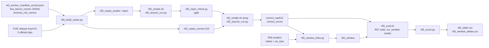

# R65: AnyV2V Baseline on FiVE-Correct

## Context

The main table (FiVE-Bench-Correct) needs an external image-to-video baseline next to the StreamEdit (VP) rows. AnyV2V is the closest peer: training-free, first-frame anchor, I2V propagation. FiVE evaluated it on official FiVE, so its protocol is known (arXiv v2 §5.1, supplement Table 1, upstream `evaluate.py`). Since all Correct anchors were regenerated (R43), every pair is rendered fresh.

Done when: the reproduction gate passed, the 415 Correct pairs are rendered and scored with the R57 suite, and the AnyV2V row plus the like-for-like window comparison against StreamEdit native and se_max are written.

## Execution steps

| Step | Type | Waits for | Sets status |
|---|---|---|---|
| `setup-env` | local | — | — |
| `repro-fetch` | manual | — | — |
| `build-cases` | local | `setup-env`, `repro-fetch` | — |
| `smoke` | sbatch | `build-cases` | `running` |
| `repro-check` | local | `smoke` | — |
| `gate` | manual | `repro-check` | — |
| `full-render` | sbatch | `gate` | `running` |
| `wait-render` | manual | `full-render` | `finished` |
| `wait-r59` | manual | R59 renders | — |
| `window-links` | local | `wait-render`, `wait-r59` | — |
| `eval` | local (submits eval_suite jobs) | `window-links` | — |
| `wait-eval` | manual | `eval` | — |
| `score` | local | `wait-eval` | — |
| `verdict` | manual | `score` | `analyzed` |

*(prep)* `/build-step setup-env R65` · `/build-step build-cases R65` · `/build-step smoke R65` · `/build-step repro-check R65` · `/build-step full-render R65` · `/build-step window-links R65` · `/build-step eval R65` · `/build-step score R65`

```
/run-step R65 setup-env
/run-step R65 repro-fetch
/run-step R65 build-cases
/run-step R65 smoke
/run-step R65 repro-check
/run-step R65 gate
/run-step R65 full-render
/run-step R65 wait-render
/run-step R65 wait-r59
/run-step R65 window-links
/run-step R65 eval
/run-step R65 wait-eval
/run-step R65 score
/run-step R65 verdict
```

## Decisions

| Decision | Choice |
|---|---|
| Platform / env | Lab L40S only; new conda env `anyv2v` (no existing env has diffusers 0.26.x; never installed into `streamgve` / `five-bench`): python 3.9, torch 2.2.2 cu118, diffusers 0.26.3, transformers 4.38.2, accelerate 0.27.2, huggingface_hub 0.25.2; AnyV2V pinned at commit `bc540befac`; weights `ali-vilab/i2vgen-xl` in `~/Data/weights/i2vgen-xl`, fetched on the frontal, `HF_HUB_OFFLINE=1` on compute nodes |
| Protocol | FiVE's published AnyV2V setting = AnyV2V's defaults: 512×512, source squashed (no crop), first n = min(32, n_src) frames (FiVE paper §5.1: "AnyV2V processes only the first 32 frames"; only `0072_dog-agility` has fewer, 25; FiVE's released clips have 40 frames, but n = 16 / 32 / 40 all fail the repro gate alike, so the paper's number is kept), DDIM inversion 500 steps (cfg 1.0, empty prompt), PnP edit 50 steps, CFG 9.0, `ddim_init_latents_t_idx` 0, PnP thresholds conv 0.2 / spatial attn 0.2 / temporal attn 0.5, seed 8888, target_fps 8, AnyV2V's default negative prompt, `random_ratio` 0 |
| Hyperparameters | FiVE's setting as-is, no re-tuning |
| Editing prompt | Correct `target_prompt` |
| First frame | `anchors_r43_correct/edit{T}/{video}.png` (832×480), resized to 512×512 by AnyV2V (LANCZOS); the only deviation from FiVE, which used InstructPix2Pix |
| Inversion | Once per video, reused by all its edit types (it depends only on the source frames); deleted after the video's pairs are rendered |
| Eval resolution | Raw 512² output resized to the source frame size with PIL's default resize (the harness's own resize) before scoring, so CoTracker tracks and the edit-part box mask share the source frame; FiVE's code passed 512² frames to the motion-fidelity metric, so our MFS is not directly comparable to their reported number |
| PSC / CF window | `--src_window render`: source cut to the render's frame count (harness, EditReward, CLIP-D and MFS already do this) |
| Window control rows | `r59_n15_rho2_vp` (native) and `r59_max_full` (se_max) re-scored on the first n frames per pair (symlinks under `$D/r65_window/`), tag `r65w`; the tuned-ρ* row is added later with the same two scripts once ρ* is chosen |
| Main-table rows | AnyV2V tag `r65` (its native 32-frame output, footnoted); StreamEdit main rows stay full-length from R59 |
| Repro gate | Official FiVE `edit1/0001_bus` + `edit2/0081_A_horse`, official `target_prompt`, first frame = frame 0 of FiVE's released AnyV2V output (FiVE's InstructPix2Pix seed and input size are unpublished, so an IP2P re-run cannot be matched); PASS iff LPIPS(ours, FiVE) ≤ 0.5 × LPIPS(FiVE, src512) on both pairs and the sheet shows the same edit; FAIL stops the task. **Outcome (2026-10-29): FAIL at n = 40 / 32 / 16 (ratios 0.92-0.97 on `0001_bus`, 0.58-0.68 on `0081_A_horse`); decision with the user: no re-tuning, keep the defaults, run the full render at n = 32 (the benchmark's number) and footnote that FiVE's released AnyV2V outputs could not be reproduced** |
| Smoke frame counts | The smoke (2 repro clips + 2 smoke pairs) is run at **n_frames = 40** (job 1070986, L40S; gate FAIL: LPIPS ratio 0.922 / 0.577 against ≤ 0.5), then re-run at **32** (FiVE paper §5.1: AnyV2V processes the first 32 frames; `Prompt-Based-Editing_frames32` in FiVE's `evaluate.py`) and **16** (AnyV2V's own `n_frames`, the I2VGen-XL training length), on an interactive A100-40GB node (`evaluation/r65_nframes_diag.sh`, outputs under `$D/r65_anyv2v/nframes/n{32,16}`, cases `evaluation/r65_cases_{repro,smoke}_n{32,16}.json` = the 40-frame lists with `n_frames = min(N, n_frames)`). **Only `n_frames` differs** from the first smoke: t_idx 0, 500 + 50 steps, CFG 9.0, PnP 0.2 / 0.2 / 0.5, seed 8888 are unchanged. t_idx 0 = FiVE's folder name = all 13 official `group_config.json` entries (the `template.yaml` value 1 is always overridden). The gate (`r65_repro_check.py --repro_raw .../nframes/n<N>/repro_raw512`) compares the first min(N, ·) frames of the 40-frame FiVE release. **Result (2026-10-29, A100, 0 failures): the frame count is not the cause of the gate FAIL.** LPIPS(ours, FiVE) / scale = ratio, `0001_bus` / `0081_A_horse`: n=40 0.922 / 0.577, n=32 0.955 / 0.642, n=16 0.972 / 0.675 (pass ≤ 0.5; CSVs in `evaluation/csv/r65_nframes/n{32,16}/`, sheets in `evaluation/figures/r65_nframes/`). Cost per full video (4.15 pairs): about 755 s at 40, 598 s at 32, 311 s at 16 frames (inversion 343 / 279 / 147 s, edit 99 / 77 / 40 s per pair; A100 for 32 and 16, L40S for 40). Sheets: the release horse follows the source body and gait (turns into a horse-like animal), ours stays a dolphin, and the release bus is streaked while ours is clean, so the release looks like a stronger-injection or later-start regime. The full render uses **n = 32** (decision 2026-10-29) |
| Sharding | By video, video j → shard j mod K; K = 10, 6 h per task: ~600 s per video at 32 frames (A100 diagnostic; 10 videos x 600 s x 1.3 ~ 2.2 h), set at the gate; `--exclude=node52` |
| Outputs | `$D = ~/Data/dataggen/outputs/five_bench`; `$D/r65_anyv2v/{src512,inversions,repro_raw512,smoke_raw512,correct_raw512,correct_srcres}`, `$D/r65_window/{method}` |
| Scoring | R57 suite, `--allow_nan motion_fidelity_score_edit_part`; plain per-clip means; paired bootstrap 2000 resamples, seed 0 |
| Official-FiVE supp table | FiVE's reported AnyV2V row, marked "reported"; not re-rendered |
| Out of scope | Hyperparameter tuning, InstructPix2Pix, official-FiVE full render, the ρ* window row, VACE |

## Step commands

### setup-env
```bash
bash evaluation/r65_make_anyv2v_env.sh
```

### repro-fetch
```bash
# manual download from FiVE's Drive folder, then:
ls -R ~/Data/five_release/AnyV2V | head -40
```

### build-cases
```bash
~/anaconda3/envs/five-bench/bin/python -I evaluation/r65_build_cases.py
```

### smoke
```bash
sbatch slurm_scripts/five_bench/r65_smoke.sh
```

### repro-check
```bash
~/anaconda3/envs/five-bench/bin/python -I evaluation/r65_repro_check.py
```

### gate
```bash
cat evaluation/csv/r65_repro_check.csv
cat ~/Data/dataggen/outputs/five_bench/r65_anyv2v/smoke_manifest_shard0.csv
```

### full-render
```bash
sbatch slurm_scripts/five_bench/r65_render.sh
```

### wait-render
```bash
sacct -j {job_id} --format=JobID,State,Elapsed
grep -h failures logs/r65_render_*.out | sort | uniq -c
find ~/Data/dataggen/outputs/five_bench/r65_anyv2v/correct_srcres -mindepth 2 -maxdepth 2 -type d | wc -l
```

### wait-r59
```bash
for r in r59_rho_sweep/r59_n15_rho2_vp r59_se_arms/r59_max_full/step14; do
  find ~/Data/dataggen/outputs/five_bench/$r -mindepth 2 -maxdepth 2 -type d | wc -l; done
```

### window-links
```bash
~/anaconda3/envs/five-bench/bin/python -I evaluation/r65_window_links.py
```

### eval
```bash
bash slurm_scripts/five_bench/r65_eval.sh
```

### wait-eval
```bash
cat logs/r65_eval_jobs.txt
wc -l evaluation/csv/suite_r65_r65_anyv2v.csv evaluation/csv/suite_r65w_r59_n15_rho2_vp.csv evaluation/csv/suite_r65w_r59_max_full.csv
```

### score
```bash
~/anaconda3/envs/five-bench/bin/python -I evaluation/r65_score.py
```

### verdict
```bash
cat evaluation/csv/r65_table.csv evaluation/csv/r65_window_deltas.csv
```

## Pipeline



## Code to touch

| File | Change | Todo |
|---|---|---|
| `evaluation/r65_make_anyv2v_env.sh` *(new)* | Clone AnyV2V @ `bc540befac`, create env `anyv2v` with pinned versions, freeze file, fetch `ali-vilab/i2vgen-xl`, import check | `anyv2v-env-script` |
| `evaluation/r65_build_cases.py` *(new)* | 415 Correct cases with `n_frames`, 2 smoke cases (incl. the 25-frame clip), 2 official repro cases with release frame 0 as first frame | `cases-script` |
| `evaluation/r65_anyv2v_run.py` *(new)* | Sharded driver: per video squash + inversion once, PnP edit per pair, raw512 + source-size outputs, resume, manifest | `driver-script` |
| `slurm_scripts/five_bench/r65_smoke.sh` *(new)* | Repro cases then smoke cases, one job, 3 h | `smoke-sbatch` |
| `evaluation/r65_repro_check.py` *(new)* | PSNR / LPIPS vs FiVE release, PASS rule, repro + smoke contact sheets | `repro-check-script` |
| `evaluation/r65_nframes_diag.sh` *(new, not in the original plan)* | Smoke at n_frames 32 and 16 on an interactive GPU node; writes `evaluation/r65_cases_{repro,smoke}_n{N}.json` and `$D/r65_anyv2v/nframes/n{N}/` | — |
| `slurm_scripts/five_bench/r65_render.sh` *(new)* | Array over K video shards on the 415 cases, per-shard count guard | `render-sbatch` |
| `evaluation/r65_window_links.py` *(new)* | Per-pair first-n-frame symlink views of the two R59 renders | `window-links-script` |
| `slurm_scripts/five_bench/eval_suite_common.sh` | Parse `--src_window full\|render` → `SRC_WINDOW`, `SRC_WINDOW_PY` | `suite-common-srcwindow` |
| `slurm_scripts/five_bench/eval_suite.sh` | Forward `--src_window` in `ARGS` | `suite-launcher-srcwindow` |
| `slurm_scripts/five_bench/eval_suite_metrics.sh` | Pass `SRC_WINDOW_PY` to `psc_score.py` | `suite-metrics-srcwindow` |
| `slurm_scripts/five_bench/eval_suite_cf.sh` | Pass `SRC_WINDOW_PY` to `cf_score.py` | `suite-cf-srcwindow` |
| `evaluation/eval_suite/psc_score.py` | `--src_window render`: score the source from a temp dir of its first len(render) frames | `psc-srcwindow` |
| `evaluation/eval_suite/cf_score.py` | `--src_window render`: `src = src[:len(tgt)]` | `cf-srcwindow` |
| `slurm_scripts/five_bench/r65_eval.sh` *(new)* | Three `eval_suite.sh` calls (AnyV2V tag `r65`, two window rows tag `r65w`), job-id log | `eval-driver` |
| `evaluation/r65_score.py` *(new)* | Per-clip means overall / per type, paired window deltas with bootstrap CI | `score-script` |
