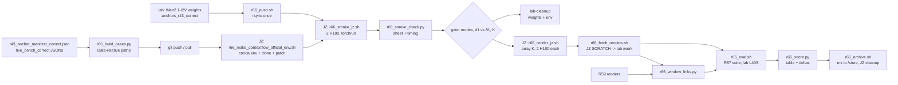

# R66: ContextFlow Baseline on FiVE-Correct

## Context

The main table needs a second, recent external I2V baseline next to AnyV2V (R65). VACE was dropped (no native first-frame propagation mode) and per-video-optimization methods are excluded for cost. ContextFlow (AAAI 2026) is training-free, takes an edited first frame and the source video, and runs on Wan2.1-I2V-14B-480P, so the Correct Qwen anchors plug in directly. Inversion depends only on the source video, so it is done once per video.

**Platform history.** Planned on the lab L40S (46 GB). The single-GPU path does not fit the fp32 DiT and its edit call crashes (the authors only ran 2 GPUs); the authors' 2-GPU setup needed `NCCL_P2P_DISABLE=1` on the L40S and then ran at 45.0–45.4 GB of 46 GB: one pair rendered, the next three OOMed (smoke job 1080831, 2026-11-02). 4 L40S per job are not available to the user, so rendering moves to **Jean Zay H100 (80 GB) with the authors' 2-GPU command unchanged**; scoring stays on the lab L40S like every main-table row.

Done when: the Jean Zay smoke gate is passed, the 415 Correct pairs are rendered on Jean Zay, fetched once to the lab, scored with the R57 suite, the ContextFlow row plus its paired deltas against StreamEdit native and se_max on the same frame windows are written, and the renders are moved to `/store`.

## Execution steps

| Step | Type | Where | Waits for | Sets status |
|---|---|---|---|---|
| `probe-paths`, `setup-env`, `smoke` | — | lab (history, completed) | — | — |
| `build-cases` | local | lab | — | — |
| `jz-sync` | manual | lab → Jean Zay (git) | `build-cases` | — |
| `jz-push` | manual | lab frontal → Jean Zay | `jz-sync` | — |
| `jz-env` | manual | Jean Zay frontal | `jz-push` | — |
| `jz-smoke` | manual (sbatch on JZ, 2 H100) | Jean Zay | `jz-env` | `running` |
| `jz-smoke-check` | manual | Jean Zay frontal → lab (2 small files) | `jz-smoke` | — |
| `gate` | manual | — | `jz-smoke-check` | — |
| `lab-cleanup` | manual | lab | `gate` | — |
| `jz-render` | manual (sbatch array on JZ) | Jean Zay | `gate` | `running` |
| `jz-wait-render` | manual | Jean Zay | `jz-render` | `finished` |
| `fetch-renders` | manual | lab frontal ← Jean Zay | `jz-wait-render` | — |
| `wait-deps` | manual | lab | R65 suite edits, R57 smoke, R59 renders | — |
| `window-links` | local | lab | `fetch-renders`, `wait-deps` | — |
| `eval` | local (submits eval_suite jobs, L40S) | lab | `fetch-renders`, `wait-deps`, `window-links` | — |
| `wait-eval` | manual | lab | `eval` | — |
| `score` | local | lab | `wait-eval` | — |
| `verdict` | manual | — | `score` | `analyzed` |
| `archive` | manual | lab frontal (+ ssh JZ) | `verdict` | — |

*(prep)* `/build-step build-cases R66` · `/build-step jz-push R66` · `/build-step jz-env R66` · `/build-step jz-smoke R66` · `/build-step jz-smoke-check R66` · `/build-step jz-render R66` · `/build-step fetch-renders R66` · `/build-step window-links R66` · `/build-step eval R66` · `/build-step score R66` · `/build-step archive R66`

```
/run-step R66 build-cases
/run-step R66 jz-sync
/run-step R66 jz-push
/run-step R66 jz-env
/run-step R66 jz-smoke
/run-step R66 jz-smoke-check
/run-step R66 gate
/run-step R66 lab-cleanup
/run-step R66 jz-render
/run-step R66 jz-wait-render
/run-step R66 fetch-renders
/run-step R66 wait-deps
/run-step R66 window-links
/run-step R66 eval
/run-step R66 wait-eval
/run-step R66 score
/run-step R66 verdict
/run-step R66 archive
```

Every Jean Zay step is run by the user (only the lab frontal can `ssh zay`; Claude cannot reach Jean Zay) and its output pasted back.

## Decisions

| Decision | Choice |
|---|---|
| Method / backbone | ContextFlow, commit `a9b903edf4` + `r66_contextflow_frames.patch` (frame count only; the only change to the authors' code), run with the authors' own command line (2 GPUs, FSDP + Ulysses), Wan2.1-I2V-14B-480P (no 1.3B I2V exists; a port would change the authors' layer selection) |
| Render platform | **Jean Zay H100** (decided 2026-11-02): `-A omt@h100`, `qos_gpu_h100-t3` (20 h per job), 1 node, `--gres=gpu:2`, 48 CPUs (24 per GPU), **the authors' setup as in `inversion.sh` and every demo script**: `torchrun --nproc_per_node=2`, `--dit_fsdp --ulysses_size 2 --t5_cpu --offload_model True`. 2 GPUs, not 1 (the single-GPU path crashes as released and the fp32 DiT + activations exceed 80 GB) and not 4 (not needed on 80 GB). NVLink: no `NCCL_P2P_DISABLE` (L40S-only workaround) |
| Env | **`contextflow` built from the official instructions only** (decided 2026-11-01): ContextFlow `requirements.txt` verbatim + Wan2.1's `xfuser>=0.4.1`, every open-ended requirement at its stated minimum (torch 2.4.0+cu121, diffusers 0.31.0, transformers 4.49.0, tokenizers 0.21.0, accelerate 1.1.1, numpy 1.23.5, opencv 4.9.0.80, gradio 5.0.0, xfuser 0.4.1), flash-attn 2.7.4.post1 wheel, python 3.10. Same script on both hosts; Jean Zay copy = conda env at `$WORK/envs/contextflow` (~51k files of the 500k `$WORK` quota), its freeze must equal the lab freeze. The lab env is removed at `lab-cleanup`. Never installed into `five-bench` / `streamgve` |
| Eval platform | Lab **L40S**, R57 `eval_suite.sh`, same as every main-table row (renders are fetched; never scored on Jean Zay) |
| Disk / copies | One transfer per item, no staging copies: weights and anchors lab → Jean Zay once (`rsync`, then the lab weights are deleted at `lab-cleanup`); the ContextFlow clone is made on Jean Zay from GitHub + the patch from the repo; code through git; FiVE sources already on Jean Zay (R50). Renders and latents written to Jean Zay `$SCRATCH`; only the 415 render dirs (~10 GB) come back, once, to `/work` (node-visible, needed by the eval jobs); after `score` they are **moved** to `/store` with a `~/Data` link and the Jean Zay copies are deleted (`archive`) |
| DiT weight precision | As released: FSDP mixed precision (bf16 compute, fp32 shards), nothing added. History: single-GPU path OOM with the fp32 DiT (job 1074397) and `latent_output_dir` crash (job 1076785); bf16-Linear cast dropped for the official setup |
| Inputs | First frame = `anchors_r43_correct/edit{T}/{video}.png`; editing prompt = Correct `target_prompt`; reconstruction path = source first frame + empty prompt (repo default); all inputs resized to the anchor size 832×480 so both paths share one latent shape. Case files hold paths relative to `~/Data` (works on both hosts) |
| Mode mapping | Types 1, 2, 3, 4 → swap (layers 27 29 31 32); 5 → insert (6 7 8 9); 6 → delete (21 26 27 29, `--is_delete`); types 3/4 in swap mode are footnoted |
| Sampling | Repo settings: RF-Solver `fm_new`, 51 steps (inversion and edit; 2 model calls per step), shift 3.0 (inert: `fm_new` uses 5.0), CFG 3.0, `injection_step` 0.5, top-4 layers per mode; seed 0 (the repo default −1 is random) |
| Frames | n = 4⌊(min(41, n_src) − 1)/4⌋ + 1 for every pair and every mode (41 for most videos, 25–37 for the 7 short ones), the protocol of Wan-Edit / UniEdit-Flow / FlowDirector; inversion uses the same n. StreamEdit renders up to 81 frames, so every StreamEdit comparison uses the window rows below |
| Frame-count patch | The released code hard-codes 81 frames (49 for deletion: latent T 21 / 13, mask, zero padding) in `generate_with_pnp` and `generate_reconstruction`; 237 / 415 pairs have < 81 source frames. `r66_contextflow_frames.patch` replaces the constants by F = `frame_num`. Paper: "the released code fixes the clip length to 81 frames (49 for deletion); we generalise it to an arbitrary frame count without changing any other setting" |
| Inversion | Once per video at n41, z_T kept on Jean Zay `$SCRATCH` (`r66_contextflow/correct/latents/n41/`, ~22 MB each) and reused on resume; never fetched |
| Smoke | 4 Correct pairs (first pair with ≥ 81 source frames of types 2, 3, 5, 6), each at 41 frames (render setting) then 81 frames (diagnostic of the patch at the authors' length, for the supplementary), on 2 H100. Reference from the L40S (job 1080831): inversion 402 s, edit 1345 s per pair at 41 frames |
| Failure handling | An OOM / error inside FSDP's forward leaves the model unusable, so the driver stops after the first failure (manifest row + exit-code file); a resubmit resumes |
| Sharding | By video, video j → shard j mod K, `--array=0-(K-1)`, < 18 h per task (20 h qos); K from the gate |
| Paths | Jean Zay: repo `$WORK/StreamEdit_new`, env `$WORK/envs/contextflow`, clone `$WORK/code/ContextFlow`, weights `$WORK/weights/Wan2.1-I2V-14B-480P`, data `$WORK/Data` (= `~/Data`), outputs `~/Data/dataggen/outputs/five_bench/r66_contextflow` → `$SCRATCH/five_bench_out/r66_contextflow`. Lab: fetched renders `/work/PERSO/skhairi/five_bench/r66_contextflow/correct/n41` until `archive`, then `/store/PERSO/skhairi/Outputs/five_bench/r66_contextflow` with the `~/Data` link; window views `{D}/r66_window/{method}`, `D = ~/Data/dataggen/outputs/five_bench` |
| Scoring | R57 suite, tag `r66`, `--src_window render` (needs R65's suite edits), `--allow_nan motion_fidelity_score_edit_part`; renders scored at their own 832×480 size like the Wan and StreamEdit rows; plain per-clip means; paired bootstrap 2000 resamples, seed 0 |
| Window control rows | Always: StreamEdit native + se_max on the same first n frames per pair as the ContextFlow render, tag `r66w`; all paired deltas use these rows. Open item beyond R66: the main table mixes 41-frame (Wan baselines), 32-frame (AnyV2V) and 69–81-frame (StreamEdit) rows; a common-window table is not decided yet |
| Main-table presentation | Separate external I2V group with AnyV2V; Backbone and NFE columns (inversion 100 model calls; edit 100 calls of a batch of 3); no wall-clock column |
| Out of scope | VACE, optimization-based methods, other ContextFlow image editors (AnyDoor / InsertAnything / MagicQuill), hyperparameter tuning, official-FiVE runs |

## Step commands

### build-cases
```bash
~/anaconda3/envs/five-bench/bin/python -I evaluation/r66_build_cases.py
```

### jz-sync
```bash
# lab: git add/commit/push the R66 files; then on Jean Zay:
cd $WORK/StreamEdit_new && git pull
ls $WORK/Data/FiVE-Fine-Grained-Video-Editing-Benchmark/images | wc -l
```

### jz-push
```bash
bash jz/r66_push.sh 2>&1 | tee logs/r66_push.log            # lab frontal, tmux
```

### jz-env
```bash
# Jean Zay frontal
cd $WORK/StreamEdit_new && module purge && module load anaconda-py3
CONDA_BIN=$(which conda) ENV_PREFIX=$WORK/envs/contextflow CF_DIR=$WORK/code/ContextFlow \
CF_WEIGHTS=$WORK/weights/Wan2.1-I2V-14B-480P FREEZE_OUT=evaluation/r66_contextflow_official_env_freeze_jz.txt \
  bash evaluation/r66_make_contextflow_official_env.sh 2>&1 | tee logs/r66_setup_env_jz.log
```

### jz-smoke
```bash
cd $WORK/StreamEdit_new && sbatch slurm_scripts/five_bench/r66_smoke_jz.sh        # Jean Zay
```

### jz-smoke-check
```bash
$WORK/envs/contextflow/bin/python -I evaluation/r66_smoke_check.py                   # Jean Zay frontal
# lab frontal: rsync the sheet + timing CSV back (two small files)
```

### gate
```bash
cat evaluation/csv/r66_smoke_timing.csv
# view evaluation/figures/r66_smoke_sheet.jpg (41 vs 81 per mode); set K in slurm_scripts/five_bench/r66_render_jz.sh
```

### lab-cleanup
```bash
rm -rf /work/PERSO/skhairi/weights/Wan2.1-I2V-14B-480P /work/PERSO/skhairi/five_bench/r66_contextflow/smoke
conda env remove -p ~/anaconda3/envs/contextflow
df -h /work/PERSO/skhairi
```

### jz-render
```bash
cd $WORK/StreamEdit_new && sbatch slurm_scripts/five_bench/r66_render_jz.sh       # Jean Zay
```

### jz-wait-render
```bash
sacct -j <jobid> --format=JobID,State,Elapsed
grep -h failures logs/r66_render_jz_*.out | sort | uniq -c
```

### fetch-renders
```bash
bash jz/r66_fetch_renders.sh 2>&1 | tee logs/r66_fetch.log  # lab frontal, tmux
```

### wait-deps
```bash
grep -c src_window slurm_scripts/five_bench/eval_suite_common.sh evaluation/eval_suite/psc_score.py evaluation/eval_suite/cf_score.py
ls evaluation/csv/suite_r57_smoke_lab_*.csv
```

### window-links
```bash
~/anaconda3/envs/five-bench/bin/python -I evaluation/r66_window_links.py
```

### eval
```bash
bash slurm_scripts/five_bench/r66_eval.sh            # ContextFlow + the two r66w window rows
```

### wait-eval
```bash
cat logs/r66_eval_jobs.txt
wc -l evaluation/csv/suite_r66_r66_contextflow.csv
```

### score
```bash
~/anaconda3/envs/five-bench/bin/python -I evaluation/r66_score.py
```

### verdict
```bash
cat evaluation/csv/r66_table.csv evaluation/csv/r66_deltas.csv
```

### archive
```bash
bash jz/r66_archive.sh                 # lab frontal: mv to /store + ~/Data link + check
bash jz/r66_archive.sh --cleanup-jz    # then: Jean Zay renders, latents, smoke
```

## Pipeline



## Code to touch

| File | Change | Todo |
|---|---|---|
| `evaluation/r66_make_contextflow_env.sh` | Superseded single-GPU env script (kept for its record) | `cf-env-script` |
| `evaluation/r66_make_contextflow_official_env.sh` | Official-recipe env (lab, 2026-11-01) | `cf-official-env-script` |
| `evaluation/r66_make_contextflow_official_env.sh` | Runs unchanged on Jean Zay: `ENV_PREFIX`, `CONDA_BIN`, `FREEZE_OUT` overridable; clones + patches ContextFlow when `CF_DIR` is empty; `$WORK` file-quota check | `jz-env-script` |
| `evaluation/r66_contextflow_frames.patch` | Hard-coded 81 / 49 frames → F = `frame_num` | `cf-frames-patch` |
| `evaluation/r66_build_cases.py` | 415 cases + 4 smoke cases | `cases-script` |
| `evaluation/r66_build_cases.py` | Anchor / source paths relative to `~/Data` | `cases-data-relative` |
| `evaluation/r66_contextflow_run.py` | Single-GPU driver → 2-GPU torchrun driver (authors' setup) | `driver-script`, `cf-bf16-linears` (superseded), `driver-usp` |
| `evaluation/r66_contextflow_run.py` | `--data_dir`; OOM message printed; stop after the first OOM / error | `driver-jz` |
| `jz/r66_push.sh` *(new)* | Weights + anchors lab → Jean Zay, rsync once, verify | `jz-push-script` |
| `slurm_scripts/five_bench/r66_smoke.sh` | Lab L40S smoke (history) | `smoke-sbatch`, `smoke-sbatch-2gpu` |
| `slurm_scripts/five_bench/r66_smoke_jz.sh` *(new)* | Jean Zay smoke: 2 H100, authors' command, 41 then 81 frames | `smoke-jz-sbatch` |
| `evaluation/r66_smoke_check.py` | Contact sheet + timing CSV + projection | `smoke-check-script` |
| `evaluation/r66_smoke_check.py` | Runs on Jean Zay; `--smoke_root` / `--data_dir`; H100-hours, 18 h per job, 76 GB flag | `smoke-check-jz` |
| `slurm_scripts/five_bench/r66_render_jz.sh` *(new)* | Jean Zay array over K video shards at 41 frames, per-shard guard | `render-jz-sbatch` |
| `jz/r66_fetch_renders.sh` *(new)* | JZ `$SCRATCH` renders → lab `/work`, once, verified | `fetch-script` |
| `evaluation/r66_window_links.py` *(new)* | First-n-frame symlink views of R59 native + se_max | `window-links-script` |
| `slurm_scripts/five_bench/r66_eval.sh` *(new)* | `eval_suite.sh` for ContextFlow (tag `r66`) and the two window rows (tag `r66w`); guards; job-id log | `eval-driver` |
| `evaluation/r66_score.py` *(new)* | Per-clip means overall / per type (3/4 flagged), paired deltas with bootstrap CI | `score-script` |
| `jz/r66_archive.sh` *(new)* | mv renders to `/store` + `~/Data` link; Jean Zay cleanup behind explicit flags | `archive-script` |
